# DamianNote 시스템 아키텍처 (as-built)

| 항목 | 내용 |
|---|---|
| 문서 버전 | v1.3 as-built (2026-10-15 — 10/09 이후 72커밋: 새 콘텐츠 종류 · 워드 왕복 · 데이터베이스 확장 · AI structure.v2 원형 배치 · 디자인 단순화 · 서버 동기화 M0) · v1.2 (2026-10-09 — 조건부 실행 취소 · 합쳐진 글 고치기 · 삭제 묘비) · v1.1 (2026-10-09 — 동기화 안전 · 배포 헤더 수정 반영) · v1.0 (2026-10-09 — 코드 기준으로 처음부터 다시 씀. 이전 v0.4는 2026-10-01 목표 설계서) |
| 작성일 | 2026-10-09 (v1.3 2026-10-15) |
| 기준 커밋 | `0df7028` (main) — v1.2는 `905434d`, v1.1은 `d1eff7b`, v1.0은 `9571ebb` |
| 상태 | 코드와 대조 완료 — 확인하지 못한 항목은 본문에 '확인 못 함'으로 표시 |
| 상위 문서 | PRD.md · FR.md · ROADMAP.md |
| 관련 문서 | [CODE-STRUCTURE.md](CODE-STRUCTURE.md)(코드 지도) · [ENTITY-DIAGRAM.md](ENTITY-DIAGRAM.md)(엔티티 그림) · [ENGINE.md](ENGINE.md)(캔버스 엔진 상세) · [DATABASE.md](DATABASE.md) · [SYNC.md](SYNC.md)(동기화) · SECURITY.md · [AI-PROMPTS.md](AI-PROMPTS.md) · [STRUCTURE-GUIDE.md](STRUCTURE-GUIDE.md) · [DEV-GUIDE.md](DEV-GUIDE.md) · [TEST-PLAN.md](TEST-PLAN.md) · [adr/](adr/README.md) |

이 문서는 저장소에 **지금 있는 코드**가 어떤 구조로 짜여 있는지를 적는다. 목표 설계나 일정이 아니라, 기준 커밋의 파일을 읽어 확인한 사실만 적는다. 설계 문서(이전 판)와 코드가 다른 곳은 코드를 따르고, 그 차이를 12절에 모았다.

---

## 목차

0. 읽는 법과 이 문서의 범위
1. 한 장 요약
2. 아키텍처 동인
3. 시스템 컨텍스트 (C4 Level 1)
4. 컨테이너 (C4 Level 2)
5. 컴포넌트 (C4 Level 3)
6. 핵심 모델과 불변식
7. 런타임 시나리오
8. 저장소와 스키마
9. 보안과 프라이버시 (as-built)
10. 빌드 · 테스트 · 품질 게이트
11. 구현 상태표
12. 설계와 달라진 점
13. 알려진 한계 · 기술 부채
14. 용어

---

## 0. 읽는 법과 이 문서의 범위

- **as-built 문서다.** 모든 서술은 기준 커밋의 소스 경로로 뒷받침한다. 경로는 저장소 루트 기준이다(예: `packages/engine-core/src/tx.ts`).
- **C4 용어를 쓴다.** 3절 = 시스템 컨텍스트(L1), 4절 = 컨테이너(L2, 여기서는 브라우저 안의 실행 단위), 5절 = 컴포넌트(L3, 패키지와 모듈).
- **범위**: 브라우저에서 도는 앱 전체(엔진 · 저장 · 검색 · AI 호출 · 앱 셸)와 빌드 · 테스트. 서버 동기화 설계는 [SYNC.md](SYNC.md)가 맡는다. 이 문서는 동기화 코드(`packages/sync`)가 지금 무엇을 하는지만 짧게 적는다.
- **서버 코드는 저장소에 없다.** `git ls-files`에 Worker · Durable Object · SQL · Supabase 함수 파일이 하나도 없다. 서버에서 도는 코드는 개발 서버(Vite)의 플러그인 둘 — Claude 키 프록시(`apps/web/vite.config.ts`의 `anthropicProxy`)와 링크 미리보기(`apps/web/dev-unfurl.ts`) — 뿐이고, 둘 다 `vite build` 결과물에는 들어가지 않는다. 서버와 주고받을 프레임 형식(`packages/sync/src/protocol.ts`, 10/13 M0)은 서버 · 클라이언트 공용 순수 함수로만 있고 아직 아무도 쓰지 않는다.
- **용어 주의**: 사용자 화면의 '콘텐츠(상자)'는 엔진의 `Block`, 사용자 화면의 '블록(묶음)'은 엔진의 묶음 id(`Block.group` · `note.groups`)다. 6.1절 대응표를 먼저 보면 읽기 쉽다.

코드 주석이 이전 판의 절 번호(예: `ARCHITECTURE 7.3`)를 가리키는 곳이 있다. 이 문서는 아래처럼 대응한다.

| 이전 판 절 | 코드에서 가리키는 곳 (예) | 이 문서 |
|---|---|---|
| 4 컨테이너 | — | 4절 |
| 5.1 패키지 의존 | `scripts/check-arch.mjs` | 5.1절 |
| 5.2 UI 셸 경계 · 5.3 스레드 | — | 5.2 · 5.3절 |
| 5.4 AI 파이프라인 · 5.5 검색 | `packages/search/src/index.ts` | 5.4 · 5.5절 |
| 6.1 Edge Worker | `packages/ai-pipeline/src/transport.ts` | 12절(없음) |
| 7.3 AI 구조화 · 7.4 동기화 · 7.5 잉크 OCR | `packages/ai-pipeline/src/pipeline.ts` 등 | 7.3 · 7.4 · 7.5절 |
| 8 데이터 | `apps/web/src/auth.ts` | 8절 |
| 9.1 · 9.3 배포 · 앱 업데이트 | `apps/web/sw.template.js` · `sw-register.ts` | 4.3절 · 10절 |
| 10 횡단 관심사 · 11 Phase | 여러 곳 | 9 · 10 · 11 · 13절 |

---

## 1. 한 장 요약

DamianNote는 **서버 없이 브라우저 한 탭 안에서 전부 도는 앱**이다. 노트 데이터의 원본은 브라우저의 IndexedDB이고, 밖으로 나가는 통신은 사용자가 AI 기능을 쓸 때의 Anthropic API 호출이 사실상 전부다(그 밖은 9.4절).

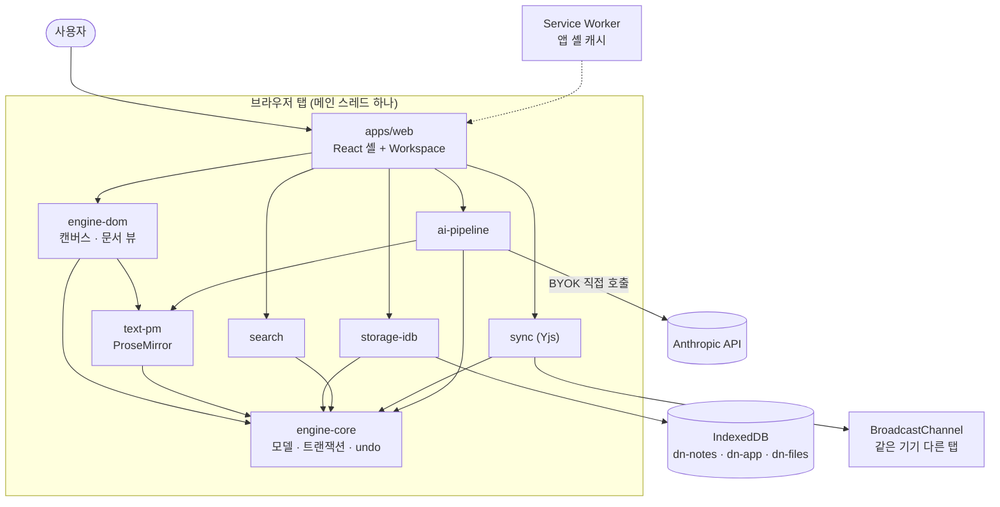

**규모 (기준 커밋 `0df7028`, `src` 아래 `.ts` · `.tsx`만 — `.d.ts` · CSS · 테스트 제외)**

| 패키지 | 소스 파일 | 소스 LOC | 단위 테스트 파일 | 단위 테스트 수 | 외부 런타임 의존성 |
|---|---:|---:|---:|---:|---|
| `packages/engine-core` | 57 | 6,540 | 42 | 233 | `rbush` · `fractional-indexing` |
| `packages/engine-dom` | 79 (+ CSS 4) | 9,865 | 0 | 0 | `perfect-freehand` |
| `packages/text-pm` | 45 (+ CSS 1) | 4,664 | 23 | 131 | `prosemirror-*` 8종 · `katex` |
| `packages/storage-idb` | 7 | 934 | 5 | 20 | 없음 |
| `packages/search` | 2 | 293 | 2 | 8 | 없음 |
| `packages/sync` | 13 | 1,316 | 6 | 46 (1건 건너뜀) | `yjs` |
| `packages/ai-pipeline` | 23 | 3,169 | 19 | 228 (3건 건너뜀) | `@anthropic-ai/sdk` |
| `apps/web` | 110 (+ CSS 11) | 12,946 | 9 | 36 | `react` · `react-dom` · `yjs` |
| **합계** | **336** | **39,727** | **106** | **702 (+ 건너뜀 4)** | |

- 단위 테스트 수는 기준 커밋에서 `vitest run --reporter=json`을 돌려 패키지별로 센 값이다(2026-10-15, 실패 0). 건너뛴 4건은 환경 변수로만 도는 측정 · 실제 API 시험(`DN_LIVE` · `DN_SESSION_CAPTURE` · `DN_BENCH`). `ai-pipeline`의 `prompts.gen.ts`(생성 파일)도 LOC에 들어 있다.
- v1.2(`905434d`) 대비: 소스 파일 285 → 336, LOC 34,338 → 39,727. 외부 런타임 의존성은 그대로다 — 머메이드 · 그래프 · PDF 보기 · 워드(.docx) 읽기 · 쓰기는 라이브러리 없이 직접 만들었다.
- 브라우저 e2e는 `e2e/*.mjs` 131개(그중 `docs-check.mjs`는 문서 검사)다. 10절. 파일 단위 지도는 [CODE-STRUCTURE.md](CODE-STRUCTURE.md).

---

## 2. 아키텍처 동인

구조를 실제로 만든 품질 목표와, 그 목표가 코드의 어디에 남아 있는지를 적는다.

| # | 동인 | 코드에 나타난 대응 |
|---|---|---|
| D1 | **로컬 우선 — 서버 없이 모든 편집 · 저장 · 검색** | 노트 원본은 IndexedDB(`packages/storage-idb`). 검색 색인도 메모리 + `dn-app.search_docs`(`packages/search`). 서버 패키지가 없다 |
| D2 | **큰 노트(블록 1만 개)에서도 빠르게** — 열기 200ms, 질의 1ms, 한 프레임 안 트랜잭션 | R-tree 공간 색인(`engine-core/src/spatial.ts`), 뷰포트 안 블록만 DOM에 올리는 가상화(`engine-dom/src/mount.ts` `syncMounts`), 줌 0.35 미만 LOD(`engine-dom/src/constants.ts` `LOD_ZOOM`), 스냅샷 + 연산 로그 저장(`storage-idb/src/session.ts`), 벤치 예산(`bench/baseline.json` `budgets`) |
| D3 | **모든 변경은 한 문, 한 undo 스택** — AI 결과도 Ctrl+Z 한 번 | `Engine.transact`가 유일한 쓰기 경로(`engine-core/src/engine.ts`), 끝난 `Tx` 재사용 금지(`tx.ts`), ProseMirror 자체 history 없이 스텝을 엔진으로 보냄(`text-pm/src/editor.ts`), AI 적용은 `origin: 'ai'` 트랜잭션 한 번(`ai-pipeline/src/apply.ts`) |
| D4 | **데이터 무결성 · 앞뒤 호환** | 커밋 직전 불변식 검사(`invariants.ts`), 스키마 v1→v6 마이그레이션 연쇄(`serialize.ts`), 상위 버전 노트는 읽기 전용(`session.ts` `openNote`), 마이그레이션 · 손상 때 원본 백업(`note-store.ts` `backup`) |
| D5 | **엔진은 DOM을 모른다** — Node에서 테스트 가능 | `engine-core`의 `tsconfig.json`이 `lib: ["ES2022"]`, `types: []`로 DOM 타입 없이 컴파일. 필요한 전역만 `src/env.d.ts`에 선언 |
| D6 | **패키지 경계 · 파일 크기를 기계로 지킨다** | `scripts/check-arch.mjs`(경계 · 파일 400줄 · `console.log` · `innerHTML` 대입 · 비밀값), `.githooks/pre-commit`, `.github/workflows/ci.yml` |
| D7 | **AI 키와 노트 내용을 함부로 내보내지 않는다** | BYOK 키는 AES-GCM으로 암호화해 `dn-app.secrets`(`meta-store.ts`), 개발 키는 개발 서버만 읽는 프록시(`vite.config.ts`), 동의 없으면 AI 호출 안 함(`apps/web/src/ws-ai.ts`), CSP `connect-src`(`apps/web/public/_headers`) |
| D8 | **화면은 React, 캔버스는 직접** — 팬 · 줌 중 React 재조정 없음 | React는 `Workspace` 상태만 구독(`App.tsx`), 캔버스 블록 DOM은 `CanvasView`가 직접 관리(`engine-dom/src/canvas-view.ts`) |

---

## 3. 시스템 컨텍스트 (C4 Level 1)

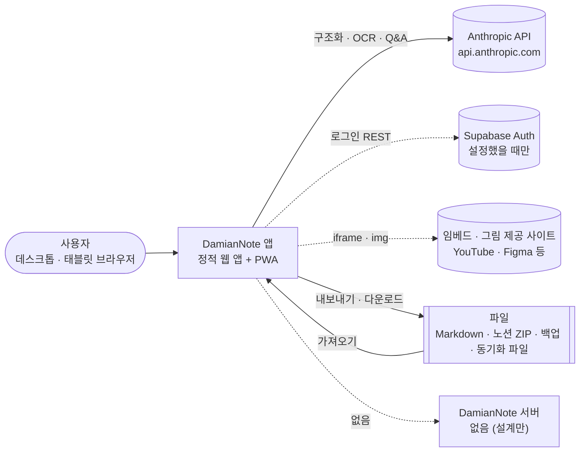

| 외부 요소 | 관계 | 코드 근거 | 없을 때 |
|---|---|---|---|
| Anthropic API | AI 구조화 · 손글씨 OCR · 노트 Q&A · 키 확인 | `packages/ai-pipeline/src/direct.ts` | AI 기능만 못 씀. 키가 없으면 설정 화면으로 안내(`ws-ai.ts`) |
| Supabase Auth | 이메일 매직 링크 · Google · Apple 로그인(REST, SDK 없음) | `apps/web/src/auth.ts` `supabaseBackend` | `VITE_SUPABASE_URL` · `VITE_SUPABASE_ANON_KEY`가 없으면 로그인 단추를 막고 "로그인 없이 계속"만 연다. 로그인해도 쓰는 기능이 아직 없다 |
| 임베드 · 그림 사이트 | 웹 임베드 iframe, 북마크 그림 | `engine-dom/src/web-render.ts` · `embed-render.ts`, `_headers`의 `frame-src` · `img-src https:` | 해당 블록만 안 보인다 |
| 파일 | 가져오기(Markdown · 노션 ZIP · 백업 JSON · 워드 `.docx` · `.csv` · 동기화 파일), 내보내기(Markdown · ZIP · PNG · PDF · HTML · 워드 `.docx` · 데이터베이스 CSV) | `apps/web/src/import*.ts` · `docx/` · `export.ts` · `pdf.ts` · `ws-sync.ts` | — |
| DamianNote 서버 | **없다.** 이전 판의 Edge API · SyncRoom · Postgres는 코드가 없다 | — | — |

---

## 4. 컨테이너 (C4 Level 2)

브라우저 안의 실행 단위만 적는다. 서버 컨테이너는 없다.

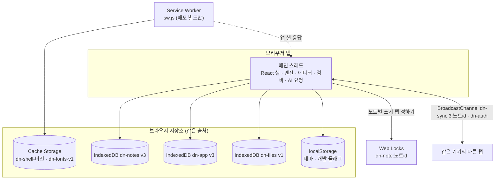

| 컨테이너 | 실제 구현 | 책임 | 근거 |
|---|---|---|---|
| 메인 스레드 | React 19 + 바닐라 DOM | 앱 셸 · 엔진 · 캔버스 · 문서 뷰 · ProseMirror · 검색 색인 · AI 파이프라인 · 저장 큐 | `apps/web/src/main.tsx` |
| Web Worker | **없다** | — | 저장소 전체에 `new Worker` · `SharedWorker`가 없다 |
| IndexedDB `dn-notes` | 버전 3: `snapshots` · `oplog` · `views` · `backups` · `versions` · `ysync` | 노트 내용 원본 | `packages/storage-idb/src/note-store.ts` |
| IndexedDB `dn-app` | 버전 3: `notes_meta` · `settings` · `secrets` · `folders` · `tags` · `search_docs` | 노트 바깥 메타 · 설정 · 비밀값 · 검색 문서 | `packages/storage-idb/src/meta-store.ts` |
| IndexedDB `dn-files` | 버전 1: `attachments` (키 = 내용 SHA-256) | 그림 · 첨부 · 녹음 파일 | `packages/storage-idb/src/attachment-store.ts` |
| Service Worker | 손으로 쓴 `sw.template.js`를 빌드 때 채워 `dist/sw.js`로 냄 | 앱 셸 미리 받기 · 캐시 먼저 응답 · 새 버전 대기 | `apps/web/sw.template.js` · `vite.config.ts` `serviceWorker()` |
| BroadcastChannel | `dn-sync:3:<노트id>`(탭 사이 Y 변경, 3 = Y 모양 버전), `dn-auth`(다른 탭 로그인 이어받기) | 같은 기기 탭 사이 통신 | `packages/sync/src/tabs.ts` · `apps/web/src/account.ts` |
| Web Locks | `navigator.locks.request('dn-note:<id>', { ifAvailable: true })` | 노트마다 저장하는 탭 하나 | `apps/web/src/ws-model.ts` `tryLockNote` |
| localStorage | 테마, `dn:auth-mock`(개발 흉내 로그인), `dn:no-env-key`(e2e) 등 작은 값 | 첫 그리기 전 값 · 개발 플래그 | `apps/web/src/theme.ts` · `auth.ts` · `ai.ts` |

### 4.1 스레드

모든 코드가 메인 스레드에서 돈다. 무거운 일(1만 블록 열기 · 압축 · 검색)은 알고리즘과 디바운스로 버틴다(7.1 · 7.2절). `search`는 DOM 없이 짜여 있어(`packages/search/src/index.ts` 머리 주석) 워커로 옮길 수 있게 되어 있지만, 옮기지는 않았다.

### 4.2 탭 여러 개

노트를 열 때 Web Locks로 `dn-note:<id>` 잠금을 시도한다. 잡은 탭이 **쓰기 탭**(저장하는 탭)이고, 못 잡은 탭은 저장하지 않는다. 다른 탭은 쓰기 탭과 BroadcastChannel로 Y 변경을 주고받아 함께 고칠 수 있다(`ws-sync.ts`, 7.4절). 브라우저에 `navigator.locks`가 없으면 `tryLockNote`가 늘 성공으로 돌아온다(13절).

IndexedDB 버전 충돌(옛 버전 탭이 연결을 쥔 채 새 버전 탭이 업그레이드하려는 경우)은 `openDb`의 `blocked` · `versionchange` 훅으로 안내하고 옛 연결을 닫는다(`packages/storage-idb/src/idb.ts`, `apps/web/src/workspace.ts` `boot`).

### 4.3 Service Worker와 앱 업데이트

- 빌드 때 Vite 플러그인이 번들 파일 목록 · 내용 해시로 `VERSION`과 `PRECACHE`를 채운다(`vite.config.ts`).
- `install`에서 앱 셸을 `dn-shell-<버전>` 캐시에 받아 두고, `activate`에서 옛 셸 캐시를 지운다. 글꼴(`/fonts/`)은 쓰는 조각만 `dn-fonts-v1`에 받는다. 다른 출처 요청(Claude API 등)은 건드리지 않는다.
- 새 워커가 대기하면 앱이 "새 버전이 준비됐어요" 안내를 띄우고, 사용자가 누르면 `skip-waiting` 메시지 → `controllerchange` → 다시 열기(`apps/web/src/sw-register.ts`). 편집 중 강제로 새로 고치지 않는다.
- 등록은 `import.meta.env.PROD`일 때만(`workspace.ts` `boot`).

---

## 5. 컴포넌트 (C4 Level 3)

### 5.1 패키지와 의존 방향

`from '@dn/…'`를 실제로 센 결과(소스 · 테스트 따로)와, 경계 검사(`scripts/check-arch.mjs`의 `ALLOWED`), `package.json` 의존성을 맞대 본 표다.

| 패키지 | `src`가 실제로 가져다 쓰는 @dn | `ALLOWED` | `package.json` 의존 | 일치 |
|---|---|---|---|---|
| engine-core | 없음 | `[]` | 없음 | 일치 |
| text-pm | engine-core | engine-core | engine-core (+ 개발 의존 storage-idb) | 일치 — 테스트 1개가 storage-idb를 씀 |
| engine-dom | engine-core · text-pm | engine-core · text-pm | 같음 | 일치 |
| storage-idb | engine-core | engine-core | 같음 | 일치 |
| search | engine-core | engine-core | 같음 | 일치 |
| sync | engine-core | engine-core | 같음 (+ yjs) | 일치 |
| ai-pipeline | engine-core · text-pm(`/headless` 1곳, `apply.ts`) | engine-core · text-pm | 같음 (+ `@anthropic-ai/sdk`) | 일치 |
| apps/web | 7개 전부 | `'*'` | 7개 전부 (+ yjs — `ws-sync.ts`가 직접 씀) | 일치 |

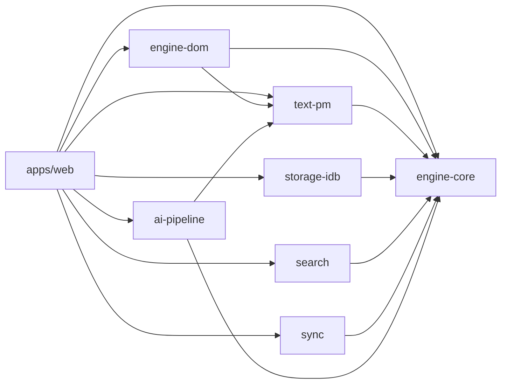

**강제 장치**

| 규칙 | 장치 | 범위 |
|---|---|---|
| 패키지 경계(위 `ALLOWED`) · 순환 금지 | `scripts/check-arch.mjs` — 정규식으로 `from '@dn/x'`를 찾는다 | `packages/*/src` · `apps/web/src`만. 테스트 폴더는 검사하지 않는다 |
| 새 패키지는 경계를 먼저 정해야 함 | 같은 스크립트 — `ALLOWED`에 없으면 실패 | 위와 같음 |
| 엔진에 DOM 없음 | `packages/engine-core/tsconfig.json` `lib: ["ES2022"]` | 타입 검사(`pnpm typecheck`) |
| 소스 파일 400줄 이하 | `check-arch.mjs` `MAX_LINES` | `.ts` · `.tsx` · `.css`, `*.gen.ts` · `*.d.ts` 제외 |
| `console.log` · `innerHTML =` 금지 | 같은 스크립트 | 소스 |
| 비밀값(`sk-ant-…`) · `.env*` 커밋 금지 | 같은 스크립트(`--staged`면 올린 파일만) | git 추적 파일 |

### 5.2 앱 셸과 엔진의 경계

- React는 캔버스 블록을 그리지 않는다. `App.tsx`가 `new Workspace()`를 만들고 `ws.subscribe(setS)`로 상태 객체 전체를 받는다. 상태가 바뀌면 `Workspace.set()`이 새 객체를 만들어 구독자에게 준다(`apps/web/src/ws-base.ts`).
- `Workspace.init(container, docContainer)`가 받은 두 `
`에 `CanvasView`와 `DocView`를 직접 붙인다(`ws-notes.ts`). 캔버스 쪽 UI 상태(선택 · 도구 등)는 `CanvasView.onUi`로 받아 `Workspace` 상태에 넣는다.
- 메뉴 · 대화 상자 요청은 엔진 뷰가 콜백으로 올린다(`onBlockMenu` · `onArrowMenu` · `onInsertMenu` · `onComments` 등, `engine-dom/src/types.ts` `CanvasViewOptions`).
- 위 막대는 `App.tsx` 안의 `header.topbar` — 이동 경로(`Breadcrumb`) · 태그 · 즐겨찾기 · 노트 정보 · 캔버스│문서 전환 · ⋯(`TopMore` — 발표 · 인쇄 · 내보내기 · 버전 기록, 10/13). 문서 뷰 아래 상태 줄은 `DocStatus`, 블록 옮기기 창은 `MoveToDialog`. 메뉴의 하위 메뉴는 `SubMenu`(블록 메뉴 · 화살표 메뉴).
- 엔진 뷰가 올리는 콜백(10/09 뒤 추가): `onMoveBlocks`(다른 노트로 옮기기) · `onEditContent(…, tab?: 'style')`(그래프 모양 탭) · `files.blob`(PDF 보기), `DocViewOptions.diagram`(묶음 → 문서 그림).
- 앱 시작 순서(`main.tsx`): 테마 적용 → `setDefaultTextCodec(pmCodec)`(로그 재생 전에 텍스트 스텝 코덱 등록) → `setDevChecks(import.meta.env.DEV)`(개발 빌드에서 엔진 레코드 동결) → React 렌더. CSS는 17개를 차례로 불러온다(engine-dom 4 · text-pm 1 · 앱 12 — `menus.css`는 10/13 400줄 한도로 `styles.css`에서 나뉨).

### 5.3 스레드 배치

4.1절과 같다 — 전부 메인 스레드다.

### 5.4 ai-pipeline

헤드리스 파이프라인이다. 엔진에는 `apply.ts`만 닿는다.

| 모듈 | 책임 |
|---|---|
| `normalize.ts` | 채팅 UI 잔여물 제거 · 길이 제한(`MIN_CHARS` · `MAX_CHARS`). 원문 글자는 바꾸지 않는다 |
| `chunk.ts` | 긴 입력 나누기 — 목표 6,000자, 7,000자 이하면 그대로, 상한 24,000자 (10/27 정확도 — 처음 12,000 · 14,000). 붙여넣기 칩이 미리 "N번에 나눠 분석해요"를 알린다 |
| `prompts.ts` · `prompts.gen.ts` | `prompts/*.md`를 생성 스크립트(`scripts/gen-prompts.mjs`)로 문자열에 넣은 것. **`STRUCTURE_PROMPT_VERSION = 'structure.v2'`**(10/10~) — 시스템 = `structure.v2.md`(4판 — 10/18 도식 · 노트형 두 갈래 `mode` · `sheet`) + 카탈로그(`structure.v2.catalog.md`, STRUCTURE-GUIDE에서 `gen-catalog.mjs`로 생성). v1은 비교용 선택지(`structurePrompts(version)`) |
| `request.ts` | 요청 조립 · 청크 하나 호출 · 교정 재요청. 모델 기본 `claude-sonnet-5-5`, 허용 `claude-sonnet-5-5` · `claude-haiku-4-5-20251001` · `claude-opus-5-5`. v2 도구 `STRUCTURE_TOOL_V2`는 **strict 끔**(선택 필드 56개 > strict 상한) — 응답은 `structure.ts`가 검증 |
| `schema.ts` | JSON Schema 부분집합 검증기(ajv 없음) — `schemas/structure.v1.json` · `structure.v2.json` · `ocr.v1.json` |
| `structure.ts` · `structure-v2.ts` | 응답 검증(응답 전체 위반 → 교정 재요청, 항목 위반 → 그 항목만 버림), v2 묶음 · 구조 판별 정리, `toV1` 내리기 |
| `retry.ts` · `errors.ts` | 재시도 · 타임아웃 · 취소, 오류 코드 정규화 |
| `pipeline.ts` | `structureText`: 정규화 → 청킹 → 청크마다 transport → 검증 · 수치 검사 → 병합 → `StructurePlan` |
| `arrange.ts` · `presets.ts` | 구조 판별(patterns)마다 원형 프리셋(P-01~23, `runPreset`)으로 놓고 덩어리를 잇는다. 원형은 카탈로그를 실행 중에 읽어 정한다. 모양을 못 정하면 `layeredLayout`으로 물러선다 |
| `layout.ts` · `bands.ts` · `venn.ts` · `fishbone.ts` | 계층형 배치(순환 끊기 → 층 → 출발점은 가리키는 상대 바로 앞 층으로(10/27) → 무게중심, 프리셋이 물러설 때만) · 층 묶음 띠 · 벤(소속 화살표로 [A만][둘 다][B만]) · 피시본. dagre · elkjs 없음 |
| `replace.ts` (10/27, FR-110) | 다시 구조화: `applyStructure`의 `replace`로 고른 상자 · 콘텐츠 · 이어진 화살표를 같은 트랜잭션에서 지우고 그 자리에 새 결과(실행 취소 한 번), 바깥과 이어졌던 화살표는 제목이 같은 새 상자로 다시 잇는다. 보낼 구간은 앱 `ai.ts` `restructureSource` — 같은 실행의 AI 상자만, 출처 구절이 든 원문 문단(원문이 없으면 상자 글 · 사이 화살표), 출처 위치는 `sourceOffset`으로 원문 기준 |
| `page.ts` (10/27) | A4 용지 노트의 도식형 결과: 원문 아래 용지 가운데, 용지 안쪽 폭을 넘으면 덩어리 줄 바꿈 → 흐름형 위→아래로 다시 → 원문 차례로 한 줄, 쪽 사이 틈에 걸친 줄은 다음 쪽으로(`paginate`). 원문 아래가 막혔으면 내용 맨 아래 |
| `apply.ts` · `estimate.ts` | `planApply`(순수 계산 — 제목만 있는 노드는 제목 한 줄 폭(120 ~ 260, 앱이 DOM으로 잰 `fit`), `arrange`로 배치, 시간축 · 사분면 · 척도 · 벤 · 피시본은 **모양 묶음** `meta.shape` · `axis` · `bracket: 'none'`, 사분면 · 벤은 `figure: true`, 노드 수식은 제목 아래 `math_block`) → `applyStructure`(엔진 트랜잭션 한 번, `origin: 'ai'`). 화면 없는 크기 추정은 `estimate.ts` |
| 배치 다듬기 (10/27) | `arrange.ts`가 흐름형 덩어리(계층형 원형 · 나머지)를 프리셋으로 놓은 뒤 engine-core `tidyLayout`(5.6)을 한 번 거친다 — 줄 맞춤 · 라벨만큼 간격 · 폭 단계. 모양 원형(원 · 칸 · 레인 · 층 쌓기 · 피시본 …)은 프리셋 그대로. 차트 · 표는 붙은 노드와 같은 층 곁에(배치용 가상 연결 `same` · `soft`), 7단계 넘는 단계는 ㄹ자로 꺾는다 |
| `transport.ts` | `StructureTransport` 인터페이스와 `createEdgeTransport`(SSE). **앱은 Edge transport를 쓰지 않는다** |
| `direct.ts` (`@dn/ai-pipeline/direct` 별도 진입점) | SDK로 브라우저 직접 호출(`dangerouslyAllowBrowser: true`): `createDirectTransport` · `testApiKey` · `createDirectOcr` · `createDirectQa`. 앱은 동적 `import()`로만 불러 SDK가 첫 번들에 들어가지 않게 한다 |
| `ocr.ts` · `qa.ts` | 손글씨 → 글(`emit_ocr` 도구), 노트 Q&A(document 블록 + 인용) |

**전송 경로 두 가지 (실제로 쓰는 것)** — 둘 다 같은 `createDirectTransport`다. `apps/web/src/ai.ts` `directOpts`가 고른다.

| 경로 | 조건 | 키의 위치 | 요청 대상 |
|---|---|---|---|
| 개발 프록시 | `vite` 개발 · 미리보기 서버에 `.env.local`의 `ANTHROPIC_API_KEY`가 있음 | 개발 서버(Node) 프로세스만. 브라우저는 자리 채움 키 `sk-ant-env-proxy`를 보내고 프록시가 바꿔 끼운다 | `<origin>/anthropic/*` → `api.anthropic.com` |
| BYOK | 그 밖(배포 빌드 포함) | `dn-app.secrets`의 `anthropic-api-key` (AES-GCM, 9.2절) | `api.anthropic.com` 직접 |

**structure v2 상태 (10/10~)**: 요청 · 응답 모두 v2다. 응답에 `version`이 빠지면 채워서 검사하고(`request.ts`), v2 묶음(containers) · 구조 판별(patterns)을 엔진 묶음과 원형 배치로 바꾼다(`structure-v2.ts` `minMembers` — slot · lane은 상자 하나여도 묶음). 보내는 원문의 수식은 `$…$` · `$$…$$`로, 문단 안 줄바꿈은 `\n`으로 바꿔 보낸다(`apps/web/src/ai.ts` `withTex`). 평가 세트는 40건(`eval/structure`), 실제 호출 평가는 `DN_LIVE=1`(비용 발생).

### 5.5 search와 Q&A

- `extractSearchDoc(engine)`: 블록마다 글자(제목 · 본문 · 각주 · 표 · 그래프 · 데이터베이스 · 캡션)와 노트 링크 · 블록 종류 · AI 여부를 모은 `SearchDoc`(형식 `SEARCH_DOC_VERSION = 4` — v4는 요약 카드용 headings · keywords · hashtags · digest).
- `SearchIndex`: 메모리 안 색인. 질의 낱말이 **모두** 든 블록(AND, 부분 문자열)을 찾고 문맥을 잘라 준다. 백링크도 여기서 찾는다. BM25 · 2-gram 색인은 없다.
- `retrieve.ts` `retrievePassages`: Q&A용 — 질문에서 조사 · 흔한 어미를 떼고, 걸린 낱말이 많은 블록부터(OR) 고른다. 노트당 4개까지.
- 탭 블록은 모든 탭의 이름 · 글, 버튼 블록은 이름만 색인한다(10/09 뒤).
- 앱은 노트를 고친 뒤 400ms 쉬면 검색 문서를 다시 만들어 메모리 색인과 `dn-app.search_docs`에 쓴다(`ws-notes.ts` `metaTimer`, `ws-base.ts` `putSearchDoc`). 잠긴 노트는 색인에서 뺀다.
- **노트에 묻기 범위 좁히기 (10/26)** — 범위가 '전체 노트'면 모든 노트의 블록을 훑지 않고 후보 노트를 먼저 고른다(`search/src/scope.ts` `scopeStages`, 앱 `note-scope.ts` · `qa-flow.ts` `findPassages`). 모두 기기 안 계산이라 토큰을 쓰지 않고, Claude에는 고른 근거(최대 8개)만 간다.
  1. 역할 · 태그: 질문 낱말이 노트 역할(회의록 · 강의 필기 · 리서치 · 주간 계획 · 사용자 역할 — 역할마다 가리키는 낱말)이나 노트 태그에 걸리면 그 노트만(둘 다 걸리면 둘 다 맞는 노트). 역할은 `note.role`(사용자 · 템플릿) 또는 제목 · 소제목으로 추정한 `roleGuess`.
  2. 요약 카드: 1)이 비거나 그 안에서 근거가 안 나오면, 노트마다 제목 · 역할 · 태그 · 소제목 · 키워드만 모은 최소 요약(`noteDigest`, 검색 문서 v4 `digest`)에 걸린 노트(최대 12개).
  3. 둘 다 없으면 근거 없음 — Claude를 부르지 않는다. 답 위에 실제로 쓴 범위를 보여 준다("전체 노트 중 회의록 노트 · #결제 1개").
- 키워드는 검색 문서를 만들 때 함께 뽑는다(`search/src/keywords.ts`): 글 속 `#해시태그`(노트 태그로 자동 등록 · 지우면 뗌 — `syncNoteScope`), 자주 나온 낱말(제목 3 · 소제목 2 · 본문 1점, 조사 떼기 · 서술어 제외). 직접 고른 범위(현재 노트 · 폴더 · 태그 · 역할)는 좁히지 않는다.
- 화면(10/26): 노트 정보 패널 '역할 · 요약 카드'(`RolePanel.tsx` — 역할 고르기 · 자동(추정) 표시 · 역할 만들기 · 지우기 · 요약 카드 md), 기본 템플릿은 같은 이름의 역할로 시작, 검색 창의 역할 필터 · 검색어 속 `#태그`로 좁히기(`ws-organize.ts` `search`), 태그 막대의 '추천 #낱말'(그 노트 키워드).
- **색인 구축 · 갱신 (FR-120, 10/28)** — 증분: 노트를 고치면 400ms 뒤(위), 만들기 · 가져오기 · 동기화 · 잠금 풀기 때 `putSearchDoc`, 휴지통은 질의에서 빼고(색인은 남김), 영구 삭제는 메모리 · `search_docs` 모두 지운다. `putSearchDoc`은 실패하면 경고만 남기고 `false` — 편집 · 저장을 막지 않고 다음 편집에서 다시 맞춘다. **필기에서 읽은 글**: 손글씨를 글로(FR-038 · 039) 읽으면 결과를 그 획들에 붙여 `SearchIndex` 안 `inks`(노트별 `InkText {id: ink:첫 획, strokes, text, at}`)와 검색 문서 `ink`에 둔다 — 노트 원본이 아니라 색인에만, 이 기기에만, 잠긴 노트는 남기지 않음. 획이 하나라도 남아 있으면 '필기' 블록(종류 `ink`)으로 검색 · 근거에 걸리고(같은 글이 글 상자에 있으면 블록은 빼고 기록만), 모두 지우면 블록은 빠지고 기록은 `gone`(지워진 때)을 달고 30일(`INK_GONE_KEEP_MS`) 남는다 — 실행 취소 · 버전 되돌리기로 획이 돌아오면 다시 걸린다(교차 검토 B3). 글 속 #태그(노트 태그가 됨)는 필기에서 읽은 글에서 뽑지 않는다 — AI가 읽은 손글씨라 틀릴 수 있고 노트 원본에서 지울 수도 없다(교차 검토 B8). 검색 결과 · 인용의 `ink:` id는 `ws-remind` `focusBlock`이 그 획들을 올가미로 고르고 화면을 옮긴다(문서 뷰면 캔버스로). 예전 형식 문서에서도 `ink`는 건진다(부팅). **다시 만들기**: 설정 › 데이터 · 명령 팔레트 → `ws-base.ts` `rebuildIndex`(저장소 오류로 멈춰도 진행 표시를 거두고 알림, 교차 검토 B11) — 없어진 노트의 문서를 지우고 모든 노트를 저장 없이 읽어 다시 색인, 진행률은 `indexing`(검색 창 · 설정), 읽지 못한 노트 수를 알린다. 녹음 전사문 색인은 녹음(FR-044)이 생기면 같은 길로. BM25 · 2-gram(ADR-0010)은 아직 — 아래 X10.
- AI 자동 태그(10/26): 구조화 응답의 `keywords`(structure.v2, 프롬프트 5판부터 — 원문 낱말 최대 8개. 6판(10/28)은 문단마다 따로 논증하는 글을 노트형으로 · 사례 보존, NOTE-SHEET-PLAN 9절) 중 원문에 그대로 있는 것만 계획에 남기고(`pipeline.ts`), 앱이 노트 태그로 붙인다(`ws-ai.ts` `tagFromAi`). 알림의 실행 취소 · 다른 모양으로 다시를 누르면 이번에 붙인 태그도 뗀다. 설정 › AI '키워드를 태그로 붙이기'(기본 켬, 설정 키 `aiAutoTag`).

### 5.6 engine-core

DOM 없는 문서 엔진이다. 공개 API는 `src/index.ts`가 다시 내보내는 것 전부다.

| 묶음 | 모듈 | 내용 |
|---|---|---|
| 모델 | `model.ts` · `text-doc.ts` · `id.ts` · `order.ts` · `geom.ts` | 타입(6절 — `model.ts`는 10/13 리팩토링으로 타입만 남고 글 도우미 `titleDoc` · `bodyDoc` · `docText` 등은 `text-doc.ts`로), 22자 id, fractional index 순서 키(`fractional-indexing`), 좌표 양자화 `q` |
| 쓰기 경로 | `engine.ts` · `tx.ts` · `ops.ts` · `history.ts` · `undo-guard.ts` · `invariants.ts` · `provenance.ts` | 트랜잭션 · 원자 연산 · undo 스택(`History` 클래스) · 원격 변경 뒤 조건부 되돌리기 · 불변식 · AI 출처 편집 시각 찍기 |
| 색인 | `spatial.ts` (+ `engine.ts`의 RBush 두 개) | 블록 · 화살표 R-tree, 더러운 id만 커밋 뒤 갱신 |
| 커맨드 | `commands.ts` · `groups.ts` · `doc-edit.ts` · `doc-units.ts` · `ink.ts` · `ink-bind.ts` · `database.ts` · `db-*.ts` · `block-style.ts` · `table-*.ts` · `comments.ts` 등 | 사용자 동작 하나 = 함수 하나 = 트랜잭션 하나 |
| 배치 | `dock.ts` · `sheet.ts` · `page-setup.ts` · `tidy.ts` · `tidy-layer.ts` | 겹침 없는 빈 자리 찾기 · 자석 스냅(순수 계산), A4 용지 · 쪽 설정. **배치 다듬기**(10/27, 서브 구조화 · 10/28 규칙 고침): 화살표로 이어진 덩어리마다 층은 화살표가 정한다 — 이어진 두 상자 중 흐름 축에서 완전히 앞(위 · 왼쪽)에 있는 쪽이 앞 층(겹치면 화살표 방향), 가장 긴 길이 층, 고리는 자리와 무관한 차례로 끊음. 층 안 차례는 앞 층 이웃 차례 평균(같으면 지금 자리), 좌표는 지금 자리를 쓰지 않고 중심 맞춤 · 부모는 자식 가운데 · 층 사이는 라벨이 들어갈 만큼. 그래서 이웃을 넘어갈 만큼 옮기기 전에는 다시 다듬어도 같은 결과이고, 덩어리는 첫 상자(뿌리) 자리에 둔다. 흐름 방향은 화살표가 한쪽으로 고르게 가는 축(부채꼴은 옆 수가 지워짐 · 근거 → 주장처럼 위로 가는 것도 고른 흐름), 이미 다듬어진 방향은 유지. 한 도식 안 글만 든 본문 상자는 같은 폭(가장 넓은 것, 360 이하) · 같은 높이(자동 높이 상자의 `minH` — `mount.ts`가 최소 높이로 그림), 따로 있는 상자는 맞추지 않고 예전 minH를 지움. 제목 상자는 글 폭(폭 단계는 도식 안에서만). 곧게 맞지 않는 화살표는 꺾은선(`route: 'orthogonal'` · 끝 아래 → 위 / 오른쪽 → 왼쪽, `arrow-route.ts`가 출발 끝 방향으로 먼저 꺾음), 곧게 맞으면 auto · 곧은 선 — 곡선 · 되돌림 · 묶음 끝은 그대로(`tidyPlan.routes`). 덩어리 부딪힘 8px · 밀 때 48px. 묶음은 안을 먼저 다듬어 한 덩어리, 모양 묶음 · 카드 · 고리 · 층 쌓기는 통째로만. `applyTidy`가 상자 · 화살표를 트랜잭션 한 번 |
| 문서 순서 | `flow.ts` · `toc.ts` | 문서 뷰 · 내보내기 · 목차가 쓰는 읽기 순서(화살표 흐름 우선, 나머지는 위→아래 · 왼→오). 위계 · 논증 관계는 받는 쪽을 먼저 읽고 들여쓴다(`readsBackward`, 10/10). 제목 번호 `setHeadingNumbers` |
| 의미 · 모양 | `relations.ts` · `meaning.ts` · `arrow-geom.ts` · `arrow-route.ts` · `group-anchor.ts` | v6 관계 · 노드 종류 · 묶음 종류, 관계별 기본 화살표 모양, 묶음 끝 화살표 |
| 직렬화 | `serialize.ts` · `rich.ts` | 스냅샷 · 마이그레이션(8.2절) |
| 그래프 ↔ 표 (10/27, FR-110) | `rich-convert.ts` | `chartToTable` · `tableToChart`(숫자로 읽히는 열 ⅔ 이상 · 공통 단위 · 시간 항목은 선) · `convertRich` — AI 없이 같은 수치를 다른 모양으로, 블록 · 화살표 · 출처는 그대로, 실행 취소 한 번 |
| 기타 | `viewport.ts` · `clip.ts` · `diff.ts` · `embed.ts` · `web.ts` · `caption.ts` | 카메라 계산 · 클립보드 형식(`dn-blocks`) · 버전 비교 · 임베드 · 웹 블록 · 캡션(+ 사진 대체 텍스트 `setImageAlt`) |
| 새 콘텐츠 · 기능 (10/09 뒤) | `button.ts` · `tabs.ts` · `mermaid.ts` · `present.ts` · `file-preview.ts` · `table-head.ts` | 버튼 블록(`pressButton` → 클립을 아래에 붙이기) · 탭 블록 · 머메이드 flowchart ↔ 상자 · 화살표(`parseMermaid` · `diagramToMermaid`) · 발표 장면(`presentSlides`) · PDF 펼쳐 보기(`PDF_VIEW_H` 640) · 표 머리 행 · 열 |
| 데이터베이스 확장 (10/13) | `db-props.ts` · `db-formula.ts` · `db-calc.ts` · `db-csv.ts` | 상태 · 파일 · 만든 때 · 고친 때 속성, 수식(직접 쓴 파서 — eval 없음), 열 계산 · 타임라인 · 차트 막대, CSV 읽기 · 쓰기 |

### 5.7 engine-dom

`CanvasView`(`canvas-view.ts`)는 상태 · 공개 API · 렌더 순서만 갖고, 일은 역할별 모듈 함수가 한다(파일 400줄 제한 때문에 나뉘었다).

**캔버스 층 (아래 → 위, `canvas-view.ts` 생성자와 `ink-layer.ts` `createInk`)**

| 층 | 요소 | 그리는 것 |
|---|---|---|
| under | `<canvas class="dn-layer dn-under">` | 배경(점 · 괘선 · 모눈) · 묶음 도식 모양(시간축 선 · 사분면 십자 · 척도 축 · 벤 타원 · 피시본 뼈, `group-shapes.ts`) · 화살표(모양이 이미 보여 주는 화살표는 옅게) · LOD일 때 블록 (`draw-under.ts`) |
| world | `
` — transform 하나로 팬 · 줌 | 블록 DOM (`mount.ts`) |
| ink | `<canvas class="dn-ink">` | 저장된 잉크(펜 · 형광펜) (`ink-layer.ts`) |
| ink wet | `<canvas class="dn-ink-wet">` | 지금 긋는 획만 |
| over | `<canvas class="dn-layer dn-over">` | 선택 · 핸들 · 안내선 · 마키 · 연결 미리보기 (`draw-over.ts`) |
| grip | `
` | 블록 핸들(⋮⋮) 하나를 옮겨 씀 |

**렌더 루프**: 엔진 `subscribe` → `changes.ts` `handleChange`가 바뀐 id를 `dirtyIds`에 넣음 → `requestAnimationFrame` 한 번에 마운트 동기화 · 높이 반영 · 두 캔버스 그리기. 블록 높이는 `ResizeObserver`로 재고 `applyMeasuredHeights`(origin `'layout'`, undo 없음)로 엔진에 넣는다.

**가상화와 LOD**: `syncMounts`가 `engine.queryBlocks(visibleRect)` 결과만 DOM으로 둔다. `cam.zoom < 0.35`(`LOD_ZOOM`)면 블록 DOM을 모두 내리고 under 캔버스에 단순화해 그리며, 0.3(`LOD_BATCH_ZOOM`) 미만이면 경로 하나로 일괄 그린다.

**입력 상태 기계**: `bind-input.ts`가 이벤트를 달고, `pointer.ts`가 `Gesture` 하나(`types.ts`)를 상태로 들고 간다.

| 상태 `k` | 시작 | 끝날 때 엔진에 하는 일 |
|---|---|---|
| `none` | — | — |
| `pan` | 빈 곳 끌기 · Space · 가운데 버튼 | 없음(카메라만) |
| `drag` | 블록 · 핸들 끌기 | `moveSelection` / `moveBlocks` (자석 스냅 `snapRect`, 겹치면 `findDockSpot`) |
| `gscale` | 묶음 모서리 | `scaleBlocks` |
| `resize` | 블록 핸들 | `resizeBlock` |
| `marquee` | 빈 곳 끌기(선택 도구) | 선택만 |
| `connect` · `reconnect` | 연결점 · 화살표 끝 | `createArrow` · `reconnectArrow` (빈 곳에 놓으면 새 블록과 연결) |
| `pinch` | 두 손가락 | 없음(카메라만) |

끄는 동안에는 엔진을 바꾸지 않고 화면만 움직인다(미리보기 좌표). 키 · 휠 · 더블클릭은 `keyboard.ts`, 잉크는 `ink-input.ts`(펜 전용 모드면 터치 무시, 필압), 접근성 · 키보드 연결은 `a11y.ts`.

**원문 출처 연결 (10/27, FR-111, `source-link.ts`)**: 그리기마다 AI 상자 하나를 고른 상태면 그 상자 `ai.source`의 구절을 원문 상자 DOM에서 찾아 CSS Custom Highlight(`dn-source`)로 칠한다(글 · DOM은 그대로, 고른 것 · 원문 글이 바뀔 때만 다시 찾음). 원문 콘텐츠를 지운 AI 상자는 `dn-nosrc` — 종류 태그 뒤에 '출처 없음'. 블록 메뉴 '원문에서 보기'는 원문 상자로 화면만 옮긴다.

**새 그리기 모듈 (10/09 뒤)**: `present.ts`(발표 — 장면마다 카메라, 보기 전용) · `button-render.ts` · `tabs-render.ts`(지금 탭은 화면 상태, 두 번 누르면 그 자리 편집) · `chart-render.ts`(SVG 그래프 · 색 묶음 `CHART_PALETTES`, `rich-render.ts`에서 나옴) · `db-timeline.ts` · `db-calc-ui.ts` · `db-props-ui.ts` · `svg.ts`. PDF는 같은 출처 `blob:` iframe으로 펼친다(`rich-render.ts`, 머리 바이트가 `%PDF-`일 때만). 데이터베이스 임베드는 임시 `Engine`으로 읽기 전용 렌더(`embed-render.ts`). 연결점 · ⋮⋮ 손잡이는 마우스를 올린 블록에만, 이름 없는 묶음 이름표는 마우스가 그 묶음 근처일 때만(10/13 디자인 단순화).

**문서 뷰 (`doc-*.ts` 17개 — 본체 `doc-view.ts`, 워드식 편집 `doc-word.ts`, 묶음 그림 `doc-diagram.ts`, 확대 `doc-zoom.ts`)**: 같은 노트를 위에서 아래로 읽는 문서로 그린다. 별도 데이터가 없고 **같은 `Engine`을 구독**한다(`opts.engine.subscribe(() => this.schedule())`). 순서는 `engine-core/src/flow.ts` `documentOrder`. 워드처럼 고치기(`DocWord`)는 상자 경계를 넘는 커서 이동 · Enter/Backspace로 상자 나누기 · 합치기 · Ctrl+Enter 쪽 나눔을 엔진 커맨드(`splitTextBox` · `mergeTextBoxes` · `setPageBreak` 등, `engine-core/src/doc-edit.ts`)로 한다. 쪽 보기는 `doc-pages.ts` `paginate`. 7.7절.

### 5.8 text-pm

| 모듈 | 내용 |
|---|---|
| `schema.ts` | ProseMirror 스키마 `pm-v1`. 노드: `doc` · `paragraph` · `heading` · `blockquote` · `code_block` · `horizontal_rule` · `bullet_list` · `ordered_list` · `list_item` · `task_list` · `task_item` · `toggle` · `callout` · `math_block` · `text` · `note_link` · `xref` · `link_mention`(10/13 — 주소 칩) · `date_mention` · `math_inline` · `footnote` · `hard_break`. `ordered_list`에 `nums`(다단계 번호) 속성. 마크: `strong` · `em` · `underline` · `strike` · `highlight` · 글자 색 · 글자 크기 · `font` · `sup` · `sub` · `comment` · `code` · `link` |
| `codec.ts` · `repair.ts` | `pmCodec: TextCodec` — 스텝 JSON 적용 · 역스텝 계산 · 문서 검증 · 스키마에 안 맞는 문서 고치기(`repair` = `repairDoc` — 맞는 최상위 블록은 두고 안 맞는 블록만 같은 글자 · 서식의 문단으로, 동기화 다리가 씀). DOM 없음(`headless.ts` 진입점으로 Node 테스트 · ai-pipeline이 씀) |
| `editor.ts` (+ `editor-keys.ts` · `editor-paste.ts` · `plugins.ts` · `node-views.ts` · `bubble.ts`) | 블록 하나에만 띄우는 에디터. 자체 history 없음 — 입력 스텝을 `onSteps`로 넘기면 `engine-dom/src/editing.ts`가 `editText`로 엔진에 적용 |
| `render.ts` | `renderStatic` — 편집 중이 아닌 블록의 정적 렌더 |
| `slash.ts` · `slash-md.ts` | 슬래시 메뉴. 항목 원본은 `docs/SLASH-COMMANDS.md`를 빌드 때 문자열로 가져온다(`import md from '../../../docs/SLASH-COMMANDS.md?raw'`). '## 제목' = 묶음, 표 한 줄 = 명령. '계획'인 줄 · 모르는 실행 이름은 건너뛴다 |
| `markdown.ts` · `to-markdown.ts` · `paste.ts` · `wikilinks.ts` | Markdown ↔ 문서, HTML 붙여넣기 정화, `[[링크]]` |
| `math.ts` · `math-palette.ts` | KaTeX 수식 |
| `cross.ts` · `doc-keys.ts` · `find.ts` | 문서 뷰의 상자 넘는 선택 · 키, 찾아 바꾸기 스텝 |
| `paste-url.ts` · `code-copy.ts` · `list-nums.ts` · `para-style.ts` · `menu.ts` | 주소 붙여넣기 › 링크 · 언급 · 북마크 · 임베드(글 사이면 링크 · 언급만, 제목은 호스트 `unfurl`), 코드 복사 단추, 다단계 번호 · 문단 스타일, 메뉴 줄 공용 `menuItem` |
| `icons.ts` | 앱 전체가 쓰는 선 아이콘 한 세트(10/13 — 글자 기호 · 색 이모지 대신) |

### 5.9 storage-idb

| 모듈 | 내용 |
|---|---|
| `idb.ts` | 프로미스 래퍼 · `openDb`(업그레이드 · `blocked` · `versionchange` 훅) |
| `note-store.ts` `IdbNoteStore` | `dn-notes`: 스냅샷 · 로그 추가 · 압축 · 백업(노트당 5건) · 버전 기록(노트당 30건) · 동기화 상태 · 노트 잠금 암호화 |
| `session.ts` `NoteSession` · `openNote` · `readNote` · `createNote` | 열기(마이그레이션 · 읽기 전용 판정 · 손상 처리) · 자동 저장 큐 · 압축 · 재시도 |
| `meta-store.ts` `MetaStore` | `dn-app`: 노트 메타 · 폴더 · 태그 · 검색 문서 · 설정 · 비밀값 |
| `attachment-store.ts` `AttachmentStore` | `dn-files`: 내용 해시 키 첨부 |
| `vault.ts` | 노트 잠금 금고(PBKDF2 → KEK → DEK 감싸기), `VaultCipher` |

### 5.10 sync

| 모듈 | 내용 |
|---|---|
| `bridge.ts` `attach` · `knownIds` | 엔진 ⇄ Y.Doc. 노트 하나 = Y.Doc 하나, 엔티티마다 `Y.Map`(필드 단위 LWW), 글 상자 문서는 `Y.XmlFragment`. `attach(engine, doc, { onRemote, prefer, known, device })`. 엔진 → Y(삭제 = 묘비, 보류 블록의 `conflict` `set`은 Y에 안 쓰고 남기기면 묘비를 지움), Y → 엔진은 `reconcile.ts`로 넘김 — 묘비가 걸린 원격 변경이면 전부 다시 맞춤 |
| `ymap.ts` | 다리 공용 도우미 — 엔진 레코드 ⇄ 엔티티 `Y.Map`(`writeEntity` · `yToEntity`), `putEntity`(같은 id 맵이 있으면 묘비를 지우고 재사용 — 실행 취소로 되살려도 그사이 다른 기기 편집이 남음) |
| `reconcile.ts` `reconcile` | 다른 곳에서 온 변경을 엔진 트랜잭션 하나(origin `'remote'`, undo 없음)로 — 살아 있음은 묘비 판정, 보류 블록에 `conflict` 투영, 끊긴 참조 거르기, `fitIncoming`으로 펴기. 막히면 걸음마다 다시 들여 나머지는 살리고 못 들인 수를 `onRemote`로 알림. 블록을 지울 때 Y에서 다른 블록으로 옮겨 살아 있는 화살표 · 콘텐츠는 지우지 않고 옮긴다(10/13 `f849735`, 수렴 시험이 찾음) |
| `reopen.ts` `pushEngine` | 저장된 Y 기록을 엔진 기준으로 이어 붙일 때 `known`(지난 저장 때 양쪽에 살아 있던 id)으로 한쪽에만 있는 엔티티를 가름 — 이 기기가 지운 것은 Y에 묘비를 씀 |
| `tombstone.ts` | 묘비 `_del:<기기id>` → `{v, tx, at, hash}`, `recordHash`(cyrb53 ×2, 위치 · 크기 · z · `conflict` · `order` 제외), `Liveness`(지연 색인: 삭제 묶음 보류 판정 R1 내용 · R2 구조, 살아 있음, 충돌 종류 · 시각, 남기기용 묶음 구성원). Y 상태만의 순수 함수 |
| `fields.ts` | 목록 필드(노트 `groups` · 블록 `comments` · DB `properties` · `rows`)를 항목 키 `필드/항목id`로 — 서로 다른 항목 · 칸의 동시 편집이 둘 다 남음. `_`로 시작하는 키(묘비)는 필드로 읽지 않음 |
| `normalize.ts` `fitIncoming` | 들이기 전 엔진 규칙에 맞게 편다 — 스키마에 안 맞는 글 고치기(I8, 앱이 등록한 기본 코덱의 `repair` — `defaultTextCodec()`), 제목 상자 한 줄(I10), 자기 자신을 잇는 화살표 숨김(I2), 블록 크기 · 좌표 · z(I6 · I7), 형식이 틀린 콘텐츠 `order`는 숨김. 이로써 엔진 코드의 불변식(6.4)은 모두 다리가 고치거나 숨긴다 |
| `text-y.ts` | `pm-v1` JSON ⇄ `Y.XmlFragment`, 최소 차이 반영 |
| `tabs.ts` `TabSync` | 노트마다 BroadcastChannel `dn-sync:3:<id>`(3 = Y 모양 버전 — 2 목록 항목 키, 3 묘비). hello · welcome · update · catchup · bye 메시지 |
| `protocol.ts` · `status.ts` (10/13 M0) | 서버 프레임 — y-protocols sync(0번대) + 우리 메시지(100번대: ack · error · auth · chunk · hello · welcome · synced …), lib0 모양 정수, 512KB 넘는 update · step 2는 청크(`frameOut` · `ChunkAssembler`), 종료 코드 `CLOSE`. 문서 동기화 상태 `DocSyncState` · 우선순위 off > error > conflict > pending > synced. **내보내기만 하고 앱은 아직 안 쓴다** |
| `exchange.ts` | 동기화 **파일**(v3)로 받은 다른 기기 Y 상태 병합. 지우기 대 고치기는 묘비 규칙이 판정하고, 키를 지우던 예전 기록 · 파일만 지문 비교로 블록 되살리기 + 충돌 표시(`mergeRemote` — Y에 키가 남아 있으면 건너뜀). 묶음 지문 · 첨부 해시 모으기 |

네트워크 전송(WebSocket 등)은 없다. 다리의 수렴은 두 · 세 기기 속성 시험(`test/harness.ts` · `converge.test.ts`, SYNC 19.2)이 커밋마다 120회 · 손으로 1만 회 확인한다. 앱의 기기 id는 `localStorage 'dn:device-id'`(`ws-sync.ts`, 묘비 키 · "이 기기가 지웠나" 판정용). 묘비 퍼지는 아직 없어 지운 엔티티가 Y 기록에 남는다. 자세한 설계는 [SYNC.md](SYNC.md).

### 5.11 apps/web — 워크스페이스 층

앱 상태와 동작은 `Workspace` 클래스 하나가 들고, 기능별 파일이 **상속 사슬 16층**으로 쌓인다(각 파일이 바로 아래 층을 `extends`. `workspace.ts` 머리 주석의 층 목록에는 `ws-move` · `ws-present`가 빠져 있다).

```mermaid
flowchart LR
  b["ws-base<br/>WorkspaceBase"] --> n["ws-notes"] --> o["ws-organize"] --> i["ws-import"] --> mv["ws-move"] --> pr["ws-present"] --> t["ws-todos"] --> r["ws-replace"] --> d["ws-dbpages"]
  d --> v["ws-versions"] --> l["ws-lock"] --> s["ws-sync"] --> rec["ws-record"] --> rem["ws-remind"] --> a["ws-ai"] --> w["workspace.ts<br/>Workspace"]
```

| 층 | 맡은 일 |
|---|---|
| `ws-base.ts` | 상태 보관 · 구독 · 토스트 · 첨부 object URL · 검색 문서 쓰기 · 새 노트 저장 |
| `ws-notes.ts` | 노트 열기 · 닫기(`doOpen`), `CanvasView` · `DocView` 붙이기, 편집 뒤 메타 갱신(400ms), 이미지 · 파일 넣기 |
| `ws-organize.ts` | 폴더 · 태그 · 휴지통 · 검색 · 빠른 전환 · 복제 · 백링크 · 내보내기 |
| `ws-import.ts` | 가져오기 계획(`import.ts`)을 실제 노트 · 폴더 · 태그로 |
| `ws-move.ts` | 블록을 다른 노트로 옮기기 — 대상 노트에 `createFromClip`, 원래 노트의 지우기는 `undoable: false` |
| `ws-present.ts` | 발표 모드 — 문서 뷰에서 시작하면 캔버스로 바꿔 발표 |
| `ws-todos.ts` | 할 일 모으기 · 홈 · 문서 뷰 워드 편집 옵션(`docExtra`) |
| `ws-replace.ts` | 찾아 바꾸기(지금 노트 · 모든 노트) |
| `ws-dbpages.ts` | 데이터베이스 항목 페이지 |
| `ws-versions.ts` | 버전 기록(10분마다 자동 · 떠날 때 · 큰 변경 전 · 직접) |
| `ws-lock.ts` | 금고 · 노트 · 폴더 잠금, 앱 잠금 화면 |
| `ws-sync.ts` | 탭 사이 실시간 · 동기화 파일 |
| `ws-record.ts` | 음성 녹음 |
| `ws-remind.ts` | 알림(30초마다 훑기) · Q&A 컨트롤러(`QaCtl`) 연결 |
| `ws-ai.ts` | AI 구조화 · 동의 · 키 · 사용량 |
| `workspace.ts` | 부팅(DB 열기 · 서비스 워커 · 설정 읽기) · 계정(`AccountCtl`) · OCR(`OcrCtl`) · 템플릿 |

화면 컴포넌트(`*.tsx` 57개, `App.tsx` · `main.tsx` 포함 — 10/09 뒤 `Breadcrumb` · `ChartColorPop` · `ChartStyleTab` · `DocStatus` · `MoveToDialog` · `SubMenu` · `TopMore`, 워드 변환은 `docx/` 폴더 9개)는 `Workspace`의 공개 메서드를 부르고 상태를 그리기만 한다.

---

## 6. 핵심 모델과 불변식

### 6.1 용어 대응표

| 사용자 화면 | 엔진 (`engine-core`) | 저장 위치 |
|---|---|---|
| 노트 | `Note` + 그 노트의 `Engine` 하나 | `dn-notes` 스냅샷 · 로그 |
| 콘텐츠(상자) — 제목 상자 · 내용 상자 · 표 · 그림 … | `Block` (위치 · 크기 · 쌓임 순서를 가진 사각형) | `blocks` |
| 상자 안의 실제 내용 | `Content` (`type`: `text` · `table` · `chart` · `image` · `file` · `database` · `toc` · `embed` · `web` · `tabs` · `button` · `ink` · 모르는 타입) | `contents` |
| 블록(콘텐츠 묶음) — 사이드바 목록에 나오는 것 | 같은 `Block.group` 값을 가진 상자들(둘 이상). 이름 · 종류 · 괄호 모양은 `note.groups[묶음id]` | `blocks[].group` · `note.groups` |
| 화살표 | `Arrow` (`from` · `to` 앵커, v6 `relation` 등) | `arrows` |
| 손글씨 | `Stroke` (`StrokeRecord`) — 자유 잉크(`parent.kind = 'layer'`) 또는 상자에 묶인 잉크(`'content'`) | `strokes` |
| 노트 목록 · 폴더 · 태그 | 엔진 밖 — `NoteMeta` · `Folder` · `Tag` | `dn-app` |

> 코드 주석과 일부 문서는 '블록'을 엔진 `Block`(= 사용자의 콘텐츠 상자) 뜻으로 쓴다. 사용자 용어로 '블록'은 묶음이다(`engine-core/src/groups.ts` 머리 주석).

### 6.2 데이터 모델 (`packages/engine-core/src/model.ts`)

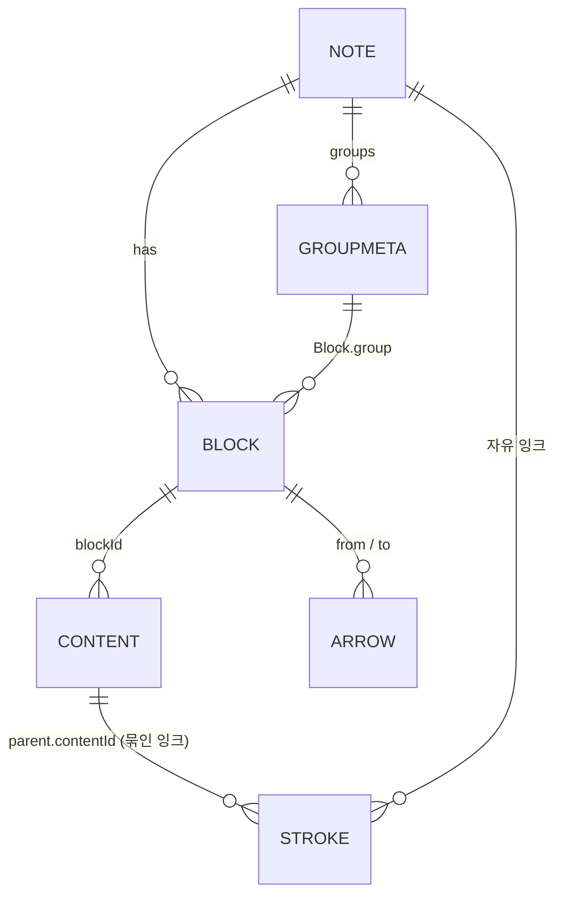

- **레코드는 불변 객체**다. 엔진은 새 객체로 바꿔 끼우고, 개발 빌드(`setDevChecks(true)`)에서는 얕게 얼려 직접 변경을 바로 터뜨린다(`tx.ts` `frozen`). 테스트도 이 검사를 켠 채 돈다(`vitest.setup.ts`).
- **모르는 필드는 보존**된다 — 레코드를 통째로 저장하고 직렬화도 그대로 싣는다(`serialize.ts` 머리 주석). 모르는 콘텐츠 타입은 자리표시자로 그리고 데이터는 둔다(`engine-dom/src/mount.ts` `otherLabel`).
- **v6 필드는 전부 선택**이다: 블록 `nodeKind` · `status` · `role` …, 화살표 `relation` · `symbol` · `negated` · `style.line/head/tail/width/route`, 앵커 `groupId`(묶음 끝 화살표), 출처 `ai.origin` · `ai.editedAt`. 없으면 읽을 때 기본값(`relations.ts` `effectiveStyle`, `provenance.ts`).
- **v6 뒤 더한 선택 필드 (버전 그대로)**: 묶음 `figure` · `shape`(timeline · matrix · scale · venn · fishbone) · `axis`, 노트 `headingNumbers`, 표 `noHeader` · `headerCol`, 그래프 `style` · 계열 `color`, 파일 `preview`(PDF), 데이터베이스 속성 status · files · formula · created · edited · 옵션 `group` · 행 `created` · `edited` · 보기 timeline · chart · `calcs`, 콘텐츠 `tabs` · `button`. 필드 표 전체는 [DATABASE.md](DATABASE.md) 3절, 그림은 [ENTITY-DIAGRAM.md](ENTITY-DIAGRAM.md).
- **텍스트 문서**는 ProseMirror JSON(`TextDoc`)이고 엔진은 구조를 해석하지 않는다. 스텝 적용 · 검증은 주입된 `TextCodec`(`pmCodec`)이 한다.
- **좌표**는 1/64 격자로 양자화한다(`geom.ts` `q`, `tx.ts` `quantizeField`).
- **순서**: `Block.z`(쌓임 순서, 읽기 순서 아님) · `Content.order`는 fractional index 문자열.

### 6.3 트랜잭션 · 연산 · undo

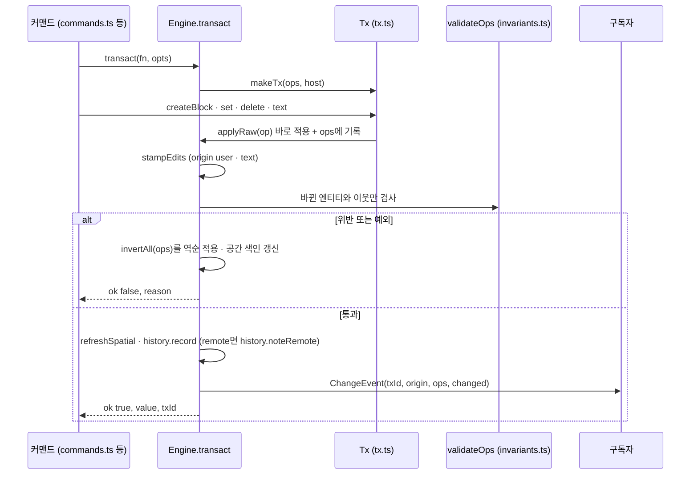

- **Op 네 종류**(`ops.ts`): `create` · `delete`(이전 값 `prev` 포함) · `set`(필드 하나, `prev` 포함) · `text`(ProseMirror 스텝과 역스텝). 역연산은 `invert`로 바로 만든다.
- **Origin**: `user` · `text` · `ai` · `undo` · `redo` · `layout` · `migration` · `remote` · `load`. undo 대상은 기본으로 `user` · `text` · `ai`(`history.ts`).
- **undo 규칙**(`history.ts` `History`): 스택 200개 상한, 같은 `mergeKey`가 1초 안에 이어지면 한 항목으로 합침(타이핑 — 단 사이에 원격 변경이 있었으면 합치지 않음). 새 기록이 생기면 redo 비움. `breakUndoMerge`로 의미 경계를 끊는다.
- **원격 변경 뒤 되돌리기**(`undo-guard.ts`, SYNC 13.7): origin `remote` 트랜잭션이면 `History.noteRemote`가 바뀐 id에 원격 시점을 적고, 그 id를 건드리는 redo 기록을 버린다. undo · redo는 연산마다 지금 상태를 보고 맞을 때만 적용한다 — `set`은 지금 값이 기대 값(`prev`)일 때, `create`는 없고 부모가 살아 있을 때, 블록 `delete`는 남은 콘텐츠 · 화살표가 없을 때, `text`는 그 기록 뒤 그 콘텐츠에 원격 변경이 없을 때(스텝 rebase는 없음). 일부만 적용되면 `engine.undoNotice` → 앱 토스트, 전부 건너뛰면 그 기록을 버리고 다음 것(최대 10개). 원격 변경이 없으면 예전과 같다.
- **중첩 `transact`**는 바깥 트랜잭션에 합류한다. 끝난 트랜잭션의 `Tx`를 쓰면 예외(`tx.ts` `live`).
- **로그 재생**(`Engine.replay`)은 `origin: 'load'`, undo 없음, 실패한 Op 수를 돌려준다.

### 6.4 불변식 (`invariants.ts`, 커밋 직전)

| 코드 | 내용 |
|---|---|
| I1 | 콘텐츠의 `blockId` 블록이 있어야 함. 블록을 지우면 콘텐츠가 남으면 안 됨 |
| I2 | 화살표 양 끝 블록이 있어야 하고, 같은 블록을 잇지 않음. 블록을 지우면 화살표가 남으면 안 됨 |
| I6 | 블록 좌표가 유한하고 크기가 `MIN_SIZE` 이상 |
| I7 | `z` · `order` 키 형식 |
| I8 | 텍스트 콘텐츠 문서가 코덱 검증 통과(`text` Op로 바뀐 것은 코덱이 이미 적용했으므로 생략). 코덱은 선택적으로 `repair`를 가진다(`TextCodec.repair?`, `model.ts`) — 엔진은 부르지 않고 동기화 다리가 들이기 전에 부른다 |
| I10 | 제목 상자(`role: 'title'`)는 문단 하나 |

스냅샷을 읽을 때(`deserialize`)도 I1 · I2 참조 무결성과 id 일치를 O(n)으로 검사한다. 묶음은 불변식이 아니다 — 상자 하나만 남은 묶음은 묶음으로 치지 않을 뿐이다(`groups.ts` `groupMembers`).

### 6.5 공간 색인

블록 · 화살표마다 RBush 하나(`engine.ts`). 트랜잭션 안에서는 바뀐 id만 `dirtyBlocks` · `dirtyArrows`에 모으고 커밋 · 롤백 뒤 한 번에 갱신한다(`spatial.ts`). 블록이 움직이면 붙은 화살표와 그 묶음의 묶음 끝 화살표도 다시 계산한다. `draft` 블록(문서 뷰의 빈 자리)은 색인 밖이다. 질의: `queryBlocks` · `queryArrows` · `queryBlocksInPolygon`(올가미) · `hitTest`(블록 z 최상위 → 화살표 8px 이내) · `blocksBounds`.

---

## 7. 런타임 시나리오

### 7.1 편집 → 저장

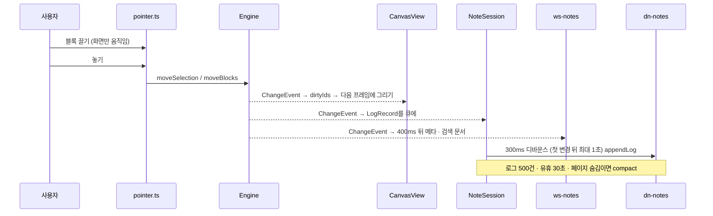

- 큐의 레코드: `{ noteId, seq, txId, origin, ops, at, schemaVersion }`(`note-store.ts` `LogRecord`). `origin: 'load'`는 쓰지 않는다.
- 쓰기에 실패하면 배치를 큐 앞에 되돌리고 상태 `error`, 1 · 2 · 4 · 10초 간격으로 다시 시도한다(`session.ts` `failed`).
- 압축(`compactNow`)은 스냅샷과 `seq`를 같은 동기 시점에 잡고 `compact(noteId, snapshot, upToSeq)`로 스냅샷을 쓰고 그 이하 로그를 지운다.
- 노트를 닫을 때(`dispose`)는 로그만 쓴다. 압축 뒤 쌓인 로그가 100건 이상일 때만 압축한다(1만 블록 노트에서 노트 전환이 느려지지 않게).
- 글 편집은 `TextEditor`의 스텝 → `editText`(origin `'text'`, 같은 `mergeKey`로 묶임) → 같은 경로.

### 7.2 노트 열기

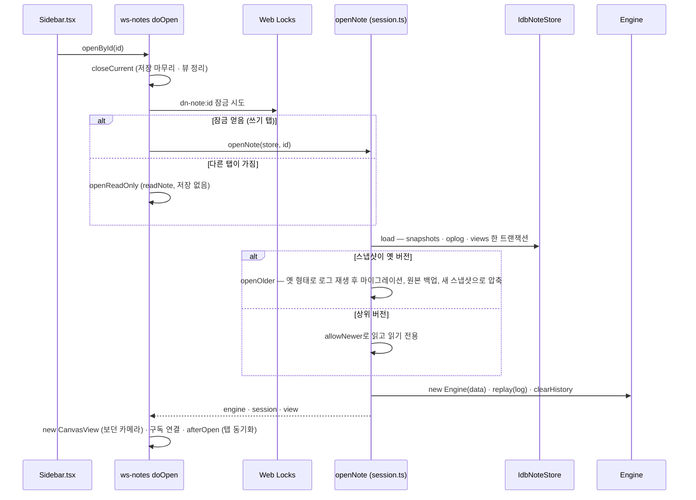

- 로그 재생 중 실패하면 그 지점에서 멈추고 원본 로그를 `corrupt-log`로 백업, 경고와 함께 연다. 스냅샷이 깨졌으면 `corrupt-snapshot` 백업 후 열기 실패.
- 잠긴 노트인데 금고가 잠겨 있으면 `VaultLockedError` → 잠금 해제 화면(7.8절).
- 문서 뷰가 기본이면 `mountDoc`으로 `DocView`도 붙인다.

### 7.3 AI 구조화

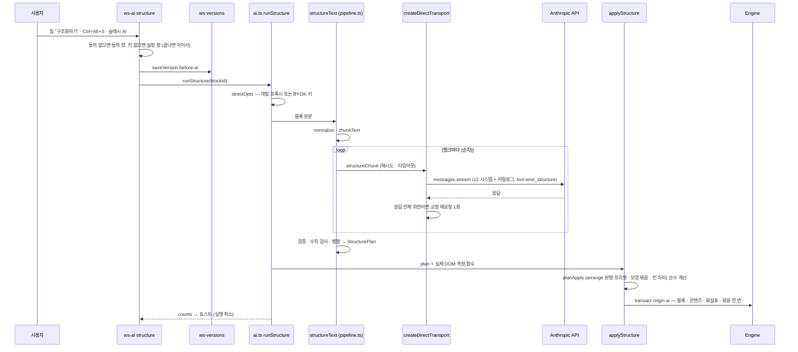

- 칩은 붙여넣은 글이 20자(`CHIP_MIN_CHARS`) 이상일 때 뜬다. 원문 블록은 바꾸지 않고, 결과는 원문 오른쪽(+120px)부터 빈 자리에 놓는다.
- 출처 `ai`에 `runId` · `origin: 'claude'` · `provider: 'anthropic'` · 모델 · 프롬프트 버전 · 스키마를 남긴다. 사람이 나중에 의미 필드를 고치면 `editedAt`이 찍힌다(`provenance.ts`).
- 사용량(입력 · 출력 · 캐시 토큰)을 `settings.aiUsage`에 누적한다(`ai.ts` `addAiUsage`).
- 노트를 닫으면 `aiAbort`로 취소된다.
- 결과 빈 자리는 `findFreeSpot`(간격 48)으로 찾는다(`apply.ts`). 원문의 수식은 `$` 구분자째 보내고, 노드에 수식이 오면 제목 아래 수식 블록으로 넣는다(10/13).

### 7.4 같은 기기 탭 사이 동기화

쓰기 탭은 혼자일 때 Y.Doc을 만들지 않는다. 다른 탭이 hello를 보내면 그때 엔진을 Y.Doc에 옮기고(`attach`) welcome으로 상태를 보낸다. 보는 탭은 쓰기 탭 상태를 최대 500ms 기다린 뒤 자기 엔진을 같은 Y.Doc에 잇고, 이후 양쪽 편집이 Y 업데이트로 오간다. 저장은 쓰기 탭만 한다(`ws-sync.ts` `joinTabs`, `packages/sync/src/tabs.ts`). 한 번이라도 동기화 파일로 오간 노트는 Y 기록을 `dn-notes.ysync`에 두고 열 때마다 이어 붙인다. 지우기는 Y 키를 지우지 않고 묘비를 남기므로, 지운 쪽이 모르는 다른 탭 · 기기의 편집은 사라지지 않고 충돌 표시(남기기 · 지우기)로 남는다. 설계 · 병합 규칙은 [SYNC.md](SYNC.md).

### 7.5 손글씨 → 글 (OCR)

올가미로 고른 잉크 → `engine-dom/src/ink-image.ts` `inkImage`로 PNG(base64) → `apps/web/src/ocr-flow.ts`가 동의 · 키 확인 → `createDirectOcr`(`emit_ocr` 도구, 모델 `OCR_MODEL` 또는 정밀 `OCR_PRECISE_MODEL`) → 결과 확인 뒤 `engine-core` `inkToText` · `ocrLinesDoc`으로 글 상자. 키 경로는 7.3절과 같다.

필기 → AI 구조화(FR-039, 10/27): 필기 막대 'AI로 구조화'는 `OcrCtl.start(false, 'structure')`로 같은 OCR을 거친 뒤, 읽은 글을 `ws-ai.ts` `structureText`로 붙여넣기와 같은 구조화(7.3절 — 같은 스키마 · 검증 · 배치 · 실행 취소 한 번)에 넘긴다. 블록이 없는 글이라 `RestructureSource`(`replace: []`, `at`)로 원문과 자리를 함께 보낸다. 신뢰도 0.6 이상 · 공백 빼고 20자 이상이면 미리보기 없이 바로, 아니면 미리보기의 주 단추가 '구조화하기'(고친 글로). 결과는 필기 오른쪽(A4 노트면 필기 아래, 용지 안 배치는 7.3절 `page`), 필기는 지우지 않는다.

### 7.6 검색 · Q&A

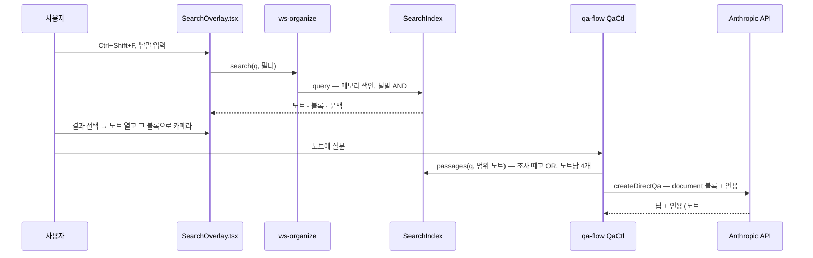

색인은 부팅 때 `dn-app.search_docs`에서 채우고, 형식 버전이 다르거나 없는 노트는 `readNote`(저장 없는 읽기)로 다시 만든다(`workspace.ts`, `ws-base.ts`). 근거 조각이 없으면 Claude를 부르지 않는다(`ai-pipeline/src/qa.ts` 머리 주석).

작성 도우미(FR-112, 10/27): 글 편집기(`text-pm` `TextEditor`)의 `onAiEdit` — 말풍선 'AI' · 캔버스 Ctrl+J(문서 뷰는 `docKeymap`이 먼저라 양쪽 맞춤) — 가 고른 범위 · 그때 문서를 엔진 쪽 호스트(`CanvasViewOptions.onAiEdit` · `DocWordHost.onAiEdit`)로 넘기면, 앱 `ai-edit-flow.ts` `AiEditCtl`이 `rangeMarkdown`으로 보낼 글을 만들고 `createDirectEdit`(`edit.v1`, 도구 없음, `onText`로 미리보기에 흘러나옴)를 부른다. 넣을 때는 글 상자의 지금 문서가 고를 때와 같은지(`sameDoc`) 보고 `aiEditSteps` → `editTexts` 한 번 — 편집기가 열려 있으면 `setDoc`으로 받는다. 프롬프트 · 실패 처리는 AI-PROMPTS 12절.

노트 요약(FR-115, 10/27): 노트 ⋯ · 명령 팔레트 → `AiEditCtl.openNote` — 입력은 늘 노트 전체(`workspace.ts` `currentMarkdown` → `digestSource`가 앞머리 · 그림 데이터를 뺌, 이전 'AI 요약' 상자는 `summaryBlocks`로 빼고 새 요약으로 바꿈), `edit.v1` `digest`로 요약 · 결정 · 할 일. 넣기는 `engine-core` `insertTextAtTop`: 'AI 요약' 콜아웃 상자 하나에 AI 출처 표시, 캔버스 노트는 맨 위 내용 위에 두기만 하고, A4 노트는 용지 맨 위에 두고 모자라면 상자 · 자유 필기를 같은 만큼 내린다 — 실행 취소 한 번. (특허 검토: 입력을 자리 표시 블록의 위치로 고르지 않는다 — PATENT-REVIEW US 12,118,513 B1 줄)

이어 쓰기 · 초안 · 번역(FR-113 · FR-114, 10/27): 같은 `AiEditCtl` · `edit.v1` 3판. 이어 쓰기는 작성 도우미 칩 → `aiEditSteps` `after`(문장 가운데면 그 문단에 띄어 이어 붙이고 아니면 다음 문단, 같은 종류 목록은 한 목록으로). 초안은 빈 글 상자에서 Ctrl+J(그 상자를 채움) 또는 노트 ⋯ · 명령 팔레트(주제 → `engine-core` `insertTextAtEnd` — 노트 맨 끝 새 상자, AI 출처 표시). 번역은 작성 도우미의 '번역' 언어 칩(바꾸기 · 아래에 넣기)과 노트 ⋯ · 명령 팔레트 'AI로 노트 번역' — 노트의 제목 · 글 상자 · 화살표 이름 · 묶음 이름을 `<<<SEG n>>>` 조각으로 한 번에 보내고(`translate-note.ts` `noteSegments`), 받은 조각으로 노트 사본을 만들어 연다(`translatedCopy` → `workspace.ts` `translatedNote` — 같은 폴더 · 상위 노트 · 태그, 상자 자리 · 화살표 · 필기 그대로, 원본은 손대지 않음). 프롬프트 · 실패 처리는 AI-PROMPTS 12.5절.

### 7.7 문서 뷰 ↔ 캔버스

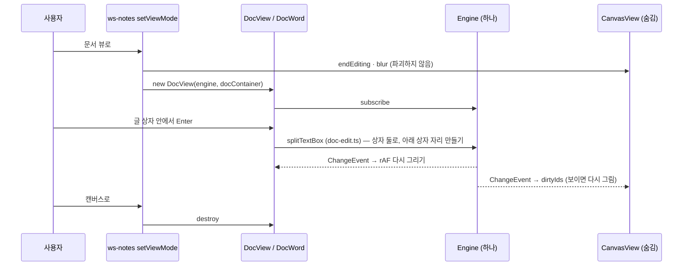

- 두 뷰는 같은 `Engine` 인스턴스를 구독하므로 복사 · 변환 단계가 없고, undo 스택도 하나다.
- 문서 순서는 `documentOrder`(화살표 흐름 → 자리 순서, 묶음은 한 덩어리). 문서 뷰에서 지우거나 옮겨도 그 순서가 유지되도록 `doc-units.ts`가 한 줄 흐름의 화살표를 다시 잇는다.
- 문서 뷰에서 새 문단 자리는 `draft` 블록으로 만들고(캔버스 · 공간 색인에 안 보임), 글이 들어오면 `draft`를 지운다. 빈 채로 떠나면 `discardIfEmpty`.
- 문서 뷰가 열려 있으면 숨은 캔버스에 키보드 초점을 주지 않는다(`ws-notes.ts` `doOpen` 끝).
- 묶음은 문서에서 소제목으로 읽히고, 단계 번호 · `↺ n단계로` 고리 · 시점/담당/기한 칩이 붙는다. `figure` 묶음(사분면 · 벤 등)은 첫 자리에 `exportPng`로 그린 그림 하나로 보인다(`doc-diagram.ts`). 인쇄 · PDF · HTML · 워드 내보내기 전에 `diagramsReady()`를 기다린다.
- 문서 확대(`doc-zoom.ts`, CSS zoom)와 아래 상태 줄(`DocStatus`)이 있다.

### 7.8 노트 잠금

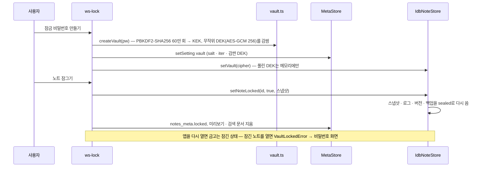

비밀번호를 바꾸면 같은 DEK를 새 KEK로 다시 감싸기만 한다(`changeVaultPassword`). 복구 열쇠는 없다. '앱 잠금'은 화면만 가리는 기능으로 데이터를 암호화하지 않는다(`ws-lock.ts` 머리 주석).

### 7.9 가져오기 · 내보내기

| 방향 | 형식 | 경로 |
|---|---|---|
| 가져오기 | 백업 JSON · 내보내기 ZIP 안 백업 | `import.ts` `planImport` → `deserialize` → `ws-import.ts`가 노트 · 폴더 · 태그 생성 |
| 가져오기 | Markdown(.md 여러 개 · 폴더 · ZIP) | `import.ts` + `import-md.ts` → `markdownToDoc` · `linkWikiLinks` |
| 가져오기 | 노션 내보내기 ZIP | `import-notion.ts`(페이지 계층 · CSV 데이터베이스 · 링크) |
| 가져오기 | 워드 `.docx` | `import.ts` `planDocx` → `docx/docx-import.ts`(DOMParser XML, 링크는 http · https · mailto만) |
| 가져오기 | `.csv` | `import.ts` `planCsv` → `csvToDatabase`(노션 CSV도 같은 함수) |
| 가져오기 | 동기화 파일 | `ws-sync.ts` → `mergeRemote` |
| 내보내기 | Markdown · 전체 ZIP(폴더 구조 .md + 손실 없는 백업 JSON) | `export.ts` · `zip.ts` · `ws-organize.ts` |
| 내보내기 | 워드 `.docx` | `ExportDialog.tsx` → `docx/docx-export.ts` `noteToDocx`(제목 번호 · 다단계 번호 · 표 · 그림 · 묶음 소제목) |
| 내보내기 | 데이터베이스 CSV | `engine-dom/src/db-menus.ts` → `dbToCsv` |
| 내보내기 | PNG | `engine-dom/src/snapshot.ts` `exportPng` |
| 내보내기 | PDF · HTML · 인쇄 | 문서 뷰 DOM → `print-render.ts` → `pdf.ts`(라이브러리 없이 PDF 1.4, 보이지 않는 글자 층 · 책갈피) |

ZIP 읽기 · 쓰기도 직접 구현이다(`unzip.ts` · `zip.ts` 저장형, 워드용 `docx/zip.ts`는 `CompressionStream` deflate — 쓰기 코드가 둘이다). Markdown은 이름 있는 묶음을 `### 이름`으로, 탭 블록은 모든 탭을 내보내고 버튼은 뺀다. 가져오기는 메인 스레드에서 진행률과 중단을 지원한다(`ws-import.ts`).

---

### 7.10 그 밖의 흐름 (10/09 뒤)

| 흐름 | 경로 | 비고 |
|---|---|---|
| 발표 모드 (Ctrl+Alt+P · ⋯) | `ws-present.ts` → `engine-core/present.ts` `presentSlides` → `engine-dom/present.ts` `startPresent` | 장면(묶음 · 제목)마다 카메라를 옮김, 발표 중 보기 전용 |
| 블록을 다른 노트로 | 블록 메뉴 · `/옮기기` → `MoveToDialog` → `ws-move.ts` | 대상 노트에 붙이고 원래 노트에서 지움 — 원래 노트에서는 실행 취소 안 됨 |
| 버튼 누르기 | `button-render.ts` → `pressButton` → `insertClipBelow` | 버튼에 저장된 상자 묶음을 바로 아래에 |
| PDF 펼치기 | 파일 콘텐츠 `preview` → `rich-render.ts` | 같은 출처 `blob:` iframe |
| 머메이드 ↔ 도식 | `/mermaid` · 블록 메뉴 → `insertMermaid` · `diagramToMermaid` | flowchart만 |

---

## 8. 저장소와 스키마

### 8.1 IndexedDB 구조

| DB (버전) | 스토어 | 키 | 내용 |
|---|---|---|---|
| `dn-notes` (3) | `snapshots` | `noteId` | `{ snapshot, upToSeq }` 또는 잠긴 노트면 `sealed` |
| | `oplog` | `[noteId, seq]` | `LogRecord` (잠긴 노트면 `sealed`) |
| | `views` | `noteId` | 보던 자리(화면 가운데 월드 좌표 · 줌) |
| | `backups` | `[noteId, key]` + 색인 `by_note` | 마이그레이션 · 손상 원본, 노트당 5건 |
| | `versions` (v2) | `[noteId, at]` | 버전 기록, 노트당 30건 |
| | `ysync` (v3) | `noteId` | 동기화 노트의 Y 기록 · 마지막 동기화 지문 · `known`(지난 저장 때 엔진 · Y 양쪽에 있던 id) |
| `dn-app` (3) | `notes_meta` | `id` + 색인 `by_updated` · `by_deleted` · `by_folder` · `by_parent` · `by_tag`(multiEntry) | 제목 · 미리보기 · 아이콘 · 알림 · 폴더 · 태그 · 즐겨찾기 · 잠금 · 묶음 이름 목록 |
| | `settings` | `key` | 기기 설정 (`vault` · `appLock` · `aiUsage` · `viewMode` …) |
| | `secrets` (v2) | `name` | 암호화된 비밀값(`anthropic-api-key` · `authSession`)과 키 암호화 키 `__kek` |
| | `folders` (v3) | `id` + `by_parent` | 폴더 |
| | `tags` (v3) | `id` + `by_name`(unique) | 태그 |
| | `search_docs` (v3) | `noteId` | 검색 문서(파생) |
| `dn-files` (1) | `attachments` | `hash`(SHA-256 hex) | `{ blob, mime, size, w, h, createdAt }` |

노트 메타는 `schemaVersion: 1`을 레코드마다 갖는다(`meta-store.ts` `NoteMeta`). 10/09 뒤 DB 구조 · 버전은 바뀌지 않았고 설정 키 `docZoom`만 늘었다. 상세 필드 · 설정 키 전체는 [DATABASE.md](DATABASE.md) 4 · 5절.

### 8.2 노트 스냅샷 스키마와 마이그레이션 (`serialize.ts`)

`SCHEMA_VERSION = 6`, 텍스트 스키마 `TEXT_SCHEMA = 'pm-v1'`. 스냅샷 모양은 `{ schemaVersion, engine: { textSchema }, note, blocks, contents, arrows, strokes, ...extra }`이고 레코드는 id 순으로 정렬한다(같은 문서 = 같은 스냅샷).

| 단계 | 변경 | 변환 |
|---|---|---|
| v1 → v2 | 텍스트 블록을 제목 칸 + 본문 칸으로 | 첫 heading을 새 제목 콘텐츠로 떼고 원래 id는 본문으로 유지 |
| v2 → v3 | 블록 = 제목 상자 또는 내용 상자 | 본문이 비면 제목 상자, 아니면 내용 상자(제목은 맨 앞 제목3 줄로 합침) |
| v3 → v4 | 표 · 그래프 정식 형식 | `rich.ts` `upgradeV0Content`(`table-v0` · `chart-v0` → v4) |
| v4 → v5 | 데이터베이스 콘텐츠 | 항등 (새 타입만 추가) |
| v5 → v6 | 의미 · 출처 · 모양 필드 | 항등 (전부 선택 필드. 버전을 올린 이유는 v5 앱이 v6 노트를 읽기 전용으로 열게 하려고) |

- `deserialize(input, { allowNewer, noMigrate })`: 상위 버전은 `allowNewer`일 때만 열린 파싱, 호출자가 읽기 전용으로 연다. `noMigrate`는 저장소가 옛 형태 로그를 먼저 재생할 때 쓴다(7.2절 `openOlder`).
- 로그 레코드도 `schemaVersion`을 갖는다. 상위 버전 로그를 만나면 그 노트를 읽기 전용으로 연다.
- 마이그레이션은 순수 함수 연쇄이고, `structuredClone`한 사본에 적용한다.

### 8.3 파생 데이터

검색 문서(`search_docs`) · 노트 메타의 미리보기 · 묶음 이름 · 알림 목록은 엔진에서 다시 만들 수 있는 파생값이다. 검색 문서는 `SEARCH_DOC_VERSION`이 다르면 다시 색인한다.

---

## 9. 보안과 프라이버시 (as-built)

### 9.1 CSP와 응답 헤더 (`apps/web/public/_headers`, Cloudflare Pages 형식 초안)

| 지시어 | 값 | 뜻 |
|---|---|---|
| `default-src` | `'self'` | |
| `script-src` | `'self'` | 인라인 · eval 없음 (스키마 검증기도 코드 생성 없이 직접 구현, `ai-pipeline/src/schema.ts`) |
| `style-src` | `'self' 'unsafe-inline'` | |
| `img-src` | `'self' blob: data: https:` | 북마크 그림 등 모든 https 그림 허용 |
| `frame-src` | `blob:` · YouTube(nocookie) · Vimeo · Figma · Google · Google Maps · CodePen · Loom · Spotify · Google Docs | 웹 임베드 · PDF 보기(`blob:`, 10/13) |
| `connect-src` | `'self' https://api.anthropic.com` | 빌드 때 `VITE_SUPABASE_URL`이 있으면 그 https 출처를 `dist/_headers`에 더한다(`apps/web/deploy-headers.ts` 플러그인) |
| 그 밖 | `worker-src 'self'` · `object-src 'none'` · `base-uri 'none'` · `frame-ancestors 'none'` · `form-action 'none'` | |

`X-Content-Type-Options: nosniff`, `Referrer-Policy: strict-origin-when-cross-origin`, `Permissions-Policy: camera=(), microphone=(self), geolocation=()`. 이 파일이 실제 배포에 적용되는지는 확인 못 함(배포 설정이 저장소에 없다). 개발 서버에는 CSP가 없다.

마이크는 같은 출처에만 허용한다(음성 녹음 `ws-record.ts`). `e2e/release.mjs` C가 이 헤더를 건 페이지에서 녹음이 시작되는지 확인한다.

### 9.2 키 · 비밀값 보관

| 비밀값 | 위치 | 보호 |
|---|---|---|
| BYOK Claude 키 | `dn-app.secrets` `anthropic-api-key` | AES-GCM 256, 키 암호화 키는 **추출 불가 `CryptoKey`**로 같은 스토어(`__kek`)에. "디스크에서 평문으로 안 보이게" 하는 수준 — 같은 출처 스크립트는 복호화할 수 있다(`meta-store.ts` 주석). 저장 전 `testApiKey`로 확인 |
| 개발 키 | 저장소 루트 `.env.local` | 개발 서버 Node 프로세스만 읽음. 앱에는 끝 4자리만(`__DN_ENV_KEY__`). `.env*` 커밋은 `check-arch.mjs`가 막음 |
| 로그인 세션 | `dn-app.secrets` `authSession` | 위와 같은 암호화 |
| 노트 잠금 DEK | 메모리(추출 불가 키)에만. 디스크에는 비밀번호로 감싼 형태(`settings.vault`) | PBKDF2-SHA256 60만 회 · salt 16바이트 · AES-GCM |

### 9.3 노트 잠금이 암호화하는 것 · 하지 않는 것

| 암호화함 (`sealed`) | 암호화하지 않음 |
|---|---|
| 스냅샷 · 연산 로그 · 버전 기록 · 백업 · 동기화 Y 기록(`ysync`) | 노트 제목(`notes_meta.title` — 목록에 보임), 첨부 파일(`dn-files` — `AttachmentStore`에 암호화 경로 없음), 보던 자리(`views`) |

잠긴 노트는 미리보기 · 검색 문서 · 묶음 이름을 두지 않고, 검색 · 백링크 · 할 일 모으기 · 내보내기 · 동기화 파일에서 빠진다(`ws-lock.ts` 머리 주석, `ws-base.ts` `putSearchDoc`).

### 9.4 밖으로 나가는 데이터 — 모든 네트워크 호출 지점

| 지점 | 목적지 | 나가는 것 | 조건 |
|---|---|---|---|
| `ai-pipeline/src/direct.ts` (`createDirectTransport`) | `api.anthropic.com` 또는 개발 프록시 | 구조화할 블록 원문(정규화 · 청크) | 동의 + 키 |
| `direct.ts` `createDirectOcr` | 같음 | 고른 잉크를 그린 PNG | 동의 + 키 |
| `direct.ts` `createDirectQa` | 같음 | 질문 · 이전 문답 · 검색으로 고른 근거 조각(노트 제목 · 블록 글 · 수정일) | 동의 + 키 |
| `direct.ts` `testApiKey` | 같음 | 키 확인 요청 | 키 저장할 때 |
| `apps/web/src/auth.ts` `supabaseBackend` | `<VITE_SUPABASE_URL>/auth/v1/*` | 이메일 · 토큰 | 환경 변수가 있을 때만 |
| `apps/web/src/web-host.ts` | 같은 출처 `/api/unfurl?url=` | 웹 주소 | 개발 · 미리보기 서버에만 응답이 있다. 북마크와 링크 언급 칩 제목(`editing.ts` · `doc-word.ts` · `paste-url-offer.ts`)이 쓴다 |
| `apps/web/dev-unfurl.ts` (개발 서버 Node) | 사용자가 붙인 웹 주소 | GET (사설 대역 · 루프백 거절, 5초 · 512KB) | 개발 · 미리보기 |
| `vite.config.ts` `anthropicProxy` (개발 서버 Node) | `api.anthropic.com` | 앱의 `/anthropic/*` 요청에 키를 붙여 전달 | `.env.local` 키가 있을 때 |
| `engine-dom/src/web-render.ts` iframe · 그림 | 임베드 · 그림 사이트 | 브라우저의 일반 요청 | 웹 임베드 · 북마크 블록이 있을 때 |
| `apps/web/src/print-render.ts` `fetch` | 같은 문서의 그림 · 글꼴 주소(object URL · 같은 출처) | 없음(읽기) | 인쇄 · 내보내기 |
| `apps/web/src/ExportDialog.tsx` `fetch` | 첨부 object URL(같은 기기) | 없음(읽기) | 워드 내보내기 |
| `apps/web/sw.template.js` | 같은 출처 | 앱 셸 · 글꼴 | 배포 빌드 |
| `ai-pipeline/src/transport.ts` `createEdgeTransport` | `<baseUrl>/ai/structure` | — | **앱이 쓰지 않음** |
| `ai-pipeline/test/live-eval.test.ts` | `api.anthropic.com` | 평가 세트 40건 원문 | **시험 전용** — `DN_LIVE=1`일 때만(비용) |

이 밖의 `fetch` · WebSocket · `sendBeacon` · `XMLHttpRequest` 호출은 `packages/*/src` · `apps/web/src`에 없다. 오류 수집(Sentry 등) · 분석 도구도 없다.

### 9.5 입력 정화

- `check-arch.mjs`가 `innerHTML =` 대입을 막는다. 붙여넣은 HTML은 ProseMirror 스키마 파싱을 거쳐 허용된 노드 · 마크만 남는다(`text-pm/src/paste.ts`). 링크는 `safeHref`(`schema.ts`).
- 웹 임베드 iframe은 `sandbox`(`allow-scripts allow-same-origin allow-popups …`)를 단다(`web-render.ts`).
- AI 출력은 데이터로만 쓰인다 — 검증된 `StructurePlan`을 엔진 레코드로 바꿀 뿐 HTML로 넣지 않는다(`apply.ts`, 글은 `markdownToDoc`).

---

## 10. 빌드 · 테스트 · 품질 게이트

| 항목 | 명령 · 파일 | 내용 |
|---|---|---|
| 패키지 관리 | `pnpm@9.15.4`(`corepack`), `pnpm-workspace.yaml` = `apps/*` · `packages/*` | 패키지는 빌드 없이 `src/index.ts`를 직접 내보낸다(`exports`) |
| 개발 서버 | `corepack pnpm dev` → `vite`(포트 5173 고정) | 키 프록시 · unfurl 플러그인 |
| 배포 빌드 | `corepack pnpm build` → `apps/web/dist` | 서비스 워커 생성. e2e용 빌드는 `VITE_E2E=1`로 `window.__dn`을 연다 |
| 구조 검사 | `corepack pnpm check` (`scripts/check-arch.mjs`) | 5.1절 표 |
| 타입 | `corepack pnpm typecheck` | 패키지 7개 `src` + `apps/web` + `engine-core/test` · `ai-pipeline/test` · `sync`(src · test) |
| 단위 테스트 | `corepack pnpm test` → `vitest run` | `packages/*/test/**/*.test.ts` · `apps/*/test/**/*.test.ts`, 환경 `node`, `fake-indexeddb`, 속성 테스트 `fast-check`. 커버리지는 `test:coverage`(engine-core만) |
| e2e | `node e2e/<이름>.mjs` (131개, 픽스처 `e2e/fixtures/word-sample.docx`) | `playwright-core`로 설치된 브라우저를 띄움 — 기본 `msedge`, CI는 `DN_CHANNEL=chrome`. 개발 서버(`DN_URL`)를 대상으로 `window.__dn`으로 상태를 읽음. 접근성 검사에 `axe-core` |
| 벤치 | `corepack pnpm bench` → `bench/run.ts` (Node 24 타입 제거로 TS 직접 실행) | 1만 블록 합성 노트: 열기 · 질의 · 점 판정 · 트랜잭션 · undo/redo. 절대 예산(`baseline.json` `budgets`)과, 같은 기기면 10% 회귀 비교 |
| AI 평가 | `eval/structure/*`(입력 · 기대 결과 40쌍), `packages/ai-pipeline/test/eval.test.ts` · `scorer.ts` · `live-eval.test.ts` | 가짜 transport로 기대 결과 → 파이프라인 → 엔진 적용 · 불변식 · undo 한 번 검사. 실제 호출 평가는 `DN_LIVE=1`(결과 `eval/results/`, `DN_LIVE_FROM`이면 저장된 답 다시 채점) · 세션 기록 채점은 `DN_SESSION_CAPTURE` — 기본 건너뜀 |
| 동기화 수렴 | `packages/sync/test/harness.ts` · `converge.test.ts` · `regressions/*.json` | 두 · 세 기기 무작위 편집 · 네트워크(섞기 · 중복 · 끊김) 뒤 P-S1~P-S4 — 커밋마다 120 · 60회, `DN_FUZZ_RUNS=10000`. 큰 노트 측정 `big-note.test.ts`(`DN_BENCH=1`) |
| 문서 검사 | `corepack pnpm docs:check` (`e2e/docs-check.mjs`) | `docs/*.md`의 mermaid 블록을 헤드리스 브라우저에서 mermaid 11 파서로 검사 |
| 트래커 | `corepack pnpm validate:tracker` | `prd-tracker.html` 데이터 검사 |

**커밋 전 훅** (`.githooks/pre-commit`, `pnpm hooks:install`로 켬): 구조 검사(`--staged`) → 타입 → 단위 테스트 → (`prd-tracker.html`을 올렸으면) 트래커 검사.

**CI** (`.github/workflows/ci.yml`, push · PR마다, ubuntu · Node 24):
- `check` 작업: 구조 검사 → 타입 → 단위 테스트 → 벤치(절대 예산만) → 트래커 검사.
- `e2e` 작업(`check` 뒤): 개발 서버를 띄우고 `smoke.mjs` · `p1.mjs` · `ai.mjs`만 실행, 스크린샷을 산출물로 올림. 나머지 e2e 128개는 CI에서 돌지 않는다(로컬은 PowerShell + Edge).

---

## 11. 구현 상태표

이전 판이 설계한 컴포넌트를 기준 커밋과 대조했다. 있음 = 설계한 책임을 하는 코드가 있음, 일부 = 일부만 · 다른 형태로, 없음 = 코드 없음.

| 설계 컴포넌트 | 상태 | 근거 · 비고 |
|---|---|---|
| engine-core (모델 · Op/Tx · undo · 공간 색인 · 직렬화) | 있음 | `packages/engine-core/src` |
| engine-dom (렌더러 · 입력) | 있음 | `CanvasView` + 모듈 함수. `mountRenderer` · `InputController` 이름의 API는 없음 |
| text-pm (코덱 · 에디터) | 있음 | `packages/text-pm/src` |
| storage-idb (스냅샷 + 로그 · 압축) | 있음 | `note-store.ts` · `session.ts` |
| app-meta 패키지 | 일부 | 별도 패키지 없음 — `storage-idb/src/meta-store.ts` `MetaStore` |
| ai-pipeline | 있음 | 요청 · 응답 structure.v2 + 원형 프리셋 배치 · 모양 묶음(5.4절) |
| search (색인 · 질의 · Q&A 근거) | 일부 | 메모리 부분 문자열 AND + 근거 OR · 필기에서 읽은 글 · 다시 만들기(FR-120). BM25 · 2-gram · 워커 없음 |
| attachments (OPFS · 해시) | 일부 | 내용 해시는 있음, 저장은 IndexedDB `dn-files`(OPFS 아님). 썸네일 없음 |
| io (가져오기 · 내보내기 변환기) 패키지 | 일부 | 별도 패키지 없음 — `apps/web/src/import*.ts` · `import-csv.ts` · `export.ts` · `pdf.ts` · `zip.ts` · `unzip.ts` · `docx/` |
| sync-yjs (브리지 · 프로바이더) | 일부 | `packages/sync` — 브리지 · 탭 채널 · 파일 병합 · 서버 프레임 · 상태 타입(M0) · 수렴 속성 시험. 네트워크 프로바이더 · 서버 없음 |
| api-client | 없음 | 대신 `ai-pipeline` `StructureTransport` 인터페이스 |
| apps/web 셸 | 있음 | `Workspace` 16층 + `.tsx` 57개 |
| Service Worker · PWA 매니페스트 | 있음 | `sw.template.js` · `public/manifest.webmanifest` (Workbox 아님) |
| Web Workers (search · io · sync) | 없음 | `new Worker` 없음 |
| IndexedDB `dn-notes` · `dn-app` | 있음 | 둘 다 v3 |
| IndexedDB `dn-sync` | 없음 | 대신 `dn-notes.ysync` |
| OPFS | 없음 | |
| Edge API Worker (AI 프록시 · 문서 · 첨부 · 계정) | 없음 | 클라이언트 쪽 `createEdgeTransport`만 있고 쓰지 않음 |
| SyncRoom Durable Object · R2 | 없음 | |
| Supabase Auth | 일부 | 클라이언트 REST(`auth.ts`) · 흉내 서버만. 서버 프로젝트 · CSP 미반영 |
| Postgres · Vault | 없음 | |
| 의존 규칙 강제 (dependency-cruiser) | 일부 | `scripts/check-arch.mjs`로 대신 |
| 오류 수집 (Sentry) | 없음 | |
| 국제화 (키 기반 문자열) | 없음 | UI 문자열이 한국어로 코드에 들어 있음 |
| `X-DN-Client` · `426` · `/v1/config` | 없음 | `X-DN-Client`는 쓰지 않는 Edge transport에만 |
| 벤치 CI | 있음 | `bench/run.ts`, CI는 절대 예산만 |
| 노트 잠금 클라이언트 암호화 | 있음 | `vault.ts` · `note-store.ts` (첨부 · 제목 제외, 9.3절) |
| 문서 뷰 (워드처럼) | 있음 | 이전 판 아키텍처에는 없던 컴포넌트 — `engine-dom/src/doc-*.ts` |
| 블록(콘텐츠 묶음) | 있음 | 이전 판에 없던 모델 — `Block.group` · `note.groups` |
| 발표 모드 · 블록 옮기기 · 버튼 · 탭 블록 | 있음 (10/09 뒤) | 7.10절 |
| 머메이드 ↔ 도식 | 있음 (flowchart만) | `engine-core/src/mermaid.ts` |
| 워드 가져오기 · 내보내기 | 있음 | `apps/web/src/docx/` |
| 데이터베이스 속성 · 보기 확장 · CSV | 있음 | `engine-core/src/db-props.ts` · `db-formula.ts` · `db-calc.ts` · `db-csv.ts` |

---

## 12. 설계와 달라진 점

이전 판(v0.4, 2026-10-02)과 코드가 다른 곳이다. 코드가 기준이다.

| # | 이전 판 | 코드 (as-built) | 근거 |
|---|---|---|---|
| X1 | 서버는 Cloudflare Workers · Durable Objects · R2 + Supabase Auth · Postgres · Vault | 서버 코드가 저장소에 없다. AI는 브라우저 직접 호출(BYOK) 또는 개발 서버 프록시 | `git ls-files`, `apps/web/src/ai.ts` |
| X2 | 앱 계층 패키지 7개(app-meta · ai-pipeline · search · io · attachments · sync-yjs · api-client) | 패키지는 7개(engine-core · engine-dom · text-pm · storage-idb · search · sync · ai-pipeline). 메타 · 첨부는 storage-idb 안, 가져오기 · 내보내기는 apps/web 안, api-client 없음 | `packages/`, 5.1절 |
| X3 | 검색 · 가져오기 · 동기화용 Web Worker 3종 | 워커 없음. 전부 메인 스레드 | 4.1절 |
| X4 | 첨부 · 녹음 · PDF는 OPFS | IndexedDB `dn-files`의 `attachments`(내용 SHA-256 키) | `attachment-store.ts` |
| X5 | 동기화 복제본 DB `dn-sync`, 동기화 워커 · WebSocket | `dn-notes`의 `ysync` 스토어. 전송은 같은 기기 탭 사이 BroadcastChannel과 동기화 **파일**뿐. 삭제 ↔ 편집은 설계대로 묘비(R1 · R2)지만 퍼지 · `Tombstone.root` · 다리 상주 색인은 없다(SYNC 13.2.2 차이 표) | `note-store.ts`, `packages/sync` |
| X6 | 노트 스냅샷 스키마 v3 | v6. v4 표 · 그래프, v5 데이터베이스, v6 의미 · 출처 · 모양 필드와 묶음 끝 화살표 | `serialize.ts` |
| X7 | '블록' = 캔버스의 상자 하나 | 사용자 용어로 '블록' = 콘텐츠 묶음(`Block.group` · `note.groups`), 상자 하나는 '콘텐츠'. 엔진 타입 이름은 그대로 `Block` | `groups.ts`, 6.1절 |
| X8 | dependency-cruiser로 경계 강제 | 의존성 없는 자체 스크립트 `check-arch.mjs` + 파일 400줄 · 금지 코드 · 비밀값 검사. 테스트 폴더는 검사 밖 | `scripts/check-arch.mjs` |
| X9 | React 쪽 얇은 훅(`useEngineSelection` · `useEngineDirty`) | `Workspace.subscribe(setState)`로 상태 객체 전체 구독 + `CanvasView.onUi`. 상태는 16층 상속 사슬 | `App.tsx` · `ws-base.ts` |
| X10 | 검색 = BM25 + 한국어 2-gram 색인(워커) | 메모리 부분 문자열 AND. Q&A 근거는 조사 떼기 + OR 점수 | `packages/search/src` |
| X11 | AI 배치 = dagre 계열, 긴 입력은 Haiku로 1차 분류 | 구조 판별별 원형 프리셋(`arrange` · `presets` P-01~23) + 모양 묶음, 못 정하면 자체 `layeredLayout`. 분류 단계 없이 청크를 순차 호출. Haiku는 고를 수 있는 모델 목록에만 | `arrange.ts` · `presets.ts` · `layout.ts` · `pipeline.ts` |
| X12 | 구조화 출력 `structure.v1` | 요청 · 응답 모두 `structure.v2`(묶음 · 구조 판별 · 축 · 노드 수식), 프롬프트 3판 + 카탈로그. v1은 비교용 | 5.4절 |
| X13 | Service Worker는 Workbox 계열 | 손으로 쓴 `sw.template.js` + Vite 플러그인이 파일 목록 · 버전 주입 | `vite.config.ts` |
| X14 | 오류 수집 Sentry(기본 꺼짐), UI 문자열 키 기반 국제화 | 둘 다 없음 | 저장소 검색 |
| X15 | 노트 잠금은 P8 | 구현됨 — 금고(PBKDF2 60만 회 · DEK 감싸기), 스냅샷 · 로그 · 버전 · 백업 · Y 기록 암호화. 첨부 · 제목은 평문 | `vault.ts` · `note-store.ts` |
| X16 | (언급 없음) 탭 여러 개 | Web Locks로 노트별 쓰기 탭 하나, 다른 탭은 BroadcastChannel로 함께 편집 | `ws-model.ts` · `ws-sync.ts` |
| X17 | (언급 없음) 문서 뷰 | 같은 엔진을 구독하는 워드식 문서 뷰 · 쪽 보기 · PDF · 워드 왕복 · 묶음 도식 그림 · 확대 | `engine-dom/src/doc-*.ts` · `apps/web/src/docx/` |
| X18 | 첨부 · 링크 미리보기는 Edge 서버 | 링크 미리보기는 개발 · 미리보기 서버 플러그인에만. 정적 배포에서는 주소만 보인다 | `web-host.ts` · `dev-unfurl.ts` |

---

## 13. 알려진 한계 · 기술 부채

코드에서 직접 확인한 것만 적는다.

| # | 한계 · 부채 | 근거 | 영향 |
|---|---|---|---|
| T1 | `engine-dom`(9,865줄)에 단위 테스트가 없다 | `packages/engine-dom`에 `test/` 없음 | 캔버스 · 문서 뷰 회귀는 e2e로만 잡힌다. CI는 e2e 131개 중 3개만 돈다 |
| T2 | 테스트 폴더 일부가 타입 검사 밖이다 | `typecheck` 스크립트 · 각 `tsconfig.json`의 `include` — text-pm · storage-idb · search · apps/web 테스트 제외 | vitest는 타입을 검사하지 않으므로 테스트 코드의 타입 오류가 지나간다 |
| T3 | 경계 검사가 테스트 import를 보지 않는다 | `check-arch.mjs` `SOURCE_DIRS`가 `src`만 | `text-pm/test`가 `storage-idb`를 쓴다(개발 의존으로는 선언됨) |
| T4 | (10/09 고침) 배포 CSP에 Supabase가 없었다 | `deploy-headers.ts` | 빌드 때 넣는다 |
| T5 | (10/09 고침) `Permissions-Policy: microphone=()` | `_headers` | `microphone=(self)` |
| T6 | 잠긴 노트의 첨부 · 제목 · 보던 자리는 평문 | `attachment-store.ts` · `meta-store.ts` · `note-store.ts` `views` | 잠금이 숨기는 범위가 노트 본문으로 한정된다 |
| T7 | BYOK 키 암호화는 같은 출처 스크립트를 막지 못한다 | `meta-store.ts` 주석 | XSS가 생기면 키가 샌다. CSP `script-src 'self'`가 주 방어선 |
| T8 | `navigator.locks`가 없으면 모든 탭이 쓰기 탭이 된다 | `ws-model.ts` `tryLockNote` | 두 탭이 같은 노트 로그에 쓸 수 있다 |
| T9 | 모든 일이 메인 스레드 | 4.1절 | 큰 가져오기 · 전체 색인 · 압축(1만 블록에서 100ms 넘음, `session.ts` 주석) 동안 입력이 막힐 수 있다 |
| T10 | 검색 색인이 모든 노트의 블록 글을 메모리에 든다 | `search/src/index.ts` `SearchIndex` | 노트 수가 늘면 메모리 · 부팅 시간이 같이 는다 |
| T11 | 400줄 상한에 붙은 파일이 많다 | `ws-notes.ts` 398 · `panels.css` 397 · `styles.css` 395 · `ws-organize.ts` 394 · `doc-view.ts` 393 · `canvas-view.ts` 390 · `commands.ts`(text-pm) 388 · `engine.ts` 386 · `presets.ts` 384 (`wc -l`) | 작은 기능 추가도 파일 분할을 부른다. `Workspace` 상속 사슬이 16층까지 늘어난 원인 |
| T12 | 쓰지 않는 코드 경로 | `createEdgeTransport`(앱 미사용). (`structure.v2.md`는 10/10부터 기본 — 해결) | 설계와 실제 경로가 갈라져 있다 |
| T13 | 알림은 기기 안에서만 | `ws-remind.ts` 머리 주석 | 앱을 닫으면 알림이 안 오고, 기기 사이 중복 방지가 없다 |
| T14 | `crypto.subtle`이 없으면 첨부 키가 무작위 id | `attachment-store.ts` `hashBlob` | 비보안 컨텍스트에서는 같은 파일 합치기가 안 된다 |
| T15 | 로그인해도 쓰는 서버 기능이 없다 | `account.ts` · `auth.ts` | 계정은 세션만 저장한다 |
| T16 | 동기화 묘비 퍼지가 없다 | `packages/sync/src/tombstone.ts`(퍼지 코드 없음), SYNC 13.6 | 지운 엔티티의 맵이 Y 기록 · 동기화 파일에 계속 남아 크기가 는다. "다른 기기가 다 따라잡았나"를 알아야 해 서버 단계로 미룸 |
| T18 | 동기화 파일이 데이터베이스 파일 속성 · 버튼 클립 안의 첨부를 싣지 않는 것으로 보인다 (코드로만 확인) | `sync/src/exchange.ts` `docAttachments`는 image · file 콘텐츠와 커버만, 백업의 `noteAttachments`(`engine-core/src/commands.ts`)는 싣는다 | 받은 기기에서 그 파일이 '없음' |
| T19 | 탭 블록 글은 `tabs` 필드 통째로 마지막 쓰기 우선으로 보인다 (추론, 시험 없음) | `sync/src/ymap.ts`는 `doc` 키만 `Y.XmlFragment`, `fields.ts`에 `tabs` 없음 | 두 기기가 같은 탭 블록을 동시에 고치면 한쪽이 사라질 수 있다 |
| T20 | 다른 노트로 옮기기는 원래 노트에서 실행 취소가 안 된다 | `ws-move.ts` `undoable: false` | 의도된 동작이지만 Ctrl+Z로 되돌릴 수 없다 |
| T21 | 머메이드는 flowchart만 읽는다 | `mermaid.ts` | 다른 다이어그램은 글로 남는다 |
| T22 | ZIP 쓰기 코드가 둘 | `apps/web/src/zip.ts` · `docx/zip.ts` | 고칠 곳이 둘 |
| T23 | 서버 프레임 · 동기화 상태는 시험에서만 쓰인다 | `sync/src/protocol.ts` · `status.ts` | 서버 단계(M3 · M4)에서 연결 |
| T17 | 원격 변경이 건드린 글 상자의 텍스트 되돌리기는 건너뛴다 | `undo-guard.ts` `canApply` `text` | 원격 글이 문서 통째로 들어와 스텝 위치를 옮길 수 없다(rebase 없음). 일부만 되돌렸다는 토스트가 뜬다 |

---

## 14. 용어

| 용어 | 뜻 |
|---|---|
| 콘텐츠(상자) | 사용자 용어. 캔버스의 사각형 하나 = 엔진 `Block` |
| 블록(묶음) | 사용자 용어. 같은 `Block.group`을 가진 상자 둘 이상 = 엔진의 묶음 |
| 제목 상자 · 내용 상자 | 텍스트 콘텐츠의 `role` `title` · `body` (스키마 v3) |
| 트랜잭션 | `Engine.transact` 한 번. 전부 적용되거나 전부 되돌려지고, undo 한 단위 |
| Op | 트랜잭션 안의 원자 변경(`create` · `delete` · `set` · `text`) |
| ChangeEvent | 커밋 뒤 엔진이 구독자에게 주는 알림(`txId` · `origin` · `ops` · `changed`) |
| Origin | 트랜잭션의 출처(`user` · `text` · `ai` · `undo` · `redo` · `layout` · `migration` · `remote` · `load`) |
| 스냅샷 · 연산 로그 · 압축 | 노트 전체 1건 · 그 뒤 커밋 목록 · 로그를 스냅샷으로 접기 |
| 쓰기 탭 | Web Locks `dn-note:<id>`를 가진 탭. 그 노트를 저장하는 유일한 탭 |
| 금고 · DEK · KEK | 노트 잠금 열쇠 체계. 비밀번호 → KEK가 데이터 키 DEK를 감싼다 |
| BYOK | 사용자가 자기 Claude API 키를 넣어 브라우저가 직접 호출하는 방식 |
| 개발 프록시 | 개발 서버가 `.env.local` 키를 붙여 Anthropic으로 넘기는 `/anthropic` 경로 |
| LOD | 줌 0.35 미만에서 블록 DOM 대신 캔버스에 단순화해 그리기 |
| 가상화 | 뷰포트 안 블록만 DOM에 두기 |
| 문서 뷰 | 같은 엔진을 위→아래 문서로 보여 주고 고치는 뷰 |
| draft 블록 | 문서 뷰가 새 문단 자리로 만든 빈 상자. 글이 생기기 전엔 캔버스에 안 보인다 |
| structure.v1 · v2 | AI 구조화 출력 스키마. v2는 묶음 · 구조 판별을 더한 상위 집합 (10/10부터 기본) |
| 원형 프리셋 | 구조 판별(목록 · 단계 · 비교 · 위계 …)마다 정해 둔 배치 모양 P-01~23 (`presets.ts`) |
| 모양 묶음 | `GroupMeta.shape`가 있는 묶음 — 시간축 · 사분면 · 척도 · 벤 · 피시본을 캔버스 밑층에 그린다 |

---

## 개정 이력

| 버전 | 날짜 | 내용 |
|---|---|---|
| v1.3 | 2026-10-15 | 기준 커밋 `0df7028` (10/09 뒤 72커밋). 규모 표를 vitest 실행값으로(소스 336 · 39,727줄, 시험 702 + 건너뜀 4), 새 콘텐츠 · 기능(버튼 · 탭 · 머메이드 · 발표 · PDF · 링크 언급 · 블록 옮기기 · 이동 경로), 워드 · CSV 왕복, 데이터베이스 확장, AI structure.v2 기본 · 원형 프리셋 · 모양 묶음, 위 막대 ⋯ · SubMenu · 선 아이콘, 서버 동기화 M0(`protocol.ts` · `status.ts` · 수렴 시험)과 다리 고침(`f849735`). 5.2 · 5.4 · 5.5 · 5.6 · 5.7 · 5.8 · 5.10 · 5.11 · 6.1 · 6.2 · 7.3 · 7.7 · 7.9 · 7.10(새) · 8.1 · 9.1 · 9.4 · 10 · 11 · 12(X9 · X11 · X12 · X17) · 13(T1 · T11 · T12 · T18~T23) · 14. 코드 지도는 [CODE-STRUCTURE.md](CODE-STRUCTURE.md), 엔티티 그림은 [ENTITY-DIAGRAM.md](ENTITY-DIAGRAM.md)로 나눔 |
| v1.2 | 2026-10-09 | 기준 커밋 `905434d`. 조건부 실행 취소(`3563ad2` — `undo-guard.ts` · `History`, 6.3), 합쳐진 글 스키마 고치기(`babc038` — `TextCodec.repair?` · text-pm `repair.ts` · `fitIncoming` I8), 삭제 = 묘비(`905434d` — `tombstone.ts`, 다리를 `ymap` · `reconcile` · `reopen`으로 나눔, 동기화 파일 v3 · 탭 채널 `dn-sync:3:`, 기기 id). 5.6 · 5.8 · 5.10 · 6.3 · 6.4 · 7.4 · X5 · T16 · T17, `packages/sync` 규모 줄 |
| v1.1 | 2026-10-09 | 동기화 안전 4건(`ba75cb2` — 원격 변경 걸음별 재시도 · 펴기, 목록 필드 항목 키, 잠글 때 `ysync` 봉인, 이어 붙일 때 `known`) · 배포 헤더(`11b0fbd` 마이크 허용, `d1eff7b` Supabase connect-src) 반영 |
| v1.0 | 2026-10-09 | as-built로 처음부터 다시 씀(기준 커밋 `9571ebb`). 서버 설계 · Phase 계획 · ADR 결정 본문을 걷어 내고, 코드에서 확인한 구조 · 수치 · 네트워크 호출 · 구현 상태표 · 설계와 달라진 점을 적음 |
| v0.4 | 2026-10-02 | 1부 '쉽게 읽는 아키텍처' 추가 · P3 search 패키지 · dn-app v3 반영 (목표 설계서) |
| v0.3 | 2026-10-02 | 구현 현황: 패키지 5개 · 로컬 전용 AI 경로 · secrets 스토어 · ADR 0013 · 0014 |
| v0.2 | 2026-10-01 | 결정 확정 |
