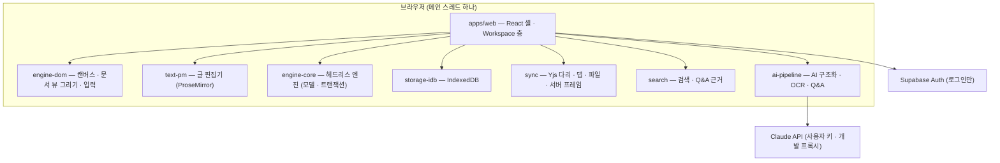
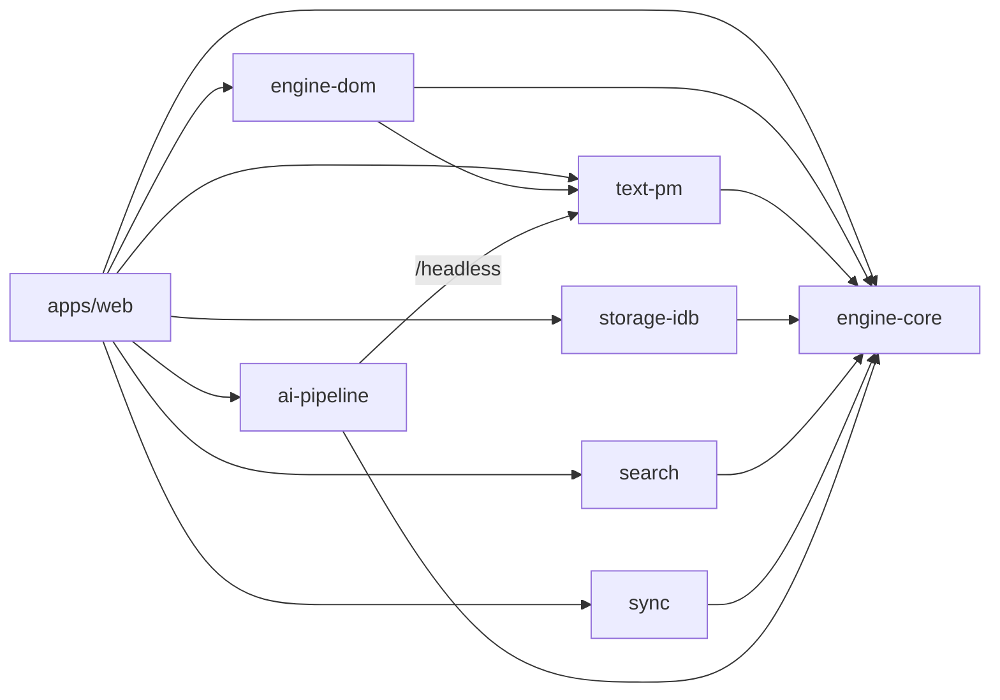
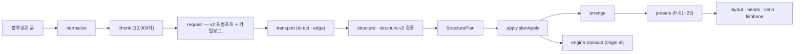
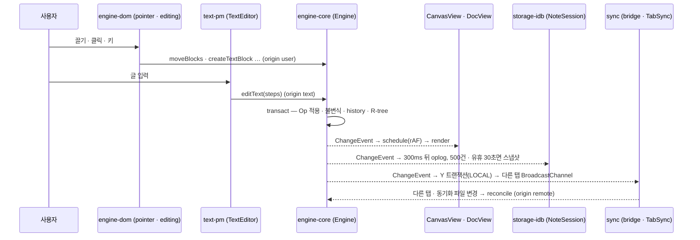

# DamianNote 코드 구조

| 항목 | 내용 |
|---|---|
| 문서 버전 | v1.0 (2026-10-15) |
| 기준 커밋 | `0df7028` (main) |
| 원본 | 저장소의 코드 — 줄 수는 `wc -l` 값(파일 끝 줄바꿈 때문에 `check-arch`의 셈보다 1 적을 수 있다) |
| 관련 문서 | [ARCHITECTURE.md](ARCHITECTURE.md)(구조의 이유 · 런타임 · 보안) · [ENTITY-DIAGRAM.md](ENTITY-DIAGRAM.md)(데이터 그림) · [DATABASE.md](DATABASE.md) · [ENGINE.md](ENGINE.md) · [DEV-GUIDE.md](DEV-GUIDE.md)(코드 규칙) · [TEST-PLAN.md](TEST-PLAN.md) |

코드가 **어디에 어떻게 나뉘어 있는지**를 적은 지도다. 왜 그렇게 나눴는지는 ARCHITECTURE.md, 저장되는 데이터는 DATABASE.md · ENTITY-DIAGRAM.md가 다룬다.

---

## 목차

1. [한눈에](#1-한눈에)
2. [저장소 트리](#2-저장소-트리)
3. [패키지와 의존 방향](#3-패키지와-의존-방향)
4. [패키지별 모듈 지도](#4-패키지별-모듈-지도)
5. [apps/web — 앱 셸](#5-appsweb--앱-셸)
6. [편집 한 번이 지나가는 길](#6-편집-한-번이-지나가는-길)
7. [시험 · 품질 장치](#7-시험--품질-장치)
8. [무엇을 고치려면 어디를](#8-무엇을-고치려면-어디를)

---

## 1. 한눈에

pnpm 모노레포(`pnpm@9.15.4`, `pnpm-workspace.yaml` = `apps/*` · `packages/*`). 브라우저 하나로 도는 local-first 앱이고 **서버 코드는 없다**.

| 구분 | 파일 | 줄 |
|---|---:|---:|
| 소스 (`packages/*/src` · `apps/web/src`, ts 282 · tsx 57 · css 16) | 355 | 42,201 |
| 단위 · 속성 시험 (vitest) | 106 | 9,612 |
| 브라우저 e2e (`e2e/*.mjs`) | 131 | 15,980 |
| 설계 문서 (`docs/*.md` 주요 22개) | 22 | 약 17,000 |



---

## 2. 저장소 트리

```
DamianNote/
├─ apps/
│  └─ web/                    React 19 앱 셸 — 모든 패키지를 조립 (122 파일 · 14,519줄)
│     ├─ src/                 Workspace 층(ws-*.ts) · 화면(.tsx) · 가져오기 · 내보내기 · docx/
│     ├─ public/              _headers(CSP 초안) · manifest · 아이콘 · fonts/pretendard
│     ├─ vite.config.ts       React · 서비스 워커 생성 · 배포 헤더 · 개발 unfurl · /anthropic 프록시
│     ├─ sw.template.js       손으로 쓴 서비스 워커 (빌드 때 버전 · 프리캐시 주입)
│     ├─ deploy-headers.ts    빌드 때 CSP connect-src에 Supabase 출처 더하기
│     ├─ dev-unfurl.ts        개발 · 미리보기 서버의 /api/unfurl (링크 미리보기)
│     └─ test/                앱 단위 시험 9개
├─ packages/
│  ├─ engine-core/            헤드리스 엔진 — DOM 없음 (58 · 6,552줄)
│  ├─ engine-dom/             캔버스 · 문서 뷰 렌더러와 입력 (83 · 10,416줄)
│  ├─ text-pm/                ProseMirror 글 스키마 · 코덱 · 편집기 · 메뉴 (47 · 5,002줄)
│  ├─ storage-idb/            IndexedDB 저장 · 금고 (7 · 934줄)
│  ├─ sync/                   Yjs 다리 · 탭 동기화 · 동기화 파일 · 서버 프레임 (13 · 1,316줄)
│  ├─ search/                 메모리 검색 · Q&A 근거 (2 · 293줄)
│  └─ ai-pipeline/            AI 구조화 파이프라인 · 원형 배치 · OCR · Q&A (23 · 3,169줄)
│     ├─ prompts/             프롬프트 원본 .md 7개 (structure.v1 · v2 · catalog · ocr · qa · repair)
│     └─ schemas/             출력 JSON Schema (structure.v1 · v2 · ocr.v1)
├─ e2e/                       브라우저 시험 131개 (playwright-core + Edge) · lib/fs-path.mjs · fixtures/
├─ bench/                     Node 벤치 — run.ts · synth.ts(합성 노트) · baseline.json
├─ eval/                      AI 평가 — structure/ 40건(.md + .expected.json) · results/ · session/
├─ scripts/                   check-arch · build-docs · validate-tracker · tracker-data (CommonJS)
├─ docs/                      설계 문서 · adr/ · qa/ · research/ · review/ · structure-guide/
├─ .githooks/pre-commit       커밋 전 검사 (7.1)
├─ .github/workflows/ci.yml   CI — check(구조 · 타입 · 단위 · 벤치 · 트래커) + e2e 3개
├─ .claude/                   agents/ 9개 · skills/ · launch.json(dev 서버 'web', 5173)
├─ prd-tracker.html           PRD · FR 트래커 원본 → docs/PRD · FR · ROADMAP 생성
├─ vitest.config.ts · vitest.setup.ts · tsconfig.base.json · package.json · pnpm-workspace.yaml
```

| 루트 스크립트 | 하는 일 |
|---|---|
| `dev` · `build` | `pnpm -F @dn/web dev` · `build` (전역 pnpm이 없으면 `corepack pnpm -F @dn/web dev`) |
| `test` · `test:watch` · `test:coverage` | vitest — `packages/*/test` · `apps/*/test`, 커버리지는 engine-core만 |
| `typecheck` | `tsc -p` 10개를 차례로 (engine-core · 그 test · text-pm · engine-dom · storage-idb · search · sync · ai-pipeline · 그 test · apps/web) |
| `check` · `verify` | `scripts/check-arch.mjs` · check → typecheck → test |
| `e2e` · `e2e:p1` · `e2e:ai` · `e2e:p3` · `e2e:p6` | `node e2e/smoke.mjs` 등 (dev 서버를 먼저 띄움) |
| `docs` · `docs:check` · `validate:tracker` | 트래커 → 문서 생성 · mermaid 검사 · 트래커 검사 |
| `bench` | `node --expose-gc --import ./bench/register.mjs bench/run.ts` |

---

## 3. 패키지와 의존 방향



| 패키지 | 허용된 @dn 의존 (`check-arch` `ALLOWED`) | 실제 `src`의 `from '@dn/…'` | 외부 의존 |
|---|---|---|---|
| `@dn/engine-core` | 없음 | 0 | `fractional-indexing` · `rbush` |
| `@dn/text-pm` | engine-core | engine-core 15 | `prosemirror-*` 8개 · `katex` |
| `@dn/engine-dom` | engine-core · text-pm | engine-core 74 · text-pm 27 | `perfect-freehand` |
| `@dn/storage-idb` | engine-core | 3 | 없음 |
| `@dn/search` | engine-core | 2 | 없음 |
| `@dn/sync` | engine-core | 8 | `yjs` |
| `@dn/ai-pipeline` | engine-core · text-pm | engine-core 9 · `text-pm/headless` 1 | `@anthropic-ai/sdk` |
| `@dn/web` | `*` | engine-core 58 · engine-dom 32 · storage-idb 31 · text-pm 26 · search 6 · ai-pipeline 5(+ `/direct` 동적 4) · sync 3 | `react` · `react-dom` 19 · `yjs`, 개발 `vite` 6 |

**`scripts/check-arch.mjs`가 막는 것** (커밋 전 · CI)
- 패키지 경계 — 위 `ALLOWED` 밖의 import, 표에 없는 새 패키지
- 소스 파일 400줄 초과 (`.ts` · `.tsx` · `.css`, `*.gen.ts` · `*.d.ts` 제외)
- `console.log(` · `.innerHTML =` 대입
- 추적 파일 속 `sk-ant-…` 키 · `.env*` 커밋

빈틈: 시험 폴더는 경계 검사 밖(`text-pm/test`가 `storage-idb`를 씀, 개발 의존으로 선언됨). 순환은 `ALLOWED`의 모양으로만 막는다.

**패키지 진입점** (`package.json` `exports`): engine-dom `.` · `./canvas.css` · `./db.css` · `./web.css` · `./caption.css`, text-pm `.` · `./headless`(DOM 없는 코덱) · `./text.css`, ai-pipeline `.` · `./direct`(브라우저 직접 호출 — 앱이 동적 import).

---

## 4. 패키지별 모듈 지도

### 4.1 engine-core — 헤드리스 엔진 (58 파일 · 6,552줄, 시험 42)

DOM이 없다(`tsconfig` `lib: ["ES2022"]`). 문서 모델 · 트랜잭션 · undo · 변경 이벤트 · 공간 색인 · 명령.

| 묶음 | 파일 |
|---|---|
| 모델 · 트랜잭션 · 직렬화 | `model.ts`(타입만) · `engine.ts`(transact · undo · subscribe · hitTest · 질의) · `tx.ts` · `ops.ts` · `invariants.ts` · `history.ts` · `undo-guard.ts`(원격 뒤 조건부 undo) · `spatial.ts`(R-tree) · `provenance.ts` · `serialize.ts`(v6 · 마이그레이션) · `diff.ts` · `viewport.ts` · `geom.ts` · `id.ts` · `order.ts` |
| 기하 · 배치 | `arrow-geom.ts` · `arrow-route.ts` · `group-anchor.ts` · `dock.ts`(자석 도킹) · `sheet.ts`(A4 용지) |
| 명령 · 편집 | `commands.ts` · `block-style.ts` · `clip.ts`(블록 묶음 복사) · `groups.ts`(블록 = 콘텐츠 묶음) · `meaning.ts` · `relations.ts` · `comments.ts` |
| 문서 순서 · 문서 뷰 | `flow.ts`(읽는 순서) · `doc-edit.ts` · `doc-units.ts` · `toc.ts` · `present.ts` · `page-setup.ts` · `caption.ts` · `text-doc.ts` |
| 콘텐츠 종류 | `rich.ts`(표 · 그래프 · 이미지 · 파일) · `table-merge.ts` · `table-sort.ts` · `table-head.ts` · `embed.ts` · `web.ts` · `file-preview.ts` · `button.ts` · `tabs.ts` · `mermaid.ts` |
| 데이터베이스 | `database.ts` · `db-views.ts` · `db-props.ts` · `db-formula.ts`(직접 쓴 파서, eval 없음) · `db-calc.ts` · `db-csv.ts` · `db-relations.ts` |
| 잉크 | `ink.ts`(획 인코딩) · `ink-bind.ts` · `ink-text.ts` · `ink-figures.ts` |

큰 파일: `engine.ts` 386 · `database.ts` 355 · `commands.ts` 306 · `model.ts` 269 · `doc-edit.ts` 254.

### 4.2 engine-dom — 그리기 · 입력 (83 파일 · 10,416줄, 단위 시험 없음 — e2e로만)

캔버스는 3층(밑 Canvas2D · 블록 DOM · 위 Canvas2D), 문서 뷰는 같은 엔진을 위에서 아래로 그린다.

| 묶음 | 파일 |
|---|---|
| 캔버스 뷰 조립 | `canvas-view.ts`(CanvasView — 층 · schedule · render) · `types.ts`(옵션 · 콜백) · `constants.ts` · `geometry.ts` · `camera.ts` · `theme.ts` · `svg.ts` · `draw-helpers.ts` · `index.ts` |
| 입력 | `bind-input.ts` · `pointer.ts` · `keyboard.ts` · `paste.ts` · `paste-url-offer.ts` · `create.ts` · `editing.ts`(글 편집기 붙이기) · `static-click.ts` · `select-both.ts` · `a11y.ts` · `changes.ts`(엔진 변경 반영) |
| 그리기 층 · 블록 DOM | `mount.ts`(가상화 · 높이 측정) · `draw-under.ts` · `draw-over.ts` · `arrow-draw.ts` · `paper.ts` · `sheet-view.ts` · `text-style.ts` · `kind-tag.ts` · `comment-badge.ts` · `conflict.ts` · `group-shapes.ts` · `groups-view.ts` · `caption-view.ts` |
| 콘텐츠 그리기 · 넣기 | `rich-render.ts` · `chart-render.ts` · `embed-render.ts` · `web-render.ts` · `button-render.ts` · `tabs-render.ts` · `toc-render.ts` · `insert.ts` · `slash-block.ts` |
| 표 | `table-edit.ts` · `table-ops.ts` · `table-picker.ts` · `table-sel.ts` · `table-sort-ui.ts` |
| 데이터베이스 화면 | `db-view.ts` · `db-viewbar.ts` · `db-menus.ts` · `db-cards.ts` · `db-calendar.ts` · `db-timeline.ts` · `db-calc-ui.ts` · `db-props-ui.ts` · `db-relation-ui.ts` |
| 잉크 | `ink-layer.ts` · `ink-input.ts` · `ink-render.ts`(perfect-freehand) · `ink-image.ts` |
| 문서 뷰 (17) | `doc-view.ts`(DocView) · `doc-word.ts` · `doc-ui.ts` · `doc-parts.ts` · `doc-pages.ts` · `doc-zoom.ts` · `doc-select.ts` · `doc-range.ts` · `doc-marquee.ts` · `doc-handle.ts` · `doc-insert.ts` · `doc-click-type.ts` · `doc-columns.ts` · `doc-diagram.ts` · `doc-footnotes.ts` · `doc-painter.ts` · `doc-table.ts` |
| PNG · 발표 | `snapshot.ts` · `present.ts` |
| CSS | `canvas.css` · `db.css` · `web.css` · `caption.css` |

큰 파일: `doc-view.ts` 393 · `canvas-view.ts` 390 · `pointer.ts` 352 · `doc-word.ts` 340 · `db-menus.ts` 303.

### 4.3 text-pm — 글 (47 파일 · 5,002줄, 시험 23)

| 묶음 | 파일 |
|---|---|
| 스키마 · 코덱 (헤드리스) | `schema.ts`(`pm-v1`) · `codec.ts`(`pmCodec`) · `headless.ts` · `repair.ts`(합쳐진 글 고치기) · `format.ts` |
| 편집기 | `editor.ts`(TextEditor — 자체 history 없음, undo는 엔진) · `editor-keys.ts` · `editor-paste.ts` · `plugins.ts` · `node-views.ts` · `input-rules.ts` · `render.ts`(정적 그리기) · `doc-keys.ts` · `cross.ts`(상자를 넘는 선택) |
| 명령 · 서식 | `commands.ts` · `mark-style.ts` · `para-style.ts` · `list-nums.ts` · `format-copy.ts` · `text-colors.ts` · `find.ts` |
| 메뉴 · 고르기 판 | `menu.ts` · `slash.ts` · `slash-md.ts`(docs/SLASH-COMMANDS.md를 `?raw`로 읽음) · `bubble.ts` · `bubble-color.ts` · `note-link.ts` · `emoji-menu.ts` · `symbol-picker.ts` · `symbols.ts` · `math-palette.ts` · `paste-url.ts` · `xref.ts` · `date-view.ts` · `code-copy.ts` |
| 인라인 기능 | `math.ts`(KaTeX) · `footnote.ts` · `dates.ts` · `highlight.ts` · `wikilinks.ts` · `icons.ts`(선 아이콘 세트) |
| 변환 | `markdown.ts` · `to-markdown.ts` · `paste.ts`(HTML) |

### 4.4 storage-idb · sync · search

| 패키지 | 파일 | 역할 |
|---|---|---|
| storage-idb (7 · 934줄) | `note-store.ts` | `dn-notes` — snapshots · oplog · views · backups · versions · ysync |
| | `meta-store.ts` | `dn-app` — notes_meta · settings · secrets · folders · tags · search_docs |
| | `attachment-store.ts` | `dn-files` — attachments (SHA-256 키) |
| | `session.ts` | `openNote` · `createNote` · `readNote` · `NoteSession`(자동 저장 · 압축) |
| | `vault.ts` · `idb.ts` | 노트 잠금 열쇠(PBKDF2 → KEK → DEK) · 프로미스 래퍼 |
| sync (13 · 1,316줄) | `bridge.ts` · `ymap.ts` · `fields.ts` · `text-y.ts` · `reconcile.ts` · `reopen.ts` · `normalize.ts` · `tombstone.ts` | 엔진 ⇄ Y.Doc 다리 — 필드 단위, 목록 필드는 항목 키, 글은 XmlFragment, 삭제는 묘비 |
| | `tabs.ts` | `TabSync` — 같은 기기 탭 사이 BroadcastChannel |
| | `exchange.ts` | 동기화 파일(v3) 병합 · 지문 |
| | `protocol.ts` · `status.ts` | 서버 프레임 · 청크 · 동기화 상태 (M0 — 앱은 아직 안 씀) |
| search (2 · 293줄) | `index.ts` · `retrieve.ts` | `SearchIndex`(메모리 부분 문자열) · Q&A 근거 조각 |

### 4.5 ai-pipeline — AI (23 파일 · 3,169줄, 시험 19)



| 묶음 | 파일 |
|---|---|
| 프롬프트 | `prompts.ts` · `prompts.gen.ts`(생성물 — `prompts/*.md`에서 `gen:prompts`, 카탈로그는 `gen:catalog`가 STRUCTURE-GUIDE에서) — 기본 `structure.v2` |
| 스키마 · 검증 | `schema.ts` · `structure.ts` · `structure-v2.ts` |
| 입력 준비 | `normalize.ts` · `chunk.ts` |
| 요청 · 전송 | `request.ts`(기본 모델 `claude-sonnet-5-5`) · `retry.ts` · `transport.ts`(Edge SSE — 앱 미사용) · `direct.ts`(BYOK · `/direct` 진입) · `errors.ts` |
| 파이프라인 | `pipeline.ts` — `structureText` |
| 배치 | `apply.ts` · `arrange.ts` · `presets.ts` · `layout.ts` · `bands.ts` · `venn.ts` · `fishbone.ts` |
| 그 밖의 AI | `ocr.ts` · `qa.ts` |

---

## 5. apps/web — 앱 셸

### 5.1 시작

`index.html` → `main.tsx`: CSS 17개 import → `applyTheme` → `setDefaultTextCodec(pmCodec)` → `setDevChecks(DEV)` → `<ErrorBoundary><App/></ErrorBoundary>`. `App.tsx`가 `new Workspace()`를 만들고 `ws.subscribe(setS)`로 상태 객체 전체를 받으며, 캔버스 · 문서 `<div>`를 `ws.init()`에 넘긴다. 위 막대는 `App.tsx` 안의 `header.topbar`.

### 5.2 Workspace 층 (지휘자)

React 밖에서 앱 상태와 동작을 맡는 클래스 하나를, 기능별 파일로 나눈 **상속 사슬 16층**이다(파일 400줄 한도 때문에 층이 늘었다).

```mermaid
flowchart LR
  base["ws-base"] --> notes["ws-notes"] --> org["ws-organize"] --> imp["ws-import"] --> mv["ws-move"] --> pr["ws-present"]
  pr --> todo["ws-todos"] --> rep["ws-replace"] --> dbp["ws-dbpages"] --> ver["ws-versions"] --> lock["ws-lock"]
  lock --> syn["ws-sync"] --> rec["ws-record"] --> rem["ws-remind"] --> aiL["ws-ai"] --> ws["Workspace (workspace.ts)"]
```



| 층 | 맡은 일 |
|---|---|
| `ws-base` | 상태 · 구독 · 토스트 · 목록 · 검색 문서 · 새 노트 저장 |
| `ws-notes` | 노트 열기 · 닫기(쓰기 탭 잠금 → `openNote` → `CanvasView`) · 저장 상태 · 메타 갱신 · DocView |
| `ws-organize` | 폴더 · 태그 · 휴지통 · 검색 · 빠른 전환 · 복제 · 백링크 · 내보내기 |
| `ws-import` | 가져오기 실행 · 진행률 · 되돌리기 |
| `ws-move` · `ws-present` | 블록을 다른 노트로 옮기기 · 발표 모드 |
| `ws-todos` · `ws-replace` | 할 일 · 홈 · 찾아 바꾸기 |
| `ws-dbpages` · `ws-versions` | DB 항목 페이지 · 버전 기록 |
| `ws-lock` · `ws-sync` | 노트 · 폴더 · 앱 잠금 · 탭 실시간 동기화 · 동기화 파일 |
| `ws-record` · `ws-remind` | 녹음 · 알림 · Q&A 근거 |
| `ws-ai` · `workspace.ts` | 구조화 진입 · 앱 시작 · SW · 설정 · 템플릿 · `window.__dn`(DEV · e2e) |
| `ws-model.ts` | 상태 타입 · 문구 · 순수 계산 · `tryLockNote` |

### 5.3 화면 (`.tsx` 57개)

| 화면 | 파일 |
|---|---|
| 셸 | `App.tsx` · `ErrorBoundary.tsx` · `Icon.tsx` · `hooks.ts` · `theme.ts` · `sw-register.ts` |
| 사이드바 | `Sidebar.tsx` · `RowMenu.tsx` · `BulkBar.tsx` · `tree.ts` |
| 위 막대 | `TopMore.tsx`(⋯) · `Breadcrumb.tsx` · `TagBar.tsx` · `NoteLook.tsx` |
| 캔버스 도구 | `Toolbar.tsx` · `InkBar.tsx` · `PaperPicker.tsx` · `InsertMenu.tsx` · `RecordBar.tsx` |
| 문서 뷰 | `DocRibbon.tsx` · `DocStatus.tsx` · `PageSetupPanel.tsx` · `ColorPalette.tsx` |
| 메뉴 | `BlockMenu.tsx` · `SubMenu.tsx` · `TextStyleMenu.tsx` · `MeaningMenu.tsx`(화살표 메뉴 포함) · `ArrowStyleMenu.tsx` · `CommandPalette.tsx` |
| 대화창 | `ConfirmDialog` · `MoveToDialog` · `VersionsDialog` · `TemplateGallery` · `ShortcutHelp` · `ChartEditor`(+ `ChartStyleTab` · `ChartColorPop`) |
| 패널 · 오버레이 | `NotePanel`(+ `Outline`) · `SidePane` · `CommentThread` · `DbRowBar` · `SearchOverlay` · `ReplaceOverlay` |
| 페이지 | `HomePage` · `TodoPage` · `TrashPage` · `GraphPage` |
| 설정 · 계정 · 잠금 | `SettingsDialog`(+ `SecuritySettings` · `NotifySettings` · `AccountSettings`) · `LoginDialog` · `LockScreen` |
| AI | `AiPanels.tsx` · `QaPanel.tsx` · `OcrDialog.tsx` + `ai.ts` · `qa-flow.ts` · `ocr-flow.ts` |
| 내보내기 | `ExportDialog.tsx` · `export.ts` · `print-render.ts` · `pdf.ts` · `pdf-text.ts` · `pdf-font.ts` · `zip.ts` · `docx/`(export · table · text · media · ooxml · zip) |
| 가져오기 | `ImportDialog.tsx` · `import.ts` · `import-md.ts` · `import-notion.ts` · `import-csv.ts` · `unzip.ts` · `docx/`(import · read · read-table) |
| 그 밖 | `Onboarding.tsx` · `sample.ts` · `templates.ts` · `reminders.ts` · `web-host.ts` · `account.ts` · `auth.ts` · `shortcuts.gen.ts`(생성물) |

CSS 11개: `styles.css`(셸 · 토큰) · `menus.css` · `panels.css` · `insert.css` · `doc-word.css` · `theme-dark.css` · `mobile.css` · `login.css` · `lock.css` · `export-dialog.css` · `qa.css`.

### 5.4 빌드 · 배포

| 파일 | 하는 일 |
|---|---|
| `vite.config.ts` | 플러그인 `react()` · `serviceWorker()`(`sw.template.js`의 버전 · 프리캐시 목록 채움) · `deployHeaders()` · `devUnfurl()`. 개발 서버는 `.env.local`의 `ANTHROPIC_API_KEY`로 `/anthropic` 프록시(번들에는 끝 4자리만) |
| `public/_headers` | Cloudflare Pages 형식 초안 — CSP(`script-src 'self'`, `connect-src` Anthropic · Supabase, `frame-src` 허용 목록 + `blob:`), 캐시 규칙 |
| `sw.template.js` | 앱 셸 캐시 `dn-shell-<버전>` · 글꼴 캐시 · 새 버전 안내 |

---

## 6. 편집 한 번이 지나가는 길

캔버스에서 상자를 옮기거나 글을 칠 때:



| 단계 | 함수 · 파일 |
|---|---|
| 입력 | `bind-input.ts` 리스너 → `pointer.ts` `handlePointerDown/Move/Up` · `keyboard.ts` · `paste.ts`, 글은 `editing.ts` → text-pm `editor.ts` `dispatchTransaction` → `commands.ts` `editText`(mergeKey `text:<id>`) |
| 트랜잭션 | `engine.ts` `transact` — `makeTx` → `fn(tx)` → `stampEdits` → `validateOps` → 실패면 `invertAll`, 성공이면 `refreshSpatial` → `history.record` → 구독자에게 `ChangeEvent` |
| 그리기 | `changes.ts` `handleChange` → `schedule` → `render`: 측정 높이 반영 → `syncMounts` → `drawUnder` → `drawInk` → `drawOver` |
| 저장 | `session.ts` `NoteSession` → `flushLog` → `appendLog`, `compact` → `serialize` → `snapshots`. 앱은 400ms 뒤 `notes_meta` · `search_docs`, 500ms 뒤 `views` |
| 열기 | `openNote` → `load` → `deserialize`(마이그레이션 · 새 버전이면 읽기 전용) → `new Engine` → `replay(log)`(origin load) |
| 동기화 | `ws-sync.ts` → `attach(engine, Y.Doc)` — 엔진 → Y `putEntity` · `writeField` · `writeTombstone` · `syncDoc`, Y → 엔진 `reconcile` + `fitIncoming`. 탭은 `TabSync`, 파일은 `mergeRemote`, 기록은 `ysync` |

---

## 7. 시험 · 품질 장치

### 7.1 커밋 전 검사 (`.githooks/pre-commit`)

1. `node scripts/check-arch.mjs --staged` — 경계 · 400줄 · 금지 코드 · 비밀값(`--staged`는 비밀값 검사만 올린 파일로 좁힘)
2. `corepack pnpm -s typecheck`
3. `corepack pnpm -s test` — 실패하면 한 번 더 돌려 출력을 보인다
4. `prd-tracker.html`을 올리면 `validate:tracker`

### 7.2 시험 종류

| 종류 | 위치 | 수 | 도는 때 |
|---|---|---|---|
| 단위 · 속성 | `packages/*/test` · `apps/web/test` | 파일 106 (engine-core 42 · text-pm 23 · ai-pipeline 19 · apps/web 9 · sync 6 · storage-idb 5 · search 2 · engine-dom 0) | 커밋마다 · CI |
| 동기화 수렴 속성 | `packages/sync/test/harness.ts` · `converge.test.ts` · `regressions/` | 두 기기 120 · 세 기기 60회 (`DN_FUZZ_RUNS`로 늘림) | 커밋마다 |
| 측정 전용 | `big-note.test.ts`(`DN_BENCH`) · `live-eval.test.ts`(`DN_LIVE` — 실제 API, 비용) · `session-*.test.ts`(`DN_SESSION_CAPTURE`) | — | 손으로 |
| 브라우저 e2e | `e2e/*.mjs` | 131 | CI는 smoke · p1 · ai 3개, 나머지는 손으로(PowerShell + Edge, `DN_URL`) |
| 벤치 | `bench/` | 기준선 10% 회귀 + 절대 예산 | CI |
| AI 평가 | `eval/structure/` | 40건 | 가짜 transport는 커밋마다, 실제는 `DN_LIVE=1` |
| 문서 | `e2e/docs-check.mjs` | mermaid 전부 | 손으로 |

`vitest.setup.ts`가 `setDevChecks(true)`로 엔진 레코드를 동결해, 시험 중 레코드를 직접 고치면 실패한다.

### 7.3 CI (`.github/workflows/ci.yml`)

`push` · `pull_request` → job `check`(Node 24: install → check-arch → typecheck → test → bench → validate:tracker) → job `e2e`(Chrome, dev 서버 + smoke · p1 · ai, 스크린샷 artifact).

---

## 8. 무엇을 고치려면 어디를

| 하려는 것 | 먼저 볼 곳 |
|---|---|
| 새 콘텐츠 종류 | `engine-core/src/model.ts`(타입) + 새 모듈(`rich.ts` · `tabs.ts` 같은) → `engine-dom/src/mount.ts` · `*-render.ts`(캔버스) · `doc-parts.ts`(문서 뷰) → `apps/web/src/InsertMenu.tsx` · text-pm 슬래시(`docs/SLASH-COMMANDS.md`) → 내보내기 `export.ts` · `docx/` |
| 저장 필드 추가 | `model.ts` 선택 필드(버전업 없이) — 옛 앱이 망가뜨릴 수 있으면 `serialize.ts` `SCHEMA_VERSION` + 마이그레이션 + `sync/src/fields.ts`(목록 필드면 항목 키) |
| 명령 · 단축키 | `engine-core/src/commands.ts` · `apps/web/src/CommandPalette.tsx` · `App.tsx`(전역 단축키) · 트래커 단축키 표 → `shortcuts.gen.ts` |
| 캔버스 마우스 동작 | `engine-dom/src/pointer.ts` · `draw-over.ts`(손잡이 · 연결점) · `groups-view.ts`(묶음) |
| 문서 뷰 · 워드처럼 | `engine-dom/src/doc-*.ts` · `apps/web/src/DocRibbon.tsx` · `doc-word.css` |
| 글 편집 · 서식 · 메뉴 | `text-pm/src/editor.ts` · `commands.ts` · `menu.ts` · `slash.ts` · `bubble.ts` |
| 데이터베이스 | `engine-core/src/database.ts` · `db-*.ts` → `engine-dom/src/db-*.ts` |
| 저장 · 열기 | `storage-idb/src/session.ts` · `note-store.ts` · `meta-store.ts` |
| 동기화 | `sync/src/bridge.ts` · `reconcile.ts` · `tombstone.ts` · `apps/web/src/ws-sync.ts` — 고치면 수렴 시험(`converge.test.ts`)을 `DN_FUZZ_RUNS=10000`으로 |
| AI 구조화 | `ai-pipeline/prompts/*.md`(→ `gen:prompts`) · `structure-v2.ts` · `apply.ts` · `arrange.ts` · `presets.ts` · 앱 `ws-ai.ts` · `ai.ts` |
| 화면 모양 | `apps/web/src/styles.css`(토큰) · `menus.css` · `panels.css` · `theme-dark.css` · 아이콘 `text-pm/src/icons.ts` |

---

## 개정 이력

| 버전 | 날짜 | 내용 |
|---|---|---|
| v1.0 | 2026-10-15 | 처음 씀 — 기준 커밋 `0df7028` |
