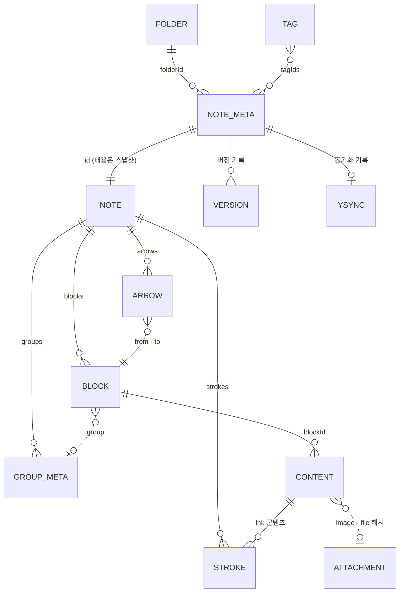

# DamianNote 데이터베이스 설계서 (as-built)

| 항목 | 내용 |
|---|---|
| 문서 버전 | v1.0 as-built (2026-10-15 — 코드 기준으로 다시 씀) · v0.3 (2026-10-02 — 스냅샷 v3 · `dn-app` v2 `secrets`) · v0.2 (2026-10-01 — 열린 이슈 확정) |
| 작성일 | 2026-10-01 (v1.0 2026-10-15) |
| 기준 커밋 | `0df7028` (main) |
| 상태 | A부(1~9 · 11~12절) = 코드에서 확인한 사실, 파일 · 줄을 붙였다. B부(10절) = 아직 없는 서버의 설계 |
| 관련 문서 | [ENTITY-DIAGRAM.md](ENTITY-DIAGRAM.md)(엔티티 그림 9종) · [ARCHITECTURE.md](ARCHITECTURE.md) 6 · 8절 · [ENGINE.md](ENGINE.md) 3 · 12장 · [SYNC.md](SYNC.md) 2 · 4 · 11절 · SECURITY.md · [CODE-STRUCTURE.md](CODE-STRUCTURE.md) |

이 문서는 DamianNote가 저장하는 모든 데이터의 모양 · 저장 위치 · 버전 · 보존을 적는다. **v1.0부터 as-built** — v0.3까지는 구현 전 목표 설계였고, 그 사이 스키마가 v3 → v6으로, 기기 저장소가 OPFS · `dn-sync` 계획에서 IndexedDB 세 개(`dn-notes` · `dn-app` · `dn-files`)로 바뀌었다. 코드와 문서가 다르면 코드(`packages/*/src`)가 원본이다. 서버(Postgres · Durable Object · R2)는 아직 코드가 없어 10절에 계획으로 남겼다.

---

## 목차

- A부 — 지금 저장되는 것
  - [0. 읽는 법](#0-읽는-법)
  - [1. 설계 원칙](#1-설계-원칙)
  - [2. 논리 데이터 모델](#2-논리-데이터-모델)
  - [3. 노트 문서 스키마 (스냅샷 v6)](#3-노트-문서-스키마-스냅샷-v6)
  - [4. 기기 저장소 (IndexedDB 외)](#4-기기-저장소-indexeddb-외)
  - [5. 작업 공간 메타](#5-작업-공간-메타)
  - [6. 노트 잠금 · 암호화](#6-노트-잠금--암호화)
  - [7. 동기화 기록 · 내보내기 형식](#7-동기화-기록--내보내기-형식)
  - [8. 버전 · 마이그레이션](#8-버전--마이그레이션)
  - [9. 보존 · 삭제 · 용량](#9-보존--삭제--용량)
- B부 — 서버 (계획)
  - [10. 서버 저장 설계](#10-서버-저장-설계-계획)
- [11. 무결성 검증](#11-무결성-검증)
- [12. 알려진 한계](#12-알려진-한계)
- [13. 확정된 이슈 B1~B5의 지금](#13-확정된-이슈-b1b5의-지금)
- [개정 이력](#개정-이력)

---

## 0. 읽는 법

- **사용자 용어 ↔ 엔진 이름**: 캔버스의 상자 하나(사용자: 콘텐츠) = `Block` + 그 안의 `Content`. 상자 여럿을 묶은 것(사용자: 블록) = 같은 `Block.group` + `Note.groups[id]`.
- 표의 `필수` 열: O = 항상 있음, X = 선택. 선택 필드는 값이 없으면 키 자체가 없다(`undefined`를 저장하지 않음).
- `파일:줄`은 기준 커밋의 `packages/engine-core/src` · `packages/storage-idb/src` · `apps/web/src` 기준이다.

---

## 1. 설계 원칙

| # | 원칙 | 지금 (as-built) |
|---|---|---|
| P1 | **기기가 원본이다** | 그대로 — 서버가 없다. 모든 데이터는 브라우저 IndexedDB에 있다 |
| P2 | 서버는 노트 내용을 해석하지 않는다 | 서버 설계(SYNC G4)에 유지. 방 DO는 Yjs 구조 병합만 |
| P3 | **id는 클라이언트가 만든다** — 22자 base62, 약 131비트 난수 | `id.ts:1-22`, 검사식 `/^[0-9A-Za-z]{22}$/` |
| P4 | **순서는 fractional 키 + id 정렬**, 배열 인덱스 금지 | `order.ts` — `(order, id)` 사전순(`localeCompare` 안 씀). 블록 쌓임 `z`, 콘텐츠 `order`, DB 행 `order` |
| P5 | 변경은 최상위 필드 단위 | Op `set`이 필드 하나. 동기화도 필드 단위 LWW, 목록 필드는 항목 키(7.1) |
| P6 | 파생 데이터는 원본이 아니다 | `search_docs`는 형식 번호가 다르면 버리고 다시 만든다. 노트 메타의 `title` · `preview` · `blocks`도 스냅샷에서 다시 계산 |
| P7 | 시계로 순서를 정하지 않는다 | 순서는 키, 동시 쓰기는 Yjs 규칙. 시각(`at` · `updatedAt`)은 표시 · 보존 기한용 |
| P8 | 모든 영속 포맷에 버전 | 스냅샷 · 로그 `schemaVersion`(6), 노트 메타 `schemaVersion`(1), 검색 문서 `v`(3), 백업 `backupVersion`(1), 동기화 파일 `v`(3), 금고 `v`(1) |
| P9 | 삭제는 두 단계 | 노트는 휴지통(`deletedAt`) → 30일 뒤 영구 삭제. 동기화에서는 묘비(7.2) |
| P10 | **모르는 것은 보존한다** (v1.0 추가) | 모르는 필드 · 콘텐츠 `type` · 최상위 키를 그대로 둔다(`model.ts:1` · `UnknownContent` · 스냅샷 `extra`). 상위 버전 노트는 읽기 전용으로 연다 |

---

## 2. 논리 데이터 모델

### 2.1 엔티티 한눈에

그림은 [ENTITY-DIAGRAM.md](ENTITY-DIAGRAM.md) 2~8절. 요약:



### 2.2 엔티티 소유와 저장 위치

| 엔티티 | 소유 | 기기 원본 | 동기화 | 비고 |
|---|---|---|---|---|
| Note · Block · Content · Arrow · Stroke · 묶음(GroupMeta) · 댓글 · DB 속성/행/보기 | 엔진 | `dn-notes.snapshots` + `oplog` | 노트 Y.Doc (탭 · 동기화 파일) | 댓글은 `Block.comments`, DB는 콘텐츠 레코드 안 배열 |
| NoteMeta · Folder · Tag | 앱 메타 | `dn-app.notes_meta` · `folders` · `tags` | **안 함** (워크스페이스 Y.Doc은 설계만, SYNC 12.8) | 동기화 파일은 노트 내용만 나른다 |
| 리마인더 | 엔진(글 속 날짜 언급 · DB `remind`) → 메타 사본 | `notes_meta.reminders` + `settings.reminderFired` | 안 함 | 알림은 기기 안에서만 |
| 설정 | 기기 | `dn-app.settings` (scope 전부 `device`) | 안 함 | 5.3 |
| 비밀값 (API 키 · 로그인 세션) | 기기 | `dn-app.secrets` (AES-GCM) | 안 함 | 5.4 |
| 버전 기록 | 기기 | `dn-notes.versions` | 안 함 | 노트당 30건 |
| 첨부 | 기기 | `dn-files.attachments` (내용 SHA-256) | 동기화 파일 · 백업에 base64로 | OPFS 아님 |
| 검색 색인 | 파생 | `dn-app.search_docs` | 안 함 | 형식 번호 4 (10/26 — 요약 카드 필드) |
| 동기화 기록 | 동기화 | `dn-notes.ysync` | — | Y 전체 상태 + 지문 · known |
| 계정 · 기기 · 문서 레지스트리 | 서버 | — | — | 계획(10절) |

---

## 3. 노트 문서 스키마 (스냅샷 v6)

### 3.1 NoteSnapshot (`serialize.ts:20-29`)

`SCHEMA_VERSION = 6`, `TEXT_SCHEMA = 'pm-v1'` (`serialize.ts:17-18`). IndexedDB에는 구조화 복제 객체로, 백업 · 내보내기에는 JSON으로 저장한다.

| 필드 | 타입 | 필수 | 뜻 |
|---|---|---|---|
| `schemaVersion` | number | O | 지금 6. 엔진이 아는 것보다 크면 읽기 전용(8.3) |
| `engine.textSchema` | string | O | `'pm-v1'` |
| `note` | Note | O | 3.2 |
| `blocks` · `contents` · `arrows` · `strokes` | `Record<Id, …>` | O | 정규화 맵. **id 순으로 정렬**해 같은 문서는 늘 같은 스냅샷(`:116-133`) |
| (그 밖의 키) | unknown | X | 모르는 최상위 키는 `extra`로 보존(`:113` · `:185-186`) |

엔티티에는 `noteId`가 없다 — 한 스냅샷에 담기는 것으로 소속이 정해진다. `serialize` 때 `note.updatedAt = max(note.updatedAt, engine.updatedAt)`.

### 3.2 Note (`model.ts:42-62`)

| 필드 | 타입 | 필수 | 뜻 |
|---|---|---|---|
| `id` | Id | O | |
| `title` | string | O | NoteMeta.title로 복사 |
| `createdAt` · `updatedAt` | number(ms) | O | |
| `paper` | `{kind: 'dots'\|'lines'\|'grid'\|'none', gap, color?: 'white'\|'oxford'\|'dark'}` | X | 캔버스 배경. 없으면 dots · 32 (FR-041). color는 캔버스 바탕색(위 막대 ⋯ › 캔버스 설정) — 없으면 앱 테마를 따름, 캔버스 안 색 토큰만 바꾼다 |
| `icon` | string | X | 이모지 또는 `'icon:<이름>'` (FR-070) |
| `cover` | `{attachment: 해시, pos: 0~100}` | X | 커버 이미지 → `dn-files` |
| `page` | `{fullWidth?, smallText?, editLock?}` | X | 페이지 표시 옵션 (FR-072) |
| `sheet` | `{size: 'a4', landscape?, pages?}` | X | A4 용지 캔버스. 없으면 끝없는 캔버스 |
| `pageSetup` | `{landscape?, margin?, header?, footer?, numbers?, skipFirst?}` | X | 쪽 설정 — margin `normal\|narrow\|moderate\|wide`, numbers `bottom-center\|bottom-right\|top-right\|none` |
| `headingNumbers` | boolean | X | 제목 번호 |
| `groups` | `Record<묶음 Id, GroupMeta>` | X | 묶음(사용자의 '블록') 정보 |

태그 · 폴더 · 댓글은 Note에 없다(태그 · 폴더는 NoteMeta, 댓글은 Block).

### 3.3 GroupMeta (`model.ts:30-40`)

| 필드 | 타입 | 필수 | 뜻 | 도입 |
|---|---|---|---|---|
| `name` | string | X | 없으면 첫 제목 · 첫 줄로 보인다 | |
| `kind` | GroupKind | X | `whole · set · case · proof · premises · layer · lane · place · path · column · section · slot · agenda · paragraph · phase · couple · frame` + 모르는 값(`relations.ts:35-36`) | v6 |
| `bracket` | `'box'\|'brace'\|'none'` | X | 테두리 모양 | v6 |
| `figure` | boolean | X | 문서 · 인쇄 · 워드에서 도식 그림으로 | |
| `shape` | `'timeline'\|'matrix'\|'scale'\|'venn'\|'fishbone'` | X | 도식 모양 | |
| `axis` | `{x?, y?}` | X | 축 이름 | |
| `ai` | AiProvenance | X | 3.4 | v6 |

### 3.4 AiProvenance (`model.ts:14-27`)

블록 · 콘텐츠 · 화살표 · 묶음의 `ai` 필드.

| 필드 | 타입 | 필수 | 뜻 | 도입 |
|---|---|---|---|---|
| `generated` | `true` | O | AI 생성 표시 | |
| `runId` | string | O | 실행 id | |
| `source` | SourceRef `{contentId?, from, to, excerpt?}` | X | 원문 범위 — `contentId`는 느슨한 참조, 위치는 그때 문서 기준이라 찾기는 `excerpt`로 | |
| `origin` | `'claude'\|'open_teacher'\|'student'` | X | 없으면 claude로 읽음 | v6 |
| `provider` · `model` · `promptVersion` · `schema` | string | X | 예: `schema = 'structure.v1'` | v6 |
| `editedAt` | number | X | 사람이 의미 필드를 고친 시각(60초 단위로 자동, `provenance.ts:9 · 30-39`) | v6 |

파생값 `DataOrigin`(`human` · `claude` · `claude_edited` …)은 저장하지 않는다(`provenance.ts:44`).

### 3.5 Block (`model.ts:97-155`)

| 필드 | 타입 | 필수 | 뜻 | 도입 |
|---|---|---|---|---|
| `id` | Id | O | | |
| `x` · `y` · `w` · `h` | number | O | 월드 좌표 · 크기 (I6: 유한, w · h ≥ 24) | |
| `sizing` | `'auto'\|'fixed'` | O | auto면 h = 콘텐츠 높이 | |
| `minH` | number | X | fixed일 때 최소 높이 | |
| `layout` | `'flow'\|'free'` | O | 블록 안 배치 | |
| `z` | OrderKey | O | 쌓임 순서(읽기 순서 아님) | |
| `style` | `{color?}` | X | 배경색 이름 | |
| `fontScale` · `textColor` · `align` · `fontFamily` · `lineHeight` · `indent` · `firstLine` · `spaceBefore` · `spaceAfter` | | X | 글자 · 문단 모양(`block-style.ts`). align `center\|right\|justify`, fontFamily `serif\|mono`, indent 1~8 | |
| `caption` | string | X | '표 N. …' · '그림 N. …' | |
| `pageBreak` | boolean | X | 이 상자부터 새 쪽 | |
| `draft` | boolean | X | 문서 뷰의 빈 자리 상자(캔버스 · 공간 색인 밖) | |
| `group` | Id | X | 묶음 id = `note.groups`의 키 | |
| `nodeKind` | NodeKind | X | 노드 종류 24개 + 모르는 값(`relations.ts:16-20`) | v6 |
| `attachTo` | Id | X | 차트 · 표가 붙은 노드 블록(느슨함) | v6 |
| `status` | `'belief'\|'refuted'\|'before'\|'wrong'\|'deferred'` | X | | v6 |
| `emphasis` | `'strong'\|'warning'` | X | | v6 |
| `hedge` | boolean | X | 불확실한 진술 | v6 |
| `role`(≤24자) · `speaker`(≤40) · `owner`(≤40) · `time` · `start` · `end` · `due` | string | X | 원문 그대로 | v6 |
| `conflict` | `{kind: 'remote-deleted'\|'local-deleted', at}` | X | 동기화 충돌로 되살린 표시 — 동기화 중에는 Y에서 **투영**(Y에 쓰지 않음) | |
| `comments` | BlockComment[] | X | 3.6 — 내보내기에서는 빠진다 | |
| `ai` | AiProvenance | X | | |
| `source` | SourceRef `{contentId?, from, to, excerpt?}` | X | 사람이 원문에서 꺼낸 상자의 원문 연결(`source-box.ts` — 말풍선 ⋯ '새 상자로 (원문 연결)' · 캔버스로 끌어 놓기). `ai.source`와 같은 꼴이지만 AI 표시가 아니다 — 원문 강조 · '원문에서 보기'는 `source ?? ai.source` | 11/02 |

### 3.6 BlockComment (`comments.ts:8-16`)

| 필드 | 타입 | 필수 | 뜻 |
|---|---|---|---|
| `id` | Id | O | |
| `text` | string(≤4000) | O | |
| `at` | number | O | |
| `resolved` | boolean | X | |
| `quote` | string(≤300) | X | 글 일부에 단 댓글의 인용문 |
| `anchor` | Id | X | 글 문서 `comment` 마크의 `attrs.id`와 짝 |

### 3.7 Content (`model.ts:182-210`)

공통(`ContentBase`):

| 필드 | 타입 | 필수 | 뜻 |
|---|---|---|---|
| `id` | Id | O | |
| `blockId` | Id | O | 소속 블록 (I1) |
| `order` | OrderKey | O | 블록 안 순서 |
| `type` | string | O | 아래 종류. 모르는 type은 `UnknownContent`로 보존 |
| `frame` | `{x, y, w, h}` | X | 블록 안 자유 배치 |
| `ai` | AiProvenance | X | |

종류별:

| type | 고유 필드 | 도입 | 정의 |
|---|---|---|---|
| `text` | `doc: TextDoc`(O, 3.10) · `role?: 'title'\|'body'`(없으면 body). 텍스트 블록 하나에 텍스트 콘텐츠 하나 · 제목 상자는 문단 하나(I10) | v1 (role v2 · 뜻 v3) | `model.ts:195-204` |
| `table` | `columns: {id, name, width?}[]` · `rows: {id, order, cells: Record<열 id, TextDoc>}[]` · `title?` · `merges?: {r0,c0,r1,c1}[]` · `sorted?: {col, dir}` · `noHeader?` · `headerCol?` | v4 | `rich.ts:8-20` |
| `chart` | `kind: 'bar'\|'line'\|'pie'` · `series: {id, name, points: {x,y}[], color?}[]` · `title?` · `unit?` · `categories?` · `style?: {palette?, itemColors?, vary?, values?, legend?, grid?, smooth?, area?, hole?}` — palette `basic · warm · cool · pastel · mono · gray` | v4 (style 10/13) | `rich.ts:22-67` |
| `image` | `attachment`(해시) · `natural: {w, h}` · `alt?` | v4 | `rich.ts:130-131` |
| `file` | `attachment` · `name` · `mime` · `size` · `duration?`(초, 녹음) · `preview?`(PDF 펼쳐 보기) | 표기 없음 | `rich.ts:138-145` |
| `database` | `properties` · `rows` · `views?` · `activeView?` · `title?` · `pageTemplate?` (3.8) | v5 | `database.ts:58-65` |
| `web` | `url` · `view: 'bookmark'\|'embed'` · `title?` · `description?` · `image?` · `site?` | 표기 없음 | `web.ts:9-18` |
| `embed` | `srcNote` · `srcBlock` — 다른 노트의 블록을 보여 줌 | 표기 없음 | `embed.ts:8-9` |
| `tabs` | `tabs: {id, label, doc: TextDoc}[]`(1개 이상) | 표기 없음 | `tabs.ts:9-11` |
| `button` | `label` · `clip: BlockClip`(누르면 붙일 상자 묶음 사본, `clip.ts:11-24`) | 표기 없음 | `button.ts:10-11` |
| `toc` | `depth?: 1\|2\|3`(기본 3) — 목록은 저장하지 않고 그릴 때 만든다 | 표기 없음 | `toc.ts:8-12` |
| `ink` | `natural: {w, h}` · `at: {x, y}` · `blockW` — 묶인 획의 부모 | 표기 없음 | `ink-bind.ts:12-13` |

"표기 없음" = 스키마 버전을 올리지 않고 선택 필드 · 새 type으로 더한 것. 옛 앱은 `UnknownContent`로 보존한다.

### 3.8 데이터베이스 (`database.ts` · `db-views.ts` · `db-props.ts` · `db-relations.ts`)

| 구조 | 필드 |
|---|---|
| DbProperty | `id` · `name` · `type` · `options?` · `width?` · `hidden?` · `remind?: 'HH:MM'` · `relation?: {db, pair}` · `rollup?: {relation, prop, fn}` · `formula?` |
| 속성 type | `text · number · select · multiSelect · status · date · checkbox · url · files · formula · created · edited · relation · rollup` |
| DbOption | `id` · `name` · `color` · `group?: 'todo'\|'doing'\|'done'`(status) |
| DbRow | `id` · `order` · `values: Record<속성 Id, DbValue>` · `raw?`(타입 바꿀 때 못 옮긴 원래 값) · `page?`(항목 페이지 노트 Id, FR-063) · `created?` · `edited?` |
| DbValue | `string \| number \| boolean \| null \| string[]` — select = 옵션 id, multiSelect = 옵션 id[], date = `YYYY-MM-DD`, relation = 상대 행 id[], files = `'해시:이름'[]` |
| DbView | `id` · `name` · `kind: table · board · calendar · gallery · list · timeline · chart` · `filters?` · `match?` · `sorts?` · `groupBy?` · `dateProp?` · `cardProps?` · `endProp?` · `chartBy?` · `chartValue?` · `calcs?` |

- `created` · `edited` · `formula` · `rollup`은 값을 저장하지 않고 그릴 때 계산한다(`db-props.ts:26`).
- 보기가 없으면 `{id: 'default', name: '표', kind: 'table'}`.
- `relation.db`는 **같은 노트**의 다른 database 콘텐츠, `pair`는 그쪽의 짝 속성.
- 행은 콘텐츠 레코드 안 배열이다. 엔티티로 떼는 것은 계획(`database.ts:4`)뿐 — 동기화는 이미 행 · 칸 단위로 합친다(7.1).

### 3.9 Arrow (`model.ts:212-262`) · Stroke (`ink.ts:14-32`)

| Arrow 필드 | 타입 | 필수 | 뜻 | 도입 |
|---|---|---|---|---|
| `id` | Id | O | | |
| `from` · `to` | `{blockId, side: 'auto'\|'top'\|'right'\|'bottom'\|'left', t?, groupId?}` | O | 양 끝 (I2: 블록 있음 · 서로 다름). `groupId`가 있으면 묶음 끝 | groupId v6 |
| `label` | string | X | | |
| `style` | `{color?, dash?, line?, head?, tail?, width?, route?}` | X | line `solid · dashed · dotted · double · wavy · curl(한 번 감김) · spring`, head/tail `none · triangle · chevron · open-triangle · diamond · open-diamond · bar · dot`, width `1 · 1.5 · 2`, route `straight · orthogonal · curve · loop`. `dash`는 v5 호환 | v6 |
| `relation` | Relation | X | 관계 종류 28개 + 모르는 값(`relations.ts:7-12`). 없으면 미정 | v6 |
| `symbol` · `negated` · `sign` · `order` · `reply` · `prob` | | X | 기호 칩 · ⇏ · 극성 · 단계 번호 · 응답 · 확률 | v6 |
| `ai` | AiProvenance | X | | |

| Stroke 필드 | 타입 | 필수 | 뜻 |
|---|---|---|---|
| `id` | Id | O | |
| `parent` | `{kind: 'layer'}` 또는 `{kind: 'content', contentId}` | O | 자유 잉크 또는 ink 콘텐츠에 묶임 |
| `origin` · `scale` | `{x, y}` · number | O | 기준점 · 배율(묶이면 콘텐츠 기준 상대 좌표) |
| `points` · `count` | string · number | O | `[x, y, 필압, ms]*` → 1/64px 양자화 → 델타 → zigzag varint → base64 (`ink.ts:51-61`) |
| `tool` · `pen` | `'pen'\|'highlighter'` · `'ball'\|'fountain'\|'brush'` | O · X | |
| `color` · `width` · `createdAt` | | O | |

### 3.10 글 문서 스키마 `pm-v1` (`text-pm/src/schema.ts`)

`TextDoc`은 ProseMirror JSON이다.

| 구분 | 이름 |
|---|---|
| 블록 노드 | `doc` · `paragraph` · `heading{level 1~4}` · `blockquote` · `code_block{language}` · `horizontal_rule` · `bullet_list` · `ordered_list{order, nums}` · `list_item` · `task_list` · `task_item{checked}` · `toggle{open}` · `callout{icon, color}` · `math_block{tex}` |
| 인라인 노드 | `text` · `hard_break` · `note_link{id, title}` · `xref{id, label}` · `link_mention{href, title, site}` · `date_mention{date, time, repeat}` · `math_inline{tex}` · `footnote{note}` |
| 마크 | `strong` · `em` · `underline` · `strike` · `highlight{color}` · `textColor{color}` · `fontSize{scale}` · `fontFamily{family}` · `sup` · `sub` · `comment{id}` · `code` · `link{href}` |

수식 · 콜아웃 · 토글 · 할 일 · 언급은 콘텐츠 종류가 아니라 이 노드들이다. 머메이드는 저장 타입이 없다 — 상자 · 화살표로 바꾸는 변환(`mermaid.ts`)과 코드 블록 `language: 'mermaid'` 강조뿐.

### 3.11 연산 로그 Op (`ops.ts:4-27`)

| Op | 모양 |
|---|---|
| `create` | `{k, e, id, value}` |
| `delete` | `{k, e, id, prev}` |
| `set` | `{k, e \| 'note', id, field, value, prev}` |
| `text` | `{k, e: 'content', id, steps, inverse}` — ProseMirror 스텝 |

Origin = `user · text · ai · undo · redo · layout · migration · remote · load`. 로그 레코드는 4.2 `oplog`.

### 3.12 불변식 (`invariants.ts:16-55`, 트랜잭션 커밋 직전)

I1 콘텐츠의 블록이 있다 · 블록을 지울 때 콘텐츠가 남지 않는다. I2 화살표 양 끝 블록이 있고 서로 다르다 · 블록을 지울 때 화살표가 남지 않는다. I6 좌표 유한 · w · h ≥ 24(`geom.ts:8`). I7 z · order 키 형식. I8 글 문서가 코덱 검증 통과. I10 제목 상자는 문단 하나. 열 때는 `deserialize`가 I1 · I2와 `record.id === 키`를 다시 본다.

---

## 4. 기기 저장소 (IndexedDB 외)

### 4.1 데이터베이스 나누기

| DB | 버전 | 담는 것 | 파일 |
|---|---|---|---|
| `dn-notes` | 3 | 노트 본문 — 스냅샷 · 로그 · 보던 자리 · 백업 · 버전 · 동기화 기록 | `storage-idb/src/note-store.ts` (업그레이드 `:60-72`) |
| `dn-app` | 3 | 작업 공간 — 노트 메타 · 폴더 · 태그 · 설정 · 비밀값 · 검색 색인 | `storage-idb/src/meta-store.ts` (`:74-96`) |
| `dn-files` | 1 | 첨부 파일 (내용 해시) | `storage-idb/src/attachment-store.ts` (`:16-17 · 34`) |

공통(`idb.ts:33-49`): `onversionchange`가 오면 연결을 닫아 다른 탭의 업그레이드에 비켜 준다, `onblocked`는 훅으로 알린다. 앱은 시작 때 세 DB를 열고(`workspace.ts:58-60`) `navigator.storage.persist()`를 요청한다(`:71`).

### 4.2 `dn-notes` v3

| 스토어 | 키 | 인덱스 | 레코드 | 도입 |
|---|---|---|---|---|
| `snapshots` | `noteId` | — | `{noteId, schemaVersion, snapshot, upToSeq, savedAt}`. 잠긴 노트는 `snapshot` 대신 `sealed: {iv, data}` | v1 |
| `oplog` | `[noteId, seq]` | — | `{noteId, seq, txId, origin, ops: Op[], at, schemaVersion}`. 잠긴 노트는 `{noteId, seq, sealed}` | v1 |
| `views` | `noteId` | — | `{noteId, x, y, zoom, center?}` — 보던 자리 | v1 |
| `backups` | `[noteId, key]` | `by_note` | `{noteId, key: '<사유>-<시각>', reason, data \| sealed, at}` — 노트당 최근 5건. 사유 `corrupt-snapshot · corrupt-log · migration · migration-v{n} · migration-failed` | v1 |
| `versions` | `[noteId, at]` | — | `{noteId, at, reason, title, blocks, snapshot \| sealed}` — 노트당 30건. 사유 `auto(10분마다) · close · before-ai · before-restore · before-replace · manual · before-sync · sync` | v2 |
| `ysync` | `noteId` | — | `{noteId, update: Uint8Array(Y 전체 상태), base: 블록별 지문 \| null, syncedAt, known?: Id[]}`. 잠긴 노트는 `{noteId, sealed}` | v3 |

**저장 흐름** (`session.ts:8-15`): 커밋마다 로그를 300ms 디바운스(최대 1초)로 쓴다. 로그 500건 · 유휴 30초 · 페이지 숨김 때 스냅샷으로 압축하고, 닫을 때는 로그 100건 이상이면 압축한다. 실패하면 1 · 2 · 4 · 10초 뒤 다시. 노트를 영구 삭제하면 snapshots · oplog · views · versions · ysync를 한 트랜잭션으로 지우고 backups는 남긴다(`note-store.ts:132-140`).

### 4.3 `dn-app` v3

| 스토어 | 키 | 인덱스 | 레코드 | 도입 |
|---|---|---|---|---|
| `notes_meta` | `id` | `by_updated` · `by_deleted` (v1), `by_folder` · `by_parent` · `by_tag`(multiEntry) (v3) | NoteMeta (5.1) | v1 |
| `settings` | `key` | — | `{key, value, scope: 'device', updatedAt}` (5.3) | v1 |
| `secrets` | `name` | — | `{name, iv, data, meta, updatedAt}` + 키 암호화 키 `{name: '__kek', key: 추출 불가 CryptoKey}` (5.4) | v2 |
| `folders` | `id` | `by_parent` | Folder (5.2) | v3 |
| `tags` | `id` | `by_name`(nameKey, **unique**) | Tag (5.2) | v3 |
| `search_docs` | `noteId` | — | `{noteId, blocks: {id, text, links?, kinds?, ai?}[], updatedAt, v, headings?, keywords?, hashtags?, digest?}` — 파생, `SEARCH_DOC_VERSION = 4`(`search/src/index.ts`). v4(10/26): 노트 요약 카드 — 소제목(제목 상자 · 제목 문단 · 이름 붙인 묶음) · 자주 나온 낱말 · 글 속 #태그 · 최소 요약 md(앱이 역할 · 태그 이름을 넣어 만든 것). 형식이 다르면 시작 때 버리고 다시 색인 | v3 |

### 4.4 `dn-files` v1

| 스토어 | 키 | 레코드 |
|---|---|---|
| `attachments` | `hash` — 내용 SHA-256 hex. 보안 컨텍스트가 아니면 `r<시각><난수>` | `{hash, blob, mime, size, w?, h?, createdAt}` |

`put` · `get`뿐이다 — **지우는 코드가 없고**(쓰레기 수거 없음), 잠긴 노트의 첨부도 **암호화하지 않는다**(12절). 같은 파일은 노트가 달라도 한 번만 저장된다.

### 4.5 IndexedDB 밖

| 저장소 | 키 · 이름 | 뜻 | 파일 |
|---|---|---|---|
| localStorage | `dn:theme` | 첫 그리기 깜빡임을 막는 테마 사본 | `theme.ts:4` |
| | `dn:device-id` | 기기 id(처음 쓸 때 `newId`) — 묘비 키 · 동기화 | `ws-sync.ts:31-32` |
| | `dn:login-email` | 마지막 로그인 이메일 | `account.ts:27` |
| | `dn:no-env-key` | `'1'`이면 개발 환경 API 키를 안 씀(e2e) | `ai.ts:41` |
| | `dn:auth-mock` | 개발 · e2e 흉내 인증 | `auth.ts:119` |
| Cache Storage | `dn-shell-<VERSION>` · `dn-fonts-v1` | 앱 셸 프리캐시 · 글꼴(배포 빌드에서만 SW 등록) | `sw.template.js:7-8` |
| BroadcastChannel | `dn-auth` · `dn-sync:3:<noteId>` | 로그인 상태 · 탭 사이 Y 업데이트(3 = Y 모양 버전) | `account.ts:35` · `sync/src/tabs.ts:29` |
| Web Locks | `dn-note:<id>` | 노트별 쓰기 탭 하나 | `ws-model.ts:240-248` |

sessionStorage · OPFS는 쓰지 않는다(`attachment-store.ts:2` "OPFS 이전은 나중").

---

## 5. 작업 공간 메타

### 5.1 NoteMeta (`meta-store.ts:9-37`)

| 필드 | 타입 | 필수 | 뜻 |
|---|---|---|---|
| `id` | Id | O | Note.id와 같다 |
| `title` | string | O | Note.title 사본 |
| `createdAt` · `updatedAt` | number | O | |
| `deletedAt` | number | X | 휴지통. 30일 뒤 영구 삭제(`TRASH_DAYS = 30`) |
| `stats` | `{blocks}` | X | |
| `preview` | string | X | 첫 줄(FR-069). 잠긴 노트는 '' |
| `icon` | string | X | note.icon 사본 |
| `reminders` | `{blockId, date, time, repeat: ''\|'daily'\|'weekly', text, done, id?}[]` | X | 글 속 날짜 언급 · DB 리마인더 사본. 잠긴 노트는 text '' |
| `folderId` | Id | X | 없으면 루트 |
| `parentNoteId` | Id | X | 예전 중첩 노트 · DB 항목 페이지의 상위 (10/13 하위 노트 중첩은 뺐다 — 남은 레코드만 읽음) |
| `blocks` | `{id, name}[]` | X | 묶음 이름 목록(사이드바) |
| `tagIds` | Id[] | X | → Tag |
| `hashTagIds` | Id[] | X | `tagIds` 중 글 속 #해시태그로 붙은 것 — 글에서 #낱말을 지우면 뗀다 (10/26, `apps/web/src/note-scope.ts`) |
| `role` | string | X | note.role 사본 — 사용자 · 템플릿이 정한 노트 역할(회의록 · 강의 필기 · 리서치 · 주간 계획 · 사용자 역할 id) |
| `roleGuess` | string | X | 파생 — 직접 정한 역할이 없을 때 제목 · 소제목으로 추정한 역할(`search/src/scope.ts` `guessRole`) |
| `favoriteAt` | number | X | 즐겨찾기 시각 |
| `locked` | `true` | X | 잠긴 노트(FR-144) |
| `dbRef` | `{noteId, contentId, rowId}` | X | DB 항목 페이지의 역참조(FR-063). `DbRow.page`와 짝 |
| `schemaVersion` | `1` | O | |

가리키는 폴더 · 상위가 없으면 화면은 루트로 보여 주고 저장값은 그대로 둔다(상위를 되살리면 제자리).

### 5.2 Folder · Tag (`meta-store.ts:39-55`)

| 엔티티 | 필드 | 규칙 |
|---|---|---|
| Folder | `id` · `name` · `parentId?` · `locked?` · `createdAt` · `updatedAt` | 휴지통 없이 바로 지운다(안의 노트는 위로 옮기거나 휴지통 — 사용자가 고름). 잠긴 폴더의 새 노트는 자동으로 잠긴다(`ws-lock.ts:143-152`). `order` 없음 — 이름순 |
| Tag | `id` · `name` · `nameKey`(NFC · trim · 소문자, unique) · `createdAt` | 지우면 모든 노트의 `tagIds`에서 뗀다(`:165-172`). `color` · `order` 없음 |

### 5.3 `settings` 키

| 키 | 값 | 출처 |
|---|---|---|
| `noteSort` | `'updated'\|'title'\|'created'` | `workspace.ts:73` |
| `textScale` · `lineSpacing` | number | `:76` |
| `treeExpanded` | `Record<string, boolean>` | `:77` |
| `recentNotes` | `string[]` | `:78` |
| `notePanel` | boolean | `:79` |
| `templates` | `{id, name, createdAt, snapshot}[]` — 사용자 템플릿(FR-078) | `:80` · `templates.ts:5` |
| `noteRoles` | `{id, name, keywords[]}[]` — 사용자가 만든 노트 역할(기본 역할은 `search` `BUILTIN_ROLES`, 10/26) | `workspace.ts` · `note-scope.ts` |
| `lastExportAt` | number | `:81` |
| `startPage` | `'last'\|'home'` | `:82` |
| `toolbarPins` | `string[]` | `:83` |
| `docPages` · `docZoom` | boolean · DocZoom | `:84-85` |
| `defaultView` · `viewMode` | `'last'\|'canvas'\|'doc'` · `'canvas'\|'doc'` | `:88-90` |
| `sidebarHidden` | boolean | `:91` |
| `theme` | `'light'\|'dark'\|'system'` | `:92` |
| `lastNoteId` | string | `:124` |
| `wheelMode` · `newNoteSheet` · `spellcheck` · `sideRatio` | `'pan'\|'zoom'` · `'a4'\|'a4l'\|'none'` · boolean · number | `ws-base.ts:192-232` |
| `aiConsent` · `aiModel` · `aiKinds` · `aiEffort` · `aiAutoTag` | boolean · string · StructureKind[] · Effort · boolean(기본 켬, 10/26) | `ai.ts` `loadAiSettings` |
| `aiConsentRecord` | `{version, at}` — AI 전송 동의 기록: 어느 판 문구(`legal/consent.ts` `CONSENT_VERSION`)에 언제 동의했는지. 판이 다르면 `aiConsent`가 참이어도 동의 없음으로 보고 다시 묻는다(LEGAL-RISK R2, 10/26). 철회해도 지우지 않는다 | `ai.ts` · `ws-ai.ts` `acceptConsent` |
| `aiUsage` | `{requests, input, output, cacheRead, cacheWrite, since, recent?}` | `ai.ts:26-32` |
| `remindPrefs` | `{inApp, device, quiet?: {from, to}}` | `ws-remind.ts:61` |
| `reminderFired` | `Record<리마인더 키, number>` — 키 `noteId\|blockId\|id\|date\|time\|repeat` | `ws-remind.ts:97` |
| `vault` | VaultRecord (6절) | `ws-lock.ts:21 · 55` |
| `appLock` | `{enabled, minutes}`(기본 5분) | `ws-lock.ts:22 · 161` |
| `lastImport` | `{ids: Id[]}` — 마지막 가져오기 되돌리기 | `ws-import.ts:77-91` |

모든 키의 `scope`는 `device`다 — 기기 사이로 옮기는 설정은 아직 없다.

### 5.4 `secrets`

| name | 값 | meta |
|---|---|---|
| `anthropic-api-key` | 사용자 Claude API 키(BYOK) | `{last4, validatedAt}` (`ai.ts:14 · 109`) |
| `authSession` | `{user: {id, email, deleteAt?}, accessToken, refreshToken, expiresAt}` JSON | `{email}` (`account.ts:26 · 100`) |
| `__kek` | 추출 불가 AES-GCM `CryptoKey` — 위 둘을 감싼다 | — |

같은 출처 스크립트는 막지 못한다(XSS가 생기면 샌다) — CSP `script-src 'self'`가 주 방어선(ARCHITECTURE T7).

---

## 6. 노트 잠금 · 암호화

`storage-idb/src/vault.ts` · `apps/web/src/ws-lock.ts`.

| 항목 | 내용 |
|---|---|
| 키 유도 | 비밀번호 NFC → PBKDF2-SHA256 **600,000회** · 16바이트 salt → KEK(AES-GCM-256, wrapKey 전용) |
| 데이터 키 | 무작위 DEK(AES-GCM-256)를 KEK로 감싼다(12바이트 iv). 비밀번호를 바꾸면 DEK만 다시 감싼다. 복구 열쇠 없음 |
| VaultRecord | `{v: 1, salt, iter, wrapped: {iv, data}, createdAt}` → `settings.vault` |
| Sealed | `{iv: 12B, data: AES-GCM(JSON.stringify(값))}` |
| 암호화하는 것 | 잠긴 노트의 `snapshots` · `oplog` · `versions` · `ysync` — 잠그거나 풀 때 로그를 비우고 다시 쓰며, 원본이 담긴 `backups`는 지운다(`note-store.ts:178-212`) |
| 하지 않는 것 | `notes_meta`(제목 평문 · 미리보기는 비움), `dn-files` 첨부. `search_docs`는 지운다(`ws-base.ts:71-74`) |
| 내보내기 | 잠긴 노트는 Markdown · 백업 · ZIP · 동기화 파일에서 빠진다 |
| 앱 잠금(FR-145) | 화면 잠금일 뿐 — 데이터를 암호화하지 않는다 |

---

## 7. 동기화 기록 · 내보내기 형식

### 7.1 노트 Y.Doc 모양 (`packages/sync` — SYNC.md 2.1)

| Y 위치 | 모양 |
|---|---|
| 최상위 | `note` · `blocks` · `contents` · `arrows` · `strokes` — 엔티티마다 `Y.Map`(필드 하나 = 키 하나, 마지막 쓰기 우선) |
| 글 | text 콘텐츠의 `doc` = `Y.XmlFragment`(글자 단위 병합) |
| 목록 필드 | 항목마다 키 `필드/항목키` → 항목 `Y.Map`, 순서는 `'#pos'`(`fields.ts:1-20`). 대상: `note.groups` · `block.comments` · `content.properties` · `content.rows`(값 `values` · `raw`는 칸 단위). 표(table)의 `rows`도 같은 규칙으로 항목 키지만 `cells`는 칸 단위가 아니다 |
| 묘비 | 엔티티 맵에 `_del:<기기 id>` → `{v: 1, tx, at, hash}`. hash = cyrb53 106비트, block은 `x · y · w · h · z · conflict`, content는 `order`를 빼고 계산(`tombstone.ts:12-16`) |

같은 삭제 묶음(`tx`)의 어느 엔티티든 지금 내용이 모든 묘비 해시와 다르거나(R1), 지운 블록 · 콘텐츠 안에 묘비 없는 자식이 생기면(R2) 묶음 전체가 살아 있고 블록에 `conflict`가 투영된다. 묘비 퍼지는 아직 없다.

### 7.2 `ysync` 기록 · 기기 id

- `{noteId, update, base, syncedAt, known?}`(4.2) — `known`은 마지막 저장 때 엔진과 Y 양쪽에 다 살아 있던 id. 저장된 Y를 다시 이어 붙일 때 "이쪽이 지운 것"과 "아직 안 들어온 것"을 가른다(`reopen.ts:1-4`).
- 기기 id는 localStorage `dn:device-id`.
- 서버 프레임(`protocol.ts`, `PROTO = 1`, 서브프로토콜 `dn-sync.1`, 프레임 상한 512KB)과 `DocSyncState`(`status.ts`)는 타입 · 순수 함수만 있다 — 앱이 저장하지 않는다(서버 동기화 M0, SYNC 20절).

### 7.3 파일 형식

| 형식 | 모양 | 파일 |
|---|---|---|
| `<제목>.damiannote.json` (노트 하나 + 하위) | `{app: 'DamianNote', backupVersion: 1, exportedAt, notes: {meta, snapshot}[], folders, tags, templates, attachments?: {hash, mime, path: '', data: base64}[]}` | `export.ts:181-191` · `ws-organize.ts:265-284` |
| `DamianNote-YYYY-MM-DD.zip` (전체) | 폴더 구조 그대로의 `.md` + `attachments/<해시>.<확장자>` + `_백업/damiannote-backup.json`(위 형식, `attachments.path` = ZIP 안 경로, 휴지통 포함). 잠긴 노트 제외 | `ws-organize.ts:312-356` |
| `DamianNote-sync-<시각>.dnsync.json` | `{app: 'DamianNote', kind: 'sync', v: 3, device, exportedAt, notes: {id, title, update: base64 Y}[], attachments?: {hash, mime, data}[]}`. v1 · v2(항목 키) · v3(묘비)를 읽는다 | `sync/src/exchange.ts:89-117` · `ws-sync.ts:146-167` |
| Markdown · PDF · Word(`.docx`) · HTML(단독 파일) · PNG | 내보내기 창 | `ExportDialog.tsx` · `docx/docx-export.ts` |
| 가져오기 | `.zip`(노션 내보내기 포함) · `.json`(백업) · `.md` · `.markdown` · `.txt` · `.docx` · `.csv` | `ImportDialog.tsx` · `import.ts` |

가져오기 규칙: 같은 id가 있으면 건너뛰기 또는 사본, 폴더는 같은 이름 · 같은 상위면 재사용, 태그는 `nameKey`로 합친다. 마지막 가져오기 id는 `settings.lastImport`.

---

## 8. 버전 · 마이그레이션

### 8.1 버전 축

| 축 | 지금 | 올리는 때 · 방식 |
|---|---|---|
| 노트 스냅샷 · 로그 `schemaVersion` | 6 | 필드 의미 변경 · 옛 앱이 망가뜨릴 수 있는 추가. 순수 함수 연쇄(`serialize.ts:37-111`), 단계마다 `structuredClone` |
| 글 문서 `textSchema` | `pm-v1` | 노드 · 마크 추가는 버전업 없이(모르는 노드는 코덱이 거절 → I8 수리) |
| IndexedDB | `dn-notes` 3 · `dn-app` 3 · `dn-files` 1 | 스토어 · 인덱스 추가. `onupgradeneeded`에서 `if (old < n)` 단계 |
| 노트 메타 레코드 | 1 | 아직 올린 적 없음 |
| 검색 문서 `v` | 3 | 다르면 버리고 다시 만든다(파생) |
| 동기화 파일 · 탭 채널 | v3 · `dn-sync:3:` | Y 모양이 바뀔 때(v2 항목 키, v3 묘비) |
| Y.Doc 안 스키마 표시 | 없음 | 설계: `meta['v:'+n]`(SYNC 10.5, M1) |

### 8.2 스냅샷 버전 이력

| v | 날짜 | 변경 | 변환 |
|---|---|---|---|
| 1 | 10/01 | Note · Block · TextContent(`pm-v1`) · InkContent · Arrow · Stroke | — |
| 2 | 10/02 (중간 형태) | 텍스트 블록 = 제목 칸 + 본문 칸, `role` | 첫 heading을 새 `role: 'title'` 콘텐츠로 떼고 원래 id는 body(`:58-70`) |
| 3 | 10/02 | 텍스트 블록 = 제목 상자 **또는** 내용 상자(블록당 텍스트 콘텐츠 하나) | 본문이 비면 제목만, 아니면 제목을 본문 맨 앞에 합침(`:75-92`) |
| 4 | 10/03 | 표 · 그래프 · 이미지 정식 형식 | `table-v0` · `chart-v0` → v4(`rich.ts:114-125`, `:97-101`) |
| 5 | 10/04 | database 콘텐츠 | 항등(`:105`) |
| 6 | 10/07 | 의미 · 출처 · 모양 필드(3.3 · 3.4 · 3.5 · 3.9의 v6 표시), 묶음 끝 화살표 | 항등 — 값을 추정해 써 넣지 않는다. v5 앱이 v6 노트를 읽기 전용으로 열게 하려고 올렸다(`:111`) |
| (7) | 계획 | DB 행을 엔티티로 분리 | 동기화가 이미 행 · 칸 단위라 급하지 않음 |

v6 이후 `file` · `web` · `embed` · `tabs` · `button` · `toc` 콘텐츠, 그래프 `style`, 블록 댓글은 버전을 올리지 않고 더했다 — 모두 옛 앱이 보존할 수 있는 추가다.

### 8.3 여는 길 · 안전 절차 (`session.ts:21-121` · `serialize.ts:139-188`)

1. `deserialize(input, {allowNewer?, noMigrate?})` → `{ok, data, migratedFrom?, extra, newer?}` 또는 `newer-version` · `invalid`.
2. **옛 버전**: 옛 모양 그대로 스냅샷 + 로그를 재생한 뒤 변환하고, 원본을 `backups`(`migration-v{n}`)에 남기고 새 버전으로 압축한다. 실패하면 `migration-failed` 백업 + 읽기 전용.
3. **새 버전**(스냅샷이나 로그 레코드가 더 높음): `allowNewer`로 열린 파싱 → **읽기 전용**(저장 금지).
4. **손상된 로그**: 그 지점에서 멈추고 `corrupt-log` 백업.

---

## 9. 보존 · 삭제 · 용량

### 9.1 보존 (as-built)

| 데이터 | 정책 | 근거 |
|---|---|---|
| 휴지통 노트 | `deletedAt` 뒤 30일 → 앱 시작 때 영구 삭제(본문 스토어 + 메타) | `workspace.ts:101` |
| 버전 기록 | 노트당 30건, 자동은 10분마다 + 닫을 때 · AI 적용 · 되돌리기 · 바꾸기 · 동기화 전 | `note-store.ts:35-36` · `ws-versions.ts:8` |
| 연산 로그 | 압축 때 스냅샷에 흡수 | `session.ts` |
| 백업 | 노트당 최근 5건. 영구 삭제 뒤에도 남는다 | `note-store.ts:120-130 · 132-140` |
| 첨부 | **지우지 않는다** — 참조가 없어져도 남음 | `attachment-store.ts` |
| 검색 문서 | 노트와 함께 지움 · 형식이 바뀌면 전부 다시 | `search` |
| 폴더 | 휴지통 없이 바로 | 5.2 |

### 9.2 용량 (측정)

| 항목 | 값 | 출처 |
|---|---|---|
| 1만 블록 노트 Y 전체 상태 | 4.16MB (블록당 0.41KB) | `packages/sync/test/big-note.test.ts`(`DN_BENCH=1`), SYNC 19.5 |
| 1만 블록 노트 다른 기기에서 받기 + 첫 연결 | 550ms (Node · 개발 PC) | 같음 |
| 1만 블록 노트 열기(역직렬화 + 엔진) | 약 31~33ms | README 현재 수치 |
| 스트로크 1개 | 점 150개 ≈ 0.6KB (추정, 인코딩 규칙에서 계산) | `ink.ts` |

브라우저 할당은 기기마다 다르다. 앱은 `navigator.storage.estimate()`로 사용량을 보여 주고(`ws-base.ts:184`) `persist()`를 요청한다.

---

## 10. 서버 저장 설계 (계획)

### 10.1 지금 상태와 우선순위

**서버 저장 코드는 없다** — 저장소에 SQL · 마이그레이션 · Worker · Durable Object · R2 코드가 없다. 서버와 닿는 코드는 Supabase **Auth REST**(브라우저, `VITE_SUPABASE_URL` · `VITE_SUPABASE_ANON_KEY`가 없으면 꺼짐, `apps/web/src/auth.ts`)와 개발 서버 전용 `/api/unfurl`(`dev-unfurl.ts`, 저장소 없음)뿐이다.

아래 10.2 ~ 10.4는 v0.3의 설계를 그대로 옮긴 것이다. 그 뒤 [SYNC.md](SYNC.md) v1.0(2026-10-09)이 다음을 바꿨고, **둘이 다르면 SYNC.md가 맞다**:

| 항목 | v0.3 (아래) | SYNC.md 11절 |
|---|---|---|
| `documents` 키 | `id` 단독 PK + `unique (user_id, id)` | PK `(user_id, id)`, `id`는 22자 또는 `'ws'`, `schema_max` 열, 워크스페이스 문서 하나 고유 인덱스 |
| `doc_checkpoints` | PK `(doc_id, seq)` | PK `(user_id, doc_id, seq)` + `r2_key` |
| 쿼터 | (없음) | `profiles.doc_quota_bytes` 1GB · `attachment_quota_bytes` 5GB + 뷰 `storage_usage` |
| 방 DO 테이블 | `meta` · `updates` · `state_segments` | `meta` · `segments` · `updates` · `quarantine`, 압축 200건 · 1MB(옛 500건), GC 압축 8MB 미만 하루 1번 |
| WS 인증 | (API 5.1 서브프로토콜 JWT) | 60초 1회용 티켓, 티켓 테이블 없음(상태 없는 서명) |
| 방 이름 | docId | `userId:docId` — 사용자마다 격리 |

### 10.2 Postgres (v0.3 설계 그대로 — 10.1 표의 변경 전)

Supabase 프로젝트의 `public` 스키마. 모든 테이블에 RLS를 켠다. id 컬럼 중 클라이언트 생성 id는 `text`(22자 base62) 그대로 쓴다.

#### 10.2.1 DDL

```sql
-- 0001_init.sql ------------------------------------------------------------
create extension if not exists pgcrypto;

-- 계정 프로필 (auth.users 1:1)
create table profiles (
  user_id        uuid primary key references auth.users(id) on delete cascade,
  display_name   text,
  locale         text not null default 'ko',
  plan           text not null default 'personal' check (plan in ('personal','tester')),
  ai_daily_token_limit integer not null default 2000000,
  created_at     timestamptz not null default now(),
  deletion_requested_at timestamptz
);

-- 기기 (FR-098)
create table devices (
  id             uuid primary key default gen_random_uuid(),
  user_id        uuid not null references profiles(user_id) on delete cascade,
  name           text not null,
  platform       text not null check (platform in ('windows','macos','ipados','android','linux','other')),
  client_version text not null,
  created_at     timestamptz not null default now(),
  last_seen_at   timestamptz not null default now(),
  last_sync_at   timestamptz,
  revoked_at     timestamptz
);
create index devices_user_idx on devices(user_id) where revoked_at is null;

-- 문서 레지스트리 — 내용 없음, 소유 · 상태만 (FR-095)
create table documents (
  id             text primary key check (char_length(id) = 22),
  user_id        uuid not null references profiles(user_id) on delete cascade,
  kind           text not null check (kind in ('note','workspace')),
  schema_version integer not null,
  size_bytes     bigint not null default 0,
  update_count   bigint not null default 0,      -- DO가 압축 시 보고
  created_at     timestamptz not null default now(),
  updated_at     timestamptz not null default now(),
  deleted_at     timestamptz,                    -- 휴지통 영구 삭제 후 표시, 30일 뒤 행 삭제
  unique (user_id, id)
);
create index documents_user_updated_idx on documents(user_id, updated_at desc) where deleted_at is null;
create unique index documents_one_workspace on documents(user_id) where kind = 'workspace';

-- 체크포인트 (R2 백업 목록)
create table doc_checkpoints (
  doc_id         text not null references documents(id) on delete cascade,
  seq            bigint not null,
  r2_key         text not null,
  size_bytes     bigint not null,
  created_at     timestamptz not null default now(),
  primary key (doc_id, seq)
);

-- 첨부 메타 (바이너리는 R2, 키 = sha256)
create table attachments (
  user_id        uuid not null references profiles(user_id) on delete cascade,
  hash           text not null check (hash ~ '^[0-9a-f]{64}$'),
  mime           text not null,
  size_bytes     bigint not null check (size_bytes <= 104857600),
  r2_key         text not null,
  created_at     timestamptz not null default now(),
  last_ref_at    timestamptz not null default now(),
  primary key (user_id, hash)
);

-- 사용자 Claude API 키 (BYOK) — 평문 저장 금지, Vault 비밀 id만
create table ai_keys (
  user_id        uuid primary key references profiles(user_id) on delete cascade,
  vault_secret_id uuid not null,
  last4          text not null,
  validated_at   timestamptz,
  updated_at     timestamptz not null default now()
);

-- AI 사용량 (FR-141) — 프롬프트 · 응답 본문 저장 금지
create table ai_usage (
  id             bigint generated always as identity primary key,
  user_id        uuid not null references profiles(user_id) on delete cascade,
  device_id      uuid references devices(id) on delete set null,
  run_id         text not null,
  feature        text not null check (feature in ('structure','ocr','edit','summary','qa','transcribe','key-test')),
  model          text not null,
  key_source     text not null check (key_source in ('user','service')),
  input_tokens   integer not null default 0,
  output_tokens  integer not null default 0,
  cache_read_tokens integer not null default 0,
  cost_micro_usd bigint not null default 0,
  status         text not null check (status in ('ok','error','cancelled','rate-limited')),
  error_code     text,
  latency_ms     integer,
  created_at     timestamptz not null default now()
);
create index ai_usage_user_time_idx on ai_usage(user_id, created_at desc);

-- 일일 사용량 집계 (레이트 리밋 조회용)
create view ai_usage_daily as
  select user_id, (created_at at time zone 'Asia/Seoul')::date as day,
         sum(input_tokens + output_tokens) as tokens,
         sum(cost_micro_usd) as cost_micro_usd, count(*) as requests
  from ai_usage group by 1, 2;

-- 읽기 전용 공유 링크 (FR-134, P9) — 토큰 원문 저장 금지
create table shares (
  id             text primary key,
  user_id        uuid not null references profiles(user_id) on delete cascade,
  doc_id         text not null references documents(id) on delete cascade,
  token_hash     bytea not null unique,
  render_r2_key  text not null,            -- 공유 시점 정적 렌더 결과
  created_at     timestamptz not null default now(),
  expires_at     timestamptz,
  revoked_at     timestamptz
);
```

#### 10.2.2 RLS 정책

```sql
alter table profiles        enable row level security;
alter table devices         enable row level security;
alter table documents       enable row level security;
alter table doc_checkpoints enable row level security;
alter table attachments     enable row level security;
alter table ai_keys         enable row level security;
alter table ai_usage        enable row level security;
alter table shares          enable row level security;

create policy own_profile   on profiles   for all using (user_id = auth.uid()) with check (user_id = auth.uid());
create policy own_devices   on devices    for all using (user_id = auth.uid()) with check (user_id = auth.uid());
create policy own_documents on documents  for all using (user_id = auth.uid()) with check (user_id = auth.uid());
create policy own_checkpoints on doc_checkpoints for select
  using (exists (select 1 from documents d where d.id = doc_id and d.user_id = auth.uid()));
create policy own_attachments on attachments for all using (user_id = auth.uid()) with check (user_id = auth.uid());
create policy own_ai_keys_meta on ai_keys for select using (user_id = auth.uid());   -- 쓰기는 서비스 역할만
create policy own_ai_usage  on ai_usage   for select using (user_id = auth.uid());   -- 쓰기는 서비스 역할만
create policy own_shares    on shares     for all using (user_id = auth.uid()) with check (user_id = auth.uid());
```

- `ai_keys` · `ai_usage` 쓰기, `doc_checkpoints` 쓰기, `documents.size_bytes` 갱신은 Edge Worker가 서비스 역할로만 한다.
- 가입 시 `profiles` 행은 `auth.users` insert 트리거로 만든다.

#### 10.2.3 주요 질의와 인덱스 근거

| 질의 | 사용 위치 | 인덱스 |
|---|---|---|
| 내 문서 중 `updated_at > :since` | 새 기기 첫 동기화 · 목록 차이 | `documents_user_updated_idx` |
| 오늘 내 토큰 합계 | 레이트 리밋 (요청마다, 60초 캐시) | `ai_usage_user_time_idx` |
| 내 기기 목록 | 기기 관리 화면 | `devices_user_idx` |
| 해시로 첨부 존재 확인 | 업로드 중복 제거 | PK `(user_id, hash)` |


### 10.3 방 Durable Object (v0.3 설계 — SYNC 11.1이 대체)

DO 인스턴스 1개 = 문서 1개. 내장 SQLite.

```sql
create table meta (k text primary key, v blob);         -- docId, userId, kind, schemaVersion
create table updates (
  seq        integer primary key autoincrement,
  data       blob not null,          -- Yjs update (v1 인코딩)
  device_id  text not null,
  bytes      integer not null,
  at         integer not null
);
create table state_segments (idx integer primary key, data blob not null, up_to_seq integer not null);  -- 병합 상태를 1MB 이하 조각으로 (행 크기 한도 대비, SYNC 11.1)
```

| 동작 | 규칙 |
|---|---|
| 업데이트 수신 | `updates`에 추가 → 다른 연결에 브로드캐스트 → 송신 기기에 ack(`seq`) |
| 새 연결 | 클라이언트 상태 벡터를 받아 `state + updates`에서 차이만 계산해 전송 (sync step 2) |
| 압축 | `updates` 500건 또는 1MB 초과 시 `state_segments`에 병합(`Y.mergeUpdates` 후 1MB 조각으로 분할)하고 `updates` 삭제 — 한 SQLite 트랜잭션 |
| 체크포인트 | 압축 직후 + 하루 1회 alarm → 병합 상태를 R2에 쓰고 `doc_checkpoints`에 기록 |
| 레지스트리 보고 | 압축 시 `documents.size_bytes · update_count · updated_at` 갱신 |
| 크기 상한 | 문서 1개 상태 32MB 초과 시 새 업데이트 거부 + 클라이언트에 `doc-too-large` (FR-091). DO 메모리 한도 대비 여유 — 실측 후 조정 |
| 휴면 | 연결 0개면 WebSocket Hibernation으로 메모리 해제 |

> DO는 Yjs를 "병합만" 한다. 내용 해석 · 검증은 하지 않는다. 클라이언트가 불변식을 `normalize()`로 복구한다(ENGINE C8).


### 10.4 R2 객체 키

| 접두어 | 키 형식 | 내용 | 수명 |
|---|---|---|---|
| `att/` | `att/{userId}/{hash[0..1]}/{hash}` | 첨부 원본 | 참조 해제 후 30일 |
| `ckpt/` | `ckpt/{userId}/{docId}/{seq}.yupd` | 문서 체크포인트 (병합 상태) | 문서당 최근 7개 + 주 1개 4주 |
| `share/` | `share/{shareId}/index.html` | 공유 링크 정적 렌더 (P9) | 공유 해제 즉시 삭제 |
| `export/` | `export/{userId}/{jobId}.zip` | 계정 전체 내보내기 (계정 삭제 전 제공) | 7일 |

- 버킷은 비공개. 모든 접근은 Edge Worker를 거치며 소유권을 확인한다.
- 사용자 접두어 단위로 계정 삭제 시 일괄 삭제한다.

---

## 11. 무결성 검증

| 수준 | 시점 | 지금 (as-built) |
|---|---|---|
| 커밋 검증 | 트랜잭션마다 | I1 · I2 · I6 · I7 · I8 · I10 (3.12) — 바뀐 엔티티와 이웃만. 실패하면 트랜잭션 전체를 되돌린다 |
| 개발 검사 | 개발 빌드 · 시험 | `setDevChecks(true)` — 엔진 레코드를 동결해 직접 고치면 예외(`vitest.setup.ts` · `main.tsx`) |
| 로드 검증 | 노트 열기 | `deserialize` — 버전 · I1 · I2 · `id === 키`. 실패하면 `corrupt-snapshot` 백업 + 오류 |
| 로그 재생 | 노트 열기 | 깨진 로그 레코드에서 멈추고 `corrupt-log` 백업(8.3) |
| 원격 반영 | 다른 탭 · 동기화 파일 | `reconcile` + `fitIncoming` — 엔진 규칙에 맞게 편 뒤 들인다(끊긴 참조 숨김 · 제목 상자 한 줄 · 글 스키마 고치기). 한 트랜잭션이 막히면 걸음별로 따로 들인다 |
| 동기화 수렴 | 시험 | 두 · 세 기기 수렴 속성 시험(SYNC 19.2) — 커밋마다 120회, 1만 회 통과(10/13) |
| 파생 재구축 | 시작 때 | `search_docs.v`가 다르면 전부 다시 색인 |
| 메타 정합성 | 화면 | 없는 폴더 · 상위를 가리키는 노트는 루트로 보여 줌(저장값 유지). 시작 때 일괄 검사는 없다 |

---

## 12. 알려진 한계

| # | 한계 | 근거 | 영향 |
|---|---|---|---|
| L1 | 첨부를 지우지 않는다 | `attachment-store.ts` — `put` · `get`만 | 노트를 지워도 파일이 남아 용량이 는다 |
| L2 | 잠긴 노트의 첨부 · 제목은 평문 | `attachment-store.ts` · `meta-store.ts` | 잠금이 숨기는 범위가 본문 · 버전 · 동기화 기록으로 한정 |
| L3 | 작업 공간 메타(폴더 · 태그 · 즐겨찾기 · 노트 목록)는 기기 사이로 옮겨지지 않는다 | 동기화 파일은 노트 내용만(`exchange.ts`) | 다른 기기에서 가져온 노트는 루트 · 태그 없음 |
| L4 | 동기화 파일이 DB 파일 속성 · 버튼 클립 안의 첨부를 싣지 않는 것으로 보인다 (코드로만 확인, 실행 확인 못 함) | `sync/src/exchange.ts:100-108` `docAttachments`는 image · file 콘텐츠와 커버만. 백업 · 내보내기의 `noteAttachments`(`commands.ts:270-275`)는 싣는다 | 받은 기기에서 그 파일이 '없음'으로 보일 수 있다 |
| L5 | 탭 블록의 글은 `tabs` 필드 통째로 마지막 쓰기 우선으로 보인다 (추론, 시험 없음) | `ymap.ts:29-30`은 `doc` 키만 `Y.XmlFragment`, `fields.ts`에 `tabs` 없음 | 두 기기가 같은 탭 블록을 동시에 고치면 한쪽 편집이 사라질 수 있다 |
| L6 | 데이터베이스 행이 콘텐츠 레코드 안 배열 | `database.ts:4` | 행이 아주 많으면 스냅샷 · 로그가 커진다. 동기화는 이미 행 · 칸 단위 |
| L7 | 동기화 묘비 퍼지 없음 | `tombstone.ts` | 지운 엔티티의 맵이 Y 기록 · 동기화 파일에 계속 남는다 |
| L8 | 버전 기록은 기기별 · 노트당 30건 | `note-store.ts` | 오래된 시점은 남지 않는다 |
| L9 | 설정이 모두 기기 범위 | `settings.scope = 'device'` | 테마 · 템플릿 등을 기기마다 다시 정한다 |
| L10 | `crypto.subtle`이 없으면 첨부 키가 무작위 | `attachment-store.ts` `hashBlob` | 비보안 컨텍스트에서는 같은 파일 합치기가 안 된다 |

---

## 13. 확정된 이슈 B1~B5의 지금

| # | 확정 (10/01) | 지금 |
|---|---|---|
| B1 | 표 셀 = `TextDoc` | 그대로 (`rich.ts` — 칸마다 TextDoc, 합치기 · 정렬 · 머리 행/열) |
| B2 | DB 항목 페이지 = 별도 노트 | 그대로 — `DbRow.page` ↔ `NoteMeta.dbRef`(이름이 설계의 `dbRowRef`에서 바뀜) |
| B3 | 버전 기록 = 기기별 + 서버 체크포인트 | 기기별 `versions`만(서버 없음) |
| B4 | DO 압축 500건 / 1MB | SYNC 11.1에서 200건 · 1MB로 내림(계획) |
| B5 | 첨부 파일당 100MB | 클라이언트는 50MB로 통일하기로(SYNC OD-13). 서버 DDL의 100MB 검사는 고칠 것 |

---

## 개정 이력

| 버전 | 날짜 | 내용 |
|---|---|---|
| v1.0 | 2026-10-15 | as-built로 다시 씀(기준 커밋 `0df7028`). 스키마 v3 → v6 필드 표(묶음 · 출처 · 의미 · 모양, 콘텐츠 12종, 데이터베이스 속성 · 행 · 보기), 기기 저장소 실제 구조(`dn-notes` v3 · `dn-app` v3 · `dn-files` v1, OPFS · `dn-sync` 없음), 설정 키 전체 · localStorage · 비밀값, 노트 잠금 암호화 범위, Y.Doc 사상 · 묘비 · 파일 형식, 마이그레이션 이력 v1~v6, 보존 · 용량 실측, 알려진 한계 L1~L10. 서버 설계는 10절에 계획으로 옮기고 SYNC.md와의 차이 표. 그림은 [ENTITY-DIAGRAM.md](ENTITY-DIAGRAM.md)로 |
| v0.3 | 2026-10-02 | 스냅샷 schemaVersion 3 · `dn-app` v2 `secrets` · 설정 키 · 구현 현황 |
| v0.2 | 2026-10-01 | 열린 이슈 B1~B5 확정, 구현 반영 |
| v0.1 | 2026-10-01 | 초안 |
