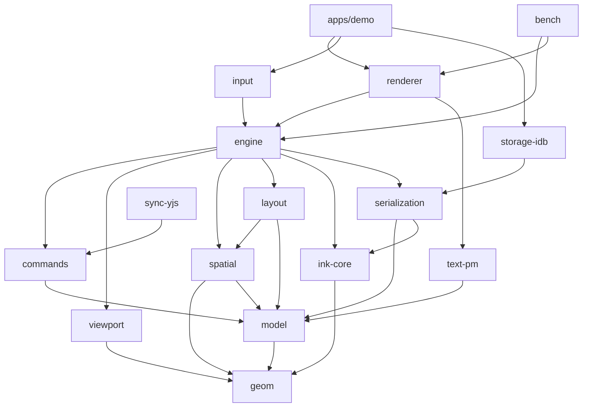
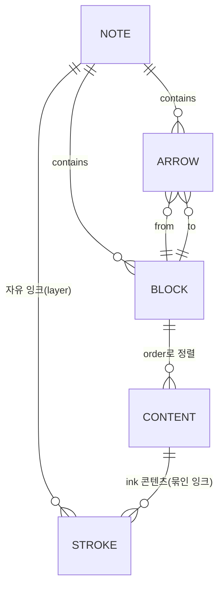
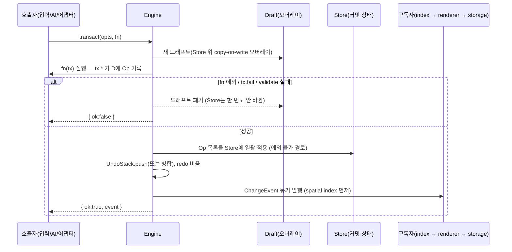
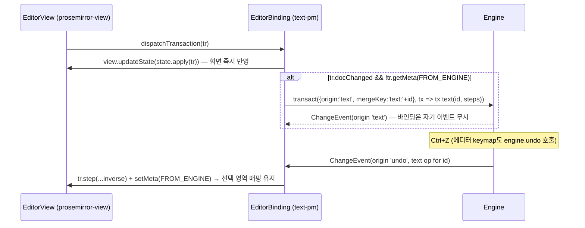
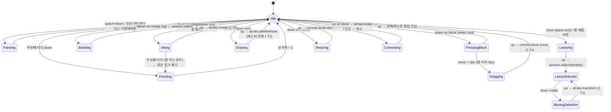

# DamianNote 캔버스 엔진 설계서

| 항목 | 내용 |
|---|---|
| 제품 | DamianNote |
| 문서명 | 캔버스 엔진 설계서 |
| 버전 | v0.3 (2026-10-02 개정: 텍스트 상자 두 종류 · 스키마 v3 · 도킹 · G1 통과 수치 반영 — 3.4 · 3.7 · 5.2 · 10 · 12.2 · 17.5 · 21절) · v0.2 (2026-10-01: 한 달 로드맵 반영 · 열린 결정 확정 · 구현 현황 21절 추가) |
| 작성일 | 2026-10-01 |
| 작성자 | 곰탱이 |
| 대상 FR | FR-001 ~ FR-009 (A. 캔버스 엔진 코어, Phase 0) |
| 원본 요구사항 | [PRD.md](./PRD.md) 4·5절, [FR.md](./FR.md) A절 및 엔진 위에 얹히는 FR |

> 이 문서는 손으로 관리한다(자동 생성 아님). `PRD.md`·`FR.md`와 달리 트래커에서 재생성되지 않는다.

**읽는 법** — 모든 결정은 `결정 / 근거 / 버린 대안` 형태로 적었다. 임계값·풀 크기·디바운스 시간 같은 **설정 상수는 초기값**이며(예: 마운트 여백 25%, 팜 판정 40px), 벤치와 실기기로 조정한다. "검증 필요"가 붙은 수치는 공개 자료로 확인하지 못한 추정치이며, 해당 마일스톤의 스파이크(17절)에서 실측으로 대체한다. FR 번호는 v1.0 확정 전까지 바뀔 수 있으므로 기능명을 함께 적었다.

## 목차

1. [개요 · 원칙](#1-개요--원칙)
2. [모듈 구조와 의존 방향](#2-모듈-구조와-의존-방향)
3. [문서 모델](#3-문서-모델)
4. [핵심 결정: 엔진 상태의 원본](#4-핵심-결정-엔진-상태의-원본)
5. [커맨드 · 트랜잭션 · undo](#5-커맨드--트랜잭션--undo)
6. [좌표계 · 뷰포트](#6-좌표계--뷰포트)
7. [공간 인덱스 · 히트테스트](#7-공간-인덱스--히트테스트)
8. [렌더러](#8-렌더러)
9. [입력 계층](#9-입력-계층)
10. [배치(layout)](#10-배치layout)
11. [잉크 파이프라인](#11-잉크-파이프라인)
12. [직렬화 · 저장](#12-직렬화--저장)
13. [동기화로 가는 길](#13-동기화로-가는-길)
14. [성능 예산](#14-성능-예산)
15. [테스트 전략](#15-테스트-전략)
16. [기술 선택표](#16-기술-선택표)
17. [Phase 0 마일스톤](#17-phase-0-마일스톤)
18. [FR 추적표](#18-fr-추적표)
19. [열린 결정](#19-열린-결정)
20. [참고 자료](#20-참고-자료)

---

## 1. 개요 · 원칙

### 1.1 엔진이 하는 일

캔버스 엔진은 한 노트(=캔버스 하나)의 **문서 상태를 보관하고, 변경을 트랜잭션으로 받아들이고, 그 상태를 화면에 그리고, 입력을 문서 변경으로 바꾸는** 계층이다. 엔진 위에 얹히는 앱(사이드바, 툴바, 노트 목록, AI 파이프라인)은 엔진 API만 쓴다.

```
┌────────────────────────── 앱 (UI 프레임워크, 미확정) ──────────────────────────┐
│  툴바 · 사이드바 · 노트 목록 · AI 파이프라인 · 설정                              │
└───────────────┬───────────────────────────────────────────────┬──────────────┘
                │ Engine API (commands, queries, events)         │ mount(container)
┌───────────────▼────────────── 헤드리스 코어 (Node 동작) ───────┐  ┌──▼──────────── DOM 계층 ─────────────┐
│ geom · model · commands · viewport · spatial · layout ·       │  │ renderer(DOM 블록 + 캔버스 오버레이) │
│ ink-core · serialization · engine(facade)                     │◄─┤ input(Pointer Events → 도구 머신)   │
└───────────────────────────────────────────────────────────────┘  │ text-pm(ProseMirror 바인딩)         │
                ▲ TextCodec(주입)                                   └─────────────────────────────────────┘
        ┌───────┴────────┐   ┌───────────────┐   ┌────────────────────┐
        │ text-pm codec  │   │ storage-idb   │   │ sync-yjs (Phase 5) │
        └────────────────┘   └───────────────┘   └────────────────────┘
```

### 1.2 소유하는 것과 빌리는 것

| 구분 | 대상 | 이유 |
|---|---|---|
| **소유** | 문서 모델(씬 그래프), 커맨드·트랜잭션·undo, 좌표계·뷰포트, 히트테스트 규칙, 배치(flow/free 전환·AI 배치 호출), 잉크 데이터·묶기/풀기, 직렬화 포맷·마이그레이션, 렌더러 골격, 입력 정규화·도구 상태 머신 | PRD "캔버스 엔진은 직접 만든다" — 자유 배치 + 노션급 텍스트 + 잉크 + 화살표의 교집합을 주는 기성품이 없음. 차별점이 여기 있다 |
| **빌림 (핵심)** | ProseMirror(model/transform/state/view) — 텍스트 편집 코어·IME | PRD 결정. 한글 IME·선택·붙여넣기는 '도구'이고 검증된 코어가 있음 |
| **빌림 (Phase 5)** | Yjs + y-prosemirror — 기기 간 병합 | PRD 결정. CRDT 알고리즘은 직접 만들 가치가 없음 |
| **빌림 (작은 부품)** | `fractional-indexing`(순서 키), `rbush`(R-tree), `perfect-freehand`(스트로크 외곽선), 그래프 배치 라이브러리(Phase 3) | 각각 수백 줄 규모의 검증된 알고리즘. **엔진 인터페이스 뒤에 숨겨** 교체 가능하게 둔다 |

"소유"의 경계는 **인터페이스**다. 예: 공간 인덱스의 *자료구조*는 rbush를 빌리지만, `SpatialIndex` 인터페이스·정밀 히트테스트·z 순서 규칙·증분 갱신 정책은 엔진 소유다.

### 1.3 설계 원칙

1. **헤드리스 우선** — 상태·규칙·계산은 DOM 없이 Node에서 돈다(FR-001). DOM은 그리기와 입력·측정에만 쓴다.
2. **모든 변경은 하나의 문(門)** — 문서 변경은 `engine.transact()` 하나로만 들어온다. 텍스트 입력, 블록 이동, AI 결과, 원격 동기화, 마이그레이션 모두 같은 경로(FR-002).
3. **커밋된 상태만 문서다** — 드래그 중 위치, 그리는 중인 스트로크, 선택, 뷰포트는 문서가 아니다. 문서에는 제스처가 끝날 때 한 번만 쓴다.
4. **연산은 속성 단위** — 변경은 `(엔티티, 필드, 값)` 단위의 작은 연산으로 표현한다. undo 역연산 자동 생성, 증분 저장, 나중의 CRDT 매핑이 모두 이것에 기댄다.
5. **좌표는 저장 가능한 것만 저장** — 캔버스(월드)·블록 상대 좌표만 저장하고 화면 좌표는 저장하지 않는다(FR-003).
6. **측정 가능한 성능** — 모든 성능 주장은 FR-008 하네스의 숫자로 증명한다. 측정 없는 최적화는 하지 않는다.

### 1.4 선행 사례에서 배울 점과 다른 점

| 사례 | 배울 점 | 우리가 다른 점 |
|---|---|---|
| Figma (멀티플레이어 블로그) | 문서 = `Map<ObjectID, Map<Property, Value>>`, 속성 단위 LWW, 부모 링크를 속성으로, 자식 순서는 fractional index | 중앙 서버 권위 대신 local-first. 텍스트는 글자 단위 병합 필요(FR-097) |
| tldraw | 레코드 스토어 + 트랜잭션(`editor.run`)으로 묶음 undo, `history: 'ignore'`로 undo 밖 변경, 카메라 = 화면↔페이지 변환, 컬링 | tldraw는 도형 중심이고 텍스트가 부차적. 우리는 블록 안 리치 텍스트가 1급이라 ProseMirror 어댑터와 단일 스택 통합이 핵심 |
| Excalidraw | 요소 배열 + 버전 필드로 단순한 동기화, 캔버스 하나에 전부 그림 | 우리는 블록을 DOM으로 그린다(텍스트 편집·IME·접근성). 대신 DOM 가상화 부담을 진다 |
| Muse / Ink & Switch local-first | 로컬이 원본, 서버는 복제본. 오프라인이 기본 상태 | 동일한 철학. 다만 CRDT는 Phase 5에 붙인다(4절) |

### 1.5 비목표 (Phase 0 및 엔진 범위 밖)

- 실시간 다중 사용자 동시 편집·커서 공유(PRD 범위 밖). 엔진은 **기기 간 비동기 병합**만 대비한다.
- 사용자용 화면. Phase 0에는 검증용 데모 페이지만 있다(FR-005).
- 텍스트 편집 기능 자체(제목·목록·서식 — FR-026~033은 Phase 2). 어댑터와 최소 스키마(문단)만 만든다.
- 클라우드 동기화 구현(Phase 5). 제약만 지킨다(13절).
- 블록 회전, 그룹/프레임, 임의 벡터 도형, 3D/WebGL 렌더러.
- 콘텐츠 사이 자동 밀어내기(FR-020이 명시적으로 배제).

---

## 2. 모듈 구조와 의존 방향

### 2.1 모듈 목록

| 모듈 | 책임 | 헤드리스 | 외부 의존 |
|---|---|---|---|
| `geom` | Vec2, Rect, Mat2D, 폴리곤, 선분-점 거리, 교차, 양자화 | ✅ | 없음 |
| `model` | 엔티티 타입, id, order 키, 정규화 스토어(읽기 전용 뷰), 불변식 검사, `TextCodec` 인터페이스 | ✅ | fractional-indexing |
| `commands` | Op, Tx(드래프트), 커맨드 카탈로그, 역연산, UndoStack, ChangeEvent | ✅ | model |
| `viewport` | 카메라 상태·변환·고정점 줌·fit·애니메이션 보간 계산 | ✅ | geom |
| `spatial` | `SpatialIndex` 인터페이스, rbush 구현, 정밀 히트테스트, 올가미 판정, 화살표 기하 캐시 | ✅ | geom, model(타입), rbush |
| `layout` | `Measurer` 인터페이스, flow↔free 전환 계산, 정리하기, 빈 영역 찾기, AI 그래프 배치 어댑터 | ✅ | geom, model, spatial |
| `ink-core` | 스트로크 코덱(양자화·델타·base64), 샘플 필터, 외곽선 생성, 지우개 기하, 묶기/풀기 좌표 변환 | ✅ | geom, perfect-freehand |
| `serialization` | 스냅샷 포맷, schemaVersion, 마이그레이션 레지스트리, 알 수 없는 필드 보존 | ✅ | model |
| `engine` | 파사드: 위 모듈을 조립한 `Engine` 클래스, 세션 상태(선택·도구·프리뷰) | ✅ | 위 전부 |
| `text-pm` | `TextCodec` 구현(헤드리스: prosemirror-model/transform), `EditorBinding`(DOM: prosemirror-view) | 코덱 ✅ / 바인딩 ❌ | prosemirror-* |
| `renderer` | DOM 블록 레이어, 캔버스 오버레이, 프레임 스케줄러, LOD | ❌ | engine, ink-core |
| `input` | Pointer Events 정규화(DOM) + 제스처 인식·도구 상태 머신(헤드리스로 테스트) | 머신 ✅ / 바인딩 ❌ | engine |
| `storage-idb` | `NoteStore` 인터페이스의 IndexedDB 구현(스냅샷 + 연산 로그) | ❌(브라우저) | serialization |
| `sync-yjs` | Phase 5. Op ↔ Y.Doc 브리지 | ✅ | yjs, y-prosemirror |

### 2.2 의존 그래프 (순환 없음)



규칙:
- **위쪽(헤드리스) 모듈은 아래쪽(DOM) 모듈을 절대 import하지 않는다.** `engine`은 `text-pm`을 모른다 — `TextCodec`을 생성자 인자로 주입받는다.
- `model`의 쓰기 API는 `commands`만 쓸 수 있다(2.4).
- `input`은 `renderer`를 모른다. 히트테스트는 `engine.query`(spatial)로 하고, 렌더러는 입력 결과(프리뷰·선택)를 엔진 이벤트로 받는다.

### 2.3 패키지 배치와 디렉터리 초안

**결정** — pnpm 워크스페이스 모노레포, 패키지는 5개로 최소화하고 패키지 내부 모듈 경계는 린트로 강제한다.
**근거** — 1인 개발에서 패키지 14개는 빌드·버전 관리 비용만 늘린다. 의존 방향은 `dependency-cruiser` 규칙으로 CI에서 막으면 충분하다. 단 "헤드리스/DOM" 경계만은 **패키지 경계**로 둬서, `engine-core`의 tsconfig에 `"lib": ["ES2022"]`(DOM 타입 없음)를 지정한다 — DOM API를 쓰면 **컴파일 에러**가 나므로 FR-001 "Node에서 전체 API 동작"을 타입 시스템이 보장한다.
**버린 대안** — (1) 단일 패키지: 헤드리스 경계를 타입으로 보장할 수 없음. (2) 모듈별 패키지 14개: 과잉.

```
damiannote/
├─ packages/
│  ├─ engine-core/            # 헤드리스. lib: ES2022, DOM 타입 금지
│  │  └─ src/
│  │     ├─ geom/  model/  commands/  viewport/  spatial/
│  │     ├─ layout/  ink-core/  serialization/
│  │     └─ engine/           # 파사드, 세션 상태
│  ├─ text-pm/                # src/codec (헤드리스) · src/binding (DOM)
│  ├─ engine-dom/             # renderer/ · input/ (input/machine·palm 은 DOM 미사용 코드 — Node에서 테스트)
│  ├─ storage-idb/
│  └─ sync-yjs/               # Phase 5 (Phase 0에는 스파이크 코드만)
├─ apps/
│  └─ demo/                   # FR-005 검증용 데모 페이지 (Vite)
├─ bench/                     # FR-008 하네스: 합성 노트 생성기, 시나리오, 결과 기록
│  ├─ synth/  scenarios/  results/   # results/*.json 은 커밋
├─ tests/                     # 교차 패키지 속성 테스트, 오프라인 e2e
└─ .dependency-cruiser.cjs
```

### 2.4 "직접 변이 API 없음"을 어떻게 강제하나 (FR-001)

- `model`은 `DocReader`(읽기 전용) 인터페이스만 공개 export한다. 실제 가변 스토어 클래스 `MutableStore`는 `model/internal`에 두고 패키지 `exports` 필드에서 노출하지 않는다.
- 엔티티 레코드는 `Readonly<...>` 타입이고, 개발 빌드에서는 `Object.freeze`로 런타임 변이도 막는다.
- 엔진 외부에서 문서를 바꾸는 유일한 방법은 `engine.transact()` / `engine.dispatch(command)`.

---

## 3. 문서 모델

### 3.1 엔티티 개요



엔진 인스턴스 하나 = 노트 하나. 폴더·태그·노트 링크·휴지통 등 노트 바깥 엔티티는 엔진 범위 밖(앱/저장소 계층)이다.

### 3.2 id 체계

**결정** — 모든 엔티티 id는 클라이언트가 생성하는 128비트 난수를 base62로 인코딩한 22자 문자열. 엔티티 종류 접두어는 붙이지 않는다(종류는 저장 위치로 안다). 생성은 `crypto.getRandomValues`(Node 19+·모든 대상 브라우저 지원, secure context 불필요).
**근거** — (1) 오프라인 기기 두 대가 각자 만든 id가 충돌하지 않아야 한다(13절). (2) `crypto.randomUUID()`는 secure context에서만 동작해 file:// 데모 등에서 막힐 수 있다. (3) 시간순 정렬(ULID/UUIDv7)이 필요한 곳은 연산 로그뿐인데 거기는 별도 `seq`를 쓴다.
**버린 대안** — 증가 정수(오프라인 충돌), UUIDv4 문자열 36자(저장 크기 1.6배), ULID(시간 노출, 이점 없음).

```ts
/** 22자 base62. 노트 안에서 엔티티 종류를 가로질러 유일. 생성 후 불변. */
export type Id = string & { readonly __brand: 'Id' };
export type NoteId = Id & { readonly __kind: 'note' };
export type BlockId = Id & { readonly __kind: 'block' };
export type ContentId = Id & { readonly __kind: 'content' };
export type ArrowId = Id & { readonly __kind: 'arrow' };
export type StrokeId = Id & { readonly __kind: 'stroke' };

/** fractional-indexing 키 (base62 문자열). 사전순 비교. */
export type OrderKey = string & { readonly __brand: 'OrderKey' };
```

### 3.3 좌표 단위와 양자화

**결정** — 저장되는 모든 좌표·크기는 **1/64 px 격자로 양자화한 double**이고, 월드 범위는 ±10,000,000 px로 제한한다.
**근거** — 1/64 = 2⁻⁶이므로 양자화된 값끼리의 덧셈·뺄셈은 |값| < 2⁴⁶ 범위에서 double로 **정확**하다. 그래서 "블록 상대 좌표 = 월드 − 블록 원점", "월드 = 상대 + 블록 원점" 왕복이 비트 단위로 무손실이다 — 잉크 묶기/풀기 무손실(FR-037)과 직렬화 왕복(FR-006)이 산술 오차 없이 성립한다. 1/64 px은 400% 줌에서도 화면 1/16 px이라 눈에 보이지 않는다. ±1e7 px는 A4 세로 약 9,000장 분량으로 노트 한 장에 충분하다.
**버린 대안** — 양자화 없는 double(왕복 오차 누적, 테스트에서 "거의 같음" 비교 필요), Int32 고정소수점 필드(직렬화·디버깅 불편, 이점은 위 방식과 동일).

```ts
export type Px = number; // 1/64 격자에 스냅된 값만 저장. geom.q(x) = Math.round(x * 64) / 64
export const WORLD_LIMIT = 10_000_000;

// geom 기본 타입 (이하 절에서 공통 사용)
export interface Vec2 { readonly x: number; readonly y: number }
export interface Size { readonly w: number; readonly h: number }
export interface Rect extends Vec2, Size {}
```

### 3.4 엔티티 타입

```ts
// ───────── 공통 ─────────
export interface AiProvenance {
  generated: true;
  /** AI 요청 단위 id. 같은 요청에서 나온 블록·화살표를 묶는다 (FR-110 재요청) */
  runId: string;
  /** 원문 구절 참조 (FR-111). 대상이 사라지면 '출처 없음'으로 표시, 오류 아님 */
  source?: { contentId?: ContentId; from: number; to: number; excerpt?: string };
}

/** 알 수 없는 필드 보존 주머니 (12.4절). 엔진은 내용을 해석하지 않고 그대로 되돌려 쓴다 */
export type Extra = Readonly<Record<string, unknown>>;

// ───────── 노트 ─────────
export interface Note {
  readonly id: NoteId;
  readonly title: string;
  readonly createdAt: number;   // epoch ms, 표시용 (순서 판단에 쓰지 않음)
  readonly updatedAt: number;
  readonly extra?: Extra;
  // 폴더·태그·아이콘·커버는 앱 계층 메타데이터 저장소 소유 (엔진 밖)
}

// ───────── 블록 ─────────
export type LayoutMode = 'flow' | 'free';

export interface Block {
  readonly id: BlockId;
  readonly x: Px; readonly y: Px;         // 월드 좌표 (좌상단)
  readonly w: Px; readonly h: Px;
  /** 'auto': h는 콘텐츠 높이를 따른다(측정값 캐시, 10.2절). 'fixed': 사용자가 세로 리사이즈로 정한 높이 — 정확한 의미(최소 높이/스크롤/잘림)는 19절 D6 */
  readonly sizing: 'auto' | 'fixed';
  readonly layout: LayoutMode;            // FR-019. AI 생성 블록은 항상 'flow'
  /** 겹침 시 쌓임 순서 전용. 읽기 순서가 아님 (19절 D5) */
  readonly z: OrderKey;
  readonly style?: { readonly color?: string; readonly border?: string };
  readonly ai?: AiProvenance;
  readonly extra?: Extra;
}

// ───────── 콘텐츠 (유니온) ─────────
/** 블록 상대 좌표. free 모드에서만 배치에 쓰이고, flow 모드에서도 값은 보존 */
export interface Frame { readonly x: Px; readonly y: Px; readonly w: Px; readonly h: Px }

interface ContentBase {
  readonly id: ContentId;
  readonly blockId: BlockId;      // 부모 링크를 속성으로 (Figma 방식)
  readonly order: OrderKey;       // 배치 모드와 무관하게 항상 존재 (PRD 4절 핵심 규칙)
  readonly frame?: Frame;         // free 모드에서 한 번이라도 놓였으면 존재
  readonly ai?: AiProvenance;
  readonly extra?: Extra;
}

export interface TextContent extends ContentBase {
  readonly type: 'text';
  /** 엔진 소유 스키마의 리치 텍스트 문서(JSON). 해석은 TextCodec이 한다 (5.6절) */
  readonly doc: TextDoc;
  /** (v0.3 · 스키마 v3) 텍스트 상자 종류. 'title' = 제목 상자(문단 하나 — I10), 'body' = 내용 상자. 없으면 body.
   *  텍스트 블록에는 텍스트 콘텐츠가 하나다 — ADR-0013 */
  readonly role?: 'title' | 'body';
}

export interface InkContent extends ContentBase {
  readonly type: 'ink';
  /** 묶을 때의 잉크 경계 크기. 표시 배율 = 실제 표시 폭 / natural.w (비율 유지 스케일) */
  readonly natural: { readonly w: Px; readonly h: Px };
  /** 묶을 때의 월드 기준점과 그때의 블록 원점 — 풀기 무손실용 (11.6절) */
  readonly bind: { readonly worldOrigin: Vec2; readonly blockOriginAtBind: Vec2 };
  // 스트로크는 Stroke.parent 로 이 콘텐츠를 가리킨다 (정규화)
}

/** Phase 3에서 추가: image | table | math | chart (FR-018). 각각 스키마 버전을 올린다 */
export interface UnknownContent extends ContentBase {
  readonly type: string;          // 이 빌드가 모르는 타입 — 렌더는 자리표시자, 데이터는 보존
  readonly raw: Readonly<Record<string, unknown>>;
}

export type Content = TextContent | InkContent | UnknownContent;

// ───────── 화살표 ─────────
export type Side = 'auto' | 'top' | 'right' | 'bottom' | 'left';
export interface Anchor {
  readonly blockId: BlockId;
  readonly side: Side;            // 'auto' = 두 블록 중심을 잇는 선이 경계와 만나는 점
  readonly t?: number;            // side 지정 시 변 위의 위치 0..1 (기본 0.5)
  readonly groupId?: Id;          // v6: 묶음 전체에 붙은 끝 (blockId = 대표 상자, 느슨한 참조)
}
export interface Arrow {
  readonly id: ArrowId;
  readonly from: Anchor;
  readonly to: Anchor;
  readonly label?: string;        // 원문 구절 (FR-066, STRUCTURE-GUIDE 4.3)
  readonly style?: ArrowStyle;    // 모양만: color · dash(v5) · line · head · tail · width · route — 바꾼 것만 저장
  readonly ai?: AiProvenance;     // v6: origin · model · promptVersion · schema · editedAt
  readonly relation?: Relation;   // v6 의미: 관계 종류 (relations.ts — 모르는 값 보존, 없으면 미정)
  readonly symbol?: string; readonly negated?: boolean; readonly sign?: '+' | '-'; readonly order?: number; readonly reply?: boolean; readonly prob?: string;
  readonly extra?: Extra;
}

// ───────── 스트로크 ─────────
export type StrokeParent =
  | { readonly kind: 'layer' }                          // 자유 잉크: 월드 좌표, order 없음
  | { readonly kind: 'content'; readonly contentId: ContentId }; // 묶인 잉크: ink 콘텐츠 natural 좌표

export interface Stroke {
  readonly id: StrokeId;
  readonly parent: StrokeParent;
  /** 점들의 기준 원점. layer면 월드 좌표, content면 ink 콘텐츠의 natural 좌표 */
  readonly origin: Vec2;
  /** 균일 배율. 올가미 크기 조절은 점을 다시 쓰지 않고 이 값만 바꾼다 */
  readonly scale: number;
  /** 원점 기준 상대 점열. 불변(생성 후 바뀌지 않음) — 11.3절 인코딩 */
  readonly points: PointsRef;
  readonly tool: 'pen' | 'highlighter';
  readonly color: string;
  readonly width: Px;             // 기준 굵기 (필압으로 변조)
  readonly bbox: Rect;            // origin·scale 반영 전 점열 경계 (캐시, 직렬화 안 함)
  readonly createdAt: number;     // 녹음 시간축 동기(FR-045)의 기준
  readonly extra?: Extra;
}
```

`PointsRef`는 지연 디코딩되는 점열 핸들이다(11.3절). 직렬화 형태는 base64 문자열 하나다.

**결정 — 스트로크 이동·크기 조절은 `origin`·`scale` 변경으로 한다.**
**근거** — 올가미로 스트로크 500개를 옮길 때 점 수만 개를 다시 쓰지 않고 필드 2개 × 500만 바뀐다. 연산 로그·undo 엔트리·나중의 CRDT 업데이트가 모두 작아진다. 묶기/풀기도 `parent`와 `origin` 변경뿐이다.
**버린 대안** — 점 좌표 직접 갱신(연산 크기가 점 수에 비례, 반복 이동 시 부동소수 누적 오차).

### 3.5 정규화된 저장 형태: 맵 vs 트리

**결정** — 엔티티 종류별 **평평한 맵(`id → 레코드`)** 으로 저장하고, 부모 관계는 자식의 속성(`content.blockId`, `stroke.parent`)으로 둔다. 트리(블록 → 콘텐츠 목록)는 파생 인덱스로 메모리에만 만든다.

```ts
export interface DocState {
  readonly note: Note;
  readonly blocks: ReadonlyMap<BlockId, Block>;
  readonly contents: ReadonlyMap<ContentId, Content>;
  readonly arrows: ReadonlyMap<ArrowId, Arrow>;
  readonly strokes: ReadonlyMap<StrokeId, Stroke>;
}

/** 파생 인덱스 (저장 안 함, 커밋 시 증분 갱신) */
export interface DerivedIndex {
  contentsByBlock: Map<BlockId, ContentId[]>;   // (order, id) 정렬 유지
  arrowsByBlock: Map<BlockId, Set<ArrowId>>;    // 블록 삭제 연쇄·화살표 추종용
  strokesByContent: Map<ContentId, Set<StrokeId>>;
}
```

**근거** — (1) 모든 변경이 `(종류, id, 필드)` 주소를 갖게 되어 연산·역연산·증분 저장이 단순해진다. (2) 콘텐츠를 다른 블록으로 옮기는 것이 `blockId` 한 필드 변경이다(Figma의 "부모 링크를 속성으로"). (3) Yjs 매핑 시 `Y.Map<id, Y.Map<field, value>>`로 1:1 대응된다(13절). (4) 정렬된 배열을 저장하지 않으므로 중간 삽입이 다른 콘텐츠를 건드리지 않는다(FR-001).
**버린 대안** — 중첩 트리 JSON(`blocks[].contents[]`): 이동이 삭제+삽입이 되고, 배열 인덱스 기반 연산은 동시 편집에 취약.

### 3.6 order 규칙

- 키 생성은 `fractional-indexing`의 `generateKeyBetween(a, b)` / 여러 개는 `generateNKeysBetween(a, b, n)`(AI가 콘텐츠 n개를 한 번에 만들 때 키가 짧아짐).
- 정렬 기준은 **`(order, id)` 사전순**. 두 기기가 같은 자리에 동시에 삽입해 같은 키가 나와도 id로 결정적 순서가 정해진다. 키 중복은 불변식 위반이 아니다.
- 삽입은 이웃 키 사이 키 하나를 새로 만들 뿐 **다른 콘텐츠의 order를 다시 쓰지 않는다**(FR-001 수락 기준). 이를 속성 테스트로 검증: 삽입 커맨드의 Op 목록에 새 콘텐츠 외의 `order` set이 없어야 한다.
- 같은 위치 반복 삽입 시 키 길이가 늘어난다. Phase 0에서는 재번호(rebalance)를 하지 않고, 벤치마크에서 최대 키 길이를 기록만 한다. 128자를 넘는 사례가 나오면 별도 유지보수 커맨드를 설계한다.
- 블록의 `z`도 같은 키 체계를 쓴다("맨 앞으로" = 최대 키 뒤).

### 3.7 불변식과 보장 위치

| # | 불변식 | 보장 위치 |
|---|---|---|
| I1 | 모든 `content.blockId`는 존재하는 블록 | 커맨드 연쇄(블록 삭제 → 콘텐츠 삭제) + 커밋 검증 |
| I2 | 모든 화살표의 `from/to.blockId`는 존재하는 블록, `from ≠ to` | 커맨드 연쇄(블록 삭제 → 연결 화살표 삭제, PRD·FR-015) + 커밋 검증 |
| I3 | `stroke.parent.kind = 'content'`이면 그 콘텐츠가 존재하고 `type = 'ink'` | 커맨드 연쇄 + 커밋 검증 |
| I4 | 스트로크가 하나도 없는 ink 콘텐츠는 존재하지 않음 | 커맨드(마지막 스트로크 삭제·풀기 시 콘텐츠도 삭제) + 커밋 검증 |
| I5 | id는 노트 안에서 종류를 가로질러 유일 | `Tx.create*` 검사 |
| I6 | 모든 좌표·크기는 유한, 1/64 격자, \|v\| ≤ WORLD_LIMIT, `w,h ≥ MIN_SIZE` | `Tx.set` 시 정규화(스냅) + 커밋 검증 |
| I7 | `order`·`z`는 유효한 fractional 키 형식 | `Tx` 검사 |
| I8 | 텍스트 `doc`은 코덱 스키마상 유효 | `TextCodec.validate` (커밋 검증) |
| I9 | 화면 좌표는 문서 어디에도 없음 (FR-003) | 타입(`ScreenPoint` 브랜드는 model에 import 불가) + 리뷰 |
| I10 | `role: 'title'` 텍스트 콘텐츠(제목 상자)의 문서는 문단 하나 (v0.3, 스키마 v3) | 커밋 검증 — 텍스트 스텝으로 줄이 나뉘어도 트랜잭션이 거부된다. 에디터는 제목 상자에서 Enter · Tab을 편집 끝으로 쓰고 여러 줄 붙여넣기를 한 줄로 합친다 |

**보장 전략: "커맨드가 맞게 만들고, 커밋이 확인한다."**
- 연쇄 삭제 같은 의미 규칙은 **커맨드가 Op를 생성할 때** 처리한다(역연산에 연쇄가 그대로 포함되어 undo 시 화살표도 돌아온다).
- 커밋 직전 `validate(draft, touchedIds)`가 **변경된 엔티티와 그 이웃만** 검사한다(O(변경량)). 위반이면 트랜잭션 전체를 버린다(5.4절). 테스트·개발 빌드에서는 매 커밋 전수 검사도 켠다.
- 원격 병합(Phase 5)은 검증 대신 `normalize()`(위반을 고치는 결정적 복구 Op 생성)를 거친다(13절).

---

## 4. 핵심 결정: 엔진 상태의 원본

### 4.1 선택지

| | (a) 자체 모델 원본 + Yjs는 동기화 어댑터 | (b) Y.Doc이 원본, 엔진은 그 위의 뷰/커맨드 | (c) 혼합: 구조는 자체 모델, 텍스트만 처음부터 Y.XmlFragment |
|---|---|---|---|
| undo 스택 단일성 | 자체 UndoStack 하나. 텍스트도 같은 스택 (5.6) | Y.UndoManager 하나로 단일화 가능(텍스트는 yUndoPlugin) | 두 스택(자체 + Y.UndoManager)을 엮어야 함 — 단일 스택 보장이 가장 어렵다 |
| 트랜잭션 롤백 (FR-002) | 드래프트 위에서 실행 후 커밋 → 실패 시 버리면 끝 | **Y.transact는 롤백이 없다.** 중간 예외 시 부분 적용이 남는다. "계획 후 적용"으로 우회해야 함 | 구조 쪽은 가능, 텍스트 쪽은 불가 |
| undo 깊이 상한 (FR-002) | 직접 구현 | UndoManager에 상한 옵션 없음 — 스택 배열을 직접 잘라야 함(검증 필요) | 혼합 |
| 역연산 검증 (무작위 왕복) | Op 단위로 결정적, 테스트 쉬움 | Yjs 내부 동작에 의존. 왕복 검증은 가능하나 실패 원인 추적이 어려움 | 혼합 |
| ProseMirror 연동 | 자체 어댑터(스텝 ↔ 엔진 Op). 직접 만들어야 함 | y-prosemirror가 바인딩 제공. 단 "Yjs 타입이 원본이고 에디터 내용을 동기적으로 대체" — 편집 중이 아닌 텍스트(정적 렌더)도 Y에서 읽어야 함 | y-prosemirror 사용 |
| 성능 (열기 200ms, 1만 블록) | 평범한 Map/객체 — 예측 가능 | Y.Doc 디코드 + 렌더용 평범한 객체로의 물질화(이중 표현) 필요. 1만 블록 디코드 시간 **검증 필요** | 중간 |
| 드래그 등 고빈도 쓰기 | 커밋 시 1회만 기록 (원칙 3) | 같은 원칙을 지키면 OK. 지키지 않으면 Y.Map이 이력을 보존해 문서가 커진다(y-utility 벤치: 10만 회 쓰기에 Y.Map 525KB vs YKeyValue 271B) | 동일 |
| 스키마 마이그레이션 (FR-006·090) | 로드 시 JSON 변환 함수 연쇄 — 단순 | CRDT 문서 마이그레이션은 기기마다 버전이 다를 때 어렵다. 같은 변경을 두 기기가 각자 하면 중복 Op 발생 | 혼합 |
| 알 수 없는 필드 보존 | `extra` 주머니로 단순 | Y.Map은 모르는 키를 그대로 들고 있어 자연스럽다 | — |
| Phase 0 범위 | Yjs 없이 시작. 범위 최소 | Phase 0부터 Yjs 의존, 학습·디버깅 비용 선불 | 둘 다 선불 |
| 나중 동기화 도입 비용 | **브리지(양방향 변환) 구현이 필요** — 가장 큰 단점. 단 연산이 속성 단위라 구조 쪽 매핑은 기계적 | 거의 0 (프로바이더만 붙이면 됨) | 낮음 |
| 원격 변경과 undo | 자체 규칙 필요 (13.3: 조건부 역연산 + 텍스트 스텝 매핑) | UndoManager가 원격 변경을 피해 로컬 변경만 되돌림 — 검증된 동작 | 혼합 |

### 4.2 결정

**결정 — (a) 자체 모델이 원본이다. Yjs는 Phase 5에 붙는 '복제 어댑터'이며, Phase 0부터 엔진 연산 포맷을 CRDT로 1:1 사상 가능한 형태로 제한해 도입 비용을 미리 낮춘다.**

**근거**
1. **FR-002 수락 기준이 (a)를 요구한다** — "실패 시 전체 롤백", "모든 커맨드는 역연산", "undo 깊이 상한", "무작위 커맨드 열 → 전부 취소 → 직렬화 동일". Yjs 트랜잭션은 롤백이 없고 UndoManager의 역연산은 엔진이 통제하지 못한다. (b)로 가면 이 기준들을 Yjs 위에서 우회 구현해야 한다.
2. **Phase 0의 목적은 "테스트로 증명 가능한 헤드리스 코어"다.** 평범한 Map + 결정적 Op는 속성 기반 테스트의 실패를 최소 반례로 줄여 원인을 바로 보여준다. Yjs 내부 상태(클라이언트 id, clock, 삭제 집합)가 섞이면 같은 테스트가 훨씬 무거워진다.
3. **동기화는 Phase 5(한 달 계획의 10/16~10/29)이고 범위가 좁다** — 실시간 공동 편집은 범위 밖, 필요한 것은 "내 기기들 사이의 오프라인 병합"이다. Phase 0~4는 Yjs 없이 끝나므로 그 사이 Yjs 학습 · 디버깅 비용을 선불하지 않는다. 그 시점의 Yjs·y-prosemirror API가 지금과 같다는 보장도 없다(조사 중 y-prosemirror 문서가 `ySyncPlugin(fragment)`에서 `syncPlugin()` + `configureYProsemirror({ ytype })` 형태로 바뀐 것을 확인). 지금 깊게 결합하면 그때 다시 쓴다.
4. **성능과 마이그레이션이 예측 가능하다.** 열기 200ms 예산을 Yjs 디코드 시간이라는 미지수에 걸지 않는다. 스키마 변경은 로드 시 순수 함수로 처리된다.
5. (a)의 최대 약점인 "브리지 비용"은 **Phase 0의 제약(13.2)과 스파이크(17절 S4)** 로 줄인다: 연산이 이미 `(종류, id, 필드, 값)` 형태이므로 구조 쪽은 Y.Map set으로 기계적으로 옮겨지고, 어려운 부분은 텍스트 하나뿐이다.

**버린 대안**
- (b) Y.Doc 원본 — 동기화 도입 비용은 가장 낮지만, Phase 0 수락 기준(롤백·상한·결정적 역연산)을 Yjs 위에서 우회해야 하고, 실시간 협업이 범위 밖인 제품에서 그 비용을 Phase 0부터 선불할 이유가 약하다.
- (c) 텍스트만 Y.XmlFragment — undo 스택이 둘로 갈라져 FR-002/FR-007의 "단일 스택, 시간순 되돌림"을 지키기 가장 어렵다.

**재검토 조건** — M5의 스파이크 S4(Op ↔ Y.Doc 브리지 + 텍스트 왕복 수렴 테스트)가 실패하면, 즉 두 복제본에 무작위 연산을 적용·교환한 뒤 수렴하지 않는 사례를 2주 안에 해결하지 못하면 (b)로 전환을 검토한다. 이 경우 바뀌는 곳은 `commands`의 적용부와 `serialization`이고, 공개 Engine API(`transact`, `ChangeEvent`, 쿼리)는 유지되도록 5절을 설계했다.

### 4.3 이 결정이 다른 절에 미치는 영향

| 절 | 영향 |
|---|---|
| 5. 커맨드 | 엔진이 Op·역연산·UndoStack을 직접 소유. 텍스트 편집은 ProseMirror 스텝을 엔진 Op로 받는다 |
| 12. 저장 | 저장 포맷은 엔진 스냅샷 + 엔진 Op 로그. Y.Doc 바이너리는 Phase 0에 없다 |
| 13. 동기화 | Phase 5에 Op ↔ Y 브리지를 만든다. Y.Doc은 동기화용 복제본이고, 로컬 원본은 여전히 엔진 스냅샷+로그 |
| 15. 테스트 | 직렬화 왕복·undo 왕복을 평범한 객체 비교로 검증 |

---

## 5. 커맨드 · 트랜잭션 · undo

### 5.1 세 단계 어휘: Op · Tx · Command

| 층 | 무엇 | 누가 만드나 | 역연산 |
|---|---|---|---|
| **Op** | 원자 변경: 생성 / 삭제 / 필드 set / 텍스트 스텝 | `Tx`의 원시 메서드만 | **자동** — 각 Op가 이전 값을 들고 있다 |
| **Tx** (트랜잭션) | Op 목록 + 드래프트 상태. 커밋되면 한 번의 ChangeEvent, undo 1단계 | `engine.transact()` | Op 역연산을 역순으로 |
| **Command** | 의미 단위 동작(`block.delete`, `ink.bind`, `ai.apply`) — Tx 원시 메서드를 호출하는 함수 | 엔진 카탈로그 + 앱 | 따로 작성하지 않음 |

**결정 — 커맨드는 역연산을 손으로 쓰지 않는다. 역연산은 Op 수준에서 기계적으로 생성한다.**
**근거** — 손으로 쓴 역연산은 버그의 온상이다(연쇄 삭제된 화살표 복원 누락 등). Op가 `prev`를 들고 있으면 "커맨드 열 → 전부 취소 → 시작 상태와 동일"(FR-002)이 구조적으로 보장되고, 테스트는 그것을 확인하기만 한다.
**버린 대안** — 커맨드 객체마다 `do/undo` 쌍(전통적 Command 패턴): 커맨드 수만큼 역연산 버그 표면이 생긴다. 전체 스냅샷 undo: 1만 블록 노트에서 메모리·시간 비용이 크고 텍스트 병합과 맞지 않는다.

### 5.2 타입

```ts
export type EntityKind = 'block' | 'content' | 'arrow' | 'stroke';

export type Op =
  | { readonly k: 'create'; readonly e: EntityKind; readonly id: Id; readonly value: Entity }
  | { readonly k: 'delete'; readonly e: EntityKind; readonly id: Id; readonly prev: Entity }
  | { readonly k: 'set'; readonly e: EntityKind | 'note'; readonly id: Id;
      readonly field: string;           // 최상위 필드만 (중첩 객체는 통째 값)
      readonly value: unknown; readonly prev: unknown }
  | { readonly k: 'text'; readonly id: ContentId;
      readonly steps: readonly TextStep[]; readonly inverse: readonly TextStep[] };

export function invert(op: Op): Op; // create↔delete, set(value,prev) 교환, text(steps↔inverse)

export type Origin =
  | 'user'        // 일반 사용자 동작
  | 'text'        // 에디터 입력 (병합 정책 대상)
  | 'ai'          // AI 결과 적용
  | 'undo' | 'redo'
  | 'layout'      // 측정값 반영 — undo 밖 (10.2)
  | 'migration'   // 로드 시 보정 — undo 밖
  | 'remote';     // Phase 5 동기화 — undo 밖

export interface TxOptions {
  origin: Origin;
  label?: string;              // undo 메뉴 표시용 ("블록 3개 삭제")
  undoable?: boolean;          // 기본: origin이 user/text/ai면 true
  mergeKey?: string;           // 직전 엔트리와 병합 후보 (5.6 타이핑 묶음)
}

export interface Tx {
  readonly doc: DocReader;     // 드래프트 반영된 읽기 뷰
  createBlock(init: BlockInit): BlockId;
  createContent(init: ContentInit): ContentId;
  createArrow(init: ArrowInit): ArrowId;
  createStroke(init: StrokeInit): StrokeId;
  set<E extends EntityKind>(e: E, id: Id, patch: Partial<EntityOf<E>>): void; // 필드별 set Op로 분해
  delete(e: EntityKind, id: Id): void;     // 원시 삭제 (연쇄 없음)
  text(id: ContentId, steps: readonly TextStep[]): void; // TextCodec으로 적용 + 역스텝 계산
  fail(reason: string): never;             // 명시적 중단 → 롤백
}

export interface Command<P = void, R = void> {
  readonly type: string;                   // 'block.delete'
  run(tx: Tx, payload: P): R;
}
```

엔진 카탈로그(Phase 0 범위): `block.create / move / resize / delete(연쇄) / duplicate / setLayout / bringToFront`, `content.insert / move(order·블록 이동) / delete / setFrame / tidy(정리하기)`, `arrow.create / reconnect / delete / setLabel`, `stroke.create / transform(origin·scale) / delete / erase`, `ink.bind / unbind`, `text.edit`, `ai.apply`. Phase 1 이후의 사용자 기능은 이 커맨드를 조합하거나 같은 방식으로 추가한다.

**구현된 커맨드 (2026-10-02, `packages/engine-core/src/commands.ts` — 함수형 커맨드, 이름이 원본):** `createTextBlock(at, {kind:'title'|'text', title, body, doc})` · `convertBoxes(ids, kind)`(상자 종류 바꾸기, 내용 → 제목은 `toTitleDoc`으로 한 줄) · `moveBlocks` · `resizeBlock` · `deleteEntities`(연쇄) · `duplicateBlocks(ids, offset, {dock})` · `bringToFront` · `createArrow` · `reconnectArrow`(끝점 다시 잇기) · `setArrowLabel` · `setText`(AI · 테스트 전용) · `editText` · `editTexts`(여러 콘텐츠 한 번에 — 블록 메뉴 내용 서식) · `extractToBlock`(선택한 글을 새 내용 상자로, undo 한 번) · `setBlockColor` · `setNoteTitle` · `applyMeasuredHeights`(`layout`, undo 밖). AI 적용은 `@dn/ai-pipeline`의 `applyStructure`(origin `ai`, 트랜잭션 하나). 텍스트 헬퍼: `titleDoc` · `bodyDoc` · `toTitleDoc` · `mergeTitleBody` · `boxKind` · `isBlankDoc` · `blockTextParts` (`model.ts`).

```ts
// 예: 블록 삭제 — 연쇄는 커맨드가 Op로 만든다 → undo 시 화살표·콘텐츠·잉크도 복원
export const deleteBlocks: Command<{ ids: BlockId[] }> = {
  type: 'block.delete',
  run(tx, { ids }) {
    for (const id of ids) {
      for (const a of tx.doc.arrowsOf(id)) tx.delete('arrow', a.id);       // PRD: 끊긴 화살표 금지
      for (const c of tx.doc.contentsOf(id)) {
        for (const s of tx.doc.strokesOf(c.id)) tx.delete('stroke', s.id);
        tx.delete('content', c.id);
      }
      tx.delete('block', id);
    }
  },
};
```

### 5.3 엔진 API

```ts
export interface Engine {
  readonly doc: DocReader;                        // 커밋된 상태 (읽기 전용)
  readonly session: SessionState;                 // 선택·도구·프리뷰 (문서 아님)
  readonly viewport: Viewport;                    // 6절. undo 밖
  readonly query: SpatialQuery;                   // 7절

  transact<R>(opts: TxOptions, fn: (tx: Tx) => R): TxResult<R>;
  dispatch<P, R>(cmd: Command<P, R>, payload: P, opts?: Partial<TxOptions>): TxResult<R>;

  undo(): boolean;
  redo(): boolean;
  readonly history: { canUndo: boolean; canRedo: boolean; depth: number; limit: number };
  closeHistoryGroup(): void;                      // 다음 텍스트 입력이 병합되지 않게

  on(ev: 'change', fn: (e: ChangeEvent) => void): Unsubscribe;
  on(ev: 'session', fn: (e: SessionEvent) => void): Unsubscribe;

  snapshot(): NoteSnapshot;                       // 12절
  dispose(): void;
}

export type TxResult<R> =
  | { ok: true; value: R; event: ChangeEvent | null }   // 변경 없으면 event null, undo 엔트리 없음
  | { ok: false; error: TxError };                      // 롤백됨. 문서 불변

export interface EngineOptions {
  textCodec: TextCodec;             // 주입 (2.2)
  undoLimit?: number;               // 기본 100, FR-022 하한 50
  textMergeWindowMs?: number;       // 기본 1000
  validate?: 'touched' | 'full';    // 기본 touched, 테스트에서 full
  idGen?: () => Id;                 // 테스트에서 결정적 생성기 주입
  clock?: () => number;
}
```

### 5.4 트랜잭션 경계와 롤백



- **드래프트**: `Map` 오버레이(`id → 레코드 | 삭제표시`). 읽기는 오버레이 → Store 순. 블록 100개 생성 트랜잭션도 오버레이 100칸이라 싸다.
- **커밋 적용은 실패할 수 없는 코드 경로**로 제한한다(검증은 커밋 전에 끝남). 그래서 "부분 적용 상태"는 구조적으로 생길 수 없다(FR-002).
- **중첩**: 트랜잭션 안의 `transact` 호출은 바깥 트랜잭션에 합류한다(별도 엔트리 없음).
- **재진입 금지**: `change` 이벤트 핸들러 안에서 `transact`를 부르면 큐에 넣어 현재 발행이 끝난 뒤 실행한다.
- **긴 제스처**: 드래그·리사이즈·올가미 이동은 트랜잭션을 열어두지 않는다. 진행 중에는 `session.preview`(문서 밖 오버라이드, 8.4)에만 쓰고, 손을 뗄 때 트랜잭션 하나로 커밋한다(원칙 3).

### 5.5 변경 이벤트

```ts
export interface ChangeEvent {
  readonly txId: number;                 // 노트 안 단조 증가
  readonly origin: Origin;
  readonly label?: string;
  readonly ops: readonly Op[];           // 저장(연산 로그)·동기화가 그대로 쓴다
  readonly changed: {
    readonly blocks: ReadonlySet<BlockId>;
    readonly contents: ReadonlySet<ContentId>;
    readonly arrows: ReadonlySet<ArrowId>;
    readonly strokes: ReadonlySet<StrokeId>;
    readonly note: boolean;
  };
  /** 경계 상자가 바뀐 엔티티 (렌더러 더티 영역·인덱스 갱신용). 화살표는 연결 블록 이동 시 자동 포함 */
  readonly geometry: ReadonlySet<Id>;
  readonly created: ReadonlySet<Id>;
  readonly deleted: ReadonlySet<Id>;
}
```

구독 순서는 고정한다: ① 파생 인덱스·공간 인덱스(동기, 다음 히트테스트가 일관되도록) ② 렌더러(더티 표시만, 실제 그리기는 rAF) ③ 텍스트 바인딩(편집 중 콘텐츠에 외부 변경 반영) ④ 저장(디바운스) ⑤ (Phase 5) 동기화 브리지. 렌더러와 저장이 **같은 이벤트**를 구독한다(FR-002).

### 5.6 ProseMirror 입력을 같은 스택에 합치기

**텍스트 포맷 결정** — 모델의 `TextDoc`과 `TextStep`은 **엔진이 소유한 중립 JSON 스키마**로 고정하되, 형태는 ProseMirror 노드 JSON·스텝 JSON의 부분집합과 같게 한다.

```ts
/** ProseMirror Node.toJSON()과 같은 모양. 허용 노드/마크 타입은 엔진 스키마 버전이 정한다 */
export interface TextNode {
  type: string; attrs?: Record<string, unknown>;
  content?: TextNode[]; text?: string;
  marks?: { type: string; attrs?: Record<string, unknown> }[];
}
export type TextDoc = TextNode & { type: 'doc' };

/** 위치는 문서 트리의 정수 오프셋(ProseMirror 위치 체계) */
export type TextStep =
  | { stepType: 'replace'; from: number; to: number; slice?: SliceJSON; structure?: boolean }
  | { stepType: 'replaceAround'; from: number; to: number; gapFrom: number; gapTo: number;
      insert: number; slice?: SliceJSON; structure?: boolean }
  | { stepType: 'addMark' | 'removeMark'; from: number; to: number; mark: MarkJSON }
  | { stepType: 'attr'; pos: number; attr: string; value: unknown };

/** 헤드리스 코덱 — engine-core가 아는 텍스트의 전부. 구현은 text-pm/codec (Node에서 동작) */
export interface TextCodec {
  readonly schemaId: string;                         // 'pm-v1'
  validate(doc: TextDoc): boolean;
  apply(doc: TextDoc, steps: readonly TextStep[]): { doc: TextDoc; inverse: TextStep[] };
  plainText(doc: TextDoc): string;                   // 검색·내보내기·추정 측정
  empty(): TextDoc;
}
```

**근거** — (1) 엔진 코어는 ProseMirror를 import하지 않는다(코덱 주입). (2) 저장 포맷이 ProseMirror 클래스가 아니라 우리 스키마 JSON이므로, 라이브러리를 바꿔도 저장 데이터는 그대로이고 새 어댑터가 자기 연산을 `TextStep`으로 번역하면 된다(FR-007 "어댑터 인터페이스 바깥 코드는 바뀌지 않음"). (3) 모양을 ProseMirror와 맞춰서 현 시점의 번역 비용은 0이다.
**버린 대안** — ProseMirror `Node`를 모델에 그대로 저장(라이브러리 교체 시 저장 포맷까지 바뀜), 텍스트 변경을 문서 통째 교체 Op로 기록(undo·저장·병합이 모두 문서 크기에 비례).

**흐름** (편집 중인 텍스트 콘텐츠 하나):



- 에디터에는 `prosemirror-history`를 **넣지 않는다**. Mod-Z/Mod-Shift-Z/Mod-Y 키맵은 `engine.undo/redo`를 부른다 → 블록 조작과 텍스트 편집이 하나의 시간순 스택을 공유(FR-007).
- **IME 조합 중**(`view.composing`)에도 ProseMirror는 트랜잭션을 낸다. 엔진은 그대로 기록하되, 조합 중에는 엔진발 변경을 에디터에 밀어넣지 않고 `compositionend`까지 보류한다(조합 중 DOM을 건드리면 글자 깨짐·중복의 주원인). 조합 중 undo 단축키는 무시.
- **에디터 풀 (FR-007)**: EditorView는 사용자가 텍스트 콘텐츠를 클릭·포커스할 때만 만든다. 그 전까지는 같은 CSS 클래스로 `TextDoc`을 정적 DOM(`DOMSerializer`)으로 렌더해 전환 시 레이아웃이 흔들리지 않게 한다. 클릭 지점의 캐럿은 에디터를 같은 엘리먼트에 붙인 뒤 `view.posAtCoords`로 잡는다. 동시에 살아 있는 인스턴스는 `maxLiveEditors`(기본 4: 편집 중 1 + 최근 편집 3, 설정값)로 제한하고 넘치면 가장 오래 안 쓴 것을 파괴해 정적 렌더로 되돌린다(LRU). 조합 중이거나 포커스된 에디터는 파괴하지 않는다. ProseMirror 커뮤니티에서도 인스턴스 수천 개를 동시에 띄우는 대신 가상화하라는 결론이다.
- 같은 스텝을 에디터와 엔진이 각각 적용하므로 두 결과가 같다는 것을 개발 빌드에서 `doc.eq` 비교로 단언한다(불일치 시 엔진 쪽을 진실로 에디터 상태 재설정).

**타이핑 묶음 정책 (FR-022 "단어/문장 단위")** — `UndoStack.push` 시 직전 엔트리와 병합할지 결정:

| 조건 | 결과 |
|---|---|
| 직전 엔트리와 `mergeKey`가 같고(같은 콘텐츠), 간격 < `textMergeWindowMs`(1초) | 병합 후보 |
| 병합 후보라도 **새 단어 시작**(직전 입력이 공백·문장부호이고 이번이 글자) | 새 엔트리 (단어 단위) |
| Enter(문단 분리), 붙여넣기, 서식 변경, 삭제 방향 전환(입력↔삭제), 선택 위치 비연속 점프 | 새 엔트리 |
| 사이에 다른 커맨드(블록 이동 등)가 끼었거나 `closeHistoryGroup()` 호출 | 새 엔트리 |
| 한글 IME: 조합 중 트랜잭션들은 항상 같은 엔트리. 음절 확정은 경계가 아님(공백이 경계) | — |

병합은 Op 목록을 이어붙이는 것이고(텍스트 스텝은 연속 스텝으로), 역연산도 이어붙인 것의 역순이라 정확성이 유지된다.

### 5.7 UndoStack

```ts
export interface UndoEntry {
  readonly txIds: readonly number[];
  readonly label?: string;
  readonly ops: readonly Op[];
  readonly mergeKey?: string;
  readonly time: number;
  readonly selectionBefore: SelectionSnapshot;   // undo 시 선택 복원 (문서 아님)
  readonly selectionAfter: SelectionSnapshot;
}
```

- **상한**: `undoLimit`(기본 100, 설정값). 초과 시 가장 오래된 엔트리를 버린다(FR-002, FR-022 "50단계 이상").
- **undo** = `transact({origin:'undo', undoable:false}, tx => apply(invert(ops) 역순))` 후 엔트리를 redo 스택으로. 역연산이 검증에 실패하면(예: 비-undo 변경과 충돌) 그 엔트리를 버리고 `history-conflict` 경고 이벤트를 낸다 — 롤백 덕분에 문서는 손상되지 않는다.
- **undo 밖 변경**: `layout`·`migration`·`remote` origin과 뷰포트·선택·도구 상태. 뷰포트는 아예 Op가 아니다(FR-003).
- **노트 전환 시 초기화**(FR-022): 엔진 인스턴스가 노트당 하나이므로 노트를 닫으면 스택도 사라진다. 스플릿 뷰(FR-153)는 엔진 두 개, 스택 두 개.
- **AI 결과 적용 = 1 트랜잭션**: AI 파이프라인은 응답 검증 → 측정(10.2) → 배치 계산(10.4)을 **트랜잭션 밖에서 끝낸 뒤** `dispatch(aiApply, plan, {origin:'ai', label:'AI 구조화'})` 한 번으로 블록·콘텐츠·화살표를 만든다. 블록 100개도 undo 1단계(FR-002, FR-022). 직후의 전체 맞춤(FR-012)은 뷰포트 조작이라 스택에 들어가지 않는다.

---

## 6. 좌표계 · 뷰포트

### 6.1 세 좌표계

| 좌표계 | 원점·단위 | 저장 | 쓰는 곳 |
|---|---|---|---|
| **월드(캔버스)** | 노트 원점, CSS px @ 100% | ✅ | 블록 x/y, 자유 잉크, 화살표 기하 |
| **블록 상대** | 블록 좌상단, 월드 단위 | ✅ | 콘텐츠 frame, ink 콘텐츠 natural 좌표 |
| **화면** | 캔버스 컨테이너 좌상단, CSS px | ❌ | 입력, 렌더 |

```ts
export type WorldPoint = Vec2 & { readonly __space: 'world' };
export type BlockPoint = Vec2 & { readonly __space: 'block' };
export type ScreenPoint = Vec2 & { readonly __space: 'screen' };   // engine-core/model에서 import 금지 (린트)
```

브랜드 타입으로 좌표계를 섞는 실수를 컴파일 단계에서 막는다.

### 6.2 카메라 표현

**결정** — 회전 없는 균일 배율 카메라: `screen = world × z + t`. 상태는 `{ tx, ty, z }` 세 숫자. 행렬은 필요할 때 `Mat2D(a=z, b=0, c=0, d=z, e=tx, f=ty)`로 만든다.
**근거** — 회전이 비목표이므로 6원소 행렬을 상태로 들고 다닐 이유가 없다. 역변환이 `(s − t) / z`로 나눗셈 하나라 수치 오차가 최소다.

```ts
export interface Camera { readonly tx: number; readonly ty: number; readonly z: number }

export interface Viewport {
  readonly camera: Camera;
  readonly size: { w: number; h: number };          // 컨테이너 CSS px
  readonly zoomRange: { min: number; max: number }; // 기본 0.25 ~ 4 (FR-011)
  toWorld(p: ScreenPoint): WorldPoint;               // (p - t) / z
  toScreen(p: WorldPoint): ScreenPoint;              // p * z + t
  toBlock(p: WorldPoint, b: Block): BlockPoint;      // p - (b.x, b.y)
  fromBlock(p: BlockPoint, b: Block): WorldPoint;
  visibleWorldRect(margin?: number): Rect;
  zoomAt(anchor: ScreenPoint, nextZ: number): Camera;  // 고정점 줌
  panBy(dx: number, dy: number): Camera;
  fit(rects: readonly Rect[], padding: number): Camera; // FR-003, FR-012
  set(c: Camera): void;                                  // 이벤트 'viewport' 발행, undo 밖
}
```

### 6.3 고정점 줌

화면 점 `s`를 고정하고 배율을 `z → z'`로 바꿀 때: `w = (s − t)/z`, `t' = s − w·z'`. `z'`는 `zoomRange`로 클램프한 뒤 계산하므로 한계에서도 고정점이 흔들리지 않는다. 핀치는 매 프레임 두 손가락 중점을 고정점으로 `zoomAt` + 중점 이동량만큼 `panBy`.

### 6.4 fit

`fit(rects, padding)`: 합집합 `U` → `z = clamp(min((W−2p)/U.w, (H−2p)/U.h), min, max)` → `t = 화면중심 − U중심·z`. 빈 집합이면 기본 카메라 `{tx: W/2, ty: H/2, z: 1}`(월드 원점이 화면 중앙)을 반환(FR-012 "블록이 없으면 기본 줌/원점"). 애니메이션(FR-012 300ms)은 앱 계층이 `interpolate(c0, c1, t)`로 하며, 배율은 로그 공간에서 보간해 줌 속도가 일정하게 보이게 한다.

### 6.5 정밀도

- **왕복 오차 (FR-003: 25%~400%, 0.01px 이내)** — double에서 `(w·z + t − t)/z`의 상대 오차는 ~1e-16 수준이다. 월드 |w| ≤ 1e7, z ∈ [0.25, 4]에서 절대 오차는 1e-8 px 이하로 기준보다 6자리 여유가 있다. 속성 테스트로 무작위 점·카메라에 대해 확인한다.
- **먼 좌표의 렌더 정밀도** — 문제는 엔진 수학이 아니라 **브라우저 합성기**다. CSS transform 행렬은 합성 단계에서 float32로 처리되는 경우가 있어(브라우저별, 검증 필요) 좌표가 1e6 px을 넘으면 float32 해상도가 0.06 px까지 나빠져 떨림이 보일 수 있다. 대응: **떠다니는 원점(floating origin)** — 렌더러는 블록 DOM 위치를 `블록.x − layerOrigin`으로 두고, 래퍼 transform의 이동량이 ±50,000 px을 넘으면 `layerOrigin`을 현재 화면 중심 근처로 다시 잡고 **마운트된 블록만** 위치를 갱신한다. 이 재기준은 드물게(장거리 이동 시) 일어나는 예외 경로이고, 일반 팬·줌 프레임에서는 래퍼 transform만 바뀐다(FR-005). 캔버스 오버레이도 같은 `layerOrigin`을 빼고 그린다.
- 월드 범위 ±1e7 px 밖으로 나가는 Op는 I6 위반으로 거부.

### 6.6 뷰포트 상태의 저장

**결정** — 뷰포트는 화면 크기와 무관한 형태 `{ centerX, centerY, zoom }`(월드 중심 + 배율)로 직렬화하고, **문서 스냅샷과 별도 레코드**(기기 로컬)에 저장한다. 문서 Op·undo·연산 로그에 들어가지 않는다(FR-003).
**근거** — `tx/ty`는 화면 좌표라 저장 금지 대상이고(FR-003), 태블릿과 데스크톱은 화면 크기가 달라 같은 `t`가 다른 곳을 보여준다. 기기마다 보던 위치가 다른 것이 자연스럽다.
**버린 대안** — Note 엔티티 필드로 저장(동기화 시 기기끼리 뷰포트를 덮어씀).

---

## 7. 공간 인덱스 · 히트테스트

### 7.1 자료구조 선택

| 후보 | 장점 | 단점 |
|---|---|---|
| **R-tree (rbush)** | 크기·분포가 제각각인 사각형에 강함, 대량 적재(`load`) 빠름, 삭제/삽입 지원 | 갱신 = 삭제+삽입(약간의 비용) |
| 균일 그리드(공간 해시) | 갱신 O(1), 구현 단순 | 셀 크기 하나로 30px 스트로크와 3,000px 블록을 동시에 잘 다루지 못함, 줌 아웃 시 많은 셀 순회 |
| Quadtree | 개념 단순 | 큰 사각형이 상위 노드에 몰림(느슨한 quadtree 필요), 동적 갱신 시 재분할 비용 |

**결정** — 레이어별로 분리된 **R-tree 3개**(블록·화살표·자유 스트로크), 구현은 `rbush`(maxEntries 9 기본, 16으로 시작해 벤치로 조정). `SpatialIndex` 인터페이스 뒤에 숨긴다.
**근거** — 블록·스트로크·화살표는 크기 분포가 수백 배 차이 나 균일 그리드에 불리하다. rbush는 100만 개 대량 적재 1.25초·작은 영역 검색 1,000회 0.03초(공식 벤치, Node)라 1만 개 뷰포트 질의 1ms(FR-004)는 큰 여유가 있다. 레이어를 나누는 이유: 질의 패턴(블록은 컬링, 스트로크는 지우개·올가미)과 허용 오차·우선순위가 다르고, 한 레이어 대량 변경이 다른 레이어 트리를 흔들지 않는다.
**버린 대안** — 균일 그리드(위 단점), 직접 구현한 동적 AABB 트리(이점 대비 구현·검증 비용).

묶인 잉크(ink 콘텐츠의 스트로크)와 콘텐츠는 인덱스에 넣지 않는다 — 블록 안은 블록 히트 후 DOM(flow)이나 frame(free)으로 판정한다(7.4).

```ts
export interface SpatialIndex<K extends Id> {
  load(items: readonly { id: K; box: Rect }[]): void;     // 열기 시 일괄 적재
  upsert(id: K, box: Rect): void;                          // 이동·크기 변경 (내부: remove+insert)
  remove(id: K): void;
  searchRect(r: Rect): K[];                                // 후보 (bbox 교차)
  size(): number;
}

export interface SpatialQuery {
  visible(rect: Rect): { blocks: BlockId[]; arrows: ArrowId[]; strokes: StrokeId[] };
  hitPoint(p: WorldPoint, opts: HitOptions): Hit | null;   // 가장 위의 것 하나
  hitAll(p: WorldPoint, opts: HitOptions): Hit[];          // 위→아래 정렬
  inRect(r: Rect, opts: AreaOptions): Hit[];               // 밴드 선택
  inLasso(poly: readonly WorldPoint[], opts: AreaOptions): Hit[]; // 올가미
  findFreeRect(size: Size, near: WorldPoint, gap: number): Rect;  // 빈 영역 (10.4)
}

export interface HitOptions {
  layers: ReadonlyArray<'handles' | 'ink' | 'arrows' | 'blocks'>; // 도구가 고름
  tolerancePx: number;      // 화면 px 기준 → 월드 = tolerancePx / z
}
export type Hit =
  | { kind: 'block'; id: BlockId }
  | { kind: 'arrow'; id: ArrowId; t: number }       // 선 위 위치
  | { kind: 'stroke'; id: StrokeId }
  | { kind: 'handle'; owner: Id; handle: HandleKind };
```

### 7.2 증분 갱신

`ChangeEvent.geometry`의 id마다 `upsert/remove`. 전체 재구축은 열기 시 `load` 한 번뿐이다(FR-004). 블록이 움직이면 `arrowsByBlock`으로 연결 화살표의 기하를 다시 계산해 화살표 인덱스도 갱신한다 — 이 화살표들은 커맨드가 Op를 만들지 않아도 `geometry`에 자동 포함된다(화살표 데이터는 그대로, 파생 기하만 바뀜).

**그리지 않는 화살표 (10/28 · 10/29)**: 정한 변(`side`)이 상대 상자를 등지면(아래 변인데 상대가 옆 · 위) 서로 마주 보는 변으로 그리고(`fitAnchors`), 두 끝 상자가 붙어 있으면(사이가 가로 · 세로 모두 `DOCK_GAP` 16 이하, 겹침 포함) 기하를 만들지 않는다(`endsTouch` → `arrowGeometry` undefined — 그리기 · 누르기 · 인덱스에서 빠짐). 둘 다 그릴 때만의 판정이라 화살표 데이터 · 라벨은 그대로이고, 상자를 떼면 다시 보인다.

**드래그 중**에는 인덱스를 갱신하지 않는다(프리뷰는 문서가 아님). 드래그 중 필요한 질의(스냅·드롭 대상)는 프리뷰 오프셋을 적용해 보정한다.

### 7.3 정밀 판정과 허용 오차

| 대상 | bbox 질의 후 정밀 판정 | 허용 오차 |
|---|---|---|
| 블록 | 사각형 포함 | 0 (가장자리 앵커·핸들은 `handles` 레이어에서 별도) |
| 화살표 | 점–폴리라인(곡선이면 평탄화) 거리 ≤ `max(선두께/2 + tol, tol)` | 기본 tol = 8 화면 px → 월드 `8/z` (FR-065 "8px 이상") |
| 자유 스트로크 | 점–폴리라인 거리 ≤ `width·scale/2 + tol` | 기본 tol = 6 화면 px |

허용 오차를 포함하도록 인덱스 질의 사각형을 `tol/z`만큼 확장한 뒤 정밀 판정한다(FR-004 "선 두께보다 넓은 허용 오차").

### 7.4 z 순서와 "가장 위"

화면의 쌓임 순서(위 → 아래): ① 선택 핸들 ② 자유 잉크(오버레이) ③ 화살표(오버레이, 19절 D4) ④ 블록(`z` 키 내림차순). `hitPoint`는 `opts.layers` 순서대로 판정해 처음 맞는 것을 반환하고, 블록끼리는 `(z, id)` 최대를 고른다. 같은 레이어의 스트로크끼리는 `createdAt`이 늦은 것이 위.

도구가 레이어를 고른다: 선택 도구 `['handles','arrows','blocks']`(잉크는 올가미로 다룸), 지우개 `['ink']`, 펜은 히트테스트 생략(성능).

### 7.5 영역 질의 — 사각형과 올가미

- **사각형(밴드 선택, FR-014)**: 블록은 교차(intersect) 기준(노션·Figma 관례 — 걸치면 선택). 옵션으로 포함(contain) 기준.
- **올가미(FR-036)**: 폴리곤 bbox로 후보 → 정밀 판정.
  - 스트로크 포함 규칙(FR-036 "일부만 걸친 스트로크"): **샘플 점의 50% 이상이 폴리곤 내부이면 포함**(짝홀 규칙). 비율은 설정값. 점이 3개 미만인 점 획은 중심점 하나로 판정.
  - 블록: 네 꼭짓점이 모두 내부이면 포함.
- 정밀 판정은 후보마다 O(점 수 × 폴리곤 변 수)이므로, 폴리곤을 64×64 비트 격자로 래스터화해 점 판정을 O(1)로 만드는 최적화를 후보가 1,000개 이상일 때만 쓴다.

### 7.6 정확성 검증 (FR-004)

무작위 블록/화살표/스트로크 집합과 무작위 이동·삭제 열을 적용한 뒤, 무작위 점·사각형·폴리곤 질의마다 **인덱스 결과 == 전수 검사 결과**(같은 정밀 판정 함수를 모든 요소에 적용)를 fast-check로 확인한다.

---

## 8. 렌더러

### 8.1 레이어 구성

```
화면 (컨테이너, position: relative, overflow: hidden, touch-action: none)
├─ canvas#ink-overlay        (z 4) 자유 잉크 · 형광펜 · 지우개 커서        ← 화면 크기 캔버스
├─ canvas#ui-overlay         (z 5) 선택 테두리 · 핸들 · 올가미 · 밴드 · 앵커 프리뷰 · 젖은 잉크
├─ canvas#arrow-overlay      (z 3) 화살표 · 라벨
├─ div#block-layer           (z 2) transform: translate(tx', ty') scale(z)   ← 래퍼 하나
│   ├─ div.block (left/top = 블록 − layerOrigin, width/height)  … 마운트된 블록만
│   │   ├─ div.content[text]  (정적 렌더 또는 EditorView)
│   │   └─ svg.content[ink]   (묶인 잉크, 스타일별 path 병합)
│   └─ …
└─ canvas#lod-underlay       (z 1) 줌 아웃 LOD: 블록을 사각형+요약으로 (8.5)
```

- **블록 = DOM**(텍스트·IME·접근성·임베드를 브라우저에 맡김), **잉크·화살표·선택 = 캔버스**(개수가 늘어도 DOM 노드가 늘지 않음) — PRD 결정 그대로.
- 캔버스 오버레이는 **화면 크기**이고 래퍼 안에 넣지 않는다. 매 그리기 때 `setTransform(z·dpr, 0, 0, z·dpr, tx·dpr, ty·dpr)`를 걸고 월드 좌표의 벡터 경로를 그리므로 줌 후에도 흐려지지 않는다(FR-005).
- 오버레이 캔버스 크기 = `cssSize × devicePixelRatio`, `matchMedia('(resolution: …dppx)')` 변화(모니터 이동)와 `ResizeObserver`로 재설정(FR-005 DPR).
- **묶인 잉크는 블록 DOM 안의 SVG**로 그린다. 오버레이에 그리면 겹친 블록의 z 순서를 지킬 수 없기 때문(위 블록 아래 깔려야 할 잉크가 위로 올라옴). 스타일(색·도구)별로 path를 병합해 ink 콘텐츠 하나당 SVG 노드 수를 몇 개로 제한한다.
- 화살표를 블록 위 또는 아래(PRD는 2026-10-01부터 추천안 (b)를 따름)에 둘지는 19절 D4. 레이어 순서만 바뀌므로 엔진 구조에는 영향 없다.

### 8.2 UI 프레임워크와의 관계

**결정 — 엔진 렌더러는 어떤 UI 프레임워크에도 의존하지 않는 바닐라 TypeScript + DOM API다.** 앱 UI(툴바·사이드바·패널)는 프레임워크(React 후보, PRD 미확정)로 만들고, 캔버스 영역은 `mount(container)`로 엔진에 넘긴다.
**근거** — (1) 1만 블록의 마운트/언마운트·transform 쓰기는 프레임 예산이 빠듯해 가상 DOM 비교 비용을 끼울 여유가 없다. (2) 프레임워크 선택을 늦출 수 있다(PRD "엔진 코어가 프레임워크에 의존하지 않으므로 선택을 늦출 수 있다"). (3) ProseMirror 자체가 DOM을 직접 소유하므로 블록 내부를 프레임워크가 관리하면 충돌한다.
**버린 대안** — React로 블록 렌더(블록마다 컴포넌트): 마운트 수백 개/프레임에서 재조정 비용, ProseMirror DOM 소유권 충돌.

확장점: 콘텐츠 타입별 뷰는 `ContentViewFactory`로 등록한다. 표·그래프·DB 뷰처럼 복잡한 콘텐츠(Phase 3+)는 팩토리 안에서 원하는 프레임워크로 그려도 된다(예: 블록 컨테이너에 React root 생성) — 엔진은 컨테이너 엘리먼트와 수명 주기만 관리한다.

```ts
export interface ContentView {
  readonly el: HTMLElement | SVGElement;
  update(next: Content, prev: Content): void;   // 바뀐 콘텐츠만 호출 (FR-005)
  setLod(level: 'full' | 'reduced'): void;
  destroy(): void;
}
export interface ContentViewFactory {
  type: string;                                  // 'text' | 'ink' | ...
  create(content: Content, ctx: RenderContext): ContentView;
}
```

### 8.3 DOM 가상화 (FR-005 "뷰포트 밖 블록은 마운트하지 않음")

- 매 프레임(카메라가 바뀐 프레임만) `query.visible(viewport.visibleWorldRect(margin))`로 후보를 얻는다.
- **히스테리시스**: 마운트 영역 = 뷰포트를 화면 크기의 25% 확장, 언마운트 영역 = 75% 확장. 경계 근처에서 깜빡이며 마운트·언마운트를 반복하지 않는다.
- **시간 분할 마운트**: 한 프레임의 마운트 작업에 3ms 예산(14절). 넘치면 다음 프레임으로 미루고, 아직 마운트되지 않은 블록은 LOD 언더레이가 사각형으로 대신 그려 빈칸이 보이지 않게 한다. 뷰포트 중심에 가까운 블록부터 마운트.
- **블록 셸 재사용 풀**: 언마운트한 `div.block` 셸을 최대 200개 보관해 재사용(생성 비용·GC 감소). 콘텐츠 뷰는 재사용하지 않는다(상태 오염 방지).
- 편집 중인 블록(EditorView가 붙은 블록)은 뷰포트 밖으로 나가도 언마운트하지 않는다(IME·선택 상태 보존).
- 블록 높이(auto)는 마운트 후 `ResizeObserver`로 읽는다(10.2).

### 8.4 변경 반영과 프리뷰

- `ChangeEvent`를 받으면 `changed`의 id 중 **마운트된 것만** 더티 표시 → 다음 rAF에서 해당 블록의 위치/크기 스타일, 해당 콘텐츠 뷰 `update()`만 호출. 오버레이는 `geometry` id들의 이전·이후 bbox 합집합을 더티 사각형으로 모아, 더티 영역이 화면 면적의 30% 미만이면 그 영역만 `clip` 후 다시 그리고 그 이상이면 전체를 다시 그린다(FR-005 "바뀐 요소만 다시 그림").
- **프리뷰(드래그·리사이즈·올가미 이동)**: `session.preview`는 `Map<Id, {dx, dy, dw?, dh?, scale?}>`. 렌더러는 프리뷰가 있는 블록에 `transform: translate(dx,dy)`를 걸고(개별 블록 스타일 변경이지만 팬·줌이 아니라 사용자가 옮기는 블록에만), 연결 화살표는 프리뷰를 반영한 기하로 오버레이에 다시 그린다(FR-064 "블록 이동 시 화살표 자동 추종", FR-147 드래그 예산).

### 8.5 팬·줌 중 최적화와 줌 시 텍스트 품질

1. **래퍼 transform만 변경**(FR-005). 블록 DOM의 개별 스타일은 건드리지 않는다(떠다니는 원점 재기준 제외, 6.5).
2. **흐림 문제**: 래퍼에 `will-change: transform`이 걸린 동안 브라우저는 레이어를 처음 래스터한 배율로 재사용해 확대 시 글자가 흐려질 수 있다. 대응: **제스처 중에만** `will-change: transform`을 켜고(빠른 합성), 제스처가 끝나고 150ms 뒤 끄면 브라우저가 현재 배율로 다시 래스터해 선명해진다. 브라우저별 동작은 M0 스파이크 S1에서 확인(검증 필요).
3. **LOD**: `z < 0.4`에서는 블록 DOM 대신 LOD 언더레이 캔버스에 블록 사각형 + 첫 줄 텍스트(또는 회색 줄)를 그리고 DOM 블록은 언마운트한다. 25% 줌에서 화면에 블록 수천 개가 들어오는 경우 DOM 수천 개를 마운트하면 프레임 예산을 지킬 수 없기 때문이다. 임계값은 벤치로 조정. 화살표·잉크도 `z < 0.4`에서는 단순화 경로(외곽선 대신 중심선 폴리라인)로 그린다.
4. **오버레이 그리기**: 스트로크마다 월드 좌표 `Path2D`를 캐시(11.4)해 매 프레임 `setTransform` + `fill(path)`만 한다. 보이는 스트로크가 많아 오버레이 그리기가 예산(4ms)을 두 프레임 연속 넘기면 **적응형 비트맵 모드**로 전환: 제스처 동안은 마지막으로 그린 비트맵을 CSS transform으로 따라가게 하고(재그리기 없음), 제스처가 끝나면 벡터로 다시 그린다.

### 8.6 프레임 스케줄링

```ts
export interface FrameScheduler {
  /** 같은 프레임 요청은 하나로 합친다. 단계 순서 고정 */
  request(stage: 'camera' | 'mount' | 'dom' | 'overlay' | 'ui'): void;
}
```

- 입력 핸들러는 상태만 바꾸고 `request()` — 그리기는 항상 rAF 한 번에서 `camera → mount → dom → overlay → ui` 순서로. 같은 프레임 안에서 **DOM 쓰기 → 레이아웃 읽기**가 섞이지 않게, 측정(ResizeObserver 결과)은 다음 프레임 시작에 모아 처리한다(레이아웃 스래싱 방지).
- 입력 → 화면 지연: 포인터 이벤트는 프레임당 한 번 묶여 오므로(Chrome·Safari의 rAF 정렬), 처리 → 같은 프레임 rAF 그리기로 **1프레임 이내**가 목표. 펜 잉크의 추가 대책은 11.2.
- 탭이 숨겨지면(rAF 정지) 저장 플러시만 수행.

---

## 9. 입력 계층

### 9.1 정규화

```ts
export interface NormalizedPointer {
  readonly id: number;                     // pointerId
  readonly device: 'mouse' | 'touch' | 'pen';
  readonly phase: 'down' | 'move' | 'up' | 'cancel';
  readonly screen: ScreenPoint;
  readonly world: WorldPoint;              // 정규화 시 viewport로 변환
  readonly pressure: number;               // 0..1. 마우스는 눌림 0.5, 펜 down 시 0 보고 대비(11.2)
  readonly tilt?: { x: number; y: number };
  readonly contact?: { w: number; h: number };   // 터치 접촉 크기 (팜 판정)
  readonly buttons: number;                // 펜 배럴 버튼 = 2 (FR-154 올가미 매핑)
  readonly modifiers: { shift: boolean; alt: boolean; ctrl: boolean; meta: boolean; space: boolean };
  readonly time: number;
  readonly samples: readonly SamplePoint[];      // getCoalescedEvents() 펼친 것 (없으면 자기 자신)
  readonly predicted: readonly SamplePoint[];    // getPredictedEvents() (그리기 전용, 저장 안 함)
  hit(layers: HitOptions['layers']): Hit | null; // 지연 계산 (FR-005 "히트테스트 결과와 함께")
}
```

- 대상 엘리먼트는 화면 컨테이너 하나. `touch-action: none`, `setPointerCapture`로 캔버스 밖으로 나가도 추적.
- `getCoalescedEvents`/`getPredictedEvents`는 기능 탐지 후 사용(Safari는 18.2부터 지원). 없으면 이벤트 자신만.
- `wheel`(트랙패드 핀치는 `ctrlKey + wheel`), Safari의 `gesturestart/change`(데스크톱 Safari 트랙패드 핀치)도 정규화해 `zoom` 의도로 변환.
- `hit()`은 **지연 계산**: 펜 필기 중에는 호출하지 않아 비용 0.

### 9.2 펜·터치·마우스 구분과 팜 리젝션 (FR-040)

| 상황 | 규칙 |
|---|---|
| 최근 2초 안에 `pen` 이벤트를 본 기기 | **펜 모드**: 한 손가락 터치는 그리기·선택 안 함(무시). 두 손가락은 팬·줌 |
| "펜으로만 필기" 설정 켬 | 터치는 절대 그리지 않음. 한 손가락 = 팬 |
| 펜 접촉 중 들어온 터치 | 전부 무시(손바닥) |
| 터치 접촉 크기 `contact.w·h`가 임계 초과(기본 40×40 CSS px) | 손바닥으로 보고 무시 |
| 터치가 먼저 내려오고 80ms 안에 펜이 내려옴 | 그 터치가 시작한 동작을 취소(프리뷰 폐기) — 펜이 이긴다 |
| 마우스·트랙패드 | 펜 도구 선택 시 마우스로도 필기 가능(FR-040 "마우스·트랙패드에서도 필기") |

판정은 헤드리스 `PalmFilter`(입력 열 → 통과/거부)로 구현해 기록된 실제 이벤트 열로 테스트한다.

### 9.3 제스처 인식

- 두 포인터(터치) 동시 → `pinch`: 매 프레임 중점·거리로 `zoomAt` + `panBy`(6.3). 세 번째 손가락은 무시.
- 펜 더블탭(FR-154)은 브라우저 표준 이벤트가 없어 웹에서는 지원이 제한된다 — 앱 셸이 네이티브면 브리지로 전달받는다(19절 D1과 연동). 엔진은 `ToolEvent('pen-double-tap')`를 받는 자리만 둔다.
- 스페이스+드래그 팬(FR-011): 키 상태를 `modifiers.space`로 정규화.
- 휠: `ctrl/meta + wheel` = 줌(커서 고정점, FR-011). 수식어 없는 휠의 기본 동작은 19절 D7.

### 9.4 도구 상태 머신



모든 상태에서 `pointercancel`·Esc는 프리뷰를 버리고 Idle로 돌아간다(문서 변경 없음).

- 상태 머신은 헤드리스(`NormalizedPointer` 열을 받아 `Effect` 목록을 냄: `preview.set`, `dispatch(cmd)`, `viewport.set`, `session.select`). DOM 없이 기록된 이벤트로 테스트한다.
- **모든 커밋은 제스처 끝에 1 트랜잭션** — 드래그·지우기·올가미 이동이 각각 undo 1단계.
- 도구 전환은 세션 상태이며 undo 밖.

---

## 10. 배치(layout)

### 10.1 원칙

- 블록은 자유 좌표(사용자·AI가 놓은 자리). 엔진은 블록을 자동으로 밀어내지 않는다 — 예외: 글이 늘어 높이가 커지면 닿는 아래 상자만 레고처럼 함께 내린다(`flowBelow`, ADR-0014 11/02).
- **도킹 (v0.3, ADR-0014)**: 겹침을 막는 것은 지금 놓는 블록 하나다. `dock.ts`의 순수 함수 — `snapRect`(끄는 동안 화면 10px 안의 이웃 가장자리 · 붙는 자리에 자석 스냅, 간격 `DOCK_GAP` 16, 안내선 반환, Shift = 끄기, 막힌 자리로는 스냅 안 함), `findDockSpot`(놓거나 만든 자리가 겹치면 겹친 블록의 아래 · 옆 붙는 자리 중 가장 가까운 빈 곳, 4단계 BFS 후 나선), `isFree` · `rectsOverlap`. 드래그 놓기 · 새 블록(더블클릭 · T/B 도구 · 붙여넣기 · 화살표로 새 블록 · 블록으로 분리) · 복제에 쓴다. 블록 높이가 늘어 이웃과 겹쳐도 이웃은 움직이지 않는다. `fitResize`(10/29): 크기 조절(모서리 끌기 · Ctrl+화살표)도 바꾼 변이 이웃의 이음매(16) 안으로 들어가면 그 앞에서 멈춘다 — 이웃을 덮지도 밀지도 않는다. 자동 높이 상자는 폭을 줄여 글이 접혀 늘어난 키가 아래 이웃을 덮게 되면 그 폭으로는 줄이지 않는다(engine-dom `fitBoxResize`, 화면에서 잰다). 여러 상자를 함께 Ctrl+화살표로 바꾸면 고른 상자끼리도 같은 규칙 — 한 줄로 붙은 상자는 바깥 변만 커진다.
- flow 모드 블록의 콘텐츠 쌓기는 **브라우저 CSS 일반 흐름**이 한다(`display: flow-root`, order 순 DOM 순서). JS 리플로우 엔진을 만들지 않는다.
- free 모드 콘텐츠는 `frame`으로 절대 배치. 겹침 허용(FR-020).

### 10.2 블록 높이는 누가 계산하나

**결정 — 화면에서는 DOM 측정이 진실이고, 모델의 `h`는 "마지막으로 알려진 높이" 캐시다. 측정값은 `origin:'layout'`(undo 밖) 트랜잭션으로 모델에 쓰되, 로컬 편집이 일어난 블록에 대해서만 쓴다.**

규칙:
1. `sizing: 'auto'` 블록의 높이는 렌더된 콘텐츠 높이. 마운트된 블록을 `ResizeObserver`로 측정.
2. 측정값이 모델 `h`와 1px 이상 다르고, **(a) 그 블록에 이번 세션에서 로컬 편집 트랜잭션이 있었거나 (b) 모델 `h`가 없을 때(새 블록)만** `layout` 트랜잭션으로 반영. 여러 블록 측정은 한 프레임에 하나의 트랜잭션으로 묶는다.
3. 단순히 보기만 한 블록은 측정값이 달라도 쓰지 않는다 — 기기마다 글꼴이 달라 측정값이 다른데, 보는 것만으로 쓰면 동기화(Phase 5) 때 두 기기가 높이를 번갈아 덮어쓰는 핑퐁이 생긴다.
4. 마운트되지 않은 블록의 컬링·히트테스트는 모델 `h`를 쓴다. 차이는 마운트 히스테리시스 여백(25%)이 흡수한다.

**근거** — 공간 인덱스·전체 맞춤·AI 빈 영역 찾기는 마운트되지 않은 블록의 크기도 알아야 하므로 모델에 높이가 있어야 한다. 그러나 높이를 헤드리스로 정확히 계산하려면 글꼴 메트릭·줄바꿈·IME를 재현해야 해 비현실적이다.
**버린 대안** — (1) 헤드리스 텍스트 레이아웃 엔진(글꼴 셰이핑까지 필요, 과잉). (2) 높이를 저장하지 않고 항상 측정(언마운트 블록 1만 개의 크기를 알 수 없음). (3) 측정할 때마다 무조건 기록(동기화 핑퐁, 연산 로그 오염).

`sizing: 'fixed'`(사용자가 세로로 리사이즈한 블록)의 동작은 19절 D6.

### 10.3 Measurer 인터페이스

```ts
export interface Measurer {
  /** 블록 폭이 w일 때 콘텐츠들의 흐름 배치 결과 (블록 상대) */
  measureFlow(block: Block, contents: readonly Content[], w: Px): Promise<{
    height: Px; frames: ReadonlyMap<ContentId, Frame>;
  }>;
}
```

- **브라우저 구현** `DomMeasurer`: 화면 밖(visibility:hidden, 같은 CSS) 측정용 컨테이너에 정적 렌더해 읽는다. 블록 100개를 한 번의 레이아웃 패스로 측정(쓰기 전부 → 읽기 전부).
- **헤드리스 구현** `EstimateMeasurer`: `plainText` 길이 × 평균 글자 폭 / 폭 → 줄 수 × 줄 높이. 테스트·Node 벤치·측정 불가 상황의 대체값.

사용처:
- **flow → free 전환(FR-019)**: `measureFlow`의 frames를 그대로 콘텐츠 `frame`에 쓰고 `layout:'free'`로 — 한 트랜잭션. "현재 화면 위치를 그대로" 만족.
- **free → flow**: `layout:'flow'`만 set, `frame`은 보존 → 다시 free로 가면 원래 좌표 그대로(FR-019 왕복 무손실).
- **정리하기(FR-020)**: free 모드 그대로 두고 `measureFlow` 결과로 `frame`들을 order 순 재배치 — undoable 트랜잭션.
- **좁은 화면 대체 렌더(FR-019·FR-152)**: 렌더러가 컨테이너 폭이 임계 미만이면 free 블록도 flow로 **그리기만** 한다. 모델은 바뀌지 않는다.
- **블록 폭 리사이즈(FR-016)**: 텍스트는 새 폭으로 브라우저가 다시 흐르게 하고, ink 콘텐츠는 `natural` 비율로 스케일(11.6).

### 10.4 AI 결과 자동 배치 (FR-109 방향)

엔진 몫: 배치 계산을 **헤드리스 순수 함수**로 제공하고, 결과를 한 트랜잭션으로 적용하는 커맨드(`ai.apply`)를 제공한다. 알고리즘 선택의 최종 확정은 Phase 3.

```ts
export interface GraphLayoutInput {
  nodes: { id: string; w: Px; h: Px }[];       // 크기는 Measurer로 미리 잰 값
  edges: { from: string; to: string }[];
  direction: 'LR' | 'TB';
}
export interface GraphLayoutEngine {
  layout(input: GraphLayoutInput): Promise<Map<string, Vec2>>; // 상대 좌표, 겹침 없음
}
```

| 후보 | 방향성(원인→결과) | 겹침 없음 | 비용 | 판단 |
|---|---|---|---|---|
| **계층형(Sugiyama) — dagre 계열** | ✅ 층으로 방향이 읽힘 | ✅ | 작음, 동기 | **1순위.** 관계 그래프의 기본 |
| 계층형 — ELK(elkjs) | ✅ 더 나은 교차 최소화·포트 | ✅ | 번들 큼(검증 필요), 웹 워커 권장 | 품질 부족 시 교체 후보 |
| 힘 기반(d3-force) | ❌ 방향 일관성 없음 | 반복 후 대체로 | 반복 계산 | 탈락 — FR-109 "일관된 방향" 위반 |
| 격자/트리 단순 배치 | 트리만 | ✅ | 최소 | 엣지가 없을 때(비교·수치 결과) 사용 |

절차: ① AI 노드마다 블록 크기 측정(`DomMeasurer`, flow 모드 고정 — PRD "AI 블록은 항상 flow") ② 계층형 배치로 상대 좌표 ③ 결과 묶음 bbox 크기로 `query.findFreeRect(size, near=뷰포트 중심, gap=48)` — 뷰포트 중심에서 나선형으로 후보 위치를 돌며 블록 인덱스 질의가 비어 있는 첫 자리(FR-109 "기존 블록이 있으면 빈 영역에") ④ 1 트랜잭션 적용 ⑤ 앱이 `viewport.fit`(FR-012) — undo 밖.

측정 → 배치 → 적용이 모두 끝난 뒤 커밋하므로, 측정 후 높이가 바뀌어 겹치는 일이 없고 트랜잭션이 하나로 유지된다.

**배치 다듬기 (2026-10-27, `engine-core/src/tidy.ts` · `tidy-layer.ts`)**: 이미 놓인 상자들의 자리 · 크기를 다듬는 순수 함수 `tidyLayout(nodes, edges, groups, heightAt?, labelWidth?)` → 상자 사각형, 적용은 `applyTidy`(트랜잭션 한 번). 차례(층 · 층 안 순서)는 지금 자리에서 읽어 그대로 두고 좌표만 새로 — 층 사이 64 · 층 안 40(라벨이 있으면 라벨 폭 + 40), 층 안 차례를 지키며 이웃 층 가운데로(등위 회귀, 수렴할 때까지), 제목 상자 폭 단계(1.4배 안은 같은 폭), 묶음은 안을 먼저 다듬은 한 덩어리 · 모양 묶음 · 카드 · 고리 · 층 쌓기는 통째로. 쓰는 곳: AI 결과의 흐름형 덩어리(`arrange.ts`), 블록 메뉴 · 명령 팔레트의 '배치 다듬기'(`engine-dom/src/tidy-view.ts` — 제목 한 줄 폭 · 높이를 DOM으로 잰다).

**구현 (2026-10-02, `packages/ai-pipeline`)**: dagre 대신 자체 계층형 배치 `layeredLayout`(순환 끊기 → 최장 경로 층 → 무게중심 정렬, 노드 ≤ 60 · 엣지 ≤ 120 규모라 충분, 입출력 형태는 위 `GraphLayoutInput`과 같음). 크기는 앱이 텍스트 노드를 화면 밖 DOM으로 실제 측정하고(`CanvasView.measureText`), 그래프 · 표는 렌더러가 없어 `estimateMeasure`(글자 수 기반 추정)를 쓴다. 빈 영역은 `findFreeSpot`(나선, gap 48). 적용은 `applyStructure` — 노드는 본문이 없으면 제목 상자, 있으면 내용 상자, 그래프 · 표는 `chart-v0` · `table-v0` 알 수 없는 콘텐츠로 보존(렌더러는 FR-018).

---

## 11. 잉크 파이프라인

### 11.1 개요

```
펜 입력 ─► PalmFilter ─► 샘플 수집(coalesced) ─► 최소 거리 필터 ─► 젖은 잉크 렌더(+predicted)
                                                        │ pointerup
                                                        ▼
                                  stroke.create Tx (원점+양자화 점열) ─► 마른 잉크 렌더(Path2D 캐시)
```

### 11.2 샘플링·스무딩

- 펜은 OS가 240Hz로 샘플링해도 pointermove는 프레임당 하나로 합쳐 오므로, **`getCoalescedEvents()`를 반드시 펼친다**(Safari 18.2+, Chrome). 미지원이면 이벤트 자신만.
- **저장 전 필터는 최소한**: 직전 점과 0.5 화면 px 미만이면 버림(제자리 떨림). 스무딩·간소화는 **렌더 시점**에 한다 — 저장은 원본에 가깝게 두어 나중에 렌더 알고리즘을 바꿔도 데이터가 남는다.
- 필압: `pressure`가 down 시 0으로 오는 기기가 있어 첫 점은 두 번째 점의 필압으로 보정. 마우스는 필압 없음 → 속도 기반 시뮬레이션(perfect-freehand `simulatePressure`)은 마우스·필압 0 기기에서만.
- **젖은 잉크**: 진행 중 스트로크는 `ui-overlay`에 증분으로 그린다(전체 오버레이 재그리기 없음). `getPredictedEvents()` 점은 그 프레임에만 그리고 저장하지 않는다(체감 지연 감소). 캔버스 컨텍스트 `desynchronized: true` 힌트는 지원 브라우저에서 지연을 줄인다(효과 검증 필요, 스파이크 S5).

### 11.3 저장 표현

**결정 — 점열(x, y, 필압, 시간) 원본을 저장한다. 외곽선 경로는 저장하지 않는다.**
**근거** — 외곽선은 렌더 알고리즘·굵기 설정의 결과물이라 파생 데이터다. 원본 점이 있으면 필압 곡선·스무딩을 바꿔 다시 그릴 수 있고, 지우개 판정·올가미·OCR(FR-038)·녹음 동기(FR-045)가 모두 점열을 쓴다. 벡터라서 확대해도 깨지지 않는다(FR-034).
**버린 대안** — 외곽선 폴리곤 저장(용량 2배 이상, 재렌더 불가), 비트맵(확대 시 깨짐).

인코딩:

```ts
/** 메모리: 지연 디코딩 핸들. 디스크: base64 문자열 하나 */
export interface PointsRef {
  readonly encoded: string;               // 직렬화 형태
  readonly count: number;
  decode(): Float64Array;                 // [x0,y0,p0,t0, x1,y1,p1,t1, ...] 첫 호출 시 디코드 후 캐시
}
// 인코딩: x,y = 원점 기준 1/64 px 정수의 델타 → zigzag varint
//         p = 0..1023 (10bit) 델타 → zigzag varint
//         t = 스트로크 시작 기준 ms 델타 → varint
// 전체 바이트열 → base64
```

- 좌표가 1/64 px 정수라 인코딩이 **무손실**(3.3) — 직렬화 왕복(FR-006) 성립.
- 델타+varint로 점당 대략 4~6바이트(검증 필요, 스파이크 S2에서 실측). 1만 획 × 100점이어도 수 MB 수준.
- 열기 시 **보이는 스트로크만** 디코드한다(14절 열기 예산).

### 11.4 렌더

- 마른 잉크: `perfect-freehand`의 `getStroke(points, {size, thinning, smoothing, streamline, simulatePressure})`로 외곽선 폴리곤 → 2차 베지어 `Path2D`로 변환해 **스트로크별 캐시**(키: id + LOD). 캐시는 월드 좌표라 줌이 바뀌어도 재생성하지 않는다. 메모리 상한(LRU, 기본 2만 개 경로).
- `z < 0.4` LOD: 외곽선 대신 간소화(Ramer–Douglas–Peucker, 허용 오차 1 화면 px) 중심선 `stroke()`.
- **형광펜**: 형광펜 스트로크를 별도 오프스크린 캔버스에 불투명하게 그린 뒤 `globalAlpha` 0.35로 한 번 합성 — 형광펜끼리 겹쳐도 진해지지 않고 아래 내용이 비친다(FR-034).
- 묶인 잉크: 같은 외곽선을 SVG path 문자열로 만들어 ink 콘텐츠 SVG에 스타일별 병합(8.1).

### 11.5 지우개

**결정 — 기본은 스트로크 단위 지우개. 부분 지우개는 "스트로크 분할"로 설계만 열어두고 Phase 4 범위 결정 시 구현한다.**
- 스트로크 단위: 지우개 경로(폭 포함)와 자유 스트로크의 거리 판정(7.3)으로 닿은 스트로크를 제스처 동안 모아 프리뷰로 흐리게 → up 시 `stroke.delete` 1 트랜잭션.
- 부분: 닿은 구간을 잘라 원본 삭제 + 조각 스트로크 생성(점열이 불변이므로 새 스트로크로). 모델 변경 없이 커맨드만 추가하면 된다.
**근거** — 굿노트류의 기본 동작이고, 점열 불변 원칙(3.4)과 충돌하지 않는다.

### 11.6 묶기/풀기 좌표 변환 (FR-037)

**묶기** `ink.bind(strokeIds)`:
1. 대상 블록: 선택 스트로크 bbox와 겹치는 블록 중 겹침 면적이 가장 큰 것(동률이면 z가 위인 것). 없으면 잉크 bbox + 여백 크기의 새 블록(flow, fixed 폭)을 만들어 담는다.
2. ink 콘텐츠 생성: `natural = 잉크 bbox 크기`, `bind = { worldOrigin: bbox 좌상단, blockOriginAtBind: (block.x, block.y) }`, order = 블록 안 위치에 맞는 키(flow면 측정된 콘텐츠 frame 사이에서 잉크 상단 y가 들어갈 자리, free면 맨 뒤), free 모드면 `frame = bbox − 블록 원점`.
3. 각 스트로크: `parent = content`, `origin = 원래 origin − worldOrigin`(natural 좌표). **점열은 그대로.**
4. 전부 1 트랜잭션.

**풀기** `ink.unbind(contentId)`:
- 표시 배율 `s = 표시폭 / natural.w`가 1이면: `world origin = stroke.origin + bind.worldOrigin + (현재 블록 원점 − bind.blockOriginAtBind)`. 블록이 안 움직였으면 원래 좌표 **정확히** 복원, 움직였으면 같은 만큼 평행이동한 자리. 모든 값이 1/64 격자라 덧셈·뺄셈은 오차 없음 → **좌표 왕복 무손실**(FR-037).
- `s ≠ 1`(블록이 리사이즈됨)이면 동작은 19절 D9 결정에 따른다(기본안: 현재 보이는 자리·크기로 풀고 `stroke.scale *= s`).
- 콘텐츠 삭제(I4) — 1 트랜잭션.

flow 블록에 묶을 때 잉크는 흐름 자리로 "끼워지므로" 시각 위치가 바뀔 수 있다 — 그래서 위치 복원은 표시 위치가 아니라 `bind` 기록으로 한다.

### 11.7 대량 스트로크 성능

- 자유 스트로크는 R-tree로 컬링(7.1) → 보이는 것만 그림.
- 점열 지연 디코드, Path2D 캐시, LOD, 적응형 비트맵 모드(8.5).
- 합성 노트 생성기(FR-008)에 "강의 필기" 프로필: 블록 500 + 자유 스트로크 2만(평균 80점)을 추가해 측정.
- 이 조합에서도 예산을 못 지키면 다음 단계로 **WebGL 오버레이**(삼각형화된 외곽선 일괄 그리기)를 검토한다. Phase 0에서는 Canvas2D로 시작한다(16절).

---

## 12. 직렬화 · 저장

### 12.1 포맷

**결정 — 논리 포맷은 JSON 호환 객체 `NoteSnapshot` 하나. 스트로크 점열만 base64 문자열(11.3)로 넣는다. IndexedDB에는 이 객체를 문자열화하지 않고 그대로(구조화 복제) 저장하고, 백업·내보내기에는 같은 객체를 `JSON.stringify`한다.**
**근거** — (1) 저장·백업·동기화가 같은 포맷을 쓴다(FR-006). (2) JSON은 사람이 읽고 디버깅할 수 있고 알 수 없는 필드 보존이 쉽다. (3) 덩치의 대부분인 점열은 이미 압축 바이너리(base64)라 JSON 오버헤드가 작다. (4) IDB 구조화 복제는 `JSON.parse` 단계를 없앤다.
**버린 대안** — 전체 바이너리 포맷(protobuf/MessagePack 등): 디버깅·확장 비용 대비 열기 시간 이득이 측정되지 않음. M0 스파이크 S2에서 200ms 예산을 못 지키면 다시 검토.

```ts
export interface NoteSnapshot {
  schemaVersion: number;                 // 정수, 1부터. FR-006 필수 필드
  engine: { textSchema: string };        // 'pm-v1' — 텍스트 스키마 식별자
  note: Note;
  blocks: Record<string, Block>;         // 정규화 맵 (3.5)
  contents: Record<string, Content>;
  arrows: Record<string, Arrow>;
  strokes: Record<string, SerializedStroke>;   // points: base64, bbox 제외(파생)
  extra?: Record<string, unknown>;       // 알 수 없는 최상위 필드
}

export interface ViewRecord {            // 문서 밖, 기기 로컬 (6.6)
  noteId: NoteId; centerX: number; centerY: number; zoom: number;
}

export function serialize(doc: DocState): NoteSnapshot;                       // 순수
export function deserialize(s: unknown, codec: TextCodec): DeserializeResult;  // 순수
export type DeserializeResult =
  | { ok: true; doc: DocState; migratedFrom?: number }
  | { ok: false; reason: 'newer-version'; version: number }   // FR-090: 덮어쓰지 않고 경고
  | { ok: false; reason: 'invalid'; errors: string[] };
```

### 12.2 schemaVersion과 연쇄 변환

```ts
export interface Migration {
  from: number;                                   // n → n+1
  migrate(s: Record<string, unknown>): Record<string, unknown>; // 순수 함수, 입력 변경 금지
}
export class MigrationRegistry {
  register(m: Migration): void;                   // from 중복·누락 시 등록 단계에서 에러
  upgrade(s: { schemaVersion: number }, target: number): NoteSnapshot; // 1→2→…→target 연쇄
}
```

- 버전 n의 스냅샷을 열면 `n → n+1 → … → 현재`를 차례로 적용한다(FR-006). 각 변환 함수는 픽스처 기반 테스트를 반드시 가진다(`fixtures/v{n}/*.json` → 기대 결과).
- 현재보다 **높은** 버전이면 `newer-version`을 반환하고 저장을 막는다(FR-090 "덮어쓰지 않고 경고"). 읽기 전용 표시 여부·안내는 앱 몫.
- 마이그레이션 결과 재저장, 실패 시 원본 백업 키 보존(FR-090)은 저장소 계층이 한다. 엔진은 순수 함수만 제공한다.
- 스키마 버전 1(Phase 0)의 범위: Note·Block·TextContent(문단만)·InkContent·Arrow·Stroke. Phase 2 텍스트 타입(FR-026), Phase 3 콘텐츠 타입(FR-018)마다 버전을 올린다.
- **구현 (2026-10-02): 현재 `SCHEMA_VERSION = 3`.** 레지스트리는 `migrations` 맵(버전 → 변환 함수, 위 클래스 대신). v1 → v2: 첫 heading을 제목 칸으로 떼어 냄 · v2 → v3: 한 블록의 제목 칸 + 본문 칸을 상자 하나로(본문이 비면 제목 상자, 제목이 비면 내용 상자, 둘 다면 제목을 맨 앞 제목3 줄로 합친 내용 상자, 본문 콘텐츠 id 유지 — ADR-0013). v2는 10/02 몇 시간만 쓰인 중간 형태다.
- **구버전 로그 재생 순서**: 연산 로그는 기록 당시 버전의 문서 형태를 전제로 한다. 그래서 storage-idb `openOlder`는 구버전 스냅샷을 `deserialize(…, {noMigrate:true})`로 그대로 읽고 → 로그를 구버전 형태에 재생하고 → `serialize(engine, extra, asVersion=구버전)`로 다시 내보낸 뒤 마이그레이션 → 원본을 `migration-v{n}` 백업 → 최신 스냅샷으로 압축한다. 실패하면 원본은 그대로 두고 `migration-failed` 백업만 남긴다.

### 12.3 무손실 왕복 (FR-006)

`deserialize(serialize(doc))`가 `doc`과 **구조적으로 같음**을 무작위 문서(fast-check 생성기)로 검증한다. 성립 근거: 좌표 1/64 격자(3.3), 점열 무손실 인코딩(11.3), 파생 데이터(`bbox`, 파생 인덱스)는 직렬화하지 않고 다시 계산, 맵 키 순서에 의존하지 않는 비교.

### 12.4 알 수 없는 필드 보존 (FR-006)

- 역직렬화는 "열린 파싱": 엔티티마다 아는 필드를 꺼내고 **나머지를 `extra`에 그대로 담는다.** 직렬화 시 `extra`를 펼쳐 되돌려 쓴다.
- 모르는 콘텐츠 `type`은 `UnknownContent`(`raw` 전체 보존)로 살려두고 렌더러는 자리표시자를 그린다. 이동·삭제·order 변경은 가능, 내용 편집은 불가.
- 모르는 최상위 키는 `NoteSnapshot.extra`.
- 커맨드는 `extra`를 건드리지 않는다. 블록 복제(FR-015)는 `extra`도 복사한다.
- `extra`는 같은 버전 안에서 "선택적 필드 추가"를 견디기 위한 장치이고, 상위 버전 데이터의 저장은 12.2대로 막는다.

### 12.5 증분 저장: 스냅샷 + 연산 로그

**결정 — 노트마다 스냅샷 레코드 1개 + 추가 전용 연산 로그. 커밋된 트랜잭션의 `ops`를 모아 로그에 추가하고, 로그가 커지면 스냅샷을 다시 쓰고 로그를 비운다(압축).**

| 이벤트 | 동작 |
|---|---|
| 트랜잭션 커밋 | 메모리 큐에 `{seq, txId, origin, ops}` 추가. 300ms 디바운스, 최대 1초 안에 IDB 트랜잭션 1회로 일괄 기록 (FR-089 "1초 내") |
| 로그 500건 초과 / 유휴 30초 / `visibilitychange: hidden`·`pagehide` | 스냅샷 재기록 + 로그 삭제를 IDB 트랜잭션 하나로 (원자적) |
| 열기 | 스냅샷 읽기 → 로그 `getAll()` → 순서대로 재생 |

**근거** — 1만 블록 노트에서 글자 하나마다 수 MB 스냅샷을 다시 쓰면 저장이 프레임을 방해하고 배터리에 나쁘다. 로그 레코드는 트랜잭션 단위라 그대로 동기화 전송 단위(FR-095)가 될 수 있다.
**버린 대안** — 매번 전체 재기록(위 이유). 엔티티마다 IDB 레코드 1개: 열기 시 레코드 수만 개를 읽어야 한다 — Nolan Lawson의 측정에서 Safari 5만 건 커서 읽기 4.7초가 `getAll` 배치로 0.23초가 됐지만, 배치로도 레코드 수에 비례하는 비용이 남아 200ms 예산에 부담.

재생 중 실패하는 로그(손상)는 그 지점에서 멈추고 그때까지의 상태로 열며, 원본 로그를 백업 키에 보존한다.

### 12.6 저장소

```ts
/** FR-089 "저장소 종류와 무관한 동일 인터페이스" */
export interface NoteStore {
  load(noteId: NoteId): Promise<{ snapshot: unknown; log: LogRecord[]; view?: ViewRecord } | null>;
  appendLog(noteId: NoteId, records: LogRecord[]): Promise<void>;
  compact(noteId: NoteId, snapshot: NoteSnapshot, upToSeq: number): Promise<void>;
  saveView(v: ViewRecord): Promise<void>;
  backup(noteId: NoteId, key: string, data: unknown): Promise<void>;   // FR-090 원본 보존
}
```

| 후보 | 판단 |
|---|---|
| **IndexedDB** | **Phase 0~1 구현.** 모든 대상 브라우저·웹뷰에서 동작, 객체 저장, 트랜잭션 원자성 |
| localStorage | 탈락 — 동기 API(메인 스레드 차단), 용량 수 MB |
| OPFS | 대용량 첨부(이미지·오디오·PDF) 후보. 노트 문서는 IDB |
| 네이티브 파일(Tauri·Capacitor 등) | 앱 셸 결정(19절 D1)에 따름. `NoteStore` 구현만 추가 |

**조사 발견 (중요)** — WebKit은 사용자가 7일간 상호작용하지 않은 웹사이트의 스크립트 저장소(IndexedDB 포함)를 삭제한다. 홈 화면에 추가한 웹앱은 예외이고, `navigator.storage.persist()`가 이 규칙을 풀어주는지는 문서화되어 있지 않다. iPad Safari에서 일반 웹사이트로 쓰면 local-first 원본이 사라질 수 있다. 엔진 설계는 바뀌지 않지만 **배포 형태 결정(19절 D1)** 이 필요하다.

### 12.7 열기 200ms 예산 분해

FR-008의 "열기" = **역직렬화 시작부터 첫 화면 표시까지**. 아래는 목표 배분이며 모든 칸은 추정치다(검증 필요) — M0 스파이크 S2에서 실측으로 바꾼다.

| 단계 | 예산 (ms) | 전략 |
|---|---|---|
| IDB 스냅샷 읽기 (구조화 복제, 수 MB) | 45 | 레코드 1개. 점열은 문자열이라 복제가 싸다 |
| 연산 로그 읽기·재생 (≤500건) | 10 | `getAll` 1회, 압축 정책으로 상한 |
| 마이그레이션 | 0 | 같은 버전이면 0. 구버전은 1회성이라 예산 밖, 재저장 |
| 모델 구축 + O(n) 구조 검증 | 25 | 텍스트는 JSON 그대로, ProseMirror Node 생성 안 함 |
| 공간 인덱스 일괄 적재 | 15 | `rbush.load` |
| 뷰포트 질의 + 첫 마운트 (보이는 블록 ≤200, 정적 텍스트) | 50 | 나머지는 다음 프레임들로 시간 분할(8.3) |
| 오버레이 첫 그리기 | 15 | 보이는 스트로크만 디코드 |
| 스타일·레이아웃·페인트 (첫 프레임) | 25 | |
| 여유 | 15 | |
| **합계** | **200** | |

`deserialize`의 순수 부분(모델 구축 + 인덱스)은 Node 벤치로 따로 측정해 회귀를 잡는다(FR-006 마지막 기준).

---

## 13. 동기화로 가는 길

### 13.1 언제·어떻게 (4절 결정의 귀결)

- **Phase 0~4**: Yjs 의존 없음. 13.2의 제약을 지키고, M5에서 브리지 스파이크(S4)로 사상 가능성을 확인한다.
- **Phase 5**: `sync-yjs`에 **Op ↔ Y.Doc 양방향 브리지**를 만든다. 로컬 원본은 여전히 엔진 스냅샷+로그이고, Y.Doc은 동기화용 복제본(별도 IDB 저장)이다.

```
          로컬 (원본)                                          동기화 복제본
Engine ─ChangeEvent(origin≠remote)─► Bridge.toY ─Y.transact(origin=BRIDGE)─► Y.Doc ─update─► 프로바이더 ⇄ 서버
Engine ◄─transact(origin='remote')── Bridge.fromY ◄─observeDeep(origin≠BRIDGE)─ Y.Doc ◄─applyUpdate─ 프로바이더
```

트랜잭션 origin으로 자기 변경을 구분해 루프를 막는다(Yjs 문서 업데이트 가이드의 권장 방식).

| 엔진 | Y.Doc 사상 |
|---|---|
| `blocks` 등 엔티티 맵 | `ydoc.getMap('blocks')`: `Y.Map<id, Y.Map<field, value>>` — 필드 단위 LWW |
| `set` Op | 해당 Y.Map의 키 set |
| `create` / `delete` Op | 바깥 맵의 키 추가 / 삭제 |
| `TextContent.doc` | 콘텐츠 Y.Map 안의 `Y.XmlFragment` |
| `text` Op → Y | 스텝 적용 후 PM 문서를 y-prosemirror 변환 유틸로 프래그먼트에 반영 (API 이름이 바뀌는 중이라 Phase 5에 확정) |
| Y → 엔진 텍스트 | 프래그먼트 → PM 문서 → 모델 문서와 `findDiffStart/End`로 최소 범위 `replace` 스텝 1개 |
| `strokes` | `Y.Map<id, Y.Map>`, `points`는 불변 바이트열 1회 기록 |

### 13.2 Phase 0에서 지켜야 할 제약

| # | 제약 | 이유 | 지키는 곳 |
|---|---|---|---|
| C1 | id는 클라이언트 생성 128비트 난수 | 오프라인 기기 간 충돌 없음 | 3.2 |
| C2 | 순서는 fractional 키 + `(order, id)` 정렬, 배열 인덱스 연산 없음 | 동시 삽입의 결정적 병합 | 3.6 |
| C3 | 변경은 **최상위 필드 단위 set**, 레코드 통째 교체 금지 | Y.Map 필드 LWW와 1:1, 다른 필드 변경은 충돌 없음(FR-097) | `Tx.set`이 패치를 필드별 Op로 분해 |
| C4 | 트랜잭션 = 전송 단위, Op는 자기완결 | FR-095 | `ChangeEvent.ops` |
| C5 | 고빈도 중간 상태(드래그·그리는 중 잉크)는 문서에 쓰지 않음 | Y.Map은 덮어쓴 값의 이력을 남겨 커짐(y-utility 벤치: 10만 회 쓰기 Y.Map 525KB) | 원칙 3, 8.4 |
| C6 | 기기 의존 파생값은 보기만으로 쓰지 않음 | 기기 간 핑퐁 방지 | 10.2 |
| C7 | 시계를 순서 판단에 쓰지 않음 | 기기 시계 불신 | `createdAt`은 표시·녹음 동기용 |
| C8 | 불변식은 거부뿐 아니라 복구 가능: `normalize(doc) → Op[]`, 결정적·멱등 | 병합 결과가 불변식을 깰 수 있음(한쪽 블록 삭제 + 다른 쪽 화살표 연결) | 3.7 (Phase 0에 함수와 테스트까지 만든다) |
| C9 | 뷰포트·선택은 문서 밖 | 기기별 상태 | 6.6 |
| C10 | 스트로크 점열 불변, 이동은 `origin/scale` | 큰 바이너리 재전송 방지 | 3.4 |

### 13.3 원격 변경과 undo (Phase 5 방향)

- 원격 트랜잭션은 `origin:'remote'`, undo 밖.
- 로컬 undo의 역연산은 **조건부**: `set` 역연산은 "현재 값이 내가 쓴 값(`op.value`)과 같을 때만" 되돌린다 — 다른 기기가 그 뒤 바꿨으면 건너뛴다. 재생성(삭제의 역)은 부모가 사라졌으면 `normalize`가 처리.
- 텍스트 역스텝은 그 뒤 들어온 원격 스텝들의 `Mapping`을 통과시켜 위치를 보정한다(prosemirror-history가 `addToHistory:false` 트랜잭션을 다루는 방식).
- 삭제↔편집 충돌(FR-097 "양쪽 보존")은 브리지가 감지해 삭제를 보류하고 충돌 레코드를 만든다 — Phase 5 상세 설계.

Phase 0의 Op가 이미 `value`와 `prev`를 모두 들고 있으므로 이 규칙에 필요한 정보는 지금 구조로 충분하다.

---

## 14. 성능 예산

### 14.1 시나리오

| 시나리오 | 구성 (합성 노트 생성기, FR-008) |
|---|---|
| S-100 / S-1k / S-10k | 블록 100 / 1,000 / 10,000. 기본 혼합: 블록당 텍스트 콘텐츠 1~3개(평균 200자), 블록 수의 50%만큼 화살표, 블록 수의 100%만큼 자유 스트로크(평균 60점) — 비율은 생성기 인자 |
| S-10k-ink | S-10k + 자유 스트로크 20,000 (강의 필기 프로필) |
| 분포 | 블록을 4만×4만 px 영역에 군집 분포(실제 노트처럼 뭉침) + 균일 분포 두 가지 |
| 동작 | ① 100% 줌에서 연속 팬 5초 ② 25%↔400% 연속 줌 5초 ③ 열기 ④ (FR-147용) 블록 드래그·타이핑 |

생성기는 시드를 받아 결정적으로 같은 노트를 만든다.

### 14.2 팬·줌 프레임 예산 (S-10k, 60Hz 기준 16.7ms)

| 단계 | 100% 줌 (보이는 블록 ~150) | 25% 줌 (LOD) | 근거·전략 |
|---|---|---|---|
| 입력 처리 · 카메라 계산 | 0.3 | 0.3 | 산술 몇 줄 |
| 래퍼 transform 쓰기 | 0.1 | 0.1 | 스타일 1회 (FR-005) |
| 컬링 질의 (확장 뷰포트) | 0.3 | 0.5 | rbush. FR-004 상한 1ms |
| 마운트 diff + 신규 마운트 (시간 분할) | ≤ 3.0 | 0 (DOM 없음) | 8.3 |
| LOD 언더레이 그리기 | 0 | ≤ 4.0 | 사각형 + 요약줄 (10k fillRect 비용 검증 필요) |
| 오버레이 (화살표 + 자유 잉크) | ≤ 4.0 | ≤ 3.0 | Path2D 캐시, LOD, 적응형 비트맵 (8.5) |
| 브라우저 스타일·레이아웃·페인트·합성 | ≤ 6.0 | ≤ 5.0 | 신규 마운트분만 레이아웃 |
| 여유 | 3.0 | 3.8 | GC, 기기 편차 |
| **합계** | **16.7** | **16.7** | |

120Hz 기기(iPad Pro 등)에서도 판정 기준은 FR-008의 16.7ms(=60fps)다. 8.3ms 목표는 두지 않는다.

### 14.3 열기 예산

12.7절 표 참조(합계 200ms).

### 14.4 측정 방법 (FR-008 하네스)

- **프레임 시간** = 연속된 `requestAnimationFrame` 콜백 타임스탬프 간격. p95 ≤ 16.7ms이면 통과(드롭 프레임이 5% 미만). 보조 지표로 rAF 콜백 안 엔진 작업 시간, Chrome의 Long Animation Frames API(LoAF)로 긴 프레임의 원인 스크립트를 기록.
- **동작 구동**: 시나리오 스크립트가 rAF마다 `viewport.set`을 호출(입력 이벤트 경로 제외 — 렌더 경로 순수 측정)하는 모드와, Playwright로 실제 휠·포인터 이벤트를 보내는 모드(입력 경로 포함) 두 가지.
- **열기 시간** = `deserialize` 호출 직전 `performance.now()` → 첫 마운트 프레임 이후 `requestAnimationFrame` 다음 콜백(첫 페인트 근사).
- **반복**: 시나리오당 워밍업 1회 + 측정 5회, 중앙값 회차의 p95를 기록.
- **기록**: `bench/results/{기기}/{날짜}-{커밋}.json`(기기·브라우저 버전·시나리오·p50/p95/p99·열기 ms)을 저장소에 커밋. 리포트는 직전 기록과 비교해 **10% 이상 느려지면 실패**(FR-008).
- **기준 기기 제안**(19절 D2): 데스크톱 = 개발 PC(Windows 11, Chrome 최신), 태블릿 = iPad 10세대(A14, Safari 최신 — Apple Pencil 지원 기종 중 하위 성능이라 보수적 기준). iPad는 Playwright 구동이 안 되므로 데모 앱의 `/bench` 페이지를 열어 실행하고 결과 JSON을 내려받아 커밋한다.

### 14.5 CI에서의 벤치마크 (FR-009 "커밋마다 자동 실행")

| 실행 | 언제 | 비교 기준 |
|---|---|---|
| Node 마이크로 벤치(역직렬화·인덱스 적재·질의·커맨드 처리량) | 매 커밋 | 같은 CI 러너 종류의 직전 기록, 10% 규칙. 잡음 대응으로 7회 중앙값 |
| 브라우저 벤치(Playwright Chromium, 헤드리스) | 매 커밋 | 절대 예산의 **스모크 판정**(예산의 1.5배 초과 시 실패). CI 러너는 GPU·성능이 일정하지 않아 10% 회귀 판정에는 쓰지 않음 |
| 기준 기기 벤치 | 마일스톤 종료·주 1회 | 10% 회귀 판정 + 절대 예산 판정. FR-008의 공식 기록 |

FR-008의 "이전 기록보다 10% 느려지면 실패"는 **같은 환경끼리의 비교**로 해석한다(다른 기기 간 비교는 의미가 없음).

---

## 15. 테스트 전략

### 15.1 층

| 층 | 도구 | 대상 | 환경 |
|---|---|---|---|
| 단위 | Vitest | geom, order, 카메라 수학, 코덱, 마이그레이션 픽스처, PalmFilter, 도구 상태 머신 | Node |
| 속성 기반 | Vitest + fast-check | 15.2의 불변식 | Node |
| 통합(헤드리스) | Vitest | Engine 파사드 시나리오: AI 적용 1 Tx, 블록 삭제 연쇄, 묶기/풀기, 텍스트 스텝 + undo 교차 | Node (실제 `text-pm` 코덱 사용) |
| DOM 통합 | Vitest browser mode 또는 Playwright 컴포넌트 | EditorBinding(IME 제외), 렌더러 더티 갱신, 가상화 | Chromium |
| e2e / 오프라인 | Playwright | 데모 열기·편집·직렬화, 네트워크 차단 | Chromium·WebKit |
| IME | 수동 체크리스트 | 한글 조합(Windows·macOS·iPadOS·Android) | 실기기 (FR-007) |
| 성능 | 14절 하네스 | | |

### 15.2 속성 기반 테스트 (FR-009 핵심)

모델 기반 테스트: fast-check가 무작위 **커맨드 열**(블록 생성·이동·리사이즈·삭제·복제, 콘텐츠 삽입·이동·삭제, 화살표 생성·재연결·삭제, 스트로크 생성·변형·삭제, 묶기·풀기, 텍스트 스텝, 레이아웃 전환, 일부러 실패시키는 트랜잭션, 중첩 트랜잭션)을 생성한다. 실패 시 fast-check가 최소 반례로 줄여준다.

| 속성 | 검사 |
|---|---|
| P1 불변식 | 매 커밋 후 전수 `validate`(I1~I9) 통과 |
| P2 undo 왕복 | 열 실행 후 전부 undo → `serialize` 결과가 시작 상태와 동일 (FR-002) |
| P3 redo 왕복 | 이어서 전부 redo → 열 실행 직후 상태와 동일 |
| P4 롤백 | 실패 트랜잭션 전후 `serialize` 동일, undo 스택 불변 (FR-002) |
| P5 묶음 | 블록 N개 생성 트랜잭션 후 undo 1회로 전부 사라짐 (FR-002 "100개 = 1단계") |
| P6 직렬화 왕복 | 임의 시점 `deserialize(serialize(doc)) ≡ doc` (FR-006) |
| P7 인덱스 일치 | 임의 시점 무작위 점·사각형·올가미 질의 결과 == 전수 검사 (FR-004) |
| P8 order 국소성 | 콘텐츠 삽입 커맨드의 Op에 다른 콘텐츠의 `order` set이 없음 (FR-001) |
| P9 좌표 왕복 | 무작위 점·카메라(z ∈ [0.25, 4])에서 화면↔월드↔블록 왕복 오차 ≤ 0.01px (FR-003) |
| P10 잉크 무손실 | 묶기 → 풀기(배율 1) 후 스트로크 월드 좌표 비트 단위 동일 (FR-037) |
| P11 normalize 멱등 | `normalize`를 임의 손상 문서에 두 번 적용한 결과가 한 번과 같고 불변식 통과 (13.2 C8) |
| P12 연산 로그 재생 | 스냅샷 + 로그 재생 결과 == 메모리 상태 (12.5) |

### 15.3 60초 예산과 커버리지

- 헤드리스 전체(단위 + 속성 + 통합)를 **60초 이내**(FR-009). 속성 테스트는 CI 기본 `numRuns` 200, 열 길이 최대 60으로 시작하고 실행 시간을 보며 조정. 야간 작업은 `numRuns` 10,000(시간 제한 없음)으로 더 깊이 찾는다.
- 커버리지: `engine-core` 라인 90% 이상(v8 커버리지, CI에서 미달 시 실패) (FR-009).

### 15.4 오프라인 검증 (FR-009)

- 데모 앱은 외부 CDN·웹폰트 없이 번들(글꼴 로컬 포함).
- Playwright `context.setOffline(true)` + 로컬 호스트 외 요청을 모두 `route.abort()`하고 기록 → 데모를 열어 블록 생성·이동·텍스트 입력·잉크·undo·저장·새로고침 복원·직렬화 내보내기까지 수행. **외부 요청 시도가 하나라도 기록되면 실패.**

### 15.5 렌더러 시각 회귀

**결정 — 캔버스 오버레이(화살표·잉크·선택 표시)만 Playwright 스크린샷 비교를 한다(Chromium 한 종, 픽셀 허용 오차 0.1%). DOM 텍스트 렌더는 스크린샷 비교하지 않는다.**
**근거** — 오버레이는 우리가 그리는 벡터라 회귀 위험이 크고 결과가 결정적이다. DOM 텍스트는 글꼴 안티앨리어싱이 OS·버전마다 달라 거짓 실패가 많다. DOM 쪽은 "어떤 블록이 마운트되었나, 어떤 스타일이 바뀌었나"를 DOM 질의로 검증한다(FR-005 "래퍼 transform만 변경"은 MutationObserver로 블록 스타일 변경 0건을 단언).

---

## 16. 기술 선택표

| 영역 | 선택 | 근거 | 대안 (버린 이유) |
|---|---|---|---|
| 언어 | TypeScript 5.x `strict` | 브랜드 타입으로 좌표계·id 오용 방지, 리팩터링 안전 | JS(타입 없음), Rust+WASM 코어(DOM·ProseMirror와의 경계 비용, 1인 개발 속도) |
| 패키지 관리 | pnpm workspaces | 모노레포 지원, 빠른 설치, 엄격한 의존 | npm/yarn workspaces(무방하나 엄격성 낮음) |
| 모노레포 | 예, 패키지 5개 + 앱 1 + 벤치 | 헤드리스 경계를 패키지·tsconfig로 강제 (2.3) | 단일 패키지(경계 강제 불가), Nx/Turborepo(규모 대비 과잉) |
| 빌드 | Vite (데모·벤치), 라이브러리는 tsc 프로젝트 레퍼런스 (번들 안 함) | 내부 패키지라 배포 번들 불필요 | tsup/rollup(지금은 불필요) |
| 테스트 러너 | Vitest | Node 실행 빠름, ESM·TS 기본, 브라우저 모드 | Jest(ESM·TS 설정 부담) |
| 속성 기반 | fast-check | 모델 기반 테스트·축소 지원 | 손으로 쓴 무작위 루프(축소 없음) |
| e2e·벤치 구동 | Playwright | Chromium·WebKit, 오프라인 모드, 요청 가로채기 | Puppeteer(WebKit 없음) |
| 의존 규칙 | dependency-cruiser | 모듈 경계 위반을 CI에서 실패 | ESLint boundaries 플러그인(동등, 택일) |
| 텍스트 편집 | prosemirror-model / -transform / -state / -view | PRD 결정. 스텝·역스텝·Mapping 모델이 단일 스택 통합에 맞음 | Lexical(스텝 역연산 모델 없음), Tiptap(ProseMirror 래퍼 — 필요 시 확장 문법만 차용) |
| 순서 키 | fractional-indexing (rocicorp) | 검증된 구현, 다중 키 생성 | 직접 구현(이득 없음) |
| 공간 인덱스 | rbush | 7.1 | flatbush(정적 — 증분 갱신 불가) |
| 스트로크 외곽선 | perfect-freehand | 필압 반영 외곽선, Canvas `Path2D`·SVG 모두 출력 가능 | 직접 구현(후순위로 교체 가능하도록 `ink-core` 뒤에 숨김) |
| 오버레이 렌더 | Canvas2D | 단순, Path2D·텍스트 라벨 지원, 디버깅 쉬움 | WebGL(삼각형화·텍스트 처리 비용 — 벤치에서 Canvas2D가 예산을 못 지킬 때 잉크 레이어만 전환 검토) |
| 블록 렌더 | 바닐라 DOM | 8.2 | React/Svelte 등(8.2) |
| 저장 | IndexedDB (얇은 래퍼 직접 작성, 또는 `idb` 소형 라이브러리) | 12.6 | Dexie(기능 과잉, 무방) |
| AI 배치 (Phase 3) | @dagrejs/dagre 계열 → 필요 시 elkjs | 10.4 | d3-force(방향성 없음) |
| 동기화 (Phase 5) | yjs, y-prosemirror | PRD 결정, 13절 | Automerge(PRD가 Yjs 계열로 결정) |
| CI | GitHub Actions | 커밋마다 테스트·벤치(FR-009) | — |

Phase 0 런타임 의존은 `fractional-indexing`, `rbush`, `perfect-freehand`, `prosemirror-*` 뿐이다.

---

## 17. Phase 0 마일스톤

### 17.1 순서 원칙

위험이 큰 가정을 **먼저 싸게 검증**(M0 스파이크)하고, 그 다음은 의존 방향대로 아래(헤드리스)에서 위(DOM)로 쌓는다. 각 마일스톤은 "테스트가 통과하는 상태"로 끝난다.

### 17.2 마일스톤

> **v0.2 개정 — 한 달 로드맵(ROADMAP.md)으로 재편.** 아래 표의 기간(합계 17주)은 v0.1의 원래 추정이며 기록으로 남긴다. 실제 일정은 Phase 0 = 10/01~10/07(1주)이고, 마일스톤은 "범위"로만 쓴다. 한 달 안에 하지 않는 것과 월 이후로 미룬 것은 17.5에 정리했다. D3은 "(c) 1주 축소"로 확정됐다(19절).

| M | 기간(v0.1 추정) | 내용 | 완료 조건 | FR |
|---|---|---|---|---|
| **M0 스캐폴딩 + 스파이크** | 2주 | 모노레포·CI·린트 경계, 합성 노트 생성기 초안. 스파이크 S1·S2·S3 (17.3) | 세 스파이크의 실측 수치를 이 문서 12.7·14.2 표에 반영하고, 기각된 가정이 있으면 해당 절을 고친 v0.2 | (기반) |
| **M1 문서 모델 + 커맨드** | 3주 | geom, id, order, 엔티티 타입, 스토어·드래프트, Tx·Op·역연산, UndoStack(상한·병합), 커맨드 카탈로그(텍스트 제외), 불변식·`normalize`, ChangeEvent | P1~P5·P8·P11 통과, `engine-core`가 DOM 타입 없이 컴파일, 직접 변이 API 미노출 | FR-001, FR-002 |
| **M2 뷰포트 + 공간 인덱스** | 2주 | 카메라·변환·고정점 줌·fit, 3개 R-tree, 정밀 히트테스트, 사각형·올가미, 화살표 기하 캐시, `findFreeRect` | P7·P9 통과, Node 벤치: 1만 블록 뷰포트 질의 p95 < 1ms | FR-003, FR-004 |
| **M3 직렬화 + 저장 + 벤치(Node)** | 2주 | 스냅샷 포맷 v1, 열린 파싱·extra, 마이그레이션 레지스트리(가짜 v0→v1 픽스처로 연쇄 검증), 잉크 코덱, `storage-idb`(스냅샷+로그), Node 마이크로 벤치 + 기록·10% 비교 | P6·P10·P12 통과, 1만 블록 `deserialize` 순수 부분 Node에서 예산(모델 25 + 인덱스 15ms) 이내 | FR-006, FR-008(일부) |
| **M4 렌더러 + 입력 + 데모** | 3주 | 레이어 구성, DOM 가상화·히스테리시스·시간 분할, 오버레이(DPR·더티 영역), LOD, 프레임 스케줄러, Pointer 정규화·PalmFilter·도구 상태 머신, 젖은/마른 잉크, 데모 페이지. 스파이크 S5 | 데모에서 블록·화살표·잉크 생성·이동·undo, 팬·줌 시 블록 스타일 변경 0건(MutationObserver), 1만 블록 데모 동작 | FR-005 |
| **M5 텍스트 어댑터** | 3주 | `text-pm` 코덱(헤드리스)·바인딩, 에디터 풀(상한), 정적 렌더, 타이핑 묶음, IME 보류 처리, 대체 어댑터(평문 contenteditable)로 경계 검증. 스파이크 S4 | 15.1 통합 테스트 통과, 4개 OS 한글 IME 체크리스트 통과, 텍스트 1,000개 노트에서 살아 있는 인스턴스 ≤ 상한, S4 결론을 4.2에 기록 | FR-007 |
| **M6 하네스 완성 + 경화** | 2주 | 브라우저 벤치(Playwright·`/bench` 페이지), 기준 기기 측정·기록, 오프라인 e2e, 커버리지 90%, 오버레이 시각 회귀, 성능 미달 항목 개선 | 18절 표의 모든 수락 기준 체크, 기준 기기 2종의 기록 커밋 | FR-008, FR-009 |

v0.1 추정 합계는 17주(예비 포함 19~20주)였다. v0.2에서는 한 달 제약에 맞춰 Phase 0을 1주로 줄이고, 마일스톤을 병렬 · 축소한다(17.5).

### 17.3 스파이크 (조기 검증)

| # | 시기 | 검증할 가정 | 방법 | 실패 시 |
|---|---|---|---|---|
| S1 | M0 | DOM 블록 1만 개 노트에서 래퍼 transform 팬·줌 p95 16.7ms, 줌 후 텍스트 선명 | 가짜 블록(div+텍스트) 1만 개, 가상화·히스테리시스·`will-change` 토글·LOD를 최소 구현해 Chrome·iPad Safari에서 측정 | LOD 임계 상향, 마운트 예산 축소. 그래도 안 되면 "블록=DOM" 결정 재논의(PRD 결정이므로 사용자 확인) |
| S2 | M0 | IDB 스냅샷 1개로 1만 블록 열기 200ms, 잉크 인코딩 점당 바이트 | 합성 스냅샷을 IDB에 넣고 읽기·모델 구축·인덱스 적재 시간 측정 | 스냅샷을 "블록 묶음 단위 청크"로 분할해 보이는 영역 먼저 읽기 |
| S3 | M0 | ProseMirror 스텝 → 엔진 Op → 역스텝 왕복, 조합 중 보류 처리로 한글 IME 깨짐 없음 | 최소 바인딩 + 엔진 undo, Windows Chrome·iPad Safari에서 한글 입력·undo 스모크 | 텍스트 Op를 "조합 종료 시점 일괄 반영"으로 단순화 |
| S4 | M5 | 엔진 Op ↔ Y.Doc 사상으로 두 복제본이 수렴 (4.2 재검토 조건) | 두 엔진 + 두 Y.Doc, 무작위 연산을 각자 적용 후 업데이트 교환 → 직렬화 동일성·불변식(`normalize` 후) 검사 | 2주 안에 해결 못 하면 (b) Y.Doc 원본 전환 검토 |
| S5 | M4 | 펜 입력 지연 1프레임 이내, coalesced 샘플로 매끄러운 선 | iPad + Apple Pencil에서 젖은 잉크 렌더, `desynchronized` 유무 비교 | 젖은 잉크를 별도 캔버스·별도 rAF 경로로 분리 |

### 17.4 가장 큰 리스크

1. **DOM 블록 가상화 성능**(S1) — 하이브리드 렌더링의 전제. 줌 아웃 시 보이는 블록이 수천 개가 되는 경우를 LOD로 피하는 설계가 통하는지가 관건.
2. **텍스트 어댑터 + IME + 단일 스택**(S3, M5) — 엔진과 에디터가 같은 스텝을 각자 적용하는 이중 상태. IME 회귀는 자동 테스트로 잡기 어렵다(수동 체크리스트 의존).
3. **일정** — 한 달 계획에서 Phase 0은 1주다. 테스트 · 하네스는 줄이지 않고(Phase 0의 존재 이유), 최적화 · 기기별 측정을 월 이후로 미룬다(17.5).
4. **동기화 브리지**(S4) — 4.2 결정의 유일한 약점. 한 달 계획에서는 P5 첫 3일(10/16~10/18)에 검증하고 10/18 게이트(G2)에서 판정한다. 상세 설계는 [SYNC.md](./SYNC.md).

### 17.5 한 달 계획의 범위 (v0.2)

| 마일스톤 | 한 달 안에 하는 것 | 월 이후로 미룬 것 | 현황 (2026-10-02) |
|---|---|---|---|
| M0 | 모노레포 · 합성 노트 생성기 · Edge 헤드리스 스모크 | CI 벤치 자동 비교, 브라우저별 스파이크 | 완료 |
| M1 | 모델 · Op/Tx · undo(상한 · 병합) · 커맨드 · 불변식 검증 | `normalize()` (P5 착수 시 함께) | 완료 (`normalize` 제외) |
| M2 | 카메라 · 고정점 줌 · fit · R-tree(블록 · 화살표) · 히트테스트 · 화살표 기하 | 스트로크 R-tree(P4) · 올가미 · `findFreeRect`(P2) | 완료 (스트로크 제외 — 블록 올가미 질의 `queryBlocksInPolygon` 10/02 추가, `findFreeRect`는 ai-pipeline `findFreeSpot`으로) |
| M3 | 스냅샷 v1 · 열린 파싱 · 마이그레이션 레지스트리 · storage-idb(스냅샷+로그) | 잉크 코덱(P4), 백업 키 정리 정책 | 완료 (잉크 제외) |
| M4 | DOM 가상화 · 오버레이 · LOD(단순화) · 입력 상태 머신 · 핀치 | 히스테리시스 · 시간 분할 · 적응형 비트맵 · PalmFilter(P4) · 젖은 잉크(P4) | 완료 (잉크 · 팜 제외) |
| M5 | text-pm 코덱 · 바인딩 · 정적 렌더 · 엔진 단일 undo · 타이핑 묶음 | 에디터 풀(LRU 4) — 지금은 편집 중 1개만 | 완료 |
| M6 | Node 단위 · 속성 테스트, Edge 헤드리스 e2e, Node 벤치 하네스(`pnpm bench`) | 시각 회귀, iPad 실측, 태블릿 기준 기기 | 완료 (10/02 G1 통과 — 커버리지 90.1%, 한글 IME 스모크, 기준 기기 i7-1165G7 기록) |

---

## 18. FR 추적표

| FR | 수락 기준 | 만족시키는 설계 | 검증 |
|---|---|---|---|
| FR-001 | 노트·블록·콘텐츠·화살표·스트로크 엔티티와 변하지 않는 id | 3.2 id 체계, 3.4 엔티티 타입 | 단위 테스트, I5 |
| FR-001 | 콘텐츠는 모드와 무관하게 order, 중간 삽입 시 다른 order 재기록 없음 | 3.4 `ContentBase.order`, 3.6 | P8 |
| FR-001 | 관계 제약(블록 삭제 시 화살표 제거 등)을 모델 수준에서 보장 | 3.7 불변식 + 커맨드 연쇄 + 커밋 검증, 5.2 `deleteBlocks` | P1 |
| FR-001 | DOM·브라우저 API 없이 Node에서 전체 API 동작 | 2.3 `engine-core` tsconfig `lib: ES2022`, 5.6 코덱 주입 | 컴파일 + Node 테스트 |
| FR-001 | 모델 변경은 커맨드로만, 직접 변이 API 없음 | 2.4 | API 표면 테스트 |
| FR-002 | 모든 커맨드는 역연산, 무작위 열 전부 취소 시 직렬화 동일 | 5.1 Op 수준 자동 역연산 | P2·P3 |
| FR-002 | 트랜잭션 묶음 undo 1회 (블록 100개 = 1단계) | 5.4, 5.7 AI 적용 | P5 |
| FR-002 | 도중 실패 시 전체 롤백 | 5.4 드래프트 + 실패 불가 커밋 경로 | P4 |
| FR-002 | 변경 이벤트를 렌더러·저장이 같은 이벤트로 구독 | 5.5 ChangeEvent, 구독 순서 | 통합 테스트 |
| FR-002 | undo 깊이 상한 설정값 | 5.3 `undoLimit`, 5.7 | 단위 테스트 |
| FR-003 | 화면↔캔버스↔블록 변환, 25~400%에서 왕복 오차 0.01px | 6.1~6.2, 6.5 | P9 |
| FR-003 | 임의 화면 지점 고정점 줌 | 6.3 `zoomAt` | 단위 테스트 |
| FR-003 | 사각형 집합을 여백과 함께 맞추는 fit | 6.4 `fit` | 단위 테스트 |
| FR-003 | 저장 좌표는 캔버스·블록 상대뿐 | 3.3, 3.7 I9, 6.6 (뷰포트도 월드 중심+배율) | 타입 + 리뷰 |
| FR-003 | 뷰포트는 노트별 직렬화, undo 밖 | 6.6 `ViewRecord`, 12.1, 5.7 | 통합 테스트 |
| FR-004 | 1만 블록 뷰포트 질의 1ms 이내 | 7.1 rbush | M2 Node 벤치 |
| FR-004 | 점 히트테스트 최상위 반환, 화살표·스트로크 넓은 허용 오차 | 7.3, 7.4 | 단위 + P7 |
| FR-004 | 사각형·올가미 영역 질의 | 7.5 | P7 |
| FR-004 | 이동·크기·삭제 시 증분 갱신 | 7.2 | P7 + 재구축 호출 0회 단언 |
| FR-004 | 결과가 전수 검사와 일치 (무작위 테스트) | 7.6 | P7 |
| FR-005 | 변경 이벤트로 바뀐 요소만 다시 그림 | 8.4 | DOM 통합 테스트 (변경 횟수 계측) |
| FR-005 | 팬·줌 시 래퍼 transform만 변경 | 8.1, 8.5 (재기준 예외는 6.5) | MutationObserver 단언 (15.5) |
| FR-005 | 뷰포트 밖 블록 미마운트 (FR-004 컬링) | 8.3 | DOM 통합 테스트 |
| FR-005 | 오버레이 DPR 대응, 줌 시 벡터 재그리기 | 8.1 setTransform·DPR, 8.5-4 | 시각 회귀 (15.5) |
| FR-005 | Pointer Events 단일 스트림 정규화 + 히트테스트 결과 전달 | 9.1 `NormalizedPointer.hit()`, 9.4 | 상태 머신 테스트 |
| FR-006 | 문서→직렬화→문서 무손실 (무작위) | 12.3 | P6 |
| FR-006 | schemaVersion 필드 | 12.1 | 단위 테스트 |
| FR-006 | n→n+1 등록 시 임의 구버전을 최신까지 연쇄 변환 | 12.2 | 픽스처 테스트 |
| FR-006 | 알 수 없는 필드 보존 | 12.4 `extra`, `UnknownContent` | 속성 테스트 (무작위 extra 주입 후 왕복) |
| FR-006 | 1만 블록 역직렬화가 열기 200ms 안 (FR-008 측정) | 12.7 | M3 Node 벤치 + M6 기준 기기 |
| FR-007 | 편집 시 에디터 연결, 비편집은 정적 렌더 | 5.6 에디터 풀·정적 렌더, 8.2 `ContentViewFactory` | DOM 통합 테스트 |
| FR-007 | 에디터 변경이 엔진 트랜잭션, undo가 블록·텍스트를 시간순으로 | 5.6 흐름, 에디터에 history 플러그인 없음 | 통합 테스트 (교차 시나리오) |
| FR-007 | 한글 IME 깨짐·중복 없음 (4개 OS) | 5.6 조합 중 보류 | 수동 체크리스트 (M5) |
| FR-007 | 텍스트 1,000개 노트에서 살아 있는 인스턴스 ≤ 상한 | 5.6 에디터 풀(`maxLiveEditors`, LRU) | DOM 통합 테스트 |
| FR-007 | 라이브러리 교체 시 어댑터 바깥 코드 불변 | 5.6 중립 `TextDoc`/`TextStep`, `TextCodec` 주입 | 대체 어댑터(평문)로 같은 테스트 통과 |
| FR-008 | 100/1,000/10,000 합성 노트 생성기 (혼합 비율 지정) | 14.1 | 생성기 단위 테스트 (결정성) |
| FR-008 | 1만 블록 팬·줌 p95 16.7ms | 8.3~8.6, 14.2 | 하네스 (14.4) |
| FR-008 | 1만 블록 열기 200ms | 12.5~12.7 | 하네스 |
| FR-008 | 기준 기기 명시·기록 | 14.4, 19절 D2 | `bench/results` |
| FR-008 | 10% 이상 느려지면 실패 | 14.4~14.5 | CI·기준 기기 비교 |
| FR-009 | 단위 테스트 + 코어 라인 커버리지 90% | 15.1, 15.3 | CI 커버리지 게이트 |
| FR-009 | 무작위 커맨드 열 불변식 (undo·직렬화·인덱스) | 15.2 P1~P12 | CI |
| FR-009 | 헤드리스 전체 60초 이내 | 15.3 | CI 시간 측정 |
| FR-009 | 네트워크 차단 시 데모 열기·편집·직렬화 | 15.4 | Playwright 오프라인 e2e |
| FR-009 | 테스트·벤치 커밋마다 자동 실행 | 14.5, 16 (GitHub Actions) | CI 설정 |

엔진 위 FR이 기대하는 엔진 능력(Phase 1 이후 검증):

| FR | 엔진이 제공하는 것 |
|---|---|
| FR-011·012 줌·팬·전체 맞춤 | 6.3 고정점 줌, 6.4 fit·로그 보간, 6.6 노트별 뷰포트 저장 |
| FR-013·015·016 블록 조작 | 5.2 커맨드 카탈로그, 8.4 프리뷰, 5.2 연쇄 삭제, 10.3 리사이즈 |
| FR-019·020 배치 모드 | 3.4 `layout`·`frame` 보존, 10.3 전환·정리하기·좁은 화면 대체 |
| FR-022 undo | 5.6 타이핑 묶음, 5.7 상한·노트 전환 초기화·AI 1단계 |
| FR-034~037 필기 | 9.2 팜 리젝션, 11장 잉크 파이프라인, 7.5 올가미 규칙, 11.6 묶기/풀기 |
| FR-064·065 화살표 | 3.4 `Anchor`, 7.2 연결 블록 이동 시 기하 갱신, 7.3 8px 허용 오차 |
| FR-089·090 저장·마이그레이션 | 12.5 1초 내 저장, 12.2 연쇄 변환·상위 버전 거부, 12.6 백업 |
| FR-095~097 동기화 | 13장 |
| FR-109 AI 배치 | 10.4 |
| FR-147 성능 유지 | 14장 하네스 재사용, 8.4 드래그 중 화살표 추종 |

---

## 19. 결정 (v0.2: 모두 확정)

**2026-10-01 확정.** 사용자가 설계 마무리를 위임해 아래 표의 추천안을 그대로 채택했다(D3만 한 달 로드맵에 맞춰 (c)로 변경). 바꾸려면 해당 항목과 영향 받는 절을 함께 개정한다.

| # | 확정 | 요약 |
|---|---|---|
| D1 | 설치형 PWA (iPad는 홈 화면 추가 필수 안내) | 네이티브 셸은 11월 재검토 — [ADR-0005](./adr/0005-app-shell-pwa.md) |
| D2 | Windows 11 개발 PC(Chrome) · iPad 10세대(Safari) | 기준 기기 |
| D3 | (c) Phase 0 = 1주 축소 | 17.5의 범위표 |
| D4 | (b) 화살표는 블록 아래 | 구현 완료 |
| D5 | (a) `z` 필드 추가 | 구현 완료 |
| D6 | (a) 세로 리사이즈 = 최소 높이(`minH`) | 구현 완료 |
| D7 | (b) 휠 = 팬, Ctrl/⌘+휠 = 줌 (설정으로 변경 가능 — 설정 UI는 P9) | 구현 완료 |
| D8 | (a) 텍스트 콘텐츠 1개 = 리치 텍스트 문서 | 구현 완료, FR-026 문구 정리됨. 10/02 보완: 텍스트 블록 = 제목 상자 또는 내용 상자, 블록당 텍스트 콘텐츠 1개 ([ADR-0013](./adr/0013-two-text-box-kinds.md)) |
| D9 | (a) 보이는 크기로 풀기 | P4 |

아래는 v0.1의 선택지 · 근거 원문이다.

| # | 결정 | 선택지 | 추천 | 언제까지 |
|---|---|---|---|---|
| D1 | **앱 셸·배포 형태** | (a) 순수 웹/PWA (b) 데스크톱 Tauri·Electron + 태블릿 PWA (c) 전 기기 네이티브 셸(Tauri 2 모바일·Capacitor 등) | Phase 0~3은 웹(데스크톱 Chrome)으로 개발하되, **Phase 4(태블릿) 전에 (c) 또는 "홈 화면 설치 필수 PWA"로 확정**. 근거: WebKit은 7일 미사용 웹사이트의 IndexedDB를 지운다(홈 화면 웹앱은 예외) — local-first 원본이 사라질 수 있음(12.6). 펜 더블탭(FR-154)도 네이티브 브리지가 필요 | Phase 3 종료 |
| D2 | **기준 기기 (FR-008)** | 데스크톱·태블릿 각 1종 | 데스크톱: 개발 PC(Windows 11, Chrome 최신) — 사양을 결과 파일에 기록. 태블릿: iPad 10세대(A14, Safari) — Pencil 지원 기종 중 낮은 성능이라 보수적 기준 | M0 시작 |
| D3 | **Phase 0 일정** | (a) 17주+예비 = 2027년 2월 중순 종료로 연장 (b) Q4(13주) 안에 맞추고 범위 축소 | **(a)**. PRD가 이미 "Phase 0과 1을 겹치지 않는다"고 했으므로 Phase 1 시작이 약 6~7주 밀린다. (b)를 고르면 LOD·적응형 비트맵·S4 스파이크를 Phase 1로 미루는 것이 그나마 안전 — 테스트·하네스는 줄이지 말 것 | M0 종료 |
| D4 | **화살표 레이어 위치** | (a) 블록 위 오버레이(이전 PRD 문구) (b) 블록 아래 캔버스 | **(b)**. 블록이 겹치거나 화살표가 블록을 가로지를 때 글자 위로 선이 지나가지 않고, 화이트보드 도구들의 관례와 같다. 가려진 부분의 클릭은 블록이 받는다. 레이어 순서만 바뀌므로 엔진 비용 차이 없음 | M4 |
| D5 | **블록 쌓임 순서 필드 `z` 추가** | (a) 추가(쌓임 전용, 읽기 순서 아님) (b) 추가 안 함(생성 순서로 고정) | **(a)**. PRD는 "블록 사이에는 순서 개념이 없다"고 했는데 이는 읽기 순서를 뜻하는 것으로 해석했다. 겹친 블록 중 "가장 위"(FR-004)를 정하려면 쌓임 순서가 필요하고, "맨 앞으로"를 지원하려면 저장해야 한다. PRD 4절에 한 줄 보충 필요 | M1 |
| D6 | **flow 블록의 세로 크기 정책** | (a) 높이 자동, 세로 리사이즈는 "최소 높이" 지정(내용은 절대 잘리지 않음) (b) 세로 리사이즈 시 고정 높이 + 내부 스크롤 (c) 고정 높이 + 넘치면 잘림 | **(a)**. 노트앱에서 내용이 숨는 것은 데이터 유실처럼 느껴진다. FR-016의 상하 핸들은 최소 높이를 바꾼다. 엔진은 `sizing`으로 세 방식 모두 표현 가능 | M1 (모델 필드 확정) |
| D7 | **수식어 없는 마우스 휠의 기본 동작** | (a) 줌(FR-011 문구 그대로) (b) 팬, Ctrl/⌘+휠 = 줌(Figma·Miro 관례, 트랙패드 두 손가락 스크롤과 일치) | **(b) + 설정으로 (a) 선택 가능**. 트랙패드는 휠 이벤트로 두 손가락 스크롤을 보내므로 (a)면 트랙패드 사용자가 팬을 할 수 없다. 핀치(Ctrl+휠)는 둘 다 줌 | Phase 1 (FR-011) |
| D8 | **텍스트 콘텐츠의 단위** | (a) 텍스트 콘텐츠 1개 = 여러 문단·제목·목록을 담는 리치 텍스트 문서 (b) 문단 하나 = 콘텐츠 하나(노션식) | **(a)**. PRD 4절 "텍스트 콘텐츠 내부 — 문단·제목·목록이 선형으로 이어진다"와 일치하고, 문단 간 선택·Enter·붙여넣기를 ProseMirror 한 인스턴스가 처리한다. (b)는 문단마다 에디터 경계가 생겨 문단을 넘는 선택·IME 처리를 직접 만들어야 한다. 단 FR-026 "8종 콘텐츠 타입 … 타입 전환"은 (a)에서 "텍스트 문서 안 노드 타입"으로 읽어야 하므로 **FR-026 문구 정리 필요**(PRD·FR 사이의 모호점). 엔진 구조는 둘 다 지원 | M5 |
| D9 | **리사이즈된 묶인 잉크를 풀 때** | (a) 현재 보이는 위치·크기로 풀기(`stroke.scale`에 배율 반영) (b) 묶을 때의 원래 크기로 복원 | **(a)**. 사용자가 본 그대로 풀리는 것이 덜 놀랍다. 배율 1이면 두 방식 모두 원래 좌표로 무손실(11.6). FR-037 "좌표 왕복 무손실"은 "묶은 뒤 크기를 바꾸지 않았을 때"로 해석 | Phase 4 |

엔진 내부 결정(4절 상태의 원본, 저장 포맷, 인덱스 자료구조 등)은 근거와 함께 이 문서에서 확정했으며 열린 결정이 아니다. 4.2의 재검토 조건(S4 실패)이 발동하면 그때 사용자에게 보고한다.

---

## 21. 구현 현황과 설계 대비 차이 (v0.2)

2026-10-02 기준 코드(`packages/engine-core` · `engine-dom` · `text-pm` · `storage-idb` · `ai-pipeline`)가 이 문서와 다르게 구현한 부분. 관찰 가능한 동작은 설계와 같고, 아래 차이는 의도한 단순화다.

| 절 | 설계 | 구현 | 이유 · 후속 |
|---|---|---|---|
| 5.4 트랜잭션 | 드래프트 오버레이 위에서 실행 후 커밋 | 상태에 바로 적용 · 기록, 실패 시 역연산을 역순 적용해 롤백 | 트랜잭션이 동기 실행이라 바깥에서 중간 상태를 볼 수 없어 결과가 같다. 코드가 단순하고 Op 기록이 그대로 역연산 근거가 된다 |
| 5.2 Op | create · delete · set · text | 같음. `text`는 `{steps, inverse}` (ProseMirror 스텝 JSON) | 코덱은 `setDefaultTextCodec(pmCodec)`로 앱 시작 시 등록. engine-core는 ProseMirror에 의존하지 않는다 |
| 5.6 에디터 | 에디터 풀(LRU 4) | 편집 중인 블록 1개에만 `EditorView`, 나머지는 `DOMSerializer` 정적 렌더 | 동시에 편집하는 블록은 하나뿐이다. 풀은 측정 후 필요 시 |
| 5.7 undo 병합 | 타이핑 묶음 | 같은 `mergeKey` · 1초 이내 병합 + 편집 시작 · 종료 시 `breakUndoMerge()` | 다시 편집에 들어가 친 글자가 이전 묶음에 합쳐지던 문제를 e2e에서 발견해 추가 |
| 7.1 공간 인덱스 | R-tree 3개 | 블록 · 화살표 2개 (스트로크는 P4) | 잉크 미구현 |
| 8.5 LOD | 단계별 LOD · 적응형 비트맵 | 줌 < 0.35면 블록을 캔버스 카드로, < 0.2면 경로 하나로 일괄 그리기 · 화살촉 · 라벨 생략 | 1만 블록 팬 프레임이 빈 페이지 기준선과 같음 (Edge 헤드리스) |
| 10.2 높이 | DOM 측정이 진실 | `ResizeObserver` → `layout` 트랜잭션(undo 밖) | 같음 |
| 12.5 저장 | 스냅샷 + 로그, 압축 | 같음. 압축 시 스냅샷과 seq를 같은 동기 시점에 잡아 대기 중 로그의 이중 적용을 막는다 | 테스트로 검증 |
| 3.4 텍스트 문서 | ProseMirror JSON | 스키마 `pm-v1`: paragraph · heading(1~3) · blockquote · code_block · horizontal_rule · bullet/ordered_list · task_list/task_item · hard_break, 마크 strong · em · underline · strike · highlight · code · link(http/https/mailto만) | 노드 · 마크 이름은 저장 포맷 — 바꾸면 schemaVersion 증가 |
| 5.2 · 5.3 시그니처 | `transact(opts, fn)`, `txId: number`, undo 상한 100, `TextCodec{schemaId, validate→boolean}` | `transact(fn, opts)`, `txId: string`(22자), 상한 200, `TextCodec{id, apply, validate→string \| null}`, text Op에 `e:'content'`, Origin에 `'load'` 추가, `Block.minH` 추가(D6) | **코드가 원본.** 이 문서의 타입 예시는 설명용이며, 어긋나면 `packages/engine-core/src`를 따른다 |
| 5.6 setText | 사용자 입력은 스텝으로만 | 사용자 타이핑은 `editText`(스텝)만 쓴다. `setText`(doc 통째 set)는 AI 결과 적용 · 테스트 전용 | 동기화 브리지는 doc 통째 set도 diff로 흡수한다(SYNC 2.4) |
| 3.7 · C8 normalize | Phase 0(M1)에 구현 | 아직 없음 | P5 착수 시 SYNC 13.4 규칙대로 구현 |
| 3.4 텍스트 블록 구조 (D8 보완) | 텍스트 콘텐츠 1개에 제목(heading) + 본문 | **스키마 v3 (10/02)**: 텍스트 블록은 두 종류 — **제목 상자**(`role:'title'`, 문단 하나 — I10, 크고 굵은 한 줄, 테두리 없음) · **내용 상자**(`role:'body'`, 리치 텍스트 카드). 블록당 텍스트 콘텐츠 하나(`boxKind`). 만들기: T 도구 = 제목 상자, B 도구 · 빈 곳 더블클릭 = 내용 상자. 블록 메뉴 "상자 종류"로 서로 바꿈(`convertBoxes`, 내용 → 제목은 한 줄로 폄). 제목 상자 Enter · Tab = 편집 끝. 붙여넣기 · 블록 분리 · AI 노드(본문 있음)는 내용 상자, 본문 없는 AI 노드는 제목 상자. v2(한 블록에 제목 칸 + 본문 칸)는 v3 변환으로 상자 하나가 된다 | 사용자 요청(10/02): 제목 박스에선 제목만, 내용 박스에선 내용만. D8(콘텐츠 하나 = 리치 텍스트 문서 하나)은 그대로 |
| 10.4 배치 · 도킹 | (설계에 없음) | **자유 배치 + 겹침 없음 + 근처면 착 붙기 (10/02 사용자 결정)**: 끌 때 가까운 블록의 가장자리 · 붙는 자리(간격 16)에 자석 스냅(화면 10px, 안내선 표시, Shift = 끄기, 이미 막힌 자리로는 스냅 안 함). 놓을 자리가 겹치면 가장 가까운 빈 자리(겹친 블록의 아래 · 옆)로 붙인다. 새 블록(더블클릭 · T/B 도구 · 붙여넣기 · 연결선 · 분리) · 복제도 같은 규칙. **다른 블록은 움직이지 않는다**(노션식 쌓기 · 밀어내기 없음 — 원하는 자리에 놓는 것이 이 앱의 장점). 예외(11/02 사용자 결정, AT-020): 글이 늘어 커지면 닿는 아래 상자만 이음매 그대로 줄줄이 내리고, 줄면 내린 만큼 되돌림(`applyMeasuredHeights` → `flowBelow`). `dock.ts`: `snapRect` · `findDockSpot` · `isFree` · `flowBelow` | 사용자 요청: 상자끼리 겹치지 않게, 레고처럼 이어지게. 단, 자유 배치가 핵심이라 자동 밀어내기는 제외 |
| 2.4 직접 변이 금지 | 개발 빌드에서 레코드 동결 | `setDevChecks(true)`일 때 엔진이 저장하는 레코드를 얕게 동결(앱은 `import.meta.env.DEV`, 테스트는 `vitest.setup.ts`). 끝난 트랜잭션의 `Tx`는 쓰면 예외 | 2026-10-02 G1. 운영 빌드는 열기 비용 때문에 끈다 |
| 12.7 열기 | 역직렬화 + 인덱스 ≤ 40ms (1만 블록) | `deserialize`가 `for…in`으로 레코드를 돈다(`Object.entries` 배열 할당 제거) — 57ms → 약 31~33ms(스키마 v3 기준선 31.7ms, p25 30.1ms), i7-1165G7 · Node 24 | 브라우저 전체 열기(IDB 읽기 · 첫 렌더 포함)는 약 144~180ms로 200ms 안 — 닫을 때 재압축을 없앤 효과(아래 12.5 행) |
| 12.5 압축 시점 | 로그 500건 · 유휴 30초 · hidden · pagehide | 같음. 단 노트를 **닫을 때(노트 전환)는 로그가 100건 이상일 때만** 압축 — 로그는 이미 디스크에 있고, 1만 블록 압축(직렬화 + 전체 쓰기 100ms+)이 노트 전환을 늦췄다 | FR-008 · FR-147 |
| 12.2 마이그레이션 | `MigrationRegistry` 클래스 | `migrations` 맵(버전 → 변환 함수) + 구버전 로그 재생 후 변환(`openOlder`, 12.2 본문) | 스키마 v3까지 두 단계 |
| 7.5 올가미 | 폴리곤 질의 | 블록용 `queryBlocksInPolygon(poly, 'contain' \| 'intersect')` (bbox 후보 → `polygonContainsRect` · `polygonIntersectsRect`). 스트로크 50% 규칙은 P4 | 10/02 |
| 5.6 에디터 ↔ 엔진 | 엔진 변경을 에디터에 반영 | `setDoc`이 바뀐 범위만 교체한다(커서가 undo/redo 뒤 튀지 않음). 편집 중인 콘텐츠에 대한 엔진 변경(undo · 블록 메뉴 서식 등)은 같은 틱에 동기로 에디터에 반영 | 10/02 버그 수정 |
| 9.4 도구 | V · B · A · H | V 선택 · **T 제목 상자** · **B 내용 상자** · A 화살표 · H 손. 도구로 만들 때 `pointerdown` 기본 동작을 막아 새 블록 편집 포커스를 잃지 않는다. 컨테이너 크기가 0일 때(숨김 상태) fit은 크기가 생길 때까지 미룬다. 전체 맞춤 · 블록으로 이동은 250ms 애니메이션이며 사용자 입력이 끼어들면 취소 | 10/02 |
---

## 20. 참고 자료

ProseMirror
- ProseMirror Guide — https://prosemirror.net/docs/guide/
- ProseMirror Reference (Step.invert, Mapping, Fragment.findDiffStart) — https://prosemirror.net/docs/ref/
- discuss.ProseMirror, How to handle thousands of editor instances on screen — https://discuss.prosemirror.net/t/how-to-handle-thousands-of-editor-instances-on-screen/8096
- discuss.ProseMirror, Working with a large number of editor instances — https://discuss.prosemirror.net/t/working-with-a-large-number-of-editor-instances/5566

Yjs
- Y.UndoManager (trackedOrigins, captureTimeout, stack item meta) — https://docs.yjs.dev/api/undo-manager
- Document Updates (state vector, transaction origin) — https://docs.yjs.dev/api/document-updates
- y-prosemirror — https://github.com/yjs/y-prosemirror
- y-utility (YKeyValue vs Y.Map 크기 벤치) — https://github.com/yjs/y-utility

순서·동기화 모델
- rocicorp/fractional-indexing — https://github.com/rocicorp/fractional-indexing
- Figma, How Figma's multiplayer technology works — https://www.figma.com/blog/how-figmas-multiplayer-technology-works/
- Figma, Realtime editing of ordered sequences — https://www.figma.com/blog/realtime-editing-of-ordered-sequences/
- Ink & Switch, Local-first software — https://www.inkandswitch.com/local-first/

캔버스 도구 아키텍처
- tldraw Editor docs (store, history, camera, culling) — https://tldraw.dev/docs/editor
- Excalidraw (소스) — https://github.com/excalidraw/excalidraw

공간 인덱스·잉크·입력
- mourner/rbush — https://github.com/mourner/rbush
- steveruizok/perfect-freehand — https://github.com/steveruizok/perfect-freehand
- MDN, PointerEvent.getPredictedEvents() — https://developer.mozilla.org/en-US/docs/Web/API/PointerEvent/getPredictedEvents
- MDN, PointerEvent.getCoalescedEvents() — https://developer.mozilla.org/en-US/docs/Web/API/PointerEvent/getCoalescedEvents
- WebKit Features in Safari 18.2 (getCoalescedEvents·getPredictedEvents 지원) — https://webkit.org/blog/16301/webkit-features-in-safari-18-2/
- MDN, will-change — https://developer.mozilla.org/en-US/docs/Web/CSS/will-change

저장·성능 측정
- Nolan Lawson, Speeding up IndexedDB reads and writes — https://nolanlawson.com/2021/08/22/speeding-up-indexeddb-reads-and-writes/
- WebKit, Tracking Prevention (7일 스크립트 저장소 상한, 홈 화면 웹앱 예외) — https://webkit.org/tracking-prevention/
- Chrome, Long Animation Frames API — https://developer.chrome.com/docs/web-platform/long-animation-frames

테스트·배치
- fast-check — https://fast-check.dev/
- dagre — https://github.com/dagrejs/dagre
- elkjs — https://github.com/kieler/elkjs
