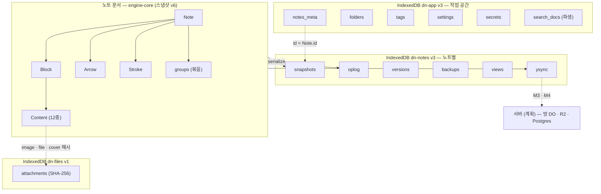
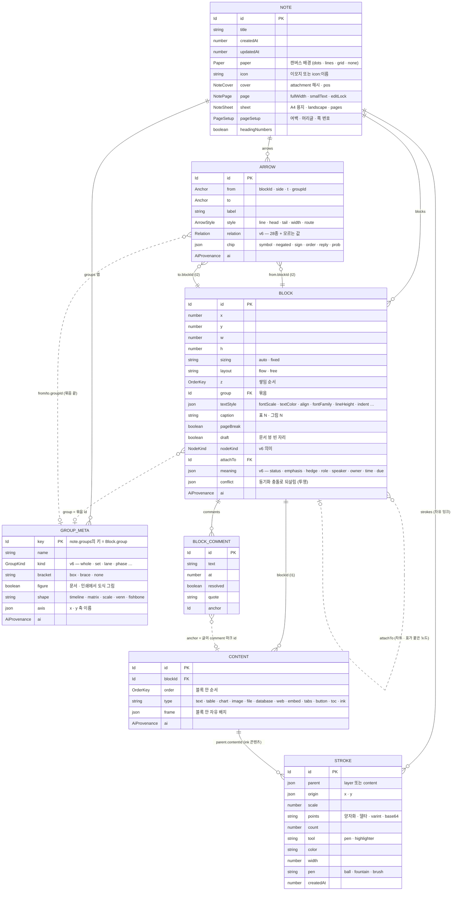
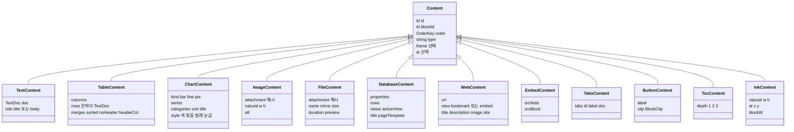
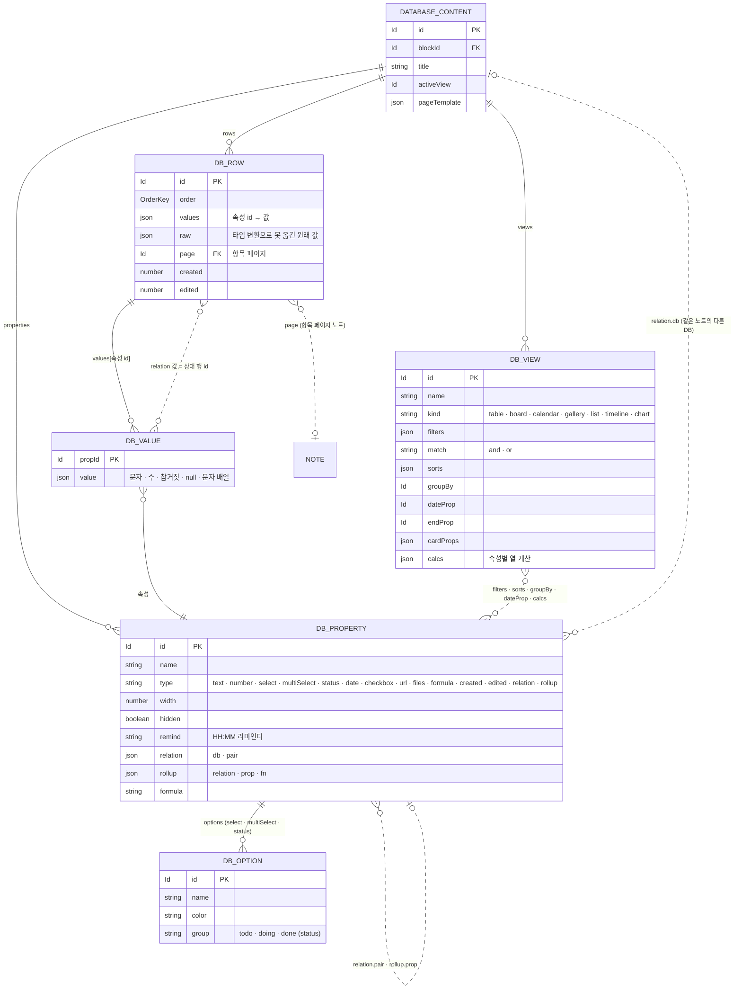
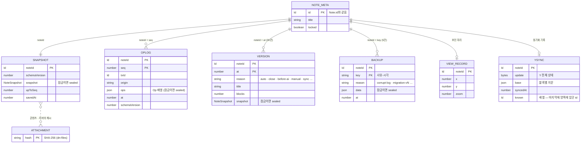
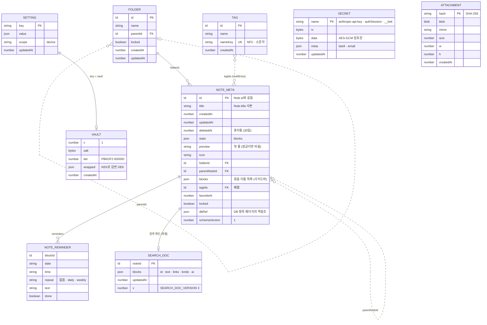
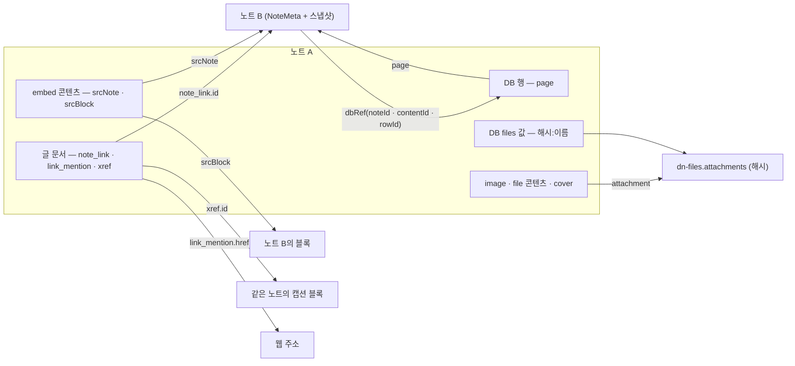
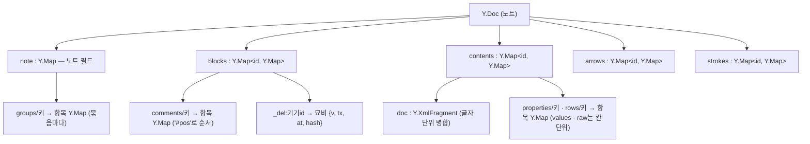
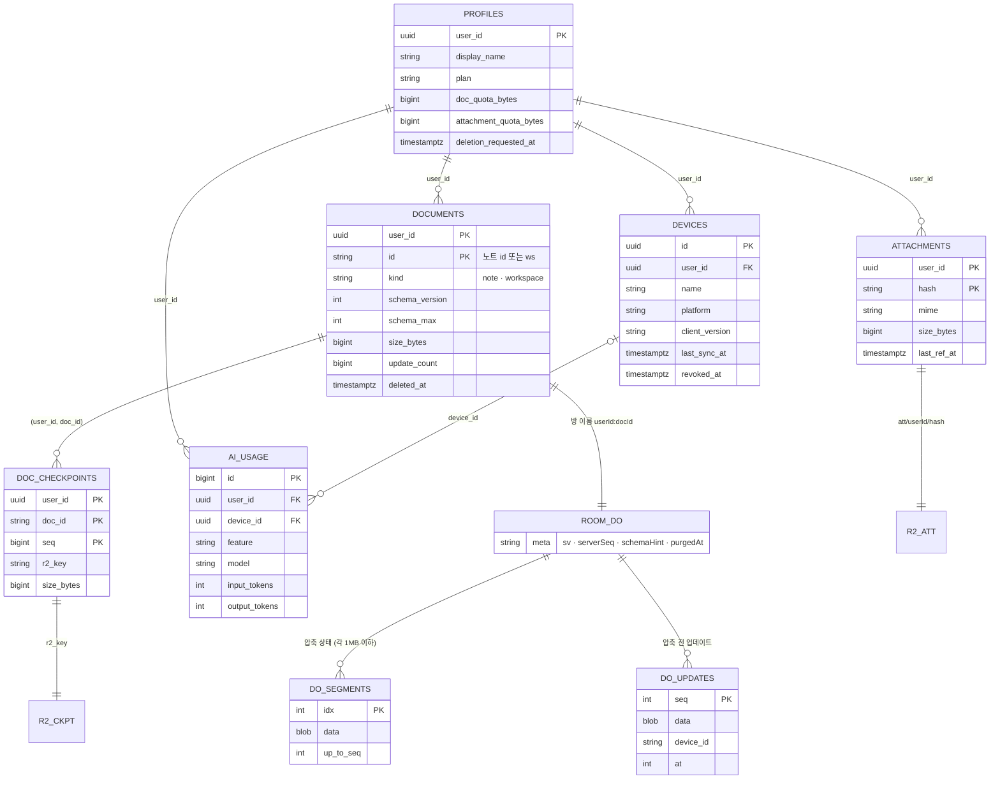

# DamianNote 엔티티 다이어그램

| 항목 | 내용 |
|---|---|
| 문서 버전 | v1.0 (2026-10-15) |
| 기준 커밋 | `0df7028` (main) |
| 원본 | 코드 — `packages/engine-core/src/model.ts` · `rich.ts` · `database.ts` · `db-views.ts` · `ink.ts` · `comments.ts` · `serialize.ts`, `packages/storage-idb/src/note-store.ts` · `meta-store.ts` · `attachment-store.ts` · `vault.ts`, `packages/sync/src/*`. 그림과 코드가 다르면 코드가 맞다 |
| 관련 문서 | [DATABASE.md](DATABASE.md)(필드 표 · 저장소 물리 설계) · [ARCHITECTURE.md](ARCHITECTURE.md) 6절(모델 · 불변식) · [SYNC.md](SYNC.md) 2 · 11절(Y 모양 · 서버 저장) · [CODE-STRUCTURE.md](CODE-STRUCTURE.md) |

저장되는 모든 것을 엔티티와 관계로 그린 그림 모음이다. 필드 뜻 · 필수 여부 · 도입 버전은 [DATABASE.md](DATABASE.md) 3 · 4 · 5절 표에 있고, 여기서는 **무엇이 무엇을 가리키는지**를 보인다.

**읽는 법**
- 엔티티 이름은 영어(코드 타입 이름), 설명은 한국어다. 속성 줄은 `타입 이름 키 "설명"`.
- 관계 선: `||--o{` 하나 대 여럿, `}o--o|` 여럿 대 없음 · 하나. 실선은 엔진이 지키는 참조(불변식 I1 · I2), 점선(`..`)은 느슨한 참조 — 대상이 없어도 데이터는 깨지지 않고 화면이 건너뛴다.
- 사용자 용어와 엔진 이름이 다르다: 캔버스의 상자 하나(사용자: **콘텐츠**) = 엔진 `Block` + 그 안의 `Content`, 상자 여럿을 묶은 것(사용자: **블록**) = `Block.group` + `Note.groups`.

---

## 목차

1. [한눈에 — 저장 계층](#1-한눈에--저장-계층)
2. [노트 문서 (엔진 스냅샷)](#2-노트-문서-엔진-스냅샷)
3. [콘텐츠 종류](#3-콘텐츠-종류)
4. [데이터베이스 콘텐츠](#4-데이터베이스-콘텐츠)
5. [작업 공간 · 기기 저장소](#5-작업-공간--기기-저장소)
6. [노트 사이 · 노트 밖 참조](#6-노트-사이--노트-밖-참조)
7. [동기화 Y.Doc 모양](#7-동기화-ydoc-모양)
8. [서버 (계획 — 아직 코드 없음)](#8-서버-계획--아직-코드-없음)

---

## 1. 한눈에 — 저장 계층

| 계층 | 원본 | 단위 | 잠긴 노트 |
|---|---|---|---|
| 노트 문서 | `dn-notes.snapshots` + `oplog` (열 때 스냅샷 + 로그 재생) | 노트 1개 = 스냅샷 1건 | 암호화(`sealed`) |
| 작업 공간 메타 | `dn-app` | 노트 · 폴더 · 태그 · 설정 레코드 | 제목 평문, 미리보기 비움 |
| 첨부 | `dn-files.attachments` | 내용 해시 1개 = 레코드 1건 (노트끼리 공유) | **평문** |
| 동기화 기록 | `dn-notes.ysync` (노트별 Y 전체 상태) | 노트 1개 = 1건 | 암호화 |
| 서버 | 없음 (설계만 — [SYNC.md](SYNC.md) B부) | — | 동기화 안 함(OD-8) |

---

## 2. 노트 문서 (엔진 스냅샷)

`NoteSnapshot` 하나 = 노트 하나. 엔티티에는 `noteId`가 없다 — 한 스냅샷 안에 담기는 것으로 소속이 정해진다(`serialize.ts:20-29`).

**AiProvenance** (블록 · 콘텐츠 · 화살표 · 묶음의 `ai`): `generated` · `runId` · `source{contentId, from, to, excerpt}` · `origin`(claude · open_teacher · student, v6) · `provider` · `model` · `promptVersion` · `schema` · `editedAt`(사람이 의미를 고친 시각, v6). `source.contentId`는 원문 콘텐츠를 가리키는 느슨한 참조다.

**불변식** (`invariants.ts`, 트랜잭션 커밋 직전): I1 콘텐츠의 블록이 있어야 함 · I2 화살표 양 끝 블록이 있고 서로 다름 · I6 좌표 유한, 크기 ≥ 24 · I7 z · order 키 형식 · I8 글 문서가 스키마에 맞음 · I10 제목 상자는 문단 하나.

---

## 3. 콘텐츠 종류

`Content.type`으로 갈린다. 모르는 `type`은 `UnknownContent`로 데이터를 그대로 보존한다(새 버전 앱이 만든 콘텐츠를 옛 앱이 망가뜨리지 않게).

| 종류 | 정의 | 도입 |
|---|---|---|
| `text` | `model.ts:195-204` — 텍스트 블록 하나에 텍스트 콘텐츠 하나(v3). `role` 없으면 body | v1 (role v2 · 뜻 v3) |
| `table` · `chart` · `image` | `rich.ts` — 표 · 그래프는 v0 자리표시자에서 변환 | v4 |
| `database` | `database.ts:58-65` · `db-views.ts:39` | v5 |
| `file` · `web` · `embed` · `tabs` · `button` · `toc` · `ink` | `rich.ts:138-145` · `web.ts` · `embed.ts` · `tabs.ts` · `button.ts` · `toc.ts` · `ink-bind.ts` | 표기 없음 — 선택 필드처럼 버전을 올리지 않고 더함 |

**콘텐츠가 아닌 것** — 수식은 글 문서 안의 노드(`math_inline` · `math_block`), 머메이드는 상자 · 화살표로 바꾸는 변환(`mermaid.ts`)일 뿐 저장 타입이 없다. 콜아웃 · 토글 · 할 일 · 노트 링크 · 링크 언급 · 날짜 언급 · 각주도 글 문서 노드다(`text-pm/src/schema.ts`, 스키마 `pm-v1`).

**버튼의 BlockClip** (`clip.ts`) — 버튼을 누르면 붙일 상자 묶음의 복사본. 블록 필드에서 `id · x · y · z · group · comments · conflict`를 빼고 `dx · dy`를 더했고, 콘텐츠 · 화살표는 클립 안 순번으로 서로를 가리킨다. 클립보드 MIME `application/x-dn-blocks`와 같은 모양.

---

## 4. 데이터베이스 콘텐츠

데이터베이스는 콘텐츠 레코드 하나(`type: 'database'`) 안에 속성 · 행 · 보기를 배열로 담는다. 행을 따로 떼어 엔티티로 만드는 것은 계획(`database.ts:4` 주석)일 뿐 아직 아니다.

- 값 저장: select = 옵션 id, multiSelect = 옵션 id 배열, date = `YYYY-MM-DD`, relation = 상대 행 id 배열, files = `해시:이름` 배열. `created` · `edited` · `formula` · `rollup`은 **값을 저장하지 않고** 그릴 때 계산한다(`db-props.ts:26`).
- 보기가 없으면 `{id:'default', name:'표', kind:'table'}`로 읽는다.

---

## 5. 작업 공간 · 기기 저장소

IndexedDB 세 개(`dn-notes` v3 · `dn-app` v3 · `dn-files` v1). 노트 본문 쪽 스토어는 `noteId`로 노트 메타와 이어진다.

### 5.1 노트 본문 — `dn-notes` (노트마다)

### 5.2 작업 공간 — `dn-app` · `dn-files`

| 스토어 | DB | 키 | 인덱스 |
|---|---|---|---|
| `snapshots` · `views` · `ysync` | `dn-notes` | `noteId` | — |
| `oplog` | `dn-notes` | `[noteId, seq]` | — |
| `versions` | `dn-notes` | `[noteId, at]` | — |
| `backups` | `dn-notes` | `[noteId, key]` | `by_note` |
| `notes_meta` | `dn-app` | `id` | `by_updated` · `by_deleted` · `by_folder` · `by_parent` · `by_tag`(multiEntry) |
| `folders` | `dn-app` | `id` | `by_parent` |
| `tags` | `dn-app` | `id` | `by_name`(unique) |
| `settings` · `secrets` · `search_docs` | `dn-app` | `key` · `name` · `noteId` | — |
| `attachments` | `dn-files` | `hash` | — |

IndexedDB 밖: localStorage 5개(`dn:theme` · `dn:device-id` · `dn:login-email` · `dn:no-env-key` · `dn:auth-mock`), Cache Storage(`dn-shell-<버전>` · `dn-fonts-v1`), BroadcastChannel(`dn-auth` · `dn-sync:3:<noteId>`), Web Locks(`dn-note:<id>`). 자세한 표는 [DATABASE.md](DATABASE.md) 4 · 5절.

---

## 6. 노트 사이 · 노트 밖 참조

스냅샷 하나를 벗어나는 참조는 모두 느슨하다 — 대상이 지워지거나 잠겨도 원본 데이터는 그대로 두고 화면이 '없는 노트' 등으로 보인다.

---

## 7. 동기화 Y.Doc 모양

노트 하나 = Y.Doc 하나([SYNC.md](SYNC.md) 2.1, `packages/sync/src/ymap.ts` · `fields.ts` · `tombstone.ts`). 엔진 엔티티마다 `Y.Map` 하나, 필드 하나 = 키 하나(필드 단위 마지막 쓰기 우선).

- 삭제는 키를 지우지 않고 묘비를 남긴다. 지운 쪽이 모르는 고침이 있으면 삭제 묶음 전체가 보류되고 블록에 `conflict`가 투영된다(Y에는 쓰지 않음).
- 엔진에 없는 Y 쪽 상태: `dn-notes.ysync`의 `base`(블록별 지문) · `known`(마지막에 양쪽에 있던 id).
- 서버 프로토콜 프레임(`protocol.ts`)과 문서 동기화 상태(`DocSyncState`, `status.ts`)는 타입 · 순수 함수만 있고 앱이 아직 저장하지 않는다(M0).

---

## 8. 서버 (계획 — 아직 코드 없음)

저장소에 서버 코드 · SQL · 마이그레이션이 없다. 아래는 [SYNC.md](SYNC.md) 11절(v1.0에서 고친 판)과 [DATABASE.md](DATABASE.md) 8절(옛 DDL)의 설계다. 노트 내용은 서버가 해석하지 않는 Y 업데이트로만 저장된다.

워크스페이스(노트 목록 · 폴더 · 태그)는 사용자당 Y.Doc 하나(`userId:ws`)로 따로 동기화한다(SYNC 12.8). 잠긴 노트는 서버로 보내지 않는다(OD-8).

---

## 개정 이력

| 버전 | 날짜 | 내용 |
|---|---|---|
| v1.0 | 2026-10-15 | 처음 씀 — 기준 커밋 `0df7028`의 코드에서 엔티티 · 필드 · 참조를 확인해 그림 9종 (5절은 dn-notes · dn-app 둘로) |
