# DamianNote 서버 동기화 설계서

| 항목 | 내용 |
|---|---|
| 제품 | DamianNote |
| 문서명 | 서버 동기화 설계서 |
| 문서 버전 | v1.4 (2026-10-19 — M1 끝: N5 · N6 · N8 · N10, `layout` 마스크, Y `meta` 스키마 버전, 동기화 파일 v4, 반례 s4-03) · v1.3 (2026-10-13 — M0: 프레임 · 상태 타입 · 수렴 속성 하네스, S4 결과, 23절) · v1.2 (2026-10-09 — 조건부 실행 취소 · I8 글 고치기 · 묘비 구현 반영) · v1.1 (2026-10-09 — A부 발견 4건 고침) · v1.0 (2026-10-09 — 코드 기준으로 다시 씀: A부 = 지금 만들어진 동기화, B부 = 서버 동기화 설계) · v0.2 (2026-10-02) · v0.1 (2026-10-01, 코드가 없던 때의 순수 설계) |
| 작성일 | 2026-10-09 |
| 작성자 | 곰탱이 |
| 기준 커밋 | `905434d` (v1.0 · v1.1은 `9571ebb` · `ba75cb2`) |
| 상태 | A부 = 코드에서 확인한 사실. B부 = 구현 전 설계 — 수치는 초기값이고 "검증 필요"는 S4 · 배포 환경 실측으로 바꾼다 |
| 대상 FR | FR-094 · FR-095 · FR-096 · FR-097 · FR-098(일부) · FR-149 · FR-146(잠긴 노트) |
| 상위 문서 | [ENGINE.md](ENGINE.md) 3 · 5 · 12 · 13장 · [ARCHITECTURE.md](ARCHITECTURE.md) (서버 · 동기화 절) · [DATABASE.md](DATABASE.md) 4 · 5 · 6 · 7 · 8절 · [API.md](API.md) 1 · 5 · 6절 · SECURITY.md 3 · 6절 |
| 관련 ADR | [ADR-0002](adr/0002-engine-model-is-source.md) · [ADR-0004](adr/0004-indexeddb-snapshot-oplog.md) · [ADR-0008](adr/0008-backend-platform.md) · [ADR-0009](adr/0009-sync-document-granularity.md) · [ADR-0011](adr/0011-attachments-content-addressed.md) · [ADR-0012](adr/0012-no-e2ee-v1.md) |
| 테스트 | [TEST-PLAN.md](TEST-PLAN.md) 5절, `packages/sync/test/*` · `packages/engine-core/test/undo-remote.test.ts` · `packages/text-pm/test/{repair,undo-remote}.test.ts` · `apps/web/test/sync-repair.test.ts`, `e2e/tabs.mjs` · `e2e/sync-file.mjs` · `e2e/login.mjs` |

> 손으로 관리한다. **A부(1~7절)는 코드를 읽어 확인한 것만** 적었고, 함수 · 타입 이름과 파일 경로를 붙였다. 코드로 확인하지 못한 것은 "확인 못 함"으로 표시했다. **B부(8~21절)는 아직 없는 서버 동기화의 설계**이며, A부 위에 무엇을 얹을지와 그 순서를 정한다. v0.2의 내용 중 아직 맞는 것은 다시 확인해 B부로 옮겼고, 코드와 어긋나거나 근거가 사라진 것은 7절 대조표에 "변경" · "폐기"로 남겼다.

**읽는 법** — 결정은 `결정 / 근거 / 버린 대안`으로 적었다. B부의 결정 중 사용자 확인이 필요한 것은 21절 열린 결정(OD-n)에 추천안과 함께 모았다. ADR-0008 · 0009 · 0012는 모두 "승인(2026-10-01, 설계 마무리 위임에 따라 추천안 채택)" 상태다 — 이 문서는 그 결정을 전제로 하되, 위임으로 승인된 결정이라 실측 결과(S4)로 다시 열 수 있다.

## 목차

**A부 — 지금 만들어진 동기화**

1. [범위 · 현재 상태](#1-범위--현재-상태)
2. [엔진 ⇄ Y.Doc 다리](#2-엔진--ydoc-다리)
3. [같은 기기 탭 동기화](#3-같은-기기-탭-동기화)
4. [기기 사이 동기화 파일](#4-기기-사이-동기화-파일)
5. [계정 · 로그인 상태](#5-계정--로그인-상태)
6. [저장되는 것 · 잠긴 노트 · UI](#6-저장되는-것--잠긴-노트--ui)
7. [구 설계(v0.2) 대조표](#7-구-설계v02-대조표)

**B부 — 서버 동기화 설계**

8. [목표 · 비목표 · 컷라인](#8-목표--비목표--컷라인)
9. [전체 구조](#9-전체-구조)
10. [연결 · 인증 · 프로토콜](#10-연결--인증--프로토콜)
11. [서버 저장](#11-서버-저장)
12. [클라이언트 동기화 수명주기](#12-클라이언트-동기화-수명주기)
13. [충돌 규칙](#13-충돌-규칙)
14. [잠긴 노트 · 암호화](#14-잠긴-노트--암호화)
15. [첨부 동기화](#15-첨부-동기화)
16. [보안](#16-보안)
17. [장애 모드와 복구](#17-장애-모드와-복구)
18. [관측](#18-관측)
19. [테스트 전략](#19-테스트-전략)
20. [단계별 구현 계획](#20-단계별-구현-계획)
21. [위험 · 열린 결정](#21-위험--열린-결정)
22. [다른 문서에 반영할 변경](#22-다른-문서에-반영할-변경)
23. [변경 이력](#23-변경-이력)

---

# A부 — 지금 만들어진 동기화

## 1. 범위 · 현재 상태

### 1.1 한눈에

| 층 | 있는 것 | 위치 | 상태 |
|---|---|---|---|
| 엔진 ⇄ Y.Doc 다리 | 노트 1개 = Y.Doc 1개, 필드 단위 LWW, 글자 단위 텍스트 병합, 삭제 = 묘비(10/09), 끊긴 참조 거르기 · 펴기 | `packages/sync/src/bridge.ts` · `ymap.ts` · `reconcile.ts` · `reopen.ts` · `tombstone.ts` · `normalize.ts` · `text-y.ts` | 구현 · 단위 테스트(`bridge` 5 · `sync-safety` 14) · 수렴 속성 시험(19.2, 10/13) |
| 서버 프레임 · 상태 | 프레임 인코딩 · 디코딩(10.3, lib0 모양 정수 · 512KB 청크 나누기 · 모으기), `DocSyncState` · 우선순위(12.9) — 서버 · 클라이언트 공용 순수 함수 | `packages/sync/src/protocol.ts` · `status.ts` | 구현 · 단위 테스트(`protocol` 11) — 아직 쓰는 곳 없음(M3 · M4) |
| 같은 기기 탭 사이 | BroadcastChannel로 Y 업데이트 실시간 교환, 쓰기 탭 1개만 저장 | `packages/sync/src/tabs.ts`, `apps/web/src/ws-sync.ts` | 구현 · `e2e/tabs.mjs` |
| 기기 사이 | **동기화 파일**(`*.dnsync.json`, v3)을 내보내고 다른 기기에서 가져와 합침. 지우기 ↔ 고치기는 묘비 규칙이 보류 · 충돌 표시(예전 키 삭제 기록은 되살려 표시) | `packages/sync/src/exchange.ts`, `ws-sync.ts` | 구현 · 단위 테스트 10건 · `e2e/sync-file.mjs` |
| 계정 | Supabase Auth REST 로그인 화면(매직 링크 · Google · Apple), 흉내 서버 | `apps/web/src/auth.ts` · `account.ts` · `LoginDialog.tsx` · `AccountSettings.tsx` | 구현 · `e2e/login.mjs` — **동기화와 연결되지 않음** |
| 서버 | — | — | **없음** (1.3) |

### 1.2 FR 상태 (docs/FR.md 기준, 2026-10-09)

| FR | FR.md 상태 | 체크된 수락 기준 | 코드와의 차이 |
|---|---|---|---|
| FR-094 계정 · 로그인 | 진행 중 | 이메일 · 소셜 로그인 | "로그인 없이 로컬 전용 사용"은 체크가 안 돼 있지만 **실제로는 동작**한다(앱 전체가 로그인 없이 쓰인다). 트래커 갱신 필요 |
| FR-095 클라우드 동기화 | 진행 중 | 네트워크 없이 편집 | 5초 반영 · 첨부 · 상태 UI는 서버가 없어 미충족 |
| FR-096 오프라인 · 재접속 | 진행 중 | 오프라인 중 다른 기기 변경 병합 | 동기화 파일로만 충족. 자동 전송 · 재시도 · 오프라인 표시는 없음 |
| FR-097 충돌 감지 · 병합 | 완료 | 5개 전부 | 동기화 파일 · 탭 경로에서 충족. 10/09부터 삭제가 묘비라(13.2) 서버 순서(13.2.1)에서도 편집을 잃지 않는다 — 서버가 없어 실측은 아직(`sync-safety.test.ts`의 순서 재현만) |
| FR-098 기기 관리 | 미착수 | — | — |
| FR-149 손상 방지 | 완료 | 3개 전부 | 동기화와 무관한 저장 경로에서 충족 |
| FR-146 저장 암호화 | 진행 중 | "잠긴 노트는 … 암호화 후 저장 · 동기화" 체크 | 동기화 파일은 잠긴 노트를 **빼고** 보낸다(4.2). "암호문만 동기화"는 구현되지 않았다 — 14절 |

### 1.3 서버 코드가 없다는 확인

- `apps/`에는 `web`만 있다. `packages/`는 `ai-pipeline · engine-core · engine-dom · search · storage-idb · sync · text-pm` 7개다.
- `git ls-files`에서 `wrangler`, `durable`, `supabase`, `edge`, `server`, `worker`를 찾으면 `docs/adr/0007-ai-via-edge-proxy.md` 한 건뿐이다(문서). `wrangler.toml`, Worker 소스, DO 클래스, SQL 마이그레이션, `supabase/` 폴더는 없다.
- 클라이언트에서 서버로 나가는 동기화 요청은 없다. 네트워크를 쓰는 것은 로그인(`auth.ts`의 `/auth/v1/*`)과 AI 호출뿐이다.
- `packages/sync`의 의존성은 `@dn/engine-core`와 `yjs`(^13.6.33) 둘이다. `y-protocols` · `y-websocket` · `y-indexeddb` · `y-prosemirror`는 없다.

### 1.4 용어

| 용어 | 뜻 |
|---|---|
| 다리(bridge) | 엔진 트랜잭션 ⇄ Y.Doc 트랜잭션 변환기. `attach()`가 돌려주는 `Bridge` |
| 동기화 노트 | `dn-notes.ysync`에 Y 기록이 저장된 노트 — 동기화 파일로 한 번이라도 오간 노트 |
| 쓰기 탭 · 함께 편집 탭 | 노트 잠금(Web Lock `dn-note:<id>`)을 가진 탭 · 잠금 없이 쓰기 탭을 통해 고치는 탭 |
| 지문(fingerprint) | 블록 하나의 내용 해시(위치 · 크기 · z 제외). 지우기 ↔ 고치기 판정용 (4.3) |
| 기준 지문(base) | 마지막 동기화 때 블록별 지문. `SyncState.base` |
| 묘비(tombstone) | 키를 지우지 않고 엔티티 맵에 남기는 삭제 표시 `_del:<기기id>` (2.1 · 13.2, `tombstone.ts`, 10/09 구현) |
| 보류(pending) · 삭제 묶음 | 같은 삭제 트랜잭션(`tx`)의 묘비들이 한 묶음. 지운 쪽이 모르는 편집(R1 · R2)이 있으면 묶음 전체가 살아 있고 충돌 표시 (2.3) |
| 기기 id | 묘비 키와 "이 기기가 지웠나" 판정에 쓰는 id. 앱은 `localStorage 'dn:device-id'`(처음 한 번 `newId()`), 주지 않으면 Y.Doc의 `clientID` |

---

## 2. 엔진 ⇄ Y.Doc 다리

### 2.1 Y.Doc 모양

```
Y.Doc (노트 1개, docId = noteId)
├─ note     : Y.Map { id, title, createdAt, updatedAt, …엔진 Note의 나머지 필드(cover · paper · page · sheet 등은 통째 값),
│                     'groups/<묶음id>': Y.Map(묶음 정보) … }   # 목록 필드는 항목 키(2.1 아래)
├─ blocks   : Y.Map<blockId,   Y.Map<field, value>>
├─ contents : Y.Map<contentId, Y.Map<field, value | Y.XmlFragment>>   # type:'text'인 콘텐츠의 doc만 Y.XmlFragment
├─ arrows   : Y.Map<arrowId,   Y.Map<field, value>>
└─ strokes  : Y.Map<strokeId,  Y.Map<field, value>>
   # 엔티티 맵 안 '_del:<기기id>' → { v: 1, tx, at, hash } — 묘비(지운 표시). 키는 지우지 않는다 (10/09)
```

- 엔티티 Y.Map에는 `id`를 빼고 엔진 레코드의 최상위 필드를 넣는다(`putEntity`, `ymap.ts` — 맵을 먼저 문서에 붙인 뒤 필드를 쓴다). 평범한 필드는 `structuredClone`한 값이라 **최상위 필드 단위 LWW**다.
- **`_`로 시작하는 키는 예약 키**다 — 필드가 아니다(`fields.ts` `readFields` · `fieldNames`가 건너뜀). 지금 쓰는 예약 키는 묘비 `_del:<기기id>` 하나(`tombstone.ts`). 값 `Tombstone {v: 1, tx(엔진 트랜잭션 txId), at(Date.now()), hash(지울 때 본 내용 해시)}`. 해시는 `recordHash` — 엔티티 필드를 키 정렬 JSON으로 만든 뒤 cyrb53을 시드 0 · 1로 두 번(106비트). `_` 키와 마스크 필드(블록 `x · y · w · h · z · conflict`, 콘텐츠 `order`)는 뺀다 — 옮기기 · 크기 · 겹침 순서만 바꾼 것은 고침이 아니다(OD-2).
- `doc`은 `isTextRecord(v)`(= `type === 'text'`이고 `doc`이 객체)일 때만 `Y.XmlFragment`다.
- **목록 필드는 항목 키** (10/09, OD-10 적용 — `packages/sync/src/fields.ts`): 노트 `groups`, 블록 `comments`, 데이터베이스 콘텐츠 `properties` · `rows`는 항목마다 엔티티 맵에 키 하나 — `필드/항목id` → 항목 `Y.Map`(항목 필드 → 값) — 로 둔다. 순서 있는 목록은 항목 안 `#pos`(분수 위치 키, 같으면 id 순), 데이터베이스 행의 `values` · `raw`는 칸 단위 `Y.Map`. 그래서 서로 다른 항목 · 서로 다른 칸의 동시 편집이 둘 다 남는다. 모음을 담는 그릇 맵을 따로 두지 않는 이유는, 비어 있던 필드에 두 기기가 동시에 첫 항목을 넣으면 그릇 둘이 같은 키를 다퉈 한쪽 그릇이 통째로 지기 때문이다. 예전 기록(필드에 통째 값)도 읽고 다음 쓰기 때 항목 키로 바꾼다.
- 아직 통째 값: 데이터베이스 `views`, 블록 `group`(묶음 소속 — 상자마다 한 값이라 그대로 맞다), 노트 `cover` · `page` · `sheet` 등.
- DATABASE 8.1이 적은 `meta` 맵(`schemaVersion` · `textSchema`)과 `dbRows` · `comments` 맵은 **없다**. 10/19부터 `meta` 맵에는 스키마 버전 표시 `v:<n>`만 쓴다(10.5 — 코드 `SCHEMA_VERSION = 6`, `packages/engine-core/src/serialize.ts`).

### 2.2 방향과 origin

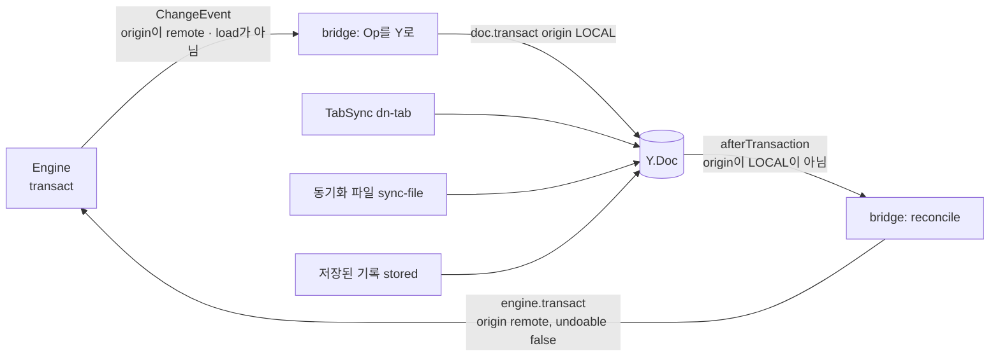

| 경로 | 코드 | 규칙 |
|---|---|---|
| 엔진 → Y | `engine.subscribe` 콜백 (`bridge.ts`) | origin `remote` · `load`만 건너뛴다. **`layout` · `migration` · `undo` · `redo` · `ai` · `text` · `user`는 모두 Y에 쓴다.** 엔진 트랜잭션 1개 = `doc.transact(…, LOCAL)` 1개. `LOCAL = Symbol('dn-local')` |
| Y → 엔진 | `doc.on('afterTransaction', onTx)` | `tr.origin === LOCAL`이면 건너뛴다. 그 밖의 origin(`'dn-tab'`, `'sync-file'`, `'stored'`, 테스트의 `'peer'`)은 모두 엔진으로 간다 |

Op → Y 사상:

| 엔진 Op | Y 쓰기 |
|---|---|
| `create(e, id, value)` | `putEntity` — 새 Y.Map을 붙이고 필드를 씀. 텍스트면 새 `Y.XmlFragment`에 `writeDoc`. **같은 id의 맵이 이미 있으면**(묘비로 지운 것을 실행 취소로 되살림) 새 맵을 만들지 않고 그 맵의 묘비를 모두 지운 뒤 필드를 맞춘다 — 그사이 다른 기기가 그 맵에 쓴 편집이 남는다(13.3 #14) |
| `delete(e, id)` | **묘비** — `writeTombstone`: 그 엔티티 맵에 `_del:<기기id>` → `{v: 1, tx: 이벤트 txId, at, hash: 지금 내용 해시}`. 키는 지우지 않는다(10/09 — 예전에는 `root.delete(id)`로 키를 지워, 다른 기기가 그 맵에 동시에 쓴 변경이 Y 수준에서 사라졌다) |
| `set(e, id, field, value)` | `writeField` — 평범한 필드는 값이 다를 때만 set, `undefined`면 **키를 지운다**. 목록 필드는 바뀐 항목 · 항목 필드만 쓴다. 예외: 보류 중인 블록의 `conflict`는 투영이라 Y에 쓰지 않고, `undefined`로 지우면(남기기) 그 삭제 묶음의 묘비를 지운다(2.3) |
| `set('note', …)` | `note` 맵에 `writeField` |
| `text(id, …)` · `set('content', id, 'doc', …)` | 트랜잭션의 Op를 다 돈 뒤 콘텐츠마다 한 번, 엔진의 **현재** 문서로 `syncDoc(fragment, doc)` — 최소 차이(2.4) |

### 2.3 원격 변경 → 엔진 (`reconcile`)

`onTx`는 `tr.changedParentTypes`의 각 타입에서 부모를 따라 올라가 루트 맵(`blocks` 등)과 그 바로 아래 키(= 엔티티 id)를 모은다. 루트 맵 자체의 키 변경(`tr.changed`)도 더한다. 그 뒤 `reconcile(engine, doc, touched, noteTouched, device)`(`reconcile.ts`)가 **엔진 트랜잭션 1개**(origin `'remote'`, `undoable: false`)로 엔진을 Y에 맞춘다. **묘비가 걸린 변경**이면 — 묘비 키(`_del:…`)가 생기거나 지워졌거나, 바뀐 엔티티 또는 그 부모(콘텐츠의 블록 · 잉크의 콘텐츠)에 묘비가 있으면(`touchesTombstones`) — 삭제 묶음 판정이 다른 엔티티의 살아 있음까지 바꾸므로 `touched = null`(전부)로 다시 맞춘다.

| 단계 | 규칙 |
|---|---|
| 노트 | Y의 노트 필드와 엔진 노트 필드를 합친 키마다 다르면 `tx.setNote` — Y에서 사라진 필드는 엔진에서도 지운다(필드를 지우면 키가 빠지므로. 예: 편집 잠금을 풀어 `page`가 빠짐) |
| 살아 있음 | `Liveness`(`tombstone.ts`, 한 번 맞추는 동안 쓰는 색인)로 판정한다. 엔티티는 Y에 맵이 있고, **묘비가 없거나 그 묘비들 중 하나의 삭제 묶음(`tx`)이 보류 중**이면 살아 있다. 묶음 보류 = **R1**(구성원 중 하나라도 지금 `recordHash`가 자기 묘비들의 해시 어느 것과도 다름 — 지운 뒤 다른 곳이 고침) 또는 **R2**(묘비 없는 자식 — 콘텐츠의 `blockId`, 잉크의 `parent.contentId` — 이 구성원을 가리킴 — 지운 뒤 다른 곳이 그 안에 더함). 화살표는 R2에 넣지 않는다(지운 블록에 건 화살표는 숨김, 13.3 #7). 묘비 없는 엔티티는 키만 보고 바로 답하고, 묘비 있는 것을 처음 물을 때만 문서를 한 번 훑어 색인을 만든다. Y 상태만의 순수 함수라 모든 기기가 같은 답을 낸다 |
| 충돌 투영 | 보류 중인 블록은 Y 레코드에 `conflict: {kind, at}`를 **덧붙여** 엔진에 넣는다(Y에는 쓰지 않음). `kind` = 그 묶음에 이 기기의 묘비(`_del:<이 기기 id>`)가 있으면 `'local-deleted'`, 아니면 `'remote-deleted'`. `at` = 보류 묶음 묘비들의 `at` 중 가장 큰 값 |
| 지우기 | 화살표 → 잉크(스트로크) → 콘텐츠 순으로, 살아 있지 않거나 참조가 끊긴 것을 `tx.delete`. 블록은 마지막에 지우고, 그 블록의 엔진 콘텐츠 · 화살표 중 이번 계획에 없는 것을 함께 지운다 |
| 끊긴 참조 거르기 | 콘텐츠는 `blockId` 블록이 살아 있어야, 화살표는 양 끝 블록이 살아 있어야, 스트로크는 `parent.kind === 'content'`면 그 콘텐츠(와 그 블록)가 살아 있어야 엔진에 들어간다. **Y에는 남아 있고 엔진에만 없는 상태**가 된다 — 블록이 되살아나면(남기기 · 실행 취소) 묘비가 걸린 변경이라 전부 다시 맞추므로 함께 돌아온다 |
| 만들기 · 고치기 | 블록 → 콘텐츠 → 화살표 → 스트로크. 엔진에 없으면 `createBlock` · `createContent` · `createArrow` · `apply(create stroke)`, 있으면 다른 필드만 `tx.set`(Y에 없는 필드는 `undefined`) |
| 텍스트 | `yToEntity`가 `fragmentToDoc`으로 문서 전체를 만들어 `doc` 필드 **set**으로 넣는다(텍스트 스텝이 아님) |
| 펴기 | 들이기 전 `fitIncoming`(`normalize.ts`)이 엔진 규칙에 맞게 편다 — 스키마에 안 맞는 글 문서는 코덱의 `repair`로 고침(I8, 10/09 — 아래), 제목 상자에 문단이 여럿이면 한 줄로(`toTitleDoc`, I10), 자기 자신을 잇는 화살표는 엔진에 넣지 않음(I2), 블록 크기 · 좌표 · z가 맞지 않으면 고침(I6 · I7). 블록은 거르지 않는다(거르면 엔진에서 지워져 그 안 콘텐츠까지 사라진다) |
| 실패 | 바꿀 일을 걸음(step)으로 모아 한 트랜잭션에 넣어 보고, 그래도 커밋 검증(`validateOps`, ENGINE 3.7)이 막으면 **걸음마다 따로** 다시 들여 나머지는 살린다. 끝내 못 들인 수는 `onRemote(changed, rejected)`로 알리고(앱은 토스트), 그 엔티티만 엔진 ≠ Y로 남는다 |

- **엔진 코드의 불변식은 모두 다리가 고치거나 숨긴다** (10/09). `invariants.ts` `validateOps`가 검사하는 것은 I1 · I2 · I6 · I7 · I8 · I10 여섯 가지이고, `normalize.ts`가 I2 · I6 · I7 · I8 · I10을 펴고 "끊긴 참조 거르기"가 I1 · I2(끝 블록)를 맡는다. 13.4의 N5 · N6 · N8 · N10은 엔진 불변식이 아니라(`invariants.ts`에 검사 코드 없음 — ENGINE 3.7의 I3 · I4 · I5에 해당) 거절을 일으키지 않는다. **10/19부터 다리가 이것도 편다** — 부모가 없거나 잉크가 아닌 콘텐츠에 묶인 스트로크(N5) · 살아 있는 획이 없는 잉크(N6) · 앞 종류 맵에 같은 id가 있는 엔티티(N8)는 숨기고(`reconcile.ts`), 구성원이 모자란 묶음(N10)은 `groups.ts`의 읽기 규칙(2개 미만은 묶음 아님, 카드는 1개부터)이 모든 기기에서 같게 묶음이 아닌 것으로 본다(필드는 그대로). 양 끝이 비어 있는 화살표 · 부모가 비어 있는 획(프레임 일부만 받은 순간, 반례 s4-03)도 숨긴다. 그래서 "실패" 줄의 걸음별 재시도는 이제 예상 밖 버그 대비이고, 끝내 못 들인 것은 `console.warn` 한 줄 + `onRemote`로 알린다. 고치기 전에는 한 엔티티가 막으면 원격 트랜잭션 전체가 거절됐다(`packages/sync/test/sync-safety.test.ts`가 재현).
- **I8 글 고치기** (`babc038`): `TextCodec.repair?(doc)`(`engine-core` `model.ts`, 선택). text-pm의 `pmCodec.repair` = `repairDoc`(`packages/text-pm/src/repair.ts`) — 스키마에 맞는 최상위 블록은 그대로, 안 맞는 블록만 글 줄(인라인 자식을 가진 노드)마다 같은 글자 · 서식의 문단으로 펼친다(서식까지 넣어 안 맞으면 글자만). 그래도 안 맞으면 글자만 줄마다 문단으로. 결정적이라 모든 기기가 같은 결과를 낸다. 다리는 엔진 인스턴스가 아니라 앱이 등록한 기본 코덱(`setDefaultTextCodec` → `defaultTextCodec()`, `engine.ts`)을 부른다 — 코덱이 없거나 `repair`가 없으면 예전처럼 I8로 그 걸음만 빠진다(`apps/web/test/sync-repair.test.ts`가 두 경우 모두 확인 — 다른 변경은 어느 쪽이든 들어간다).
- `attach(engine, doc, { onRemote, prefer, known, device })`(`AttachOptions`, 10/09 — 예전 `attach(engine, doc, onRemote?, prefer)`)의 시작 동작. `device`가 없으면 그 Y.Doc의 `clientID`를 쓴다:

| Y.Doc 상태 | `prefer` | 동작 |
|---|---|---|
| 비어 있음 (`note.id` 없음) | — | 엔진 전체를 Y에 씀 (origin `LOCAL`) |
| 내용 있음 | `'doc'` (기본) | `reconcile(…, null)` — 엔진을 Y 전체에 맞춤 (탭 · 파일로 받은 상태) |
| 내용 있음 | `'engine'` + `known` | `pushEngine`(`reopen.ts`) — 필드는 엔진 기준으로 Y에 쓰고(프래그먼트는 `syncDoc`, 보류 블록의 `conflict`는 쓰지 않음), **한쪽에만 살아 있는 엔티티는 `known`으로 가른다**: Y에만 살아 있고 known에 있으면 이 기기가 지운 것(Y에 **묘비**를 씀 — 한 번 이어 붙이는 동안 새 `tx` 하나), known에 없으면 아직 엔진에 안 들어온 것(엔진으로 들임). 엔진에만 있고 known에 있으면 다른 곳에서 지운 것(엔진에서 지움), known에 없으면 이 기기가 만든 · 되살린 것(`putEntity`). `known`이 없는 예전 기록은 지우지 않고 들인다 (저장된 Y 기록을 이어 붙일 때 — 6.1) |

### 2.4 텍스트: 글자 단위 병합 (`text-y.ts`)

| 대상 | Y 표현 |
|---|---|
| 블록 노드 (`paragraph`, `heading`, `bullet_list`, `task_item`, 표 등) | `Y.XmlElement(nodeName)`. 속성은 값마다 `JSON.stringify`한 문자열 |
| 글 줄 (`TEXTBLOCK = paragraph · heading · code_block`) | 그 요소 안 `Y.XmlText` 1개 |
| 마크 | 서식 속성 `{mark: attrs \| true}`. 넣을 때 `MARK_ORDER`(strong · em · underline · strike · highlight · code · link)의 키를 모두 적고 없는 마크는 `null` — 앞 글자 서식을 물려받지 않게 |
| 인라인 원자 (줄바꿈 · 노트 링크 · 수식 등) | embed |

- `writeDoc(frag, doc)` — 처음 한 번 전체를 만든다.
- `syncDoc(frag, doc)` — 자식 목록의 앞뒤 공통 부분을 남기고 가운데만 바꾼다. 가운데가 같은 종류 노드 하나면 그 안으로 들어가고, 글 줄이면 `diffText`가 글자(UTF-16 코드 단위 + 서식 키) 열의 앞뒤 공통 부분을 남겨 가운데만 지우고 넣는다. 그래서 다른 기기가 같은 문단의 다른 위치에 쓴 글자와 Yjs가 글자 단위로 합친다 (`bridge.test.ts` "같은 문단 글자 단위 병합", `e2e/tabs.mjs`).
- `fragmentToDoc(frag)` — Y → JSON. 마크는 `MARK_ORDER` 순으로 정렬해 ProseMirror 저장 순서와 맞춘다.
- 확인 못 함: 서로게이트 쌍(이모지)을 `split('')`로 나누므로, 두 글자가 앞 반쪽만 같으면 차이 경계가 쌍 가운데에 놓일 수 있다. 결과 문서가 깨지는지는 테스트가 없다.

### 2.5 실행 취소와의 관계 (지금 동작 — 조건부, 10/09 `3563ad2`)

13.7의 규칙이 구현돼 있다. 코드: `engine.ts` `undo()` · `redo()` · `undoNotice`, `history.ts` `History`, `undo-guard.ts` `canApply` · `applyGuarded`.

| 상황 | 동작 |
|---|---|
| 원격 트랜잭션 | `undoable: false`라 undo 스택에 쌓이지 않는다. 대신 `History.noteRemote(바뀐 id)`가 원격 시점(`tick`)을 하나 올리고 id마다 그 시점을 적는다. **그 엔티티를 건드리는 redo 엔트리는 버린다** |
| 기록 병합 | 같은 `mergeKey` · 1초 안이어도 **사이에 원격 변경이 있었으면 합치지 않는다**(엔트리의 `tick`이 지금과 다름). 엔트리는 기록 때의 `tick`을 가진다 |
| 로컬 undo · redo | 역연산(redo면 원래 연산)을 하나씩 `canApply`로 지금 엔진 상태와 대조해 맞는 것만 적용한다(같은 엔트리 안 앞 연산의 결과를 반영하며 순서대로). 결과는 origin `undo`/`redo`라 Y에 쓰여 다른 탭 · 기기로 간다 |
| `set` | 지금 값이 그 연산의 `prev`(되돌리기면 내가 쓴 값)와 같을 때만. 다른 곳이 그 뒤 바꾼 값을 덮지 않는다 |
| `create` (지운 것 되살리기) | 아직 없고 부모가 살아 있을 때만 — 콘텐츠는 블록, 화살표는 양 끝 블록, 잉크(`parent.kind === 'content'`)는 부모 콘텐츠 |
| `delete` (만든 것 지우기) | 있을 때만. 블록이면 남은 콘텐츠 · 화살표가 없을 때만(다른 곳이 그 블록에 더한 것을 함께 지우지 않게) |
| `text` | 그 콘텐츠가 있고, 이 엔트리의 `tick` 뒤로 그 콘텐츠에 원격 변경이 없었을 때만. 원격 글은 `doc` set으로 통째 들어와 스텝 위치를 옮길 수 없으므로 **건너뛴다**(v0.2 7.3의 스텝 rebase는 없음) |
| 일부 건너뜀 | 적용된 것만 커밋하고 `engine.undoNotice(kind, skipped)` → 앱(`ws-sync.ts`) 토스트 "다른 곳의 변경과 겹쳐 일부만 되돌렸어요." / "… 다시 실행했어요." |
| 전부 건너뜀 | 그 엔트리는 버리고 다음 엔트리를 시도한다(한 번 누를 때 최대 10개, `SKIP_EMPTY_MAX`) |
| 원격 변경이 없을 때 | 모든 조건이 참이라 예전과 결과가 같다(`property.test.ts`의 무작위 undo/redo 왕복 통과) |

- 시험: `packages/engine-core/test/undo-remote.test.ts`(7건 — 다른 곳이 또 옮긴 블록 · 일부만 되돌림 알림 · 다른 곳이 콘텐츠를 더한 블록은 안 지움 · 다른 곳이 지운 블록에 콘텐츠를 되살리지 않음 · 원격 변경 뒤 redo 버림 · 원격 없으면 예전과 같음 · 원격 사이 병합 안 함), `packages/text-pm/test/undo-remote.test.ts`(2건 — 같은 글 상자를 다른 곳이 바꿨으면 글자 입력 되돌리기를 건너뜀 · 다른 상자만 바뀌었으면 그대로 되돌림). 고치기 전에는 6건이 실패했다.
- 남은 차이: 원격이 건드린 글 상자의 텍스트 되돌리기는 **버려진다**(rebase가 아님). 원격 시점은 엔티티 단위라, 같은 블록의 다른 필드를 원격이 바꿔도 그 블록의 redo는 버려진다.

### 2.6 테스트와 알려진 한계

`packages/sync/test/sync-safety.test.ts` (13건, 10/09): 원격 변경이 규칙에 어긋나도 펴서 들이고 다른 변경을 버리지 않음 · 자기 자신을 잇는 화살표 · 노트 필드 지우기 · 댓글 · 묶음 이름 · 데이터베이스 행과 칸의 동시 편집 · 예전 통째 값 읽기와 변환 · 이어 붙일 때 known으로 가르기 3건 · 묘비 3건(서버 순서 13.2.1 — 오프라인 기기의 삭제가 고친 뒤 늦게 와도 고친 내용이 남음 · 실행 취소로 되살리면 그사이 다른 기기 편집도 남음(#14) · 고치지 않은 것을 지우면 양쪽에서 사라지고 걸린 화살표도 숨음).
`apps/web/test/sync-repair.test.ts` (2건): 목록 안에 끼어든 문단(I8)을 펴서 들이고(코덱에 repair가 없으면 그 글 상자만 빠짐), 같은 트랜잭션의 다른 변경도 반영(거절 0). `packages/text-pm/test/repair.test.ts` (3건): 맞는 문서는 그대로 · 안 맞는 블록만 문단으로(앞뒤 블록 · 서식 유지) · 모르는 노드 · 빈 문서.
`packages/sync/test/bridge.test.ts` (5건): 빈 엔진을 Y에 맞추기 · 실시간 옮기기 · 글 고치기 · 새 블록 · 삭제 · 끊긴 채 따로 고친 뒤 다시 만나면 서로 다른 블록 변경 + 같은 문단 글자 단위 병합 · 지운 블록에 화살표를 건 경우 끊긴 화살표를 엔진에 넣지 않음 · 서식 · 목록 · 원자 노드 왕복.

| 한계 | 결과 | B부 |
|---|---|---|
| 묘비가 쌓임 | 지운 엔티티의 맵 · 필드가 Y에 계속 남는다(퍼지 없음). 퍼지(13.6)는 "다른 기기가 다 따라잡았나"를 알아야 해 서버 단계로 미룸 | 13.6 |
| 묘비 판정 비용 | 묘비가 걸린 원격 변경마다 전부 다시 맞추고 묶음 해시를 다시 계산한다(측정 없음) | 19.5 |
| 엔진 불변식이 아닌 N 규칙 | ~~N5 · N6 · N8 · N10은 수리 없이 들어간다~~ 10/19 숨김(N10은 groups.ts 읽기 규칙) | 13.4 |
| `layout` origin도 Y에 씀 | 높이 자동 블록의 측정 `h`가 기기마다 달라 서로 덮어쓸 수 있다 | 13.3 #20 |
| `migration` origin도 Y에 씀 | 스키마를 올린 기기가 마이그레이션 결과를 쓰고, 구버전 기기는 모르는 필드를 그대로 편집해 되돌려 보낸다(docs/review/V6-SCHEMA-REVIEW.md 4.2) | 10.5 |
| 텍스트 undo rebase 없음 | 원격이 건드린 글 상자의 글자 되돌리기는 건너뛴다(2.5) | 13.7 |

---

## 3. 같은 기기 탭 동기화

같은 노트를 두 탭에서 열면 둘 다 고칠 수 있고, 저장은 한 탭(쓰기 탭)만 한다.

| 항목 | 내용 |
|---|---|
| 채널 | 노트마다 `BroadcastChannel('dn-sync:3:<noteId>')` (`TabSync`, `tabs.ts`). 가운데 숫자는 Y 모양 버전(2 = 목록 항목 키 10/09, 3 = 묘비 10/09) — 예전 앱의 탭과는 서로 보지 않는다(쓰기 탭 판단은 Web Lock이라 저장은 안전) |
| 메시지 | `hello{from, writer, sv}` → 받은 탭이 `welcome{to, writer, update(상대에게 없는 부분), sv}` → 새 탭이 `catchup{to, update}`, 이후 `update{update}`, 나갈 때 `bye`. 모두 `Y.encodeStateVector` · `Y.encodeStateAsUpdate(doc, sv)`로 빠진 부분만 보낸다 |
| 받은 업데이트 | `Y.applyUpdate(doc, u, 'dn-tab')` → 다리가 엔진에 반영. `doc.on('update')`는 origin이 `'dn-tab'`이 아닌 것만 내보낸다(되돌려 보내기 방지) |
| 역할 | 쓰기 탭 = 노트 잠금(Web Lock `dn-note:<id>`, `ws-notes.ts` `waitForLock`)을 가진 탭. 함께 편집 탭 = 잠금은 없지만 쓰기 탭이 있는 탭(`coEditing()`이 참이면 `canWrite`). 쓰기 탭이 없으면 보기 전용 |
| 비용 | 쓰기 탭은 다른 탭을 처음 만날 때(`prepare`) 비로소 `attach`한다 — 혼자면 Y.Doc 비용 없음 |
| 새 탭 시작 | 함께 편집 탭은 쓰기 탭 상태를 최대 500ms 기다린 뒤(`waitForState(500)`) `attach(…, 'doc')` |
| 쓰기 탭이 닫힘 | 잠금이 풀리면 기다리던 탭이 노트를 다시 열어 쓰기 탭이 된다 (`e2e/tabs.mjs` "첫 탭을 닫으면 둘째 탭이 저장하는 탭") |
| 표시 | 상단 `.tab-sync` "탭 N개와 동기화" / "함께 편집 중", 저장 상태 "다른 탭이 저장" (`App.tsx`). 상태 `tabPeers` · `tabRole` (`ws-model.ts`) |

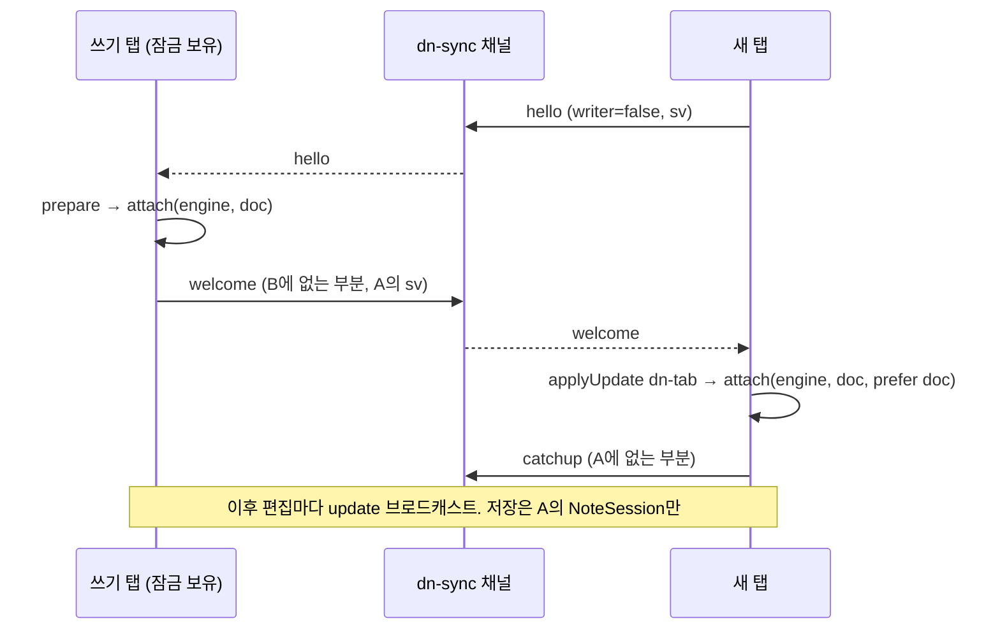

한계 — 탭 사이는 메모리 교환뿐이고, 동기화 노트가 아니면 Y 기록을 저장하지 않는다. 함께 편집 탭이 500ms 안에 상태를 못 받아 자기 엔진으로 Y를 따로 만든 뒤 쓰기 탭과 이어지면, 같은 엔티티 키에 서로 다른 Y.Map이 생겨 LWW로 한쪽이 이긴다(확인 못 함 — 재현 테스트 없음).

---

## 4. 기기 사이 동기화 파일

서버 없이 두 기기가 파일로 노트를 맞춘다. 설정 › 가져오기 · 내보내기의 "기기 사이 동기화 (파일)"(`SettingsDialog.tsx`)과 명령 팔레트 `sync-export`에서 쓴다.

### 4.1 파일 형식 (`SyncFile`, `exchange.ts`)

```ts
interface SyncFile {
  app: 'DamianNote'; kind: 'sync'; v: 1 | 2 | 3 | 4;   // 2(10/09): 목록 필드가 항목 키(2.1). 3(10/09): 삭제가 묘비(2.1). 4(10/19): schema 필드. 내보내기는 4. 예전 앱은 자기가 모르는 버전을 거절한다 — 잘못 읽지 않게
  schema?: number;         // v4: 내보낸 앱의 노트 스키마 버전 — 이 앱보다 크면 가져오지 않는다
  device: string;          // navigator.userAgent에서 뽑은 'Windows' · 'Mac' · 'iPad' 등
  exportedAt: string;      // ISO
  notes: { id: string; title: string; update: string /* Y.encodeStateAsUpdate 전체, base64 */ }[];
  attachments?: { hash: string; mime: string; data: string /* base64 */ }[];   // 10/05 추가
}
```

파일 이름 `DamianNote-sync-YYYYMMDDHHmm.dnsync.json`. **10/19부터 v4 — `schema`(내보낸 앱의 `SCHEMA_VERSION`)를 적는다(OD-15).** 받는 앱보다 크면 가져오지 않고 "새 버전 앱에서 만든 동기화 파일이에요. 앱을 업데이트한 뒤 가져와 주세요."를 띄운다. v3 이하 앱은 v4 파일을 모르는 버전으로 거절한다. 노트별 Y 기록에도 `meta` 스키마 표시가 담긴다(10.5).

### 4.2 내보내기 · 가져오기 (`ws-sync.ts` `SyncLayer`)

내보내기 `exportSyncFile()` — 잠기지 않은 노트마다 `docOf(id)`로 Y 기록을 얻는다(열린 노트면 지금 Y.Doc, 동기화 노트면 저장된 기록에 엔진을 `prefer 'engine'`으로 이어 붙인 것, 처음이면 엔진에서 새로 만든 것). 노트가 쓰는 첨부 해시(`docAttachments` — 이미지 · 파일 콘텐츠의 `attachment`, 노트 `cover.attachment`)의 바이너리를 넣고, 노트마다 `putSync({update, base: fingerprints(doc), syncedAt, known})` — 이 순간이 그 노트의 "마지막 동기화"다.

가져오기 `importSyncFile(file)`:

| 받는 노트 | 처리 |
|---|---|
| 이 기기에서 잠긴 노트 | 건너뜀 |
| 이 기기에 없는 id (목록 · 휴지통 모두) | `createFromSync` — 같은 id로 새 노트, Y 기록 · 기준 지문 저장 |
| 있지만 동기화 노트가 아님 (공통 Y 기록 없음) | 새 id 사본 `"<제목> (<기기>)"` — 따로 만든 Y 기록끼리 합치면 같은 엔티티가 두 Y.Map으로 겹치기 때문 |
| 동기화 노트 | `mergeSyncInto` (4.3) |

첨부는 노트보다 먼저 `AttachmentStore.put`으로 넣고, 다시 계산한 해시가 파일의 해시와 다르면 버린다(`badFiles`). 끝에 토스트 "합침 · 새 노트 · 사본 · 잠긴 노트 건너뜀 · 충돌 N개 — 주황 테두리 블록에서 남기기 · 지우기".

### 4.3 지우기 ↔ 고치기: 묘비 판정 + 예전 기록 되살리기 (`mergeRemote`)

**10/09부터 삭제는 묘비다(2.1 · 2.2).** 파일로 받은 Y를 합치면 지운 블록의 키가 남아 있으므로, 지우기 ↔ 고치기는 다리의 묘비 규칙(2.3 살아 있음 · 충돌 투영)이 판정한다 — 지운 쪽이 모르는 편집(R1 · R2)이 있으면 그 삭제 묶음이 보류돼 **양쪽 기기에서** 살아 있고 충돌 표시가 붙는다. 사용자 트랜잭션으로 되살리지 않으므로 이 경로에는 실행 취소할 "되살리기"가 없다.

아래 지문 비교 되살리기는 **키를 지우던 예전 기록 · 파일**(묘비 이전)용으로 남아 있다. Yjs 병합에서 키 삭제는 이기므로, 병합 전후를 비교해 사라진 블록 중 "지운 쪽 반대편이 고친" 블록을 되살린다. 블록 키가 Y에 남아 있으면(= 묘비로 지운 것) 건너뛴다(`keys.has(id)`).

```ts
mergeRemote(local: Y.Doc, remoteUpdate: Uint8Array, base: Record<blockId, fingerprint> | null): Conflict[]
// before = bundles(local), theirs = bundles(새 Y.Doc + remoteUpdate), applyUpdate(local, remoteUpdate, 'sync-file'), after = bundles(local)
// bundles()는 살아 있는(Liveness) 블록 · 콘텐츠만 묶는다 — 묘비로 지워진 것(보류 아님)은 뺀다
// 블록 id가 after에 없고, Y에 키도 없고(예전 키 삭제), base에 있으면:
//   mine 있고 theirs 없고 fingerprint(mine) ≠ base  → 'remote-deleted' (다른 기기가 지웠고 이 기기가 고침 → 이 기기 내용으로)
//   theirs 있고 mine 없고 fingerprint(theirs) ≠ base → 'local-deleted'  (이 기기가 지웠고 다른 기기가 고침 → 그쪽 내용으로)
```

- 묶음(`BlockBundle`) = 블록 + `blockId`로 찾은 콘텐츠들(id순). **화살표 · 스트로크는 포함하지 않는다.**
- 지문(`fingerprint`) = 콘텐츠(`order` 제외) + 블록 `style` + 노트 v6 의미 필드(`nodeKind · attachTo · status · emphasis · hedge · role · speaker · owner · time · start · end · due`)의 JSON(키를 정렬해 직렬화 — 기기 · 읽는 순서와 무관)에 FNV-1a 32비트 + 길이. 키 순서를 타던 예전 지문으로 남긴 `base`도 맞게 보도록 두 지문 중 하나라도 같으면 "고치지 않음"으로 본다. **위치 · 크기 · z는 빼서 옮기기만 한 것은 고침으로 보지 않는다.**
- `base`가 없으면(처음) 충돌을 판정하지 않는다.
- 되살리기(예전 기록만): `engine.transact(origin 'user', label '동기화 충돌 블록 되살리기')`로 블록(+ `conflict: {kind, at}` 필드)과 콘텐츠를 만든다. 일반 사용자 트랜잭션이라 Y에 쓰이고 다음 파일로 상대 기기에 간다. **실행 취소할 수 있다**(되돌리면 되살린 블록이 다시 지워진다 — 합치기 전 버전이 남아 있음).
- 표시(`packages/engine-dom/src/conflict.ts` `conflictBadge`): 블록 위 안내문("다른 기기에서 지운 블록이에요 — 여기서 고친 내용이 있어 남겨 두었어요" / "이 기기에서 지운 블록을 다른 기기에서 고쳤어요 — 고친 내용으로 되살렸어요") + **남기기**(`resolveConflict(keep=true)` = `conflict` 필드를 `undefined`로) · **지우기**(`deleteEntities`). 블록에 `.dn-has-conflict` 주황 테두리. 묘비 보류 블록에서는: 남기기 → 다리가 그 `set`을 Y에 쓰지 않고 보류 묶음 구성원의 묘비를 모두 지운다(그 블록은 보통 블록이 됨), 지우기 → 이 기기의 새 묘비(지금 해시)라 R1이 풀려 양쪽에서 사라진다(`exchange.test.ts` "충돌 해결이 양쪽으로 간다").

### 4.4 버전 기록

`mergeSyncInto`는 합치기 전 `saveVersion(reason 'before-sync')`, 되살리기까지 끝난 뒤 `saveVersion(reason 'sync')`를 남긴다(`VersionReason`, `note-store.ts`). FR-097 "병합 결과를 버전 기록에 남김"은 이것으로 충족한다.

### 4.5 테스트 · 한계

`packages/sync/test/exchange.test.ts`(10건): 다른 블록 · 같은 문단 변경은 충돌 없음, 묘비로 remote-deleted · local-deleted 판정(남김 · 충돌 표시), 지운 블록 안에 콘텐츠를 더하면 남김(R2), 남기기 · 지우기가 양쪽으로 감, 예전 기록(키 삭제)은 지문 비교로 되살릴 목록을 냄, 고치지 않은 블록 삭제와 옮기기만 한 것은 충돌 아님, 기준 없으면 판정 안 함, 첨부 해시 모으기, v6 노드 종류 변경은 고침. `e2e/sync-file.mjs`: 브라우저 컨텍스트 두 개(저장소가 따로인 "기기")로 첨부 포함 첫 전달 · 따로 고친 뒤 글자 단위 병합 · 충돌 표시 · 남기기 · 버전 기록 · 되돌려 보내기 · 새로 고침 뒤 이어 합치기.

| 한계 | 내용 |
|---|---|
| 화살표 · 잉크 | 되살린 블록에 붙어 있던 화살표, 잉크 콘텐츠의 스트로크는 되살리지 않는다(확인 못 함 — 스트로크 쪽 테스트 없음) |
| 메타 | 폴더 · 태그 · 고정 · 아이콘 등 `notes_meta`는 파일에 없다. 새로 받은 노트는 루트에 생긴다 |
| 스키마 | ~~버전 표시가 없어 구버전 기기가 새 필드를 받아 그대로 편집한다~~ 10/19: 파일 v4 `schema` + Y `meta` 표시 — 새 버전 파일은 가져오지 않고, 새 스키마 노트는 보기 전용 |
| 크기 | 매번 노트 전체 Y 상태(+ 첨부 전부)를 base64로 담는다 |
| 기준 지문 | 예전 기록 경로만 해당. 기기 쌍마다가 아니라 노트마다 하나라, 기기 세 대 이상이 번갈아 주고받으면 판정 기준이 어긋날 수 있다(확인 못 함). 묘비 경로는 기준 지문을 쓰지 않는다 |
| 삭제 vs 삭제 | 두 기기가 각자 다른 편집 뒤 같은 블록을 지우면 어느 묘비 해시도 지금 내용과 안 맞아 보류(가짜 충돌)로 남는다 — "지우기"로 끝남(13.3 #13) |

---

## 5. 계정 · 로그인 상태

| 항목 | 지금 코드 |
|---|---|
| 백엔드 고르기 (`authBackend()`) | `VITE_SUPABASE_URL` · `VITE_SUPABASE_ANON_KEY`가 있으면 `supabaseBackend`, 개발 · e2e(`VITE_E2E=1`)에서 `localStorage 'dn:auth-mock'`이 있으면 `mockBackend`, 아니면 `unconfigured`(로그인 단추 막힘, "동기화 서버가 아직 연결되지 않았어요") |
| Supabase 호출 | SDK 없이 REST: `POST /auth/v1/otp`(매직 링크), `/auth/v1/authorize?provider=google\|apple`, `GET /auth/v1/user`, `POST /auth/v1/token?grant_type=refresh_token`, `POST /auth/v1/logout`, `PUT /auth/v1/user {data:{delete_at:null}}` |
| 흐름 | **암시적 흐름** — 돌아온 주소 해시 `#access_token=…&refresh_token=…&expires_in=…`를 `fromRedirect`가 읽고 `history.replaceState`로 지운다. SECURITY 3절의 PKCE와 다르다 |
| 세션 저장 | `AccountCtl.commit` → `MetaStore.setSecret('authSession', JSON)` — `dn-app.secrets`, 추출 불가 AES-GCM 키로 암호화. SECURITY 3절의 "localStorage"와 다르다 |
| 탭 사이 | `BroadcastChannel('dn-auth')` — 한 탭이 로그인 · 로그아웃하면 다른 탭이 `load(true)` |
| 삭제 예약 계정 | `user_metadata.delete_at`이 미래면 "계정 삭제가 예약돼 있어요" 단계 → 취소(`cancelDeletion`) 또는 로그아웃. 누가 `delete_at`을 쓰는지(서버 `DELETE /v1/account`)는 없다 |
| 토큰 갱신 | `refresh()`는 정의만 있고 **아무 곳에서도 부르지 않는다**. `accessToken`을 쓰는 코드도 없다 |
| 기기 등록 | 없음 (`POST /v1/devices` 미구현) |
| 로그인과 동기화 | **연결 없음** — 로그인해도 동기화가 시작되지 않고, 로그아웃은 세션만 지운다("노트는 이 기기에 남김", MSG-ACC-001) |
| 화면 | `LoginDialog.tsx` 단계 `start · sent(60초 뒤 다시 보내기) · expired · deletion`, "로그인 없이 이 기기에서만 쓰기". `AccountSettings.tsx` 로그인 상태 · 로그아웃 확인 |
| 테스트 | `e2e/login.mjs` — 흉내 서버로 이메일 → 링크 → 로그인 유지 · 다른 탭 따라옴 · 만료 링크 · Google · 삭제 예약 취소 · 로그아웃 · 폰 화면 |

실제 Supabase 프로젝트가 있는지, 환경 변수가 어디에 설정돼 있는지는 저장소에서 확인 못 함(커밋된 `.env`는 없다).

---

## 6. 저장되는 것 · 잠긴 노트 · UI

### 6.1 저장되는 것

| 저장소 | 내용 | 쓰는 때 |
|---|---|---|
| `dn-notes.snapshots` · `oplog` | 엔진 원본(ADR-0004). **origin `remote` 트랜잭션도 로그에 남는다**(`NoteSession.onChange`는 `load`만 건너뜀) | 300ms 디바운스(최대 1초), 500건 · 유휴 30초 압축 |
| `dn-notes.ysync` (IDB v3) | `SyncState {noteId, update(Y 상태 전체 — 묘비 포함), base(블록 지문), syncedAt, known?(그때 엔진과 Y 양쪽에 **살아 있던** id — `knownIds`가 묘비 판정으로 셈)}`. 동기화 노트만 | 열린 동기화 노트는 Y 업데이트가 생길 때마다 800ms 디바운스로 **상태 전체를 다시 씀**(`persistSync`), 닫을 때 한 번 더. 파일 내보내기 · 합치기 때 |
| `dn-notes.versions` | `before-sync` · `sync` 버전 | 파일 합치기 때 |
| `dn-files.attachments` | 첨부 바이너리(내용 해시 키). OPFS가 아니라 IndexedDB다 | 첨부 추가 · 파일 가져오기 |
| `dn-app.secrets` | `authSession` (암호화) | 로그인 |
| 없음 | `dn-sync` IDB, pending 큐, 동기화 상태, 충돌 레코드 저장소 | — |

같은 변경이 엔진 로그와 Y 상태에 **두 번** 저장되고, 두 저장은 다른 트랜잭션이다. 예전에는 동기화 노트를 열 때 `attach(…, 'engine')`이 엔진에 없는 Y 엔티티를 모두 지워, Y에만 있고 엔진 로그에 아직 안 쓰인 변경(예: 파일을 합친 직후 탭이 죽음)이 사라지고 그 지우기가 다음 파일로 퍼졌다(`sync-safety.test.ts`가 재현). 10/09부터 (1) `persistSync` · 합치기는 **엔진 로그를 먼저 디스크에 쓴 뒤** Y 기록과 `known`을 쓰고, (2) 열 때 `known`으로 "이 기기가 지운 것"과 "아직 안 들어온 것"을 가른다(2.3). 두 저장을 한 트랜잭션으로 묶는 근본 수정은 B부 12.6.

### 6.2 잠긴 노트

- 동기화 파일 내보내기 · 가져오기 모두 잠긴 노트를 건너뛴다(`!n.locked`, `meta?.locked`). 설정 화면 문구 "잠긴 노트는 넣지 않아요".
- `putSync`는 그 순간 노트가 잠겨 있으면 `{sealed}`(금고 열쇠로 AES-GCM)로 쓴다.
- `IdbNoteStore.setNoteLocked`는 `snapshots · oplog · versions · backups`와 함께 **`ysync`도 같은 트랜잭션에서** 봉인 · 해제한다(10/09 고침 — 예전에는 `ysync`를 빠뜨려, 동기화 노트를 잠가도 평문 Y 상태가 남았다. `vault.test.ts`가 재현).

### 6.3 UI 상태 (지금)

| 상태 | 표시 | 코드 |
|---|---|---|
| 혼자 | 저장 상태만(저장됨 · 저장 중 · 오류 · 보기 전용) | `App.tsx` `save-status` |
| 같은 노트 다른 탭 | "탭 N개와 동기화" / "함께 편집 중" · "다른 탭이 저장" | `tabPeers` · `tabRole` |
| 파일 합침 결과 | 토스트 한 줄 | `importSyncFile` |
| 충돌 블록 | 주황 테두리 + 안내 + 남기기 · 지우기 (묘비 보류 블록은 `conflict`가 투영으로 붙음) | `conflict.ts` |
| 일부만 되돌림 | 토스트 "다른 곳의 변경과 겹쳐 일부만 되돌렸어요." / "… 다시 실행했어요." (2.5) | `ws-sync.ts` `engine.undoNotice` |
| 로그인 | 계정 이메일, 로그인 창 | `AccountSettings` · `LoginDialog` |
| 없음 | 동기화됨 · 대기 N개 · 오프라인 · 동기화 오류(MSG-SYNC-001~015), 충돌 목록 화면 16, 업로드 질문(MSG-SYNC-020) | — |

---

## 7. 구 설계(v0.2) 대조표

v0.2(2026-10-01 · 02)의 각 절이 주장한 것과 코드 상태. **구현** = 그대로 있음, **일부**, **미구현** = 설계는 유효하나 코드 없음, **변경** = 다른 방식으로 구현됐거나 B부가 다르게 정함, **폐기** = 근거가 사라져 B부에서 뺌.

| v0.2 절 | 주장 | 코드 상태 | B부에서 |
|---|---|---|---|
| 1.1 FR 대응 | FR-094~098 · 149 설계 대응 | 일부 — 1.2 | 8.2 |
| 1.2 목표 G1~G5 | 수렴 · 무손실 · local-first · 불투명 서버 · 5초 | G3(local-first)만 충족. G1 · G2는 파일 경로에서 시나리오 테스트만, 속성 테스트 없음 | 8.1 (G4 표현 변경) |
| 2.1 구성 요소 | `NoteBridge` · `WorkspaceBridge` · sync 워커 · Materializer · `packages/sync-yjs` | 변경 — 패키지 이름은 `@dn/sync`, 다리는 함수 `attach()`. 워크스페이스 다리 · 워커 · Materializer 없음 | 9.1 |
| 2.2 스레드 배치 (열린 노트 Y는 메인) | 메인에 Y.Doc · 다리 | 구현 — 다리는 메인 스레드. 워커는 없음 | 9.3 (워커 없이 시작) |
| 2.3 메인 ↔ 워커 메시지 | `MainToSync` · `SyncToMain` | 미구현 | 폐기 (9.3) |
| 2.4 로컬 저장소 역할 (`dn-sync` IDB) | `ydocs · pending · inbox · sync_state · conflicts · quarantine` | 변경 — `dn-notes.ysync` 하나 | 12.6 (`dn-notes` 안에 둠) |
| 3.1 첫 로그인 · 로컬 노트 업로드 | 업로드 다이얼로그, `syncExcluded` | 미구현 | 12.2 |
| 3.2 새 기기 부트스트랩 | 워크스페이스 먼저, 노트 지연 | 미구현 | 12.3 |
| 3.3 정상 상태 | 100ms 묶음 · ack · `doc-changed` 허브 | 미구현 (탭 사이는 즉시 브로드캐스트) | 12.4 |
| 3.4 오프라인 · 재접속 | pending 재전송, step 1/2 | 미구현 (파일 병합만) | 12.5 (pending 대신 상태 벡터) |
| 3.5 로그아웃 | flush · 유지/삭제 선택 · `dn-sync` 유지 | 일부 — 로그아웃은 노트 유지만, 동기화 상태 없음 | 12.7 |
| 3.6 기기 해지 | 4403 · 105 | 미구현 (FR-098 미착수) | 16.4 |
| 4.1 브리지 불변식 B1~B4 | 투영 = 엔진, origin 분리, 투영은 Y 상태의 순수 함수 | 일부 — B3(origin 분리) · B4(묘비 판정 · 펴기는 Y 상태만의 순수 함수, 10/09)는 구현. B2는 엔진 불변식 범위에서 성립(`conflict` 투영 마스크 포함), `layout` 마스크 10/19 구현, 퍼지는 없음 | 13.1 |
| 4.2 Y.Doc 스키마 · 예약 키 `_del:` · `v:<n>` | 묘비 · 버전 키 | 구현 — 묘비 `_del:<기기id>`(10/09, `_` 키 = 예약), `meta` 맵 `v:<n>` 버전 키(10/19) | 13.2 · 10.5 |
| 4.2.3 필드 값 규칙 (마스크 `h`, points 바이트) | `layout` 미동기화 | 미구현 — `layout`도 Y에 씀, 스트로크는 엔진 값 그대로 | 13.3 #20 |
| 4.2.4 정규 해시 cyrb53 | 묘비 해시 | 구현(10/09) — `recordHash` 엔티티 단위 cyrb53 ×2. 예전 기록용 블록 묶음 지문(FNV-1a, 4.3)도 남음 | 13.2 |
| 4.3 Op → Y | 사상표 | 구현 (삭제 = 묘비, 10/09) | 2.2 |
| 4.4 텍스트 문서 diff, `TextBridgeCodec` in text-pm | `y-prosemirror` 유틸 | 변경 — `packages/sync/src/text-y.ts` 자체 구현, y-prosemirror 없음. 원격 → 엔진은 스텝이 아니라 `doc` set | 2.4, 13.7 |
| 4.5 Y → Op (범위 확장 · `yRefIndex`) | 역참조 인덱스 | 일부 — `reconcile`이 접촉 엔티티 + 끊긴 참조 거르기만. 역참조 인덱스 없음(블록이 되살아나도 그 화살표는 화살표가 다시 접촉될 때까지 엔진에 안 들어옴) | 13.4 |
| 4.6 배치 | 100ms · 256KB 묶음 | 미구현 | 12.4 |
| 4.7 재조정 (`lastBridgedSeq`) | 두 IDB 사이 크래시 복구 | 변경 — `prefer 'engine'` + `known`으로 한쪽에만 있는 엔티티를 가름, 엔진 로그를 먼저 씀(6.1) | 12.6 |
| 4.8 스키마 버전 · `migrateRecord` | 레코드 단위 마이그레이션 | 방식 변경 — 버전 표시 + 새 스키마 문서 보기 전용(10/19), 레코드 마이그레이션은 안 함 | 10.5 |
| 4.9 워크스페이스 브리지 | `MetaStore` ↔ 워크스페이스 Y.Doc | 미구현 (`meta_oplog`도 없음) | 12.8 |
| 5.1 충돌 분류 20종 | 표 | 일부 — #1~4 · #12는 Yjs 기본 동작으로, #5 · #6 · #6a · #6b · #13~16은 묘비로(10/09), #7 · #17은 숨김, 나머지 미구현 | 13.3 |
| 5.2 삭제 ↔ 편집 (상태 기반 R1 · R2, 보류 그룹) | 묘비 + 해시 | 구현(10/09, `tombstone.ts`) — 탭 · 파일 경로 모두. 예전 키 삭제 기록은 지문 비교 되살리기 | 13.2 |
| 5.2.4 화면 16 · 5.2.5 세 가지 해결 | 내 것 · 상대 것 · 둘 다 | 변경 — 블록 위 남기기(묘비 지움) · 지우기(새 묘비) 두 가지 | 13.2.4 |
| 5.2.8 버전 기록 `reason:'merge'` | `dn-app.versions` | 변경 — `dn-notes.versions`의 `before-sync` · `sync` | 13.8 |
| 5.3 묘비 퍼지 30일 | — | 미구현 — "다른 기기가 다 따라잡았나"를 알아야 해 서버 단계. 그동안 묘비는 쌓인다 | 13.6 |
| 5.4 노트 퍼지 vs 편집 (`knownSV`, 409, 4410) | — | 미구현 | 13.6 |
| 6.1 normalize N1~N9 | 투영 단계 함수 | 다리에서 전부 — `fitIncoming` + 끊긴 참조 거르기가 N1 · N2 · N3 · N4 · N7 · N9(10/09), `reconcile` 숨기기가 N5 · N6 · N8(10/19), N10은 `groups.ts` 읽기 규칙. 엔진 함수 `normalizeRemote`는 없음(다리 안 투영으로 충분 — 13.4) | 13.4 |
| 6.2 normalizeMeta M1~M6 | — | 미구현 | 13.5 |
| 7 원격 변경과 undo (조건부 역연산, 텍스트 rebase) | — | 일부 — 조건부 역연산 구현(10/09, 2.5). 텍스트 rebase는 없음(원격이 건드린 글 상자의 텍스트 되돌리기는 건너뜀) | 13.7 |
| 8.1 연결 인증 (서브프로토콜에 토큰) | — | 미구현 | 10.2 (티켓으로 변경) |
| 8.2 메시지 100~105 | — | 미구현 | 10.3 |
| 8.3 SyncRoom 저장 · 압축 · 상한 | 세그먼트 1MB · 32MB | 미구현 | 11.1 |
| 8.4 워크스페이스 DO = 허브 | `doc-changed` | 미구현 | 9.2 · 12.4 |
| 8.5 문서 레지스트리 · `PUT state` · `POST diff` | — | 미구현 | 10.6 (WS만으로 시작) |
| 8.6 첨부 업로드 순서 | 참조 먼저, 자리표시자 | 일부 — 파일 경로는 첨부를 같이 담음 | 15 |
| 9 장애 모드 | quarantine 등 | 미구현 (저장 실패 재시도는 `NoteSession`에 있음) | 17 |
| 10 UI 상태 모델 `SyncStatus` | off · synced · pending · error · conflict | 미구현 | 12.9 |
| 11 테스트 P-S1~P-S8 · DE-01~20 | 퍼징 · 시나리오 | 일부 — 시나리오 단위 테스트(`packages/sync/test` 28건 · undo-remote 9건 · repair 4건), 퍼징 없음 | 19 |
| 12 일정 · 컷라인 (P5 10/16~10/29) | S4 → G2 10/18 | 일정은 ROADMAP 그대로, 다리는 이미 있음 | 20 |
| 13 리스크 R1~R12 | — | 유효한 것은 21절로 | 21 |
| 14 다른 문서 반영 | — | 대부분 미반영 | 22 |

---

# B부 — 서버 동기화 설계

## 8. 목표 · 비목표 · 컷라인

### 8.1 목표

| # | 목표 | 측정 |
|---|---|---|
| G1 | **수렴** — 같은 업데이트 집합을 받은 기기는 받은 순서와 무관하게 같은 엔진 상태가 된다 | 2 · 3-클라이언트 속성 테스트 (19.2 P-S1) |
| G2 | **무손실** — 다른 기기의 삭제를 모르고 한 편집은 자동 병합 결과에서 사라지지 않는다. 사라질 수밖에 없는 경우는 충돌로 보존한다 | P-S3, 13.2.1의 순서 시나리오 |
| G3 | **local-first** — 로그인 · 서버 · 네트워크가 없어도 편집 · 저장 · 열기는 지금과 똑같다 | 지금 e2e 전부 + 오프라인 e2e |
| G4 | **서버는 노트 의미를 해석하지 않는다** — DO는 Yjs 구조 병합(`Y.mergeUpdates` · `Y.diffUpdate`)만 하고 필드 · 텍스트를 읽지 않는다. v0.2의 "업데이트를 디코드하지 않음"은 압축과 양립하지 않아 이렇게 고친다. E2EE(ADR-0012 이후)가 들어오면 압축은 클라이언트로 옮긴다(21.1 R9) | 코드 리뷰: DO가 `Y.Doc`을 만들어 필드를 읽는 곳 없음 (11.1의 GC 압축 예외 제외) |
| G5 | **5초 반영** — 두 기기가 온라인이면 변경이 p95 5초 안에 다른 기기에 보인다 | e2e E8 |
| G6 | **기존 경로 유지** — 탭 동기화 · 동기화 파일은 서버가 있어도 그대로 동작한다 | `e2e/tabs.mjs` · `e2e/sync-file.mjs` 통과 |

### 8.2 FR 컷라인

FR.md의 수락 기준마다 무엇이 있어야 하는지와 20절 마일스톤. **굵게** 표시한 것이 M4(10/29) 판정에 필요한 최소선이다.

| FR | 수락 기준 | 필요한 것 | 마일스톤 |
|---|---|---|---|
| FR-094 | 이메일 · 소셜 로그인 | 있음 (5절). 토큰 갱신 · PKCE 전환 | **M5** |
| FR-094 | 로그인 없이 로컬 전용 | 있음. 동기화 상태 `off` | — |
| FR-094 | 로그인 시 로컬 노트 업로드 여부 확인 | 업로드 질문 MSG-SYNC-020 · 노트별 `syncExcluded` | **M5** |
| FR-094 | 로그아웃 · 계정 삭제 시 로컬 데이터 처리 | 12.7 · 16.5 | **M5** (로그아웃) · M7 (계정 삭제) |
| FR-095 | 5초 반영 | 노트 방 WS · 워크스페이스 방 `doc-changed` | **M3 · M4** |
| FR-095 | 블록 · 화살표 · 잉크 · 첨부 | 노트 Y.Doc 전체(이미 다리에 있음) + 첨부(15절) | **M3** · M6 |
| FR-095 | 상태 UI | 12.9 | **M4** |
| FR-096 | 오프라인 표시 · 편집 | 12.9 · 이미 편집은 됨 | **M4** |
| FR-096 | 재접속 자동 전송 · 병합 | 12.5 상태 벡터 교환 | **M3** |
| FR-096 | 재시도 · 알림 | 17.2 | **M4** |
| FR-097 | 자동 병합 · 글자 단위 | 있음 (2절) | — |
| FR-097 | 삭제 ↔ 편집 보존 · 해결 전 어느 쪽도 지우지 않음 | 묘비 13.2 — **구현(10/09)**, 퍼지만 남음 | M1 (퍼지는 M7) |
| FR-097 | 버전 기록 | 13.8 | **M4** |
| FR-098 | 기기 목록 · 원격 로그아웃 | 범위 밖(P9). 해지 신호 받은 기기의 처리(4403)만 | M7 |
| FR-149 | 파싱 불가 데이터 보존 | 손상 업데이트 격리 17.1 | **M4** |
| FR-146 | 잠긴 노트 | 동기화 안 함 (14절, OD-8) | M5 |

S4가 실패하면(19.5) ROADMAP G2 규칙대로 FR-094~097의 서버 동기화를 11월로 넘기고, **로그인 + 동기화 파일**로 출시한다. 묘비(M1 일부)는 10/09에 이미 들어가 동기화 파일 · 탭 경로의 무손실을 높이고 있다.

### 8.3 비목표

- 다른 사용자와의 공동 편집 · 공유 편집 · 커서 공유(awareness). 같은 사용자의 기기끼리만 동기화한다.
- E2EE(ADR-0012). 잠긴 노트의 서버 동기화(14절, OD-8).
- 폴더 단위 선택 동기화 · 첨부 요청 시 다운로드(FR-098 일부, P9).
- 서버 측 내용 검증 · 병합 판단. 병합은 Yjs, 불변식 복구는 클라이언트 normalize(13.4).
- v1에서 Web Worker 분리(9.3), HTTP 전체 상태 업 · 다운로드 엔드포인트(10.6), 공유 링크(FR-134).

---

## 9. 전체 구조

### 9.1 구성 요소

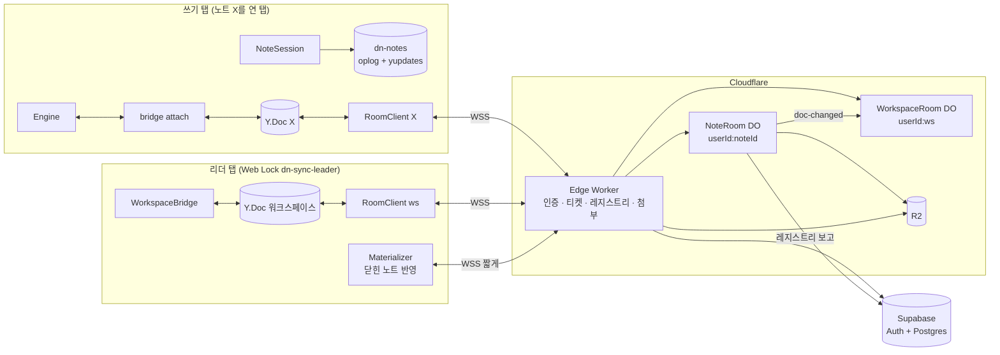

| 구성 요소 | 위치 (새 파일은 설계) | 책임 | 하지 않는 것 |
|---|---|---|---|
| `attach` 다리 | `packages/sync/src/bridge.ts` · `ymap.ts` · `reconcile.ts` · `reopen.ts` · `tombstone.ts` · `normalize.ts` (있음, 묘비 · `conflict` 투영 · `layout` 마스크 · `meta` 스키마 버전 포함) | 엔진 ⇄ Y.Doc | 네트워크 · 저장 |
| `protocol.ts` | `packages/sync/src/protocol.ts` (새) | 프레임 인코딩 · 디코딩(10.3). 서버 · 클라이언트 공용, 순수 함수 | Y 해석 |
| `RoomClient` | `packages/sync/src/room.ts` (새) | 문서 하나의 WS: 핸드셰이크 · step 1/2 · ack 추적 · 백오프. `WebSocket` 생성자를 주입받아 Node 테스트 가능 | 엔진 · 저장 |
| `normalizeRemote` | `packages/engine-core/src/normalize.ts` (새) | 원격 트랜잭션 안에서 불변식 수리(13.4) | Y 쓰기 |
| `CloudLayer` | `apps/web/src/ws-cloud.ts` (새, `SyncLayer` 위 층) | 로그인 → 기기 등록 → 연결, 리더 선출, 업로드 질문, 상태 표시, Materializer | |
| YStore | `packages/storage-idb` `IdbNoteStore` 확장 | `ysync` · `yupdates`를 엔진 로그와 같은 트랜잭션에 (12.6) | |
| Edge Worker | `apps/edge/src/*` (새) | JWT 검증 · 티켓 발급 · 라우팅 · 레지스트리 · 첨부 · 계정 | 노트 내용 |
| NoteRoom · WorkspaceRoom | `apps/edge/src/room.ts` (새, 한 클래스 + kind) | 업데이트 저장 · ack · 브로드캐스트 · 압축 · 체크포인트, 워크스페이스는 허브 겸함 | 의미 해석 |

`scripts/check-arch.mjs`의 `ALLOWED`에 `edge: ['sync']`를 더하고(엔진 의존 없음), 소스 파일 400줄 상한을 서버 코드에도 적용한다.

### 9.2 토폴로지 — 노트 방 + 워크스페이스 방

**결정 — ADR-0009대로 노트당 Y.Doc · DO 1개, 사용자당 워크스페이스 Y.Doc · DO 1개. DO 이름은 `idFromName(userId + ':' + docId)`, 워크스페이스는 `userId + ':ws'`로 한다.**

**근거**
1. 노트 방 — 다리가 이미 "노트 1개 = Y.Doc 1개"로 되어 있고(2.1), 새 기기가 모든 노트를 한꺼번에 받지 않아도 된다(ADR-0009).
2. 워크스페이스 방 — 폴더 · 태그 · 노트 목록을 노트 내용 없이 먼저 받아 목록을 그린다. 그리고 그 방이 **사용자 허브**가 되어 닫힌 노트의 변경 알림(`doc-changed`)과 기기 해지를 기기마다 한 소켓으로 전한다.
3. 이름에 `userId`를 넣으면 다른 사용자의 같은 `docId`(같은 백업을 두 계정이 가져온 경우)가 **구조적으로 다른 방**이 된다. 연결마다 Postgres로 소유권을 조회하지 않아도 격리가 성립하고, API 6.2의 "다른 사용자의 같은 id면 409"가 필요 없어진다(DATABASE 5.1의 `documents` 기본 키는 `(user_id, id)`로 바뀐다, 11.3).

**버린 대안** — 사용자당 DO 1개에 모든 노트: 연결 수는 줄지만 큰 노트 하나가 그 사용자 전체를 막고(DO는 단일 스레드), 메모리 128MB(검증 필요) 안에 여러 노트 상태가 들어가야 한다. 연결 상한(API 1.5, 사용자당 64)에 실제로 닿으면 다시 검토한다.

### 9.3 스레드와 탭

**결정 — v1은 Web Worker 없이 메인 스레드에서 시작한다. 노트 방 소켓은 그 노트의 쓰기 탭이, 워크스페이스 방 소켓과 닫힌 노트 반영은 리더 탭(Web Lock `dn-sync-leader`)이 갖는다.**

**근거** — 다리 · Y.Doc이 이미 메인에 있고(v0.2 2.2의 결정과 같음), WebSocket은 비동기 I/O라 메인을 막지 않는다. 워커를 두면 v0.2 2.3의 메시지 계약과 Y 업데이트 왕복을 새로 만들어야 하는데, 지금 근거가 되는 측정(큰 노트 `Y.applyUpdate` 시간)이 없다. 노트 잠금(`dn-note:<id>`)을 가진 탭만 그 노트를 저장하므로(3절) 서버 소켓도 그 탭이 가져야 "Y에 있는 것 = 저장된 것"이 한 곳에서 성립한다. 함께 편집 탭은 지금처럼 `TabSync`로 쓰기 탭을 거친다.

**대가 · 재검토** — 1만 블록 노트의 첫 동기화 디코드가 메인을 100ms 넘게 막으면(S4 측정, 검증 필요) v0.2 2.2 · 13 R2의 워커 대안을 다시 연다. 리더 탭이 죽으면 Web Lock이 풀려 다음 탭이 리더가 된다.

---

## 10. 연결 · 인증 · 프로토콜

### 10.1 연결 순서

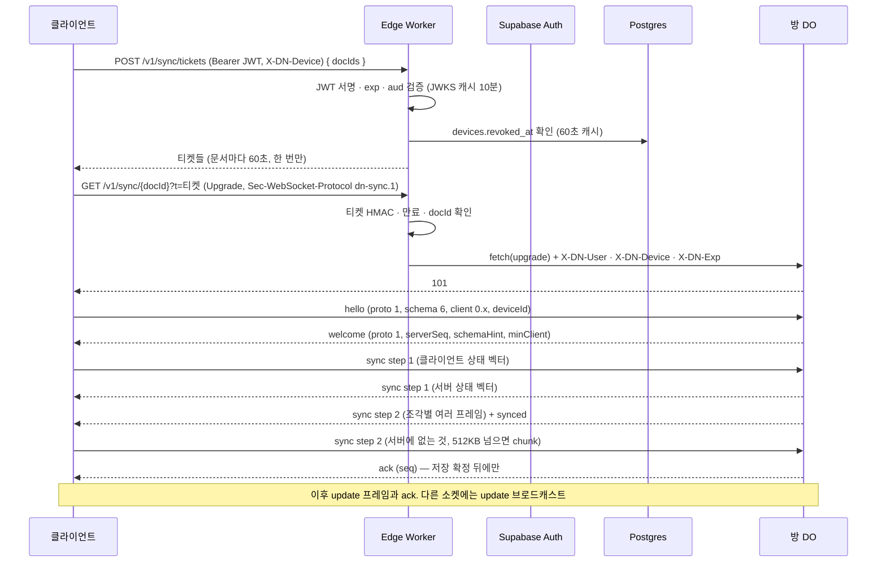

### 10.2 인증 — 짧은 티켓

**결정 — WebSocket은 Supabase JWT 대신 Worker가 발급한 60초짜리 1회용 티켓으로 연다. 티켓 = `base64url(JSON{u, d, doc, jexp, exp, n}) + '.' + HMAC-SHA256(SYNC_TICKET_SECRET)`. 저장소 없음(상태 없는 서명).**

**근거** — (1) JWT 검증 · 기기 해지 조회를 HTTP 한 곳(티켓 발급)에 모아 WS 업그레이드 경로에서 Postgres를 부르지 않는다. (2) 노출 창이 1시간짜리 access token에서 60초 티켓으로 줄어든다. (3) DO는 Worker가 붙인 내부 헤더만 믿으면 된다(DO는 외부에서 직접 라우팅되지 않음). (4) 티켓 하나에 `docId`가 묶여 다른 방에 못 쓴다.

**버린 대안** — API 5.1의 서브프로토콜 `bearer.<jwt>`: 동작하지만 연결마다 JWKS 검증 + Postgres 조회가 필요하고 토큰이 헤더에 실린다. 첫 메시지 인증: 인증 전 소켓이 DO까지 와서 DO가 공격면이 된다. → API 5.1 변경(22절), OD-3.

| 항목 | 규칙 |
|---|---|
| JWT 검증 | `aud = authenticated`, `exp`, `sub`(= userId), `role`. 서명은 Supabase JWKS(`/auth/v1/.well-known/jwks.json`, 비대칭 키) 또는 프로젝트 JWT 비밀(HS256) — **어느 쪽인지는 프로젝트가 없어 확인 못 함**. Worker는 둘 다 지원하고 `wrangler secret`의 `SUPABASE_JWT_SECRET` 유무로 고른다 |
| 다시 인증 | 티켓의 `jexp`(원래 JWT 만료)를 DO가 소켓 첨부(`serializeAttachment`)에 둔다. `jexp + 5분`이 지나면 4401로 닫는다. 클라이언트는 토큰을 갱신할 때마다 새 티켓을 받아 `auth`(102)로 보낸다 |
| 클라이언트 토큰 갱신 | `AccountCtl`에 갱신 예약을 넣는다 — 만료 5분 전, 탭 포커스 · `online` 때. 지금 `refresh()`는 불리지 않는다(5절) |
| 기기 id | 로그인 직후 `POST /v1/devices` → `deviceId`를 `settings`(기기 범위)에 저장. 티켓의 `d` |

### 10.3 프레임

y-protocols(lib0 인코딩)의 sync 메시지를 그대로 쓰고 100번대에 우리 메시지를 둔다. 0~3은 y-protocols가 쓰므로 피한다.

| 종류 | 값 | 방향 | 내용 |
|---|---|---|---|
| sync step 1 | `0,0` | 양방향 | 상태 벡터 |
| sync step 2 | `0,1` | 양방향 | 상대에게 없는 업데이트. 서버 → 클라는 조각마다 한 프레임 |
| update | `0,2` | 양방향 | 새 업데이트 |
| awareness | `1` | — | **쓰지 않는다** — 같은 사용자 기기뿐이고 커서 공유는 범위 밖. 받으면 무시 |
| ack | `100` | 서버 → 클라 | `varuint seq` — 한 소켓에서 보낸 update · step 2 · 완성된 chunk 순서대로(FIFO) |
| error | `101` | 서버 → 클라 | `varstring code` (`bad-update` · `doc-too-large` · `frame-too-large` · `chunk-timeout` · `quota` · `rate`) |
| auth | `102` | 클라 → 서버 | `varstring ticket` (다시 인증) |
| chunk | `103` | 양방향 | `varstring id, varuint idx, varuint total, varUint8Array bytes` — 512KB 넘는 update · step 2 |
| doc-changed | `104` | 서버 → 클라 (워크스페이스 방만) | `varstring docId, varuint serverSeq` |
| device-revoked | `105` | 서버 → 클라 (워크스페이스 방만) | 직후 4403 |
| hello | `110` | 클라 → 서버 | `varuint proto, varuint schema, varstring client, varstring deviceId` |
| welcome | `111` | 서버 → 클라 | `varuint proto, varuint serverSeq, varuint schemaHint, varstring minClient` |
| synced | `112` | 서버 → 클라 | 서버 쪽 step 2 프레임을 다 보냈음 — 클라이언트가 "따라잡기 끝"을 아는 표시 |

- 프레임 상한 512KB. Workers WebSocket 메시지 상한은 1MiB로 가정했다(공개 자료로 재확인 필요 — 더 커졌다는 기억이 있으나 확인 못 함). 청크 설계는 더 작은 상한에서도 동작한다.
- 종료 코드는 API 5.3을 쓰고 `4410`(노트 영구 삭제됨, 13.6)과 `4409`(같은 기기 · 같은 문서 소켓이 새로 열려 옛 소켓을 닫음)를 더한다.

### 10.4 RoomClient 상태

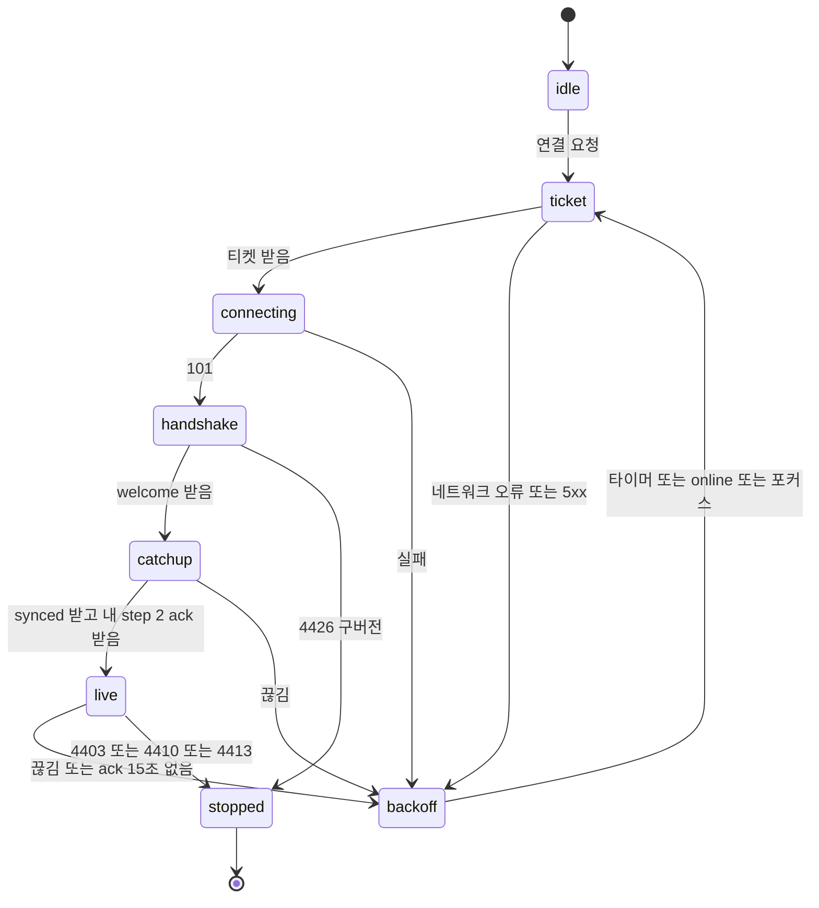

백오프는 API 5.3(1s → 60s, ±20% 지터, `online` · 포커스 시 즉시)을 그대로 쓴다. 4401은 토큰 갱신 후 곧바로 `ticket`으로 간다.

### 10.5 스키마 버전 차이

10/18까지 Y.Doc에는 버전 표시가 없었고(2.1), `migration` origin도 Y에 쓰인다(2.6). 버전이 다른 앱 두 개가 같은 노트를 동기화하면 구버전이 새 필드를 모르는 채 고쳐 되돌려 보낸다(V6-SCHEMA-REVIEW 4.2).

**결정 — 노트 Y.Doc에 `meta` 맵을 두고, 쓰는 클라이언트는 `meta['v:' + SCHEMA_VERSION] = true`를 같은 트랜잭션에 쓴다. 문서 버전 = `v:n` 키의 최댓값(키 합집합이라 단조 증가). 문서 버전이 내 `SCHEMA_VERSION`보다 크면 그 노트는 이 기기에서 보기 전용이 되고 로컬 업데이트를 보내지 않는다. 작으면 내가 마이그레이션 결과를 쓴다(origin `migration`을 Y에 쓰는 지금 동작 유지).**

| 상황 | 동작 |
|---|---|
| 문서 버전 > 내 버전 | 받기는 계속(엔진은 열린 파싱으로 모르는 필드 보존 — 엔진이 다리로 들어온 모르는 필드를 그대로 두는지는 확인 못 함, M1에서 테스트), 편집 막음, 배너 "이 노트는 새 버전 앱에서 고쳐졌어요 — 업데이트하면 고칠 수 있어요" (FR-090의 "새 스냅샷 = 보기 전용"과 같은 정책) |
| 문서 버전 < 내 버전 | `attach` 직후 엔진(이미 마이그레이션된 상태)과 Y의 차이를 origin `migration`으로 쓴다 — 여러 기기가 같은 값을 써도 같은 값 LWW라 무해 |
| 프로토콜 · 앱이 너무 오래됨 | `hello.proto` 불일치 또는 `/v1/config`의 `minClient` 미만 → 4426, "업데이트 — 다시 열기"(ARCHITECTURE 9.3). 편집 · 로컬 저장은 계속 |
| 서버 힌트 | DO는 받은 `hello.schema`의 최댓값을 `meta.schemaHint`로 기억해 `welcome`에 실어 준다 — 첫 step 2 전에 배너를 띄우기 위한 힌트일 뿐, 판단 기준은 Y의 `meta` |

**지금(10/19)** — `bridge.ts`: 엔진 → Y 로컬 트랜잭션마다 `meta['v:' + SCHEMA_VERSION]`이 없으면 같은 트랜잭션에 쓴다(Y.Doc을 엔진에서 처음 만들 때도). `docSchema(doc)` = `v:n` 키의 최댓값(표시 전 기록은 0). 붙일 때 · 다른 곳 변경을 받을 때마다 확인해 문서 버전이 내 버전보다 크면 `onNewerSchema(v)`를 한 번 부르고 `Bridge.newerSchema()`가 그 값을 돌려주며, **그 뒤 로컬 변경은 Y에 쓰지 않는다**(받기는 계속). 앱(`ws-sync.ts`)은 그 노트를 보기 전용으로 바꾸고(`isReadOnly`) 배너 "이 노트는 새 버전 앱에서 고쳐졌어요 — 앱을 업데이트하면 고칠 수 있어요. 지금은 보기만 할 수 있어요."를 띄운다. 같은 기기의 탭 두 개가 서로 다른 앱 버전일 때(PWA 업데이트 직후)도 이 규칙이 막는다. 다리로 들어온 모르는 필드(새 버전 앱의 필드)를 엔진이 그대로 두는 것을 시험으로 확인했다(`normalize-m1.test.ts`). "문서 버전 < 내 버전"은 표시를 더할 뿐 레코드 마이그레이션은 쓰지 않는다(지금 동작 유지 — 예전 앱은 그 뒤 보기 전용).

**버린 대안** — v0.2 4.8 "편집 가능 + 레코드 단위 `migrateRecord`": 엔진에 레코드 단위 마이그레이션 함수가 없고(스냅샷 단위만 있음, `session.ts`), PWA는 업데이트가 빨라 버전 차이 창이 짧다. 동기화 파일도 같은 이유로 `SyncFile.v = 2`에 `schema` 필드를 더한다(OD-15).

### 10.6 REST 엔드포인트 (v1에서 쓰는 것)

| 메서드 · 경로 | 용도 | API.md와의 차이 |
|---|---|---|
| `GET /v1/config` | `minClient` · 기능 플래그 | 같음 |
| `POST /v1/devices` · `GET /v1/devices` | 기기 등록 · 목록 | 같음 |
| `POST /v1/sync/tickets` | 문서별 WS 티켓 (10.2) | **새로** |
| `GET /v1/documents?since=` | 레지스트리 차이 | 같음 |
| `PUT /v1/documents/:docId` | 등록(멱등) + 방 초기화 | 409 없음(9.2) |
| `DELETE /v1/documents/:docId` `{knownSV}` | 영구 삭제, 서버가 앞서면 409 (13.6) | 본문 · 409 추가 (v0.2와 같음) |
| `HEAD · PUT · GET /v1/attachments/:hash`, `POST /v1/attachments/touch` | 첨부 (15절) | touch 추가 |
| `DELETE /v1/account` | 7일 유예 삭제 예약 (16.5) | 같음 |
| WS `/v1/sync/:docId?t=` | 동기화 | 인증 방식 변경 (10.2) |

**결정 — `PUT /v1/documents/:id/state`와 `POST /v1/documents/:id/diff`(API 2절 · v0.2 8.5)는 v1에 만들지 않는다.** 첫 업로드는 빈 서버 상태 벡터에 대한 sync step 2(청크)로, 닫힌 노트 따라잡기는 짧은 WS 세션(12.4)으로 한다. 경로가 하나라 서버 코드 · 테스트가 반으로 준다. 노트 1,000개 부트스트랩이 느리면(E12, 검증 필요) 그때 HTTP 일괄 경로를 더한다(OD-12).

---

## 11. 서버 저장

### 11.1 방 DO의 SQLite

```sql
create table meta (k text primary key, v blob);
  -- userId, docId, kind('note'|'workspace'), registered(1), sv(상태 벡터), serverSeq, schemaHint, purgedAt
create table segments (                      -- 압축된 병합 상태 조각, 각 ≤ 1MB
  idx integer primary key, data blob not null, bytes integer not null, up_to_seq integer not null);
create table updates (                       -- 압축 전 업데이트 (추가 전용)
  seq integer primary key autoincrement, data blob not null,
  device_id text not null, bytes integer not null, at integer not null);
create table quarantine (seq integer primary key, data blob not null, reason text not null, at integer not null);
```

DATABASE 6의 `state_segments`와 같은 생각이며, 한 행 2MB 상한(검증 필요) 때문에 단일 `state` 행을 두지 않는다.

| 동작 | 규칙 | 초기값 |
|---|---|---|
| 받기 (`ingest`) | 크기 확인 → `Y.parseUpdateMeta`로 구조만 확인(실패면 저장 안 하고 `bad-update`) → `updates` 추가 → 메모리 `sv` 갱신 → 다른 소켓에 브로드캐스트 → 보낸 소켓에 ack | 프레임 512KB |
| ack 내구성 | DO 출력 게이트가 저장 확정 전 나가는 메시지를 붙잡으므로 ack = 저장됨 (Cloudflare 문서상 동작으로 알고 있으나 재확인 필요) | — |
| step 2 응답 | 조각마다 `Y.diffUpdate(segment, clientSV)`, 미압축 `updates`는 `Y.mergeUpdates` 후 diff. 비어 있지 않은 것만 보내고 끝에 `synced` | 메모리 = 조각 크기 |
| 압축 | `updates`가 200건 또는 1MB를 넘으면 `transactionSync` 한 번에 `Y.mergeUpdates` → 1MB 이하 조각들 → `updates` 삭제. 실패한 업데이트는 `quarantine`으로 | 200건 · 1MB (DATABASE 6의 500건에서 내림) |
| GC 압축 | 상태가 8MB 미만일 때만, 하루 1번: `new Y.Doc({gc:true})`에 적용 후 `encodeStateAsUpdate`로 다시 써 지워진 내용을 버린다. **G4의 유일한 예외**(구조 GC이지 필드를 읽지는 않음) | 8MB · 1일 (추정) |
| 체크포인트 | 압축 후(직전 체크포인트에서 1시간 지났으면) + 하루 1번 alarm: 조각을 이어 R2 `ckpt/{userId}/{docId}/{serverSeq}.yupd`에 쓰고 `doc_checkpoints` 행 추가 | DATABASE 7 보존 |
| 레지스트리 보고 | 업데이트가 있으면 30초 디바운스 alarm으로 `documents.updated_at · size_bytes · update_count · schema_max` 갱신(서비스 역할, Supabase REST) | 30초 |
| 닫힌 노트 알림 | 업데이트를 받으면 1초 디바운스로 `userId:ws` 방에 `notify(docId, serverSeq, fromDevice)` | 1초 |
| 문서 상한 | 조각 + 업데이트 합 32MB(노트) · 8MB(워크스페이스). 넘으면 `doc-too-large` 후 4413 | 메모리 128MB 가정(검증 필요) |
| 휴면 | 소켓 0개면 Hibernation. `sv` · `serverSeq`는 `meta`에서 복원 | — |

### 11.2 R2

DATABASE 7을 그대로 쓴다: `att/{userId}/{hash[0..1]}/{hash}`(참조 해제 후 30일), `ckpt/{userId}/{docId}/{seq}.yupd`(문서당 최근 7개 + 주 1개 4주), `export/{userId}/{jobId}.zip`(7일). 버킷은 비공개, 모든 접근은 Worker가 `userId` 접두어를 붙여서만 한다(클라이언트가 키를 정하지 않는다).

### 11.3 Postgres — DATABASE 5.1에 대한 변경

아직 배포한 적이 없으므로 `0001_init.sql`을 고쳐 쓴다(별도 마이그레이션 불필요).

```sql
create table documents (
  user_id        uuid not null references profiles(user_id) on delete cascade,
  id             text not null check (char_length(id) = 22 or id = 'ws'),
  kind           text not null check (kind in ('note','workspace')),
  schema_version integer not null,               -- 처음 등록한 클라이언트 버전
  schema_max     integer not null default 0,     -- DO 보고: 문서 meta의 v:n 최댓값 (힌트)
  size_bytes     bigint not null default 0,
  update_count   bigint not null default 0,
  created_at     timestamptz not null default now(),
  updated_at     timestamptz not null default now(),
  deleted_at     timestamptz,                    -- 영구 삭제 표시 (13.6). 30일 뒤 행 삭제
  primary key (user_id, id)                      -- 변경: id 단독 → (user_id, id). 9.2
);
create index documents_user_updated_idx on documents(user_id, updated_at desc) where deleted_at is null;
create unique index documents_one_workspace on documents(user_id) where kind = 'workspace';

create table doc_checkpoints (
  user_id uuid not null, doc_id text not null, seq bigint not null,
  r2_key text not null, size_bytes bigint not null, created_at timestamptz not null default now(),
  primary key (user_id, doc_id, seq),
  foreign key (user_id, doc_id) references documents(user_id, id) on delete cascade
);

alter table profiles
  add column doc_quota_bytes        bigint not null default 1073741824,   -- 1GB (초기값)
  add column attachment_quota_bytes bigint not null default 5368709120;  -- 5GB (초기값)

create view storage_usage as
  select p.user_id,
         coalesce((select sum(size_bytes) from documents d where d.user_id = p.user_id and d.deleted_at is null), 0) as doc_bytes,
         coalesce((select sum(size_bytes) from attachments a where a.user_id = p.user_id), 0) as attachment_bytes
  from profiles p;
```

- `devices` · `attachments` · RLS(DATABASE 5.2)는 그대로. `doc_checkpoints` 정책은 `user_id = auth.uid()`로 단순해진다.
- 티켓 테이블은 없다(10.2 상태 없는 서명).
- 쿼터 검사는 티켓 발급 · 첨부 PUT 때 `storage_usage`로 하고(60초 캐시), DO는 문서 상한만 직접 지킨다.

---

## 12. 클라이언트 동기화 수명주기

### 12.1 켜고 끄기

| 조건 | 동기화 상태 |
|---|---|
| 로그인 안 함 · 서버 설정 없음(`unconfigured`) | `off` — 지금과 같다. 네트워크 요청 없음 |
| 로그인 + 기기 등록 + 업로드 질문 끝남 | 켬. 리더 탭이 워크스페이스 방에 연결 |
| 로그아웃 · 기기 해지 · 구버전 | `off` |

### 12.2 첫 로그인과 로컬 노트 업로드

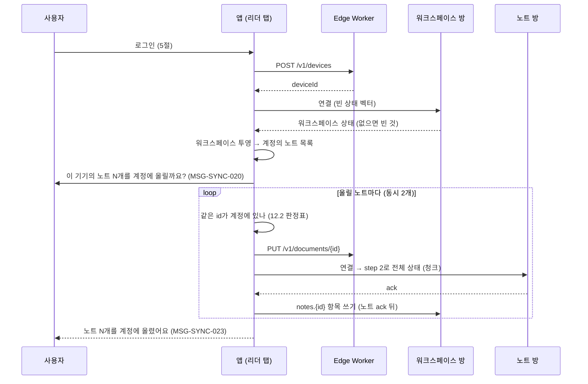

같은 id의 노트가 이 기기와 계정에 둘 다 있을 때 — 지금 동기화 파일이 "공통 Y 기록이 없으면 사본"(4.2)으로 하는 것을 서버에도 쓴다:

| 이 기기 | 계정 (서버 상태 벡터) | 처리 |
|---|---|---|
| Y 기록 없음 (`ysync` 없음) | 없음 | 엔진에서 Y를 만들어(seed) 올림 |
| Y 기록 있음 | 없음 | 그 기록을 올림 |
| Y 기록 있음 | 있고 **상태 벡터의 clientID가 하나라도 겹침** | 같은 기록 → 일반 동기화(합침, 13절 규칙) |
| 있음 (기록 유무 무관) | 있고 clientID가 겹치지 않음 | 따로 만든 기록 — 로컬 노트를 새 id 사본 `"<제목> (이 기기)"`로 올리고, 계정 노트는 따로 받음. 판정이 애매하면 늘 사본(데이터를 잃지 않는 쪽) |

- 올리지 않은 노트는 `notes_meta.syncExcluded = true`, 워크스페이스 문서에 넣지 않는다. 노트 ⋯ 메뉴 "계정에 올리기"(MSG-SYNC-024)로 나중에 올린다.
- 순서는 **노트 상태 ack → 워크스페이스 항목**. 다른 기기가 목록에서 본 노트의 방이 비어 있는 시간을 없앤다(v0.2 3.1과 같음).
- 잠긴 노트는 질문 목록에 넣지 않는다(14절).

### 12.3 새 기기 부트스트랩

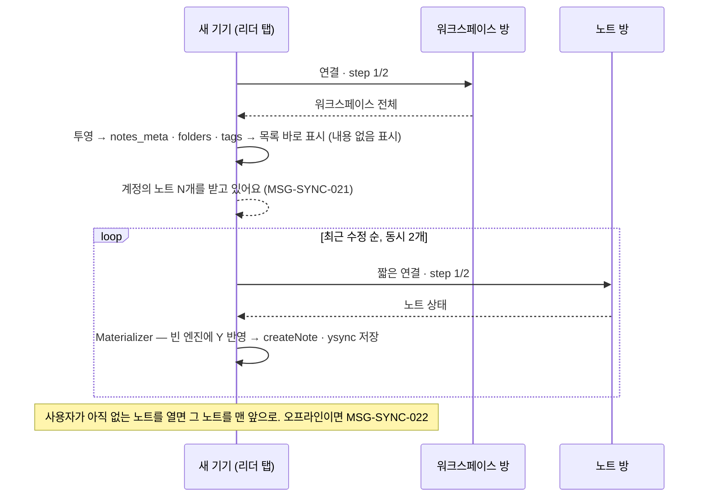

- 첫 반영은 빈 엔진에 대한 `attach(…, 'doc')`라 지금 코드 그대로 모든 엔티티가 origin `remote`로 들어오고 undo에 쌓이지 않는다.
- 받을 노트 예산: 노트 50개 또는 200MB까지 미리 받고 나머지는 열 때(설정값). `navigator.storage.estimate()` 80% 이상이면 멈춘다(FR-091).

### 12.4 정상 상태 (온라인)

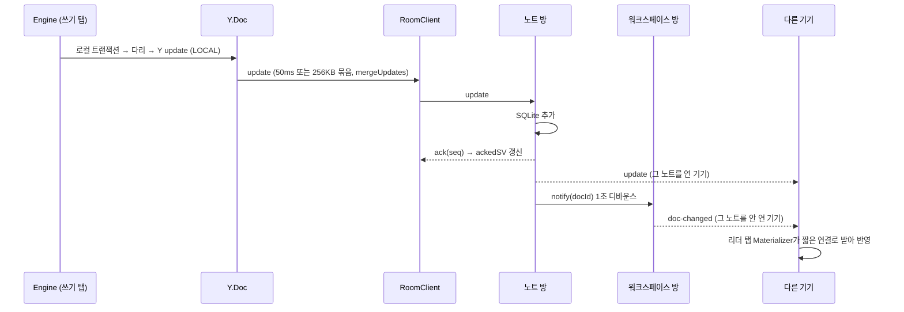

- **5초 예산(추정)**: 노트를 연 기기는 묶음 50ms + 왕복 2회(보냄 · 브로드캐스트) ≈ 0.3초. 노트를 안 연 기기는 1초 디바운스 + `doc-changed` + 티켓 · 연결 · step 1/2 ≈ 2~3초. 둘 다 5초 안(실측 E8, 검증 필요).
- 닫힌 노트 반영은 리더 탭이 노트 잠금(`dn-note:<id>`)을 잡을 수 있을 때만 한다 — 다른 탭이 그 노트를 열고 있으면 그 탭의 RoomClient가 이미 받고 있다. 반영은 지금 `mergeSyncInto`의 닫힌 노트 경로(`openNote` → `attach(…, 'engine')` → 업데이트 적용 → `dispose`)와 같다. 유휴 시간(`requestIdleCallback`)에 노트 하나씩.
- 놓친 알림 보정: 앱 포커스 · `online` · 온라인 중 60초마다 `GET /v1/documents?since=<cursor>`로 `updated_at`이 바뀐 문서를 찾는다.

### 12.5 오프라인과 재접속

**결정 — 별도 pending 큐를 두지 않는다. 로컬 Y 상태(12.6)가 원본 복제본이고, 재접속 때 양방향 sync step 1/2가 빠진 것을 주고받는다. "아직 안 올라간 변경"은 상태 벡터로 계산한다.**

- 클라이언트는 문서마다 `ackedSV`(ack받은 업데이트들의 `Y.encodeStateVectorFromUpdate`를 합친 것)를 저장한다. **안 올라간 변경 있음 ⇔ 로컬 상태 벡터의 내 clientID 시계 > `ackedSV`의 그 값**. 표시 "동기화 대기 N개"의 N은 그런 문서 수다.
- 재접속: step 1 교환 → 서버가 모르는 것을 step 2로 보냄(ack 대상) → 서버가 보낸 것을 반영. 같은 업데이트가 두 번 가도 Yjs 병합은 멱등이다.
- **근거** — v0.2의 `pending` 스토어는 서버 ack 전 업데이트를 따로 들고 FIFO로 짝지어야 했다. 상태 벡터로 차이를 계산하면 큐 · 재전송 순서 · 중복 처리 코드가 없어지고, 크래시 뒤에도 Y 상태만 있으면 정확하다.
- 오프라인 표시: `navigator.onLine === false` 또는 연결 실패가 이어지면 `connectivity: offline`. 편집은 막지 않는다(이미 그렇다).

### 12.6 로컬 영속 — 이중 저장 정리

지금은 엔진 로그와 Y 상태가 다른 트랜잭션에 따로 저장되고, Y는 800ms마다 상태 전체를 다시 쓴다(6.1).

**결정 — `dn-notes`를 IDB v4로 올려 `yupdates` 스토어(`[noteId, seq]`)를 더하고, 다리가 만든 Y 업데이트 바이트를 `NoteSession`의 로그 묶음과 같은 IDB 트랜잭션에 쓴다. `ysync`는 `{noteId, state(압축된 Y 상태), ackedSV, bridgeSeq, base, syncedAt}`로 바꾸고, 엔진 압축과 같은 트랜잭션에서 `yupdates`를 `state`로 합친다. 별도 `dn-sync` IDB는 만들지 않는다.**

| 경우 | 같은 트랜잭션에 쓰는 것 |
|---|---|
| 로컬 편집 | oplog 레코드(origin user 등) + 그 트랜잭션의 Y 업데이트 |
| 원격 업데이트 | Y 업데이트(받은 바이트) + 다리가 만든 엔진 트랜잭션(origin remote)의 oplog 레코드. 엔진 변화가 없는 업데이트(이미 숨겨진 엔티티 등)도 Y 바이트는 쓴다 (`NoteSession.appendY`) |
| 압축 | 스냅샷 + oplog 삭제 + `ysync.state` 갱신(`Y.mergeUpdates`) + `yupdates` 삭제 + `bridgeSeq` |

- 열 때: 스냅샷 + oplog로 엔진, `ysync.state` + `yupdates`로 Y. 둘은 같이 쓰였으므로 맞다. `bridgeSeq`보다 뒤의 oplog 레코드가 있으면(다리가 붙기 전 편집 — 동기화를 켜기 전에 고친 노트 등) 그 Op만 엔진 → Y로 옮긴다(origin `LOCAL`). 지금의 `attach(…, 'engine')` 전체 맞추기는 **Y를 처음 만들 때만** 쓴다.
- 크래시로 마지막 묶음을 잃으면 엔진과 Y가 **함께** 잃는다. 로컬 편집이면 그 300ms~1초 편집이 없어진다(지금과 같은 저장 보장, ENGINE 12장). 원격이면 다음 재접속 step 1/2가 다시 받아온다(서버에 있으므로).
- 6.1의 손실 경로(Y에만 있던 원격 변경이 열 때 지워져 삭제로 퍼짐)가 없어진다. 800ms 전체 다시 쓰기도 없어진다.
- 잠긴 노트는 `yupdates`도 봉인한다(14절). `setNoteLocked`가 `ysync` · `yupdates`를 함께 다시 쓰도록 고친다(6.2 발견).

**버린 대안** — v0.2의 별도 `dn-sync` IDB + `lastBridgedSeq` 재조정: 두 DB를 한 트랜잭션으로 쓸 수 없어 재조정 알고리즘(v0.2 4.7)과 이중 장애 경로가 필요했다. `y-indexeddb`: 또 다른 IDB라 같은 문제, 그리고 의존성 추가.

### 12.7 로그아웃 · 계정 바꾸기

- 로그아웃: 열린 소켓의 ack를 최대 10초 기다린 뒤, 안 올라간 노트가 있으면 "동기화되지 않은 변경 N건 — 그래도 로그아웃할까요?". 이어서 "이 기기의 노트를 남길까요(기본) / 지울까요". 남기면 `ysync`를 그대로 두고 설정 `syncOwner = userId`를 남긴다.
- 같은 사용자로 다시 로그인: `ysync`가 그대로라 step 1/2가 로그아웃 중 편집까지 이어 보낸다.
- 다른 사용자로 로그인: `syncOwner`가 다르면 모든 `ysync`의 `ackedSV`를 비우고 노트를 "로컬 노트"로 보고 12.2 업로드 질문을 다시 한다. Y 기록은 지우지 않는다 — 새 계정으로 올리면 그 기록이 새 계정 방의 시작이 된다(방 이름이 `userId`로 나뉘므로 섞이지 않는다, 9.2).
- 지우기를 고르면 `dn-notes` · `dn-app` · `dn-files`를 지운다(SECURITY 3절).

### 12.8 워크스페이스 문서

```
Y.Doc (워크스페이스, 방 이름 userId:ws)
├─ meta    : Y.Map { 'v:<n>': true }
├─ notes   : Y.Map<noteId, Y.Map{ title, folderId, parentNoteId, order, icon, pinned, favorite, deletedAt, importBatchId,
│                                  tags: Y.Map<tagId, true> }>
├─ folders : Y.Map<folderId, Y.Map{ name, parentId, order, deletedAt }>
└─ tags    : Y.Map<tagId, Y.Map{ name, nameKey, color, order }>
```

- DATABASE 8.2에서 `reminders` · `settings`는 v1에서 뺀다(P8 · 기기 설정은 동기화하지 않음, DATABASE 8.3). 잠긴 노트 · `syncExcluded` 노트는 `notes`에 넣지 않는다.
- `MetaStore`에는 지금 변경 이벤트가 없다(`patch` · `putTag` · `removeTag` 등이 바로 IDB에 쓴다). `MetaStore.onChange(fn)`을 더해 필드 단위 변경을 내보내고, `WorkspaceBridge`가 노트 다리와 같은 규칙(origin 분리, 필드 LWW, 태그 합집합)으로 잇는다. DATABASE 4.3의 `meta_oplog`는 만들지 않는다(워크스페이스 Y 상태가 그 역할).
- 제목: 노트 문서 `note.title`이 원본이고 `notes.<id>.title`은 미러다. 노트 문서를 가진 기기가 다르면 고쳐 쓴다(같은 값이면 안 써서 멈춘다, v0.2 4.9).
- 병합 후 수리는 `normalizeMeta`(13.5).

### 12.9 UI 상태

v0.2 10.1의 모델을 그대로 쓴다(코드는 아직 없음).

```ts
export type SyncStatus = 'off' | 'synced' | 'pending' | 'error' | 'conflict';
export type Connectivity = 'online' | 'connecting' | 'offline';
export interface DocSyncState {
  status: SyncStatus; connectivity: Connectivity;
  unsynced: boolean;          // 로컬 SV > ackedSV (12.5)
  conflicts: number;          // 보류 그룹 수 (13.2)
  lastAckAt?: number;
  lastError?: 'bad-update' | 'bridge' | 'local-quota' | 'doc-too-large' | 'quota' | 'auth' | 'outdated' | 'revoked' | 'network';
}
// 우선순위: off > error > conflict > pending > synced. 앱 전체 = 문서 중 가장 높은 것
```

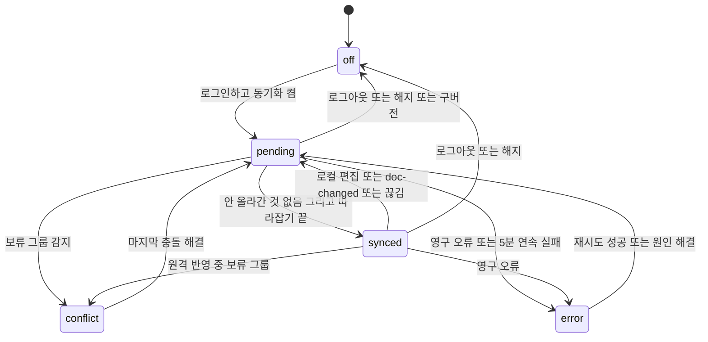

| 상태 | 표시 (MESSAGES) |
|---|---|
| `off` | "이 기기에만 저장" MSG-SYNC-006 |
| `synced` | "동기화됨" MSG-SYNC-001 (누르면 마지막 시각) |
| `pending` + online | "동기화 대기 N개" · "동기화 중…" MSG-SYNC-002 · 003 |
| `pending` + offline | 같은 문구 + 오프라인 표시 |
| `conflict` | "충돌 N개" MSG-SYNC-005, 노트 상단 배너 MSG-SYNC-010 |
| `error` | "동기화 오류" MSG-SYNC-004 → MSG-SYNC-014 · 015 |

탭 동기화 표시(`tabPeers` · `tabRole`)와 저장 상태는 그대로 두고, 동기화 상태는 그 옆에 하나 더한다.

---

## 13. 충돌 규칙

### 13.1 세 층

| 층 | 누가 | 예 | Y에 쓰나 |
|---|---|---|---|
| 1. CRDT 자동 | Yjs | 다른 필드 · 다른 엔티티, 같은 필드 LWW, 같은 문단 글자 병합, 태그 합집합 | — |
| 2. 투영 · 정규화 | 다리(`reconcile` · `fitIncoming` · `Liveness`, 원격 트랜잭션 안) | 끊긴 화살표 숨김, 제목 상자 한 줄, 글 스키마 고치기, 묘비 판정 · 충돌 투영 | **아니오** — 모든 기기가 같은 Y에서 같은 결과를 계산 |
| 3. 사용자 | 충돌 표시 · 남기기 · 지우기 | 삭제 ↔ 편집 | 해결 결과만 일반 Y 쓰기로 |

다리 불변식(v0.2 4.1을 다시 확인): **B3**(origin 분리 — `LOCAL`은 Y → 엔진을 안 타고, `remote`는 엔진 → Y를 안 탐)는 구현돼 있다. **B2**(엔진 = normalize(투영(Y)), 마스크 필드 제외)와 **B4**(투영 · 판정은 Y 상태만의 순수 함수)는 10/09 묘비(13.2) · I8 고치기(13.4)로 **퍼지를 빼고 성립한다** — 엔진 코드의 불변식은 모두 펴거나 숨기므로 원격 거절은 예상 밖 버그일 때만 생긴다(2.3). B2의 마스크 필드는 `conflict`(투영) · 높이 자동 블록의 `h`(`layout` 마스크, 13.3 #20 — 10/19). 남은 틈: 묘비 퍼지(13.6)가 없어 묘비가 계속 쌓인다. 속성 테스트(19.2)는 두 기기 1만 · 세 기기 5천 회로 B2(P-S4) · 수렴(P-S1)을 확인한다(비교에서 마스크 필드는 뺀다).

### 13.2 삭제 ↔ 편집 — 묘비

#### 13.2.1 키 삭제 방식이 서버에서 놓치던 순서

(10/09 이전 코드 — 지금은 묘비라 이 순서에서도 편집이 남는다. `sync-safety.test.ts` "서버 순서"가 재현.) 예전에는 삭제가 Y 키 삭제이고, 동기화 파일은 "마지막 동기화 때 지문(base)"과 비교해 되살린다(4.3). 서버 실시간 동기화에서는 base가 ack마다 앞으로 가므로 다음 순서에서 편집이 사라진다.

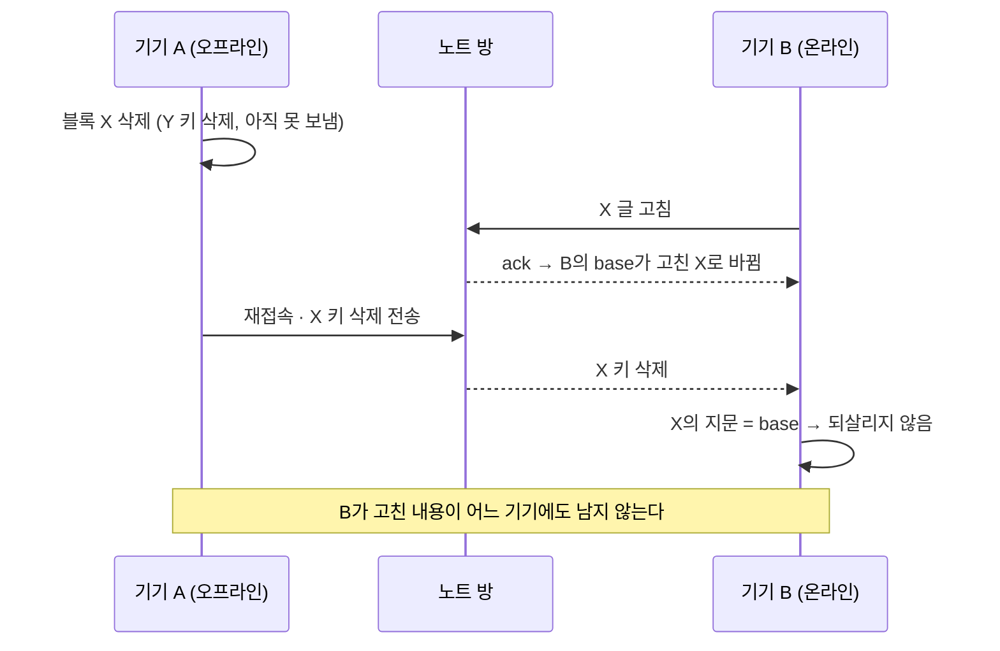

또 `local-deleted` 판정은 상대 기기의 **전체** 상태가 있어야 하는데(4.3의 `theirs`), 서버가 보내는 것은 차이 업데이트라 그것만으로는 묶음을 만들 수 없다. 원인은 "지운 기기가 무엇을 보고 지웠는가"가 Y에 남지 않는다는 데 있다.

#### 13.2.2 결정 — 적용됨 (10/09, `905434d`, OD-1)

**결정 — 엔티티 삭제는 Y 키를 지우지 않고 그 엔티티 Y.Map에 `'_del:' + deviceId` 키로 묘비를 쓴다. 묘비에는 지운 기기가 본 내용의 해시를 적는다. 엔티티가 엔진에 살아 있을지는 Y 상태만으로 판정한다(v0.2 4.2 · 5.2를 다시 채택). Y 키 자체는 30일 뒤에만 지운다(13.6 — 퍼지는 아직 없음).**

```ts
// packages/sync/src/tombstone.ts (구현)
export const TOMB = '_del:';
export interface Tombstone {
  readonly v: 1;
  readonly tx: string;     // 삭제 트랜잭션 txId — 같은 tx의 묘비들이 "삭제 묶음"
  readonly at: number;     // 충돌 표시 시각 · 퍼지 대상 판정에만 (순서 판단 금지)
  readonly hash: string;   // 지우기 직전 이 기기가 본 레코드 해시 (recordHash)
}
/** `_`로 시작하는 키와 마스크 필드를 뺀 레코드의 해시. 블록은 x · y · w · h · z · conflict, 콘텐츠는 order를 뺀다
 *  (예전 지문과 같은 정책 — 옮기기만 한 것은 고침이 아니다, OD-2). cyrb53을 시드 0 · 1로 두 번 = 106비트, 동기 계산 */
export function recordHash(kind: EntityKind, m: Y.Map<unknown>): string;
```

판정(v0.2 5.2.1, 코드의 참조 필드 이름으로 다시 확인 — `content.blockId`, `stroke.parent.contentId`):

```ts
function isPending(T: string, y: YView): boolean {
  const members = y.groupIndex.get(T);                       // 묘비 tx === T 인 엔티티
  for (const e of members)                                   // R1 내용: 지운 기기가 본 것과 지금이 다르다
    if (!tombstonesOf(e).some((t) => t.hash === recordHash(e))) return true;
  for (const e of members)                                   // R2 구조: 묘비 없는 자식이 그룹 구성원을 부모로 가리킨다
    for (const child of y.refIndex.childrenOf(e)) if (tombstonesOf(child).length === 0) return true;
  return false;
}
const isAlive = (e: YEntity, y: YView) => y.has(e) && (tombstonesOf(e).length === 0 || tombstonesOf(e).some((t) => isPending(t.tx, y)));
```

- 13.2.1의 순서에서: B가 고친 X에 A의 묘비가 오면 A의 해시(고치기 전)와 지금 해시가 달라 **보류(pending)** → X는 A · B 모두에서 살아 있고 충돌 표시.
- 화살표는 R2에 넣지 않는다 — 지운 블록에 새로 건 화살표만으로는 블록을 되살리지 않고 숨긴다(13.3 #7, 지금 코드의 거르기와 같은 결과).
- 다리 변경: `delete` Op → `root.get(id).set(TOMB + deviceId, tombstone)`(키 유지), `create`가 묘비 있는 키를 만나면 묘비를 모두 지우고 필드를 맞춤, 투영(`reconcile`)은 `isAlive`로 거른다. 다리는 Y 기준 역참조 인덱스(`refIndex`)와 그룹 인덱스를 따로 유지한다 — 숨겨진 엔티티도 Y에는 있어 블록이 되살아날 때 다시 찾아야 하기 때문이다(v0.2 4.5.1).

**구현에서 위 스케치와 다른 점** (10/09, A부 2.1 · 2.2 · 2.3이 지금 동작):

| 항목 | 스케치 | 구현 |
|---|---|---|
| `Tombstone.root` | 그룹 대표 `'block:<id>'` | **없음** — 묶음은 `tx`만으로 묶고, 충돌 표시는 보류 묶음에 든 **블록마다** 투영한다 |
| 색인 | 다리가 `refIndex` · 그룹 인덱스를 계속 유지 | `Liveness` — 한 번 맞추는 동안만 쓰는 지연 색인. 묘비 없는 엔티티는 색인 없이 답하고, 묘비 있는 것을 처음 물을 때 문서를 한 번 훑는다. 묘비가 걸린 원격 변경이면 전부 다시 맞추어(2.3) 되살아난 블록의 숨은 자식도 돌아온다 |
| 기기 id | `deviceId`(16.4의 등록 기기) | 앱은 `localStorage 'dn:device-id'`(처음 한 번 `newId()`, `ws-sync.ts`), `attach`에 `device`를 안 주면 Y.Doc `clientID`. 서버 기기 등록과는 아직 무관 |
| 충돌 표시 | 대표 블록에 `conflict` 투영 | 보류 블록마다 `conflict: {kind, at}` 투영 — `kind`는 묶음에 이 기기 묘비가 있으면 `local-deleted`, `at`은 묘비 `at`의 최댓값. Y에는 쓰지 않는다(`reopen.ts` `pushEngine`도 `conflict`를 건너뜀) |
| 남기기 | `bridge.restore(groupTx)`를 `resolveConflict(keep)`가 부름 | 엔진 API를 늘리지 않았다 — `resolveConflict(keep)`는 예전처럼 `conflict: undefined`를 `set`하고, **다리가 그 `set`을 가로채** 보류 묶음 구성원의 묘비를 모두 지운다(Y에 `conflict`를 쓰지 않음) |
| 남기기 실행 취소 | 묘비 다시 쓰기 | **남기기는 실행 취소 기록에 넣지 않는다**(`resolveConflict(keep)` `undoable: false`) — 되돌리면 묘비 없이 `conflict`만 일반 필드로 Y에 쓰이기 때문. 남긴 뒤 마음이 바뀌면 지우기를 고른다 |
| 실행 취소로 되살림 | `create`가 묘비를 지움 | 같음 — `putEntity`가 기존 맵을 재사용해 묘비를 지우고 필드를 맞춘다(새 맵을 만들면 그사이 다른 기기 편집이 사라짐, #14) |
| 이어 붙이기 | — | `reopen.ts` `pushEngine`이 `known`으로 "이 기기가 지운 것"을 가려 키를 지우는 대신 묘비를 쓴다 |
| 퍼지 | 30일 | 없음 (13.6) |

**버린 대안** — 예전 방식(키 삭제 + base 지문) 유지: 13.2.1. Yjs 내부 구조(DeleteSet · Item 작성자)로 동시성 판정: 받는 기기마다 결과가 달라질 수 있고 내부 API에 기댄다. 서버 판정: G4.

#### 13.2.3 호환

- 동기화 파일 경로는 `mergeRemote`의 되살리기를 남겨 두었다 — 묘비 이전 파일(키 삭제)도 그대로 처리한다. 묘비가 있는 Y는 키가 남아 있으므로 `mergeRemote`가 사라진 블록으로 보지 않고(`keys.has(id)`면 건너뜀), 판정은 묘비 규칙이 한다. 동기화 파일은 v3, 탭 채널은 `dn-sync:3:`(10/09).
- 서버에는 묘비를 쓰는 클라이언트만 붙는다(`hello.proto = 1`, 10.5). 키 삭제를 쓰는 옛 클라이언트는 4426.
- 10/09 이전 Y 기록(`ysync`)에 이미 있는 키 삭제는 되돌릴 수 없으므로 그대로 둔다(그 블록은 지워진 채, 파일 경로에서는 지문 되살리기가 맡음).

#### 13.2.4 사용자에게

지금 UI(블록 위 안내 + 남기기 · 지우기, 4.3)를 그대로 쓰고 의미만 묘비에 맞춘다. 10/09에 표시 · 남기기 · 지우기 · 동시 해결 줄은 구현됐다(남기기 방식은 13.2.2 표의 차이). 목록 줄은 아직 없다.

| 항목 | 규칙 |
|---|---|
| 표시 | 보류 묶음의 블록에 엔진 `conflict` 필드를 투영으로 붙인다. `conflict`는 **마스크 필드** — 다리가 Y에 쓰지 않는다(예전 키 삭제 기록의 되살리기만 사용자 트랜잭션으로 Y에 씀, 4.3). 문구는 묘비를 쓴 기기가 나면 "이 기기에서 지운 블록을 다른 기기에서 고쳤어요", 아니면 "다른 기기에서 지운 블록이에요 — 여기서 고친 내용이 있어 남겨 두었어요" |
| 남기기 | 그룹의 모든 `_del:*` 키를 지운다. 구현은 `resolveConflict(keep)`의 `conflict: undefined` `set`을 다리가 가로채서(`bridge.ts`) — 엔진 변경 없음. 남기기는 실행 취소 기록에 넣지 않는다(13.2.2 표) |
| 지우기 | 일반 삭제 → 이 기기의 새 묘비(지금 해시) → R1이 맞아 보류 해제 → 모든 기기에서 사라짐 |
| 동시 해결 | 한쪽 지우기 + 한쪽 남기기 = 지우기(지우기 쪽 새 묘비는 남기기 쪽이 모르는 키라 안 지워짐). 같은 선택은 멱등 (v0.2 5.2.5 표) |
| 목록 | 노트별 보류 그룹 수 → 상태 `conflict`. 화면 16 · "둘 다 남기기"(MSG-SYNC-012 · 013)는 컷라인 아래(20절) |

### 13.3 분류표

v0.2 5.1을 코드와 다시 맞춘 것. "지금" = A부 코드(탭 · 파일 경로), "서버 v1" = B부 규칙.

| # | 동시에 일어난 일 | 지금 | 서버 v1 |
|---|---|---|---|
| 1 | 같은 엔티티 같은 필드 (이동 vs 이동, 색 vs 색) | Y.Map LWW — Yjs 규칙으로 결정적 | 같음. 진 값은 버전 기록에만 |
| 2 | 같은 엔티티 다른 필드 | 둘 다 남음 | 같음 |
| 3 | 같은 블록에 동시 삽입 | 다른 엔티티 둘, `(order, id)` 정렬 | 같음 |
| 4 | 같은 텍스트 동시 편집 | 글자 단위 병합 (2.4) | 같음. 스키마 위반이면 N7 |
| 5 | 삭제 vs 편집 | 묘비 보류(R1) — 탭 · 파일 모두, 양쪽 기기에서 살아 있고 충돌 표시 (10/09). 예전 키 삭제 기록은 지문 비교로 되살림 | 같음 |
| 6 | 삭제 vs 이동만 | 충돌 아님, 삭제 — 해시에서 위치 · 크기 · z 제외(OD-2) | 같음 |
| 6a | A가 블록 B1 삭제, B가 다른 블록 콘텐츠를 B1로 옮김 | R2로 B1 묶음 보류 → 둘 다 살아 있음 (10/09, 시험은 "지운 블록 안에 콘텐츠를 더함"으로) | 같음 |
| 6b | A가 B1 삭제(콘텐츠 C 연쇄), B가 C를 B1 밖으로 | C의 `blockId`가 바뀌어 해시 불일치(R1) → 묶음 보류 (10/09, 시험 없음) | 같음 |
| 7 | 지운 블록에 다른 기기가 화살표 연결 | 화살표를 엔진에 안 넣음 | 같음(N3 숨김). 블록이 되살아나면 다시 보임 |
| 8 | 폴더 순환 | 워크스페이스 동기화 없음 | normalizeMeta M2 |
| 9 | 같은 이름 태그 동시 생성 | 없음 | M4 (Y에 씀) |
| 10 | 스키마 버전 차이 | 검사 없음 — 구버전이 그대로 편집 | 10.5 |
| 11 | 노트 영구 삭제 vs 다른 기기 오프라인 편집 | 동기화 파일엔 영구 삭제가 없음 | 13.6 |
| 11a | 노트 휴지통 vs 내용 편집 | 휴지통 노트도 파일 합치기 대상 | 둘 다 남음, 알림 1회 + 휴지통 보존 기간 다시 30일 |
| 12 | 같은 id 동시 생성 (같은 백업을 두 기기에서) | 파일: 공통 기록 없으면 사본 | 12.2 판정표(사본) |
| 13 | 삭제 vs 삭제 (각자 다른 편집 뒤) | 해시가 어느 묘비와도 안 맞으면 가짜 보류 → "지우기"로 끝 (알려진 한계, v0.2 5.2.7, 10/09) | 같음 |
| 14 | 삭제 후 undo vs 편집 | 기존 맵의 묘비 제거 → 살아 있고 그사이 편집도 남음 (10/09, `sync-safety.test.ts` #14) | 같음 |
| 15 | undo 복원 vs 다른 기기 삭제 | 묘비 규칙대로 — 복원은 자기가 본 묘비만 지우므로 다른 기기의 동시 묘비는 남고, 그 해시 = 복원 값이면 삭제 확정, 아니면 보류 (10/09, 시험 없음) | 같음 |
| 16 | 잉크 전부 지움(ink 콘텐츠 삭제) vs 스트로크 추가 | R2로 보류 — 묘비 없는 스트로크가 `parent.contentId`로 가리킴 (10/09, 시험 없음) | 같음 |
| 17 | 화살표 양 끝을 같은 블록으로 동시 재연결 | 엔진에 넣지 않음(숨김, `normalize.ts` — 10/09, `sync-safety.test.ts`) | 같음 |
| 18 | `z` · `order` 같은 키 | `(key, id)` 정렬 | 같음 |
| 19 | 노트 위치 동시 변경 (폴더 vs 부모 노트) | 없음 | M3 |
| 20 | 높이 자동 블록의 측정 `h` | **10/19 구현** — `layout` origin(높이 측정)을 Y에 쓰지 않고, 받을 때 높이 자동 블록의 `h`는 이 기기 값을 둔다(새로 만들 때만 Y 값으로 시작). 고정 높이는 그대로 맞춘다 | 같음 (OD-11) |
| 21 | 같은 데이터베이스의 다른 행 동시 편집 | 항목 키 — 다른 행 · 같은 행의 다른 칸 모두 남음 (10/09, 2.1) | 같음 |
| 22 | 같은 블록에 댓글 동시 추가 | 항목 키 — 둘 다 남음 (10/09) | 같음 |
| 23 | 서로 다른 묶음의 이름 동시 변경 | 항목 키 — 둘 다 남음 (10/09) | 같음 |
| 24 | 묶기 vs 풀기 · 묶음 구성원 동시 변경 | `block.group` 필드 LWW | 같음 + N10(구성원 2개 미만인 묶음은 묶음 아님으로 투영) |
| 25 | 화살표 끝 `groupId`가 풀린 묶음을 가리킴 | 느슨한 참조 — 상자 끝으로 읽음 (`model.ts` `Anchor.groupId`) | 같음 |
| 26 | 잠긴 노트 | 파일에서 제외 | 동기화 안 함 (14절) |

### 13.4 normalize (원격 트랜잭션 안)

**결정 — `normalizeRemote(tx, scope)`를 `engine-core`에 만들고 다리의 `reconcile` 트랜잭션 안, 커밋 검증 전에 부른다. 수리 결과는 엔진에만 반영하고 Y에는 쓰지 않는다.**

**지금(10/09)** — 엔진 함수는 없고, 다리의 `fitIncoming`(`packages/sync/src/normalize.ts`, 들이기 전 레코드 단위)과 끊긴 참조 거르기(2.3)가 같은 일을 한다. 엔진 코드의 불변식(I1 · I2 · I6 · I7 · I8 · I10)은 모두 여기서 고치거나 숨긴다. 아래 표의 "지금" 열 참고.

근거는 v0.2 6.1과 같다 — 모든 기기가 같은 Y에서 같은 결과를 계산하므로 쓸 필요가 없고, 쓰면 중간 상태의 수리가 영구 기록돼 되돌릴 수 없다(블록이 잠시 없어 지운 화살표가 블록이 돌아와도 영영 없음). 지금 코드의 끊긴 참조 거르기(2.3)는 N3~N5의 부분 집합이다.

규칙은 아래 순서로, 각 규칙 안에서는 id 사전순으로 한 번씩. 불변식 번호는 `invariants.ts`에서 확인한 것(I1 · I2 · I6 · I7 · I8 · I10)과 ENGINE 3.7의 것(I3 · I4 · I5 — 코드 위치는 확인 못 함).

| # | 규칙 | 위반 예 | 수리 (투영) | 지금 (10/09) |
|---|---|---|---|---|
| N1 | 좌표 · 크기 (I6) | NaN, 범위 밖, `MIN_SIZE` 미만 | 유한하지 않으면 0, 클램프, 하한 | 있음 — 크기는 하한, 범위 밖이면 기본 위치 · 크기 |
| N2 | 키 형식 (I7) | `z` · `order`가 fractional 키가 아님 | 맨 뒤로 정렬되는 표시용 키 | 블록 `z`는 새 키. 콘텐츠 `order`가 틀리면 **숨김**(들이지 않음) |
| N3 | 화살표 끝 (I2) | 끝 블록이 살아 있지 않음, `from = to`, 끝이 비어 있음 | 숨김 | 있음 (거르기 · `fitIncoming`). 끝이 비어 있는 순간(프레임 일부만 받아 Yjs가 새 끝은 보류하고 옛 끝 삭제만 적용 — 반례 s4-03, 10/19)도 숨김 |
| N4 | 콘텐츠 부모 (I1) | `blockId` 블록이 살아 있지 않음 | 숨김 | 있음 (거르기) |
| N5 | 스트로크 부모 (I3) | 부모 콘텐츠 없음 · ink 아님 | 숨김 | **있음** (10/19) — 부모 없음 · ink 아님 · 부모 필드가 비어 있음(반례 s4-03) 모두 숨김 |
| N6 | 빈 ink 콘텐츠 (I4) | 살아 있는 스트로크 0개 | 숨김 | **있음** (10/19) — 획이 바뀌면 그 부모 잉크도 다시 본다. 로컬도 같은 규칙: `deleteStrokes`가 묶인 획을 다 지우면 그 잉크 콘텐츠도 같은 트랜잭션에서 지움(엔진 I4) |
| N7 | 텍스트 스키마 (I8) | 동시 구조 편집으로 스키마에 맞지 않는 프래그먼트 | 허용 안 되는 노드를 같은 글자의 문단으로 펼침. 다음 로컬 편집 때 `syncDoc`이 수리 결과를 자연히 Y에 반영 | **있음** (`babc038`) — `TextCodec.repair` · text-pm `repair.ts`: 맞는 최상위 블록은 두고 안 맞는 블록만 문단으로(서식 유지), 끝내 안 되면 글자만 줄마다 문단 |
| N8 | id 종류 중복 (I5) | 같은 id가 두 맵에 | block > content > arrow > stroke 순으로 앞만 | **있음** (10/19) — 다른 종류 맵의 같은 id가 바뀌면 이쪽도 다시 본다 |
| N9 | 제목 상자 한 줄 (I10) | `role:'title'` 문서에 문단 여럿 (상자 종류 변경 + 줄 추가 동시) | `toTitleDoc`으로 한 줄로 폄(글자 · 서식 유지) | 있음 (`ba75cb2`) |
| N10 | 묶음 (v6) | `block.group` 구성원이 2개 미만 | 묶음 아님으로 투영 | **확인함** (10/19) — `groups.ts` `groupMembers` · `groupOf`가 읽을 때 2개 미만(카드는 1개 미만)을 묶음으로 치지 않아 모든 기기가 같다. 필드는 고치지 않는다(다시 구성원이 생기면 묶음으로 돌아옴). 시험: 서로 다른 묶기가 같은 상자를 동시에 가져감 |

- 결정성: 입력은 투영 상태뿐, 순회는 id 사전순, 시계 · 난수 · 기기 정보 없음. 멱등: 뒤 규칙은 숨기기만 해 앞 규칙 위반을 만들지 않는다 → `normalize(normalize(s)) = normalize(s)` (P-S5).
- 그래도 검증이 실패하면(버그) 17.1 "브리지 오류": 그 문서만 `error(bridge)`, 엔진은 그대로, 다음 열기 때 전체 재투영.

### 13.5 워크스페이스 normalizeMeta

v0.2 6.2를 그대로 쓴다(코드 없음).

| # | 규칙 | 수리 | Y에 쓰나 |
|---|---|---|---|
| M1 | 없는 · 지운 폴더를 가리킴 | 루트로 투영 | 아니오 |
| M2 | 폴더 `parentId` 순환 | 순환 중 id가 가장 작은 폴더를 루트로 투영 | 아니오 |
| M3 | `folderId`와 `parentNoteId`가 둘 다 | `parentNoteId` 우선 | 아니오 |
| M4 | `nameKey`가 같은 태그 여럿 | id가 가장 작은 태그로 합침, 나머지 `deletedAt` | **예** (모든 기기가 같은 값 → 멱등) |
| M5 | 노트 중첩 순환 | M2와 같음 | 아니오 |
| M6 | 제목 미러 불일치 | 노트 문서 기준으로 | 예 (노트 문서가 있는 기기만) |

### 13.6 퍼지

**묘비 퍼지(30일)** — 그룹의 모든 묘비 `at`이 30일 전이고, 그룹이 보류가 아니고, 퍼지하는 기기가 이번 세션에 그 문서의 따라잡기(`synced`)를 끝냈고 온라인일 때만, 그룹 구성원의 바깥 키와 그 블록을 가리키는 숨겨진 화살표 키를 한 Y 트랜잭션으로 지운다. 여러 기기가 동시에 해도 멱등(v0.2 5.3).

**노트 영구 삭제 vs 다른 기기 편집** (v0.2 5.4, API · DATABASE 10이 이미 인용):

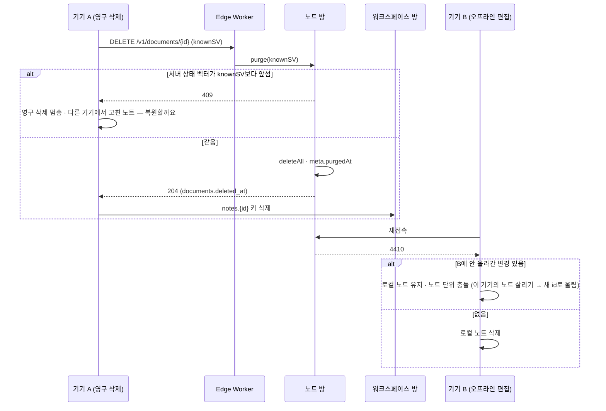

### 13.7 원격 변경과 실행 취소

**구현됨 (10/09, `3563ad2`)** — 아래 규칙이 `engine-core` `undo-guard.ts` · `history.ts`에 있다(지금 동작은 2.5). v1 규칙(v0.2 7.1 · 7.2를 줄인 것):

| 역연산 | 조건 | 아니면 |
|---|---|---|
| `set` → `set(prev)` | 대상이 있고 현재 값이 내가 쓴 값과 같을 때만 | 건너뜀 (다른 기기가 그 뒤 바꾼 값을 존중) |
| `create` → `delete` | 대상이 있을 때. 블록이면 남은 콘텐츠 · 화살표가 없을 때만(구현에서 더함) | 건너뜀 |
| `delete` → `create(prev)` | 대상이 없고 부모(콘텐츠 → 블록, 화살표 → 양 끝 블록, 잉크 → 부모 콘텐츠)가 살아 있을 때 | 건너뜀 (보류로 이미 살아남았거나 부모가 지워짐) |
| `text` | 이 엔트리 이후 그 콘텐츠에 원격 변경이 없었을 때만 | **v1은 그 콘텐츠의 텍스트 Op를 엔트리에서 버림** — 원격 텍스트는 `doc` set으로 들어와 스텝 매핑이 없기 때문. v0.2 7.3의 스텝 rebase는 컷라인 아래 |

- 일부만 적용되면 적용된 것만 커밋하고 `engine.undoNotice` → 토스트 "다른 곳의 변경과 겹쳐 일부만 되돌렸어요."(redo는 "다시 실행했어요."). 전부 건너뛰면 그 엔트리를 버리고 다음 엔트리로(최대 10개). — 구현됨
- 원격 트랜잭션이 바꾼 엔티티를 건드리는 redo 엔트리는 버린다. 원격 변경을 사이에 둔 기록은 병합하지 않는다. — 구현됨
- 구현 위치: `engine-core` `undo-guard.ts`(연산별 판단) · `history.ts`(`History` — 원격 시점 `tick`, `noteRemote`) · `engine.ts`(origin `remote` 트랜잭션이면 `history.noteRemote(바뀐 id)`). 엔진 바깥 API는 `undoNotice` 하나만 늘었다.
- 원격 변경이 없으면 모든 조건이 참이라 예전과 결과가 같다(`property.test.ts` 무작위 undo/redo 왕복 통과).
- 남은 것: `text` 줄의 스텝 rebase(v0.2 7.3) — 컷라인 아래 그대로.

### 13.8 버전 기록

지금 파일 경로의 `before-sync` · `sync`(4.4)를 서버 경로에도 쓴다.

| 때 | 이유 | 상한 |
|---|---|---|
| 재접속 따라잡기에서 **안 올라간 로컬 변경이 있던 노트**에 원격 변경을 반영하기 직전 | `before-sync` | 노트당 1시간에 1개 |
| 보류 그룹이 처음 생긴 원격 트랜잭션 뒤 | `sync` | 그때마다 |
| 충돌 해결 | 일반 사용자 트랜잭션(실행 취소 가능) — 버전은 기존 규칙(auto) | — |

---

## 14. 잠긴 노트 · 암호화

ADR-0012: v1은 E2EE가 없다. 서버(DO · R2 · Postgres)는 동기화된 노트의 평문 Y 업데이트를 저장하고 운영자 · 플랫폼 침해 때 노출될 수 있다(개인정보 고지 필요, SECURITY 7). 잠긴 노트(FR-144)는 기기별 금고 열쇠로 암호화돼 있고(`vault.ts`, 비밀번호 → KEK → DEK), 그 열쇠는 기기 밖으로 나가지 않는다.

| 방식 | 내용 | 대가 |
|---|---|---|
| (a) 동기화 안 함 | 잠긴 노트는 노트 방 · 워크스페이스 항목 모두 없음 | 다른 기기에 안 보임. 구현 비용 0. 지금 동기화 파일과 같음 |
| (b) 암호문 통째 동기화 | 봉인된 스냅샷을 불투명 블롭으로 올리고 LWW, 겹치면 사본 | 글자 병합 없음, 금고 기록(감싼 DEK)을 기기끼리 공유해야 함 — 같은 비밀번호로 열리는 공용 금고 설계 필요 |
| (c) 업데이트마다 암호화 | 사실상 노트 단위 E2EE | 서버 압축 불가(G4 예외 확대), 일정 밖 |

**결정(추천, OD-8) — v1은 (a).** 그리고:

- 이미 동기화된 노트를 잠그면 확인 창: "잠그면 이 노트는 더 이상 동기화되지 않고, 서버의 사본을 지워요. 다른 기기의 사본은 다음 연결 때 지워져요(그 기기에서 아직 안 올라간 변경이 있으면 남겨요)." → 13.6 영구 삭제 절차(`knownSV`)로 서버 사본 삭제(OD-9). 서버 사본을 지우지 않고 동기화만 멈추면 평문이 서버에 계속 남아 잠금의 뜻과 맞지 않는다.
- 잠금을 풀면 다시 올릴지 묻는다(12.2와 같은 질문, 노트 하나).
- 6.2 발견을 고친다: `setNoteLocked`가 `ysync` · `yupdates`를 같은 트랜잭션에서 봉인한다.
- FR-146 수락 기준 "잠긴 노트는 … 저장 · 동기화" 중 "동기화"는 (a)에서 "동기화하지 않음"으로 바꿔 적어야 한다(트래커 · FR.md는 메인 세션이 고친다). SECURITY 6절의 "암호문만 동기화"도 같이.

---

## 15. 첨부 동기화

v0.2 8.6의 결정을 다시 확인해 쓴다 — **참조(노트 업데이트)가 바이너리보다 먼저 가도 되고, 받는 쪽은 바이너리가 올 때까지 자리표시자를 보여 준다.** 100MB 업로드가 끝날 때까지 텍스트 동기화를 막으면 5초 반영이 깨지고, 내용 해시 키라 바이너리는 언제 와도 같은 것이며(ADR-0011), 작성 기기의 저장소에 있는 한 잃지 않는다.

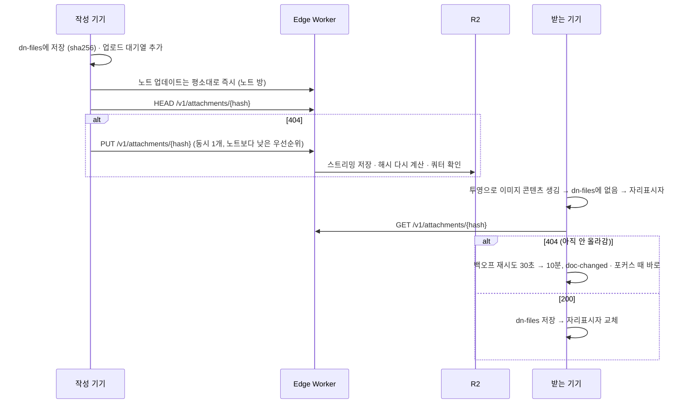

| 항목 | 규칙 |
|---|---|
| 저장 위치 | 지금 `dn-files.attachments`(IndexedDB). ADR-0011 · DATABASE 4.6의 OPFS 이전은 별개 작업이고, `AttachmentStore` 인터페이스가 같아 동기화 설계는 영향 없음 |
| 업로드 대기열 | `dn-files`에 `uploads` 스토어 `{hash, state:'queued'\|'uploading'\|'done'\|'failed', tries, nextAt}` (IDB v2). DATABASE 4.3의 `dn-app.attachments.syncState`는 코드에 없으므로 이쪽으로 바꾼다 |
| 참조 수집 | 기존 `docAttachments(doc)`(이미지 · 파일 · 커버)를 그대로 쓰고, 녹음 · PDF 등 다른 콘텐츠 종류가 `attachment`를 쓰면 같이 모은다(종류 목록은 M6에서 확인) |
| 크기 상한 | 클라이언트는 지금 파일 하나 50MB(DATABASE 4.1 FR-052 메모), 서버 · ADR-0011은 100MB. **50MB로 맞추기 추천**(OD-13) |
| 받을 때 | 노트를 그릴 때 없는 해시만 내려받는다(지연). 부트스트랩 미리 받기 예산(12.3)에 첨부 바이트를 포함 |
| 7일 계속 404 | 자리표시자 문구 "원본이 아직 업로드되지 않았어요 — 파일을 추가한 기기에서 앱을 열어 주세요" |
| R2 정리 | 서버는 참조를 해석하지 않으므로(G4) 각 기기가 하루 1번 참조 해시 목록을 `POST /v1/attachments/touch`로 보내 `last_ref_at` 갱신, 30일 지난 객체 삭제(v0.2 8.6) |
| 동기화 파일 | 지금처럼 첨부를 함께 담는다(4.2) |

---

## 16. 보안

### 16.1 인증

| 항목 | 규칙 |
|---|---|
| 로그인 흐름 | 지금 암시적 흐름(해시에 토큰)을 **PKCE**로 바꾼다(SECURITY 3과 맞춤, OD-14): `code_challenge`를 붙여 `/authorize` · `/otp`, 돌아온 `?code=`를 `POST /auth/v1/token?grant_type=pkce`로 교환. Supabase REST의 정확한 매개변수는 구현 때 확인(확인 못 함) |
| 세션 보관 | 지금처럼 `dn-app.secrets`(추출 불가 키로 암호화). SECURITY 3의 "localStorage"를 이쪽으로 고친다 |
| 토큰 갱신 | 10.2 |
| Worker | 모든 `/v1/*`에서 JWT 검증, `sub`만 신뢰. 클라이언트가 보낸 `userId`는 어디서도 쓰지 않는다 |
| DO | Worker가 붙인 `X-DN-User`만 신뢰, 처음 연결 때 `meta.userId`에 고정하고 이후 불일치면 4403 |

### 16.2 테넌트 격리

방 이름 `userId:docId`(9.2), R2 키 `…/{userId}/…`(11.2), Postgres RLS(DATABASE 5.2)의 세 겹. Worker 테스트에 "다른 사용자 티켓으로 남의 docId" · "티켓의 doc과 다른 경로" · "만료 티켓"을 넣는다(SECURITY 9 체크리스트 "다른 사용자 토큰으로 문서 · 첨부 · WS 접근 시 403/4403").

### 16.3 상한 · 레이트 리밋 (초기값)

| 대상 | 한도 | 넘으면 |
|---|---|---|
| 동시 WS | 사용자당 64 (API 1.5) | 4429 |
| 티켓 발급 | 사용자당 분당 120 | 429 |
| update 프레임 | 512KB, 소켓당 초당 50개 · 분당 10MB | `rate` 오류 후 4429 |
| 노트 문서 · 워크스페이스 | 32MB · 8MB | 4413 (MSG-SYNC-015) |
| 사용자 문서 합 · 첨부 합 | 1GB · 5GB (`profiles` 열, 11.3) | 티켓 · PUT 거절 `quota` |
| 첨부 업로드 | 시간당 2GB (API 1.5) | 429 |

### 16.4 기기 해지 (최소)

FR-098 화면은 P9. v1은 받는 쪽만: Worker가 `devices.revoked_at`을 보고 티켓을 거절(403 `device-revoked`)하고, 워크스페이스 방이 그 기기 소켓에 105 → 4403. 클라이언트는 모든 소켓을 닫고 `off`로, "이 기기는 다른 기기에서 로그아웃되었어요"(데이터 유지 · 삭제 선택). 노트 방에 열려 있던 소켓은 다음 다시 인증(최대 1시간 + 5분) 때 닫힌다(21.1 R6).

### 16.5 보존 · 삭제

| 대상 | 규칙 |
|---|---|
| 노트 영구 삭제 | 13.6 — DO `deleteAll`, `documents.deleted_at`, R2 체크포인트 30일 뒤 삭제, 행은 30일 뒤 삭제 |
| 계정 삭제 | `DELETE /v1/account` → `profiles.deletion_requested_at` + `user_metadata.delete_at = now + 7d`(로그인 화면이 이미 이 값을 읽는다, 5절). 유예 중 로그인하면 취소 가능. 7일 뒤 Worker cron: `documents`를 돌며 방마다 `deleteAll`, R2 `att/ckpt/export/{userId}/` 삭제, `auth.users` 삭제(→ cascade). 순서는 DO · R2 먼저, Postgres 마지막(목록이 있어야 지울 수 있으므로) |
| 체크포인트 | DATABASE 7 |
| 로그 | Worker 로그에 노트 내용 · 토큰 · 티켓을 남기지 않는다(18절) |

### 16.6 릴리스 체크리스트에 더할 것 (SECURITY 9)

다른 사용자 · 만료 · 다른 doc 티켓으로 WS 거절 · DO가 `X-DN-User` 없이 온 요청 거절 · 잠긴 노트가 네트워크 탭에 안 나감 · 로그에 Y 업데이트 바이트 없음 · 계정 삭제 후 R2 접두어 비어 있음.

---

## 17. 장애 모드와 복구

### 17.1 표

| 장애 | 감지 | 처리 | 데이터 |
|---|---|---|---|
| 원격 트랜잭션이 검증에 걸림 (지금 코드의 실제 경로, 2.3) | `TxResult.ok = false` | normalize(13.4) 뒤에도 실패하면 그 문서만 `error(bridge)`, 엔진 유지, 원본 업데이트 바이트를 격리(`yquarantine`), 다음 열기 때 전체 재투영. 개발 빌드는 예외 | 로컬 원본 무사, 업데이트 보존(FR-149) |
| 손상 업데이트 — 클라이언트 수신 | `Y.applyUpdate` 예외 | 격리 후 그 문서 step 1부터 1회 재요청. 또 실패면 그 문서 동기화 멈춤, 편집 계속 | 보존 |
| 손상 업데이트 — 서버 수신 | `parseUpdateMeta` 실패 | 저장 안 함, `bad-update`. 클라이언트는 그 문서를 엔진에서 새로 만든 Y와 비교해 다시 씀(12.6 열기 규칙) | — |
| 손상 — 서버 압축 | `mergeUpdates` 실패 | DO `quarantine` + 경보 로그, 나머지 계속 | — |
| 로컬 저장 공간 부족 | `QuotaExceededError` | 지금 `NoteSession`의 재시도 · 오류 표시(FR-091) 그대로. `yupdates`는 oplog와 같은 트랜잭션이라 따로 실패하지 않음. 미리 받기 멈춤 | 원본 우선 |
| 서버 문서 상한 | 4413 · `doc-too-large` | 그 노트만 멈춤, MSG-SYNC-015 | 로컬 무사 |
| DO 재시작 · 축출 | 소켓 끊김 | 재연결 → step 1/2. ack된 것은 저장돼 있고, 안 된 것은 상태 벡터 차이로 다시 감 | 손실 없음 |
| 청크 일부만 도착 | 60초 미완성 | DO가 버퍼 폐기 · `chunk-timeout`, 클라이언트가 그 차이를 다시 계산해 보냄 | — |
| 티켓 만료 · 토큰 무효 | 403 · 4401 | 갱신 후 1회 재시도, 실패면 `error(auth)` + 다시 로그인 안내 | 로컬 유지 |
| 구버전 | 4426 · `/v1/config` | 동기화 멈춤, 편집 계속, 업데이트 배너 | — |
| 기기 해지 | 403 `device-revoked` · 4403 · 105 | 16.4 | 로컬 유지 |
| 리더 탭 종료 | Web Lock 해제 | 다른 탭이 리더가 되어 워크스페이스 방에 다시 연결 | — |
| 시계 차이 | — | 순서 판단에 시계를 쓰지 않는다(Yjs LWW · fractional 키 · 해시). 시계는 표시 · 묘비 퍼지 대상(13.6 따라잡기 조건이 안전을 지킴) · JWT `exp`(서버 시계)에만 | 영향 없음 |
| iPad 저장소 삭제 (D1) | 로그인 세션은 있는데 로컬이 빔 | 새 기기 부트스트랩(12.3). 마지막 ack 이후 편집은 복구 불가 → 상태 화면에 "마지막 동기화 시각" | 서버 사본으로 복구 |

### 17.2 재시도 · 알림 (FR-096)

일시 오류(네트워크 · 5xx · 4429)는 백오프, 상태는 `pending`. 같은 문서가 5분 넘게 계속 실패하거나 영구 오류(`bad-update` · `bridge` · `doc-too-large` · `quota` · `auth` · `outdated`)면 `error`, 배너 MSG-SYNC-014("변경 N개를 서버에 보내지 못했어요. 이 기기에는 저장돼 있고, 계속 다시 시도할게요" + 지금 다시 시도 · 오류 정보 복사), 상세에 FR-092 백업 내보내기 안내(FR-149).

---

## 18. 관측

| 위치 | 무엇을 | 어떻게 |
|---|---|---|
| Worker | 요청 수 · 상태 코드 · 지연, 티켓 발급 · 거절 사유, 쿼터 거절 | Workers 로그(구조화 JSON, `X-Request-Id`), 내용 · 토큰 · 티켓 · 업데이트 바이트 금지 |
| 방 DO | 연결 · 끊김 · 종료 코드, 받은 업데이트 수 · 바이트, ack 지연, 압축 시간 · 결과 크기, 격리 건수, 문서 크기 | Workers Analytics Engine 카운터(사용 가능 여부 확인 못 함 — 없으면 로그 집계) |
| 경보 | 격리 > 0, 압축 실패, 4413 발생, 5xx 비율 1% 초과 | 일 1회 요약으로 시작 |
| 클라이언트 | 문서별 `DocSyncState`, 마지막 오류, 연결 횟수 | 설정 › 계정 › "동기화 정보" — 복사 가능한 진단 텍스트(내용 · 제목 없음, 문서 id · 상태 · 크기 · SV 길이만). 원격 전송은 기본 끔(SECURITY 7) |

---

## 19. 테스트 전략

### 19.1 단위 (vitest, Node)

지금 것(10/09 — `packages/sync/test` 28건: `bridge` 5 · `exchange` 10 · `sync-safety` 13, 조건부 undo 9건: `engine-core` `undo-remote` 7 · `text-pm` `undo-remote` 2, 글 고치기 5건: `text-pm` `repair` 3 · `apps/web` `sync-repair` 2)을 유지하고 더한다: `protocol.ts` 인코딩 왕복 · 경계(512KB 청크), `recordHash` 결정성(키 순서 무관), 묘비 판정 R1 · R2 표(지금은 시나리오 몇 개뿐 — #6b · #15 · #16은 시험 없음), `fitIncoming` 규칙별, `ackedSV` 계산, 12.2 같은 id 판정표, `setNoteLocked`가 `ysync`를 봉인함(6.2 회귀).

### 19.2 두 · 세 클라이언트 수렴 속성 테스트

`fast-check`(루트 devDependency에 이미 있음)로 만든다. 하네스는 `bridge.test.ts`의 `pair()`를 일반화한다.

- 복제본 N(2 또는 3) = `Engine` + `Y.Doc` + `attach`. 서버 = 메모리 객체(업데이트 저장 · step 1/2 응답), 네트워크 = 큐(순서 섞기 · 중복 · 지연 · 끊김 · 부분 교환 후 최종 전부 교환).
- 명령: 블록 생성 · 이동 · 삭제(연쇄) · 복제, 콘텐츠 삽입 · 블록 간 이동 · 삭제, 화살표 생성 · 재연결 · 삭제, 스트로크, 묶기 · 풀기, 텍스트(삽입 · 삭제 · 문단 나누기 · 목록 · 마크, 제목 상자 변환), undo · redo, 충돌 해결(무작위), 오프라인 · 온라인.

| # | 속성 | 합격 |
|---|---|---|
| P-S1 | 수렴 — 전부 교환 후 모든 복제본의 `serialize(engine)` 같음(마스크 필드 제외) | 커밋마다 1,000 · 야간 1만, 실패 0 |
| P-S2 | 불변식 — 모든 트랜잭션 경계에서 `validateOps` 위반 0, **원격 트랜잭션 거절 0** | 같음 |
| P-S3 | 무손실 — 다른 복제본의 삭제를 모르고 편집한 엔티티는 전부 교환 후 모든 복제본에서 살아 있거나 사용자 해결로 지워짐 | 같음 |
| P-S4 | 다리 — 엔진 = normalize(투영(Y)) | 같음 |
| P-S5 | normalize 멱등 · 결정성 | 1만 |
| P-S6 | 왕복 — 무작위 Op → Y → 빈 엔진 → 원래와 같음 | 1만 |
| P-S7 | 원격 + 로컬 undo — 원격이 쓴 필드 · 글자가 남음 | 1,000 |
| P-S8 | 크래시 — 무작위 지점에서 마지막 IDB 묶음 버림 → 다시 열기 → 재접속 → P-S1 · P-S3 성립 | 1,000 |

반례는 축소한 명령 열을 `packages/sync/test/regressions/*.json`으로 고정한다. 13.2.1의 순서는 이미 이름 붙은 회귀 테스트로 있다(`sync-safety.test.ts` "서버 순서", 10/09 묘비로 통과). v0.2 11.2의 DE-01~20 시나리오 중 "이동만 = 충돌"(DE-01 · DE-19)은 OD-2에 따라 기대값을 "충돌 아님"으로 바꿔 쓴다.

**지금 상태 (10/13, M0)** — `packages/sync/test/harness.ts`(`World`: 기기 = 엔진 + Y.Doc + 다리, 서버 = Y만 다루는 메모리 방, 네트워크 = `protocol.ts` 프레임 큐로 순서 섞기 · 중복 · 끊김 · 다시 붙기 step 1/2) · `converge.test.ts`. 난수(id) · 시각 · Y clientID를 고정해 반례를 같은 결과로 다시 돌리고 줄인다.

- 명령: 블록 만들기(내용 · 제목) · 옮기기 · 지우기 · 복제, 글 넣기 · 지우기(줄바꿈 포함 — 제목 상자면 로컬 거절), 상자 종류 바꾸기, 화살표 만들기 · 지우기 · 다시 잇기, 묶기 · 풀기, 실행 취소 · 다시 실행, 보내기 · 받기(중복) · 끊김 · 다시 붙기.
- 속성: P-S1(시각 · `conflict` 투영 · 키 순서 빼고 비교) · P-S2(원격 거절 0) · P-S3 · P-S4. **P-S3은 묘비 해시와 따로 계산한다** — 최종 Y에서 묘비만 걷어 낸 그 블록 내용이 그 블록의 모든 지움이 지우기 직전에 본 내용과 다르면 살아 있어야 한다(뒤처진 기기 · 실행 취소로 되돌린 고침 · 같은 필드 동시 쓰기에서 진 고침은 세지 않음).
- 횟수: 커밋마다 두 기기 120 · 세 기기 60, `DN_FUZZ_RUNS=10000`이면 두 기기 1만 · 세 기기 5천. 하네스가 어려운 경우를 밟는지(지운 쪽이 모르는 고침 · 충돌 표시)도 시험한다. 돌연변이 확인 — 묘비 R1을 끄면 P-S3, 원격 콘텐츠 변경을 무시하면 P-S1이 잡는다.
- 반례: `test/regressions/*.json` + `index.ts`(이유와 함께). s4-01 = 다리 결함(19.5 결과), s4-02 = 하네스 판정 오류였음, s4-03 = 다리 결함(10/19 1만 회에서 — 프레임 일부만 받으면 Yjs가 새 값은 보류하고 옛 값 삭제만 적용해 화살표의 `to`가 잠깐 비었고, 정리 단계가 `from`만 보고 들여 `okArrow`가 멈춤 → 양 끝 · 부모가 비어 있으면 숨김).
- 비교(`World.masked`)는 마스크 필드(충돌 표시 투영 · 높이 자동 블록의 `h`)를 뺀다(10/19).
- 아직 없음: P-S5 ~ P-S8, 글 구조 편집(목록 · 마크 · 표), 잉크 · 콘텐츠 블록 간 옮기기 · 데이터베이스 · 댓글, 충돌 해결(남기기 · 지우기), 노트 필드.

### 19.3 서버 통합

`apps/edge` 테스트는 Miniflare(wrangler 로컬 런타임)로 Worker + DO + R2를 띄운다. vitest와 묶는 방식(Workers용 vitest 풀 등)은 버전 호환을 확인 못 함 — 안 되면 `wrangler dev` 위에서 Node 스크립트로 돈다. 장애 주입(v0.2 11.3 그대로): 프레임 드롭 · 중복 · ack 드롭 · 청크 중간 끊김 · DO 재시작 · Hibernation 후 깨어남 · 압축 중 재시작(`transactionSync` 원자성) · 티켓 만료 · 4413 · 4426 · 4403 · 4410.

### 19.4 e2e

`e2e/sync-file.mjs`의 `device()`(저장소가 따로인 브라우저 컨텍스트 두 개)를 그대로 쓰고, 서버는 로컬 `wrangler dev`, 인증은 흉내 서버(`dn:auth-mock`) + Worker의 개발 전용 "흉내 토큰 허용" 플래그로 한다(배포 빌드에서는 플래그가 없으면 거절). PowerShell + Edge(`DN_CHANNEL=msedge`)로 돌린다.

| ID | 시나리오 | 합격 |
|---|---|---|
| E8 | 두 기기 온라인, A 편집 → B 화면 | p95 5초 (노트 연 B · 안 연 B 둘 다) |
| E9 | `context.setOffline(true)`로 두 기기 따로 편집(같은 문단 · 삭제 vs 편집) → 온라인 | 글자 병합, 충돌 표시, 남기기 후 양쪽 같음 |
| E12 | 계정에 노트 200개 → 새 기기 로그인 | 목록 3초 안, 열면 내용 |
| E13 | 로그아웃(유지) → 오프라인 편집 → 같은 계정 다시 로그인 | 편집 전송 |
| E14 | 탭 둘 + 서버 | 쓰기 탭만 소켓, 함께 편집 탭 편집도 서버로 |
| E15 | 잠긴 노트 | 네트워크 요청에 그 노트 id · 내용 없음 |

### 19.5 S4 스파이크 기준 (G2, 10/18)

다리는 이미 있으므로 S4는 "새로 만들기"가 아니라 **"지금 다리 + 묘비 + normalize가 속성 테스트를 통과하는가"**다.

| 기준 | 합격 |
|---|---|
| P-S1 · P-S2 · P-S3 · P-S4 | 2-복제본 1만 시나리오 실패 0 |
| 텍스트 동시 편집 (구조 편집 포함) | 수렴 + N7 · N9 뒤 원격 거절 0 |
| 큰 노트 | 1만 블록 노트의 `encodeStateAsUpdate` 크기 · `applyUpdate` + 첫 `attach` 시간 기록. 기준 기기 100ms 이하면 메인 스레드 유지(9.3) |
| 실패 시 | 구조 수렴 실패 → 서버 동기화 이월, 동기화 파일 + 로그인으로 출시. 텍스트만 실패 → 사용자 결정(이월 또는 텍스트 콘텐츠 단위 LWW, v0.2 12.3) |

**결과 (10/13)**

| 기준 | 결과 |
|---|---|
| P-S1 · P-S2 · P-S3 · P-S4 | **통과** — 두 기기 1만 · 세 기기 5천 실패 0 (19.2의 명령 범위 안). 첫 1만 회에서 다리 결함 1건을 찾아 고침: 원격에서 '화살표 다시 잇기 + 원래 블록 지우기'가 한꺼번에 오면 `reconcile`의 블록 지우기 걸음이 엔진의 옛 연결을 보고 화살표까지 지웠고, 뒤의 고치기 걸음은 화살표가 없어 건너뛰어 **그 기기에서만** 화살표가 사라졌다. 이제 Y에서 다른 블록으로 옮겨 살아 있는 화살표 · 콘텐츠는 지우지 않고 옮긴다(`sync-safety` "한꺼번에 들어온 다시 잇기 + 지우기") |
| 텍스트 동시 편집 (구조 편집 포함) | 문단 나누기 · 글자 넣기 · 지우기 · 제목 ↔ 내용 바꾸기까지 통과. 목록 · 마크 · 표 구조 편집은 아직 명령에 없다(M1에서 더함) |
| 큰 노트 | `DN_BENCH=1` `big-note.test.ts` — 1만 블록: Y 4.16MB(블록당 0.41KB), 처음 Y 쓰기 474ms, 다른 기기에서 받기 `applyUpdate` 234ms + 첫 `attach` 316ms = **550ms** (Node · 개발 PC). **100ms 기준 초과** → R2가 현실화. 브라우저 · 기준 기기 실측은 아직(FR-008) — 같은 정도면 OD-5(워커 없음)를 다시 열어 큰 노트만 나눠 붙이기 또는 워커로 |


---

## 20. 단계별 구현 계획

P5 = 10/16~10/29(ROADMAP). 일수는 **추정**(1인, 에이전트 병행 전)이다.

| M | 내용 | 추정 | 선행 | 완료 조건 |
|---|---|---|---|---|
| M0 | ~~계약 고정: `protocol.ts` 타입 · 프레임, `DocSyncState`(`Tombstone`은 10/09 구현으로 고정), 속성 테스트 하네스(19.2, 지금 다리로)~~ **완료 10/13** | 1.5일 | — | 하네스가 지금 다리에서 돈다(13.2.1 · N9는 이미 고쳐져 통과해야 함) — 통과, S4 속성 기준도 통과(19.5 결과) |
| M1 | ~~묘비 · `recordHash` · 보류 판정~~(10/09 `905434d`), ~~normalize N1 ~ N10~~(10/09 · 10/19), ~~조건부 undo(13.7)~~(10/09 `3563ad2`, 텍스트 rebase 제외), ~~`layout` 마스크~~(10/19) · ~~`conflict` 마스크~~(10/09), ~~복합 필드 사상(OD-10)~~(10/09), ~~Y `meta` 버전 키~~(10/19), ~~동기화 파일 v4 `schema`~~(10/19) — **완료 10/19** | 3일 → 끝 | M0 | **S4 = G2**: 19.5 전부, 기존 e2e(tabs · sync-file) 통과 |
| M2 | YStore: `dn-notes` v4 `yupdates` · 새 `ysync`, `NoteSession` 같은 트랜잭션, 열기 규칙, `setNoteLocked` 봉인 | 1일 | M1 | P-S8, 6.1 경로 회귀 테스트 |
| M3 | 서버 최소: `apps/edge` Worker(JWT · 티켓 · 레지스트리 · 기기), 방 DO(ingest · ack · step 1/2 · 청크 · 압축 · Hibernation), Postgres 스키마, Miniflare 통합 | 3일 | M0 | 19.3 장애 주입 통과 |
| M4 | 클라이언트 연결: `RoomClient`, 쓰기 탭 소켓, `ackedSV`, 재접속, 상태 UI(12.9), 오류 · 재시도(17), 버전 기록(13.8), 격리 | 2일 | M2 · M3 | E8 · E9 |
| M5 | 계정 연결: 토큰 갱신 · PKCE, 기기 등록, 업로드 질문 · 같은 id 판정(12.2), 워크스페이스 문서 · `MetaStore.onChange` · normalizeMeta, 리더 탭 · Materializer, 부트스트랩, 로그아웃(12.7), 잠긴 노트 제외 | 2.5일 | M4 | E12 · E13 · E14 · E15 |
| M6 | 첨부: 업로드 대기열 · HEAD/PUT/GET · 자리표시자 · touch | 1.5일 | M4 | 첨부 포함 E8 |
| M7 | 영구 삭제(13.6) · 묘비 퍼지 · 기기 해지 수신 · 쿼터 · 계정 삭제 cron · 보안 체크리스트(16.6) | 1.5일 | M5 | SECURITY 9 + 16.6 |
| M8 | 굳히기: 야간 퍼징 1만, e2e 전부, 문서 갱신(22절) | 1일 | 전부 | M4 마일스톤(10/29) 판정 |

합 **17일(추정)** > P5 14일(10/09에 M1의 큰 부분이 끝나 실제로는 약 15일). 그래서 아래 순서로 줄인다 — **데이터 손실과 관련된 것(M1 묘비 · normalize · 조건부 undo, M2 같은 트랜잭션 영속, ack 의미)은 줄이지 않는다.**

1. 계정 삭제 cron · 기기 해지 수신(M7 일부) → 문서만 두고 P9로.
2. 첨부(M6) → 자리표시자 "이 기기에 없음"만(FR-095 기준 2 일부 미충족을 출시 판정에 보고). 동기화 파일로는 첨부가 계속 간다.
3. 닫힌 노트 Materializer → 노트를 열 때만 따라잡기(5초 반영은 연 노트만).
5. 묘비 퍼지 → 묘비가 30일 넘게 남음(용량만 늘어남).

S4(M1)가 실패하면 M3~M7을 멈추고 8.2의 이월 규칙대로 한다. 그 경우에도 M1 중 통과한 부분과 M2는 동기화 파일 경로의 안전을 위해 넣는다.

병렬: 에이전트 1 = M1(engine-core · sync), 에이전트 2 = M3(apps/edge), M0 계약은 10/16 오전에 고정. 메인 세션 = M2 · M4 통합.

---

## 21. 위험 · 열린 결정

### 21.1 위험

| # | 위험 | 영향 | 가능성 | 대응 |
|---|---|---|---|---|
| R1 | 묘비 도입 후에도 텍스트 구조 동시 편집 + N7 수리가 수렴하지 않음 | 상 | 중 | S4(19.5). 텍스트만 실패면 사용자 결정 |
| R2 | 큰 노트 Y 디코드가 메인을 막음 | 중 | **상(10/13 측정)** | S4 측정 — 1만 블록 받기 + 첫 attach 550ms(Node · 개발 PC, 19.5). 브라우저 · 기준 기기 실측 뒤 워커 또는 나눠 붙이기(9.3 · OD-5) |
| R3 | DO 한도 가정(행 2MB · 메모리 128MB · WS 메시지 1MiB · `serializeAttachment` 크기)이 틀림 | 중 | 중 | M3 Miniflare · 실제 배포에서 확인. 조각 · 청크는 더 작은 한도에서도 동작 |
| R4 | 서버 문서가 이력만큼 커짐 | 중 | 상(장기) | GC 압축(11.1, 8MB 미만), 32MB 상한, 장기적으로 클라이언트 압축 제안 메시지 |
| R5 | 묘비 해시 충돌 · 가짜 충돌(13.3 #13) | 하 | 하 | 106비트, 가짜 충돌은 손실 없음 |
| R6 | 해지된 기기의 노트 방 소켓이 최대 1시간 남음 | 중 | 하 | 같은 사용자 기기. 워크스페이스 방 → 노트 방 해지 팬아웃은 P9 |
| R7 | 다리의 원격 거절(2.3)이 서버 동기화에서 자주 생김 | 중 | 하 | 10/09에 통째 거절은 없앰(걸음별 재시도), 엔진 코드의 불변식 I1 · I2 · I6 · I7 · I8 · I10은 모두 펴거나 숨김(I8은 `babc038`). N5 · N6 · N8은 10/19부터 숨기고 N10은 groups.ts 읽기 규칙. 남은 거절은 버그뿐 — P-S2에 "원격 거절 0"(1만 회 통과, 10/19) |
| R8 | 복합 필드 LWW(13.3 #21~23) — 데이터베이스 · 댓글 동시 편집 손실 | — | — | **해소(10/09)** — OD-10 적용(2.1). 남은 통째 값은 DB `views` |
| R9 | E2EE로 갈 때 서버 압축(`mergeUpdates` · GC)이 불가능해짐 | 중 | 하(v1 밖) | G4 범위를 구조 병합으로 한정해 기록, E2EE 때 압축을 클라이언트로 |
| R10 | Supabase JWT 서명 방식 · PKCE REST 매개변수 미확인 | 하 | 중 | Worker가 두 방식 지원, M5 첫날 실제 프로젝트로 확인 |
| R11 | 리더 탭 · 쓰기 탭 분리로 같은 노트 소켓이 두 탭에서 열림 | 하 | 중 | 노트 소켓은 노트 잠금을 가진 탭만, 리더는 잠금을 못 잡으면 반영 건너뜀. DO는 같은 기기 · 같은 문서 새 소켓이 오면 옛 소켓을 4409로 닫음 |
| R12 | 30일 넘게 오프라인인 기기가 퍼지된 엔티티를 편집 | 중 | 하 | v0.2 5.4의 `_del:purged` 되살림을 M7에. 기기 목록 경고는 P9 |
| R13 | 한 달 일정 안에 17일(추정) | 상 | 상 | 20절 줄이는 순서 |

### 21.2 열린 결정 (추천안)

| # | 질문 | 추천 | 근거 절 |
|---|---|---|---|
| OD-1 | 삭제를 묘비로 바꿀까, 지금 키 삭제 + 되살리기를 둘까 | **적용됨(10/09, `905434d`)** — 묘비. 키 삭제는 서버 순서(13.2.1)에서 편집을 잃었다. 동기화 파일 v3, 탭 채널 `dn-sync:3:`. 예전 키 삭제 기록은 지문 되살리기 그대로. 퍼지(13.6)는 서버 단계 | 13.2 |
| OD-2 | 옮기기만 한 것을 "고침"으로 볼까 | **아니오(지금 동작 유지)** — 지운 블록의 위치는 지켜도 쓸모가 없고, e2e가 이미 이 동작을 기대 | 13.2.2 |
| OD-3 | WS 인증: 60초 티켓 vs API 5.1의 서브프로토콜 JWT | **티켓** | 10.2 |
| OD-4 | DO 이름에 `userId`를 넣을까 | **넣음** — 격리가 구조적, 409 경로 삭제 | 9.2 |
| OD-5 | 워커 스레드 | **v1은 없음**, S4 측정으로 재검토 | 9.3 |
| OD-6 | Y 영속 위치 | **`dn-notes` 안, 엔진 로그와 같은 트랜잭션** | 12.6 |
| OD-7 | 스키마 버전이 높은 문서를 구버전 앱에서 | **보기 전용 + 업데이트 배너** | 10.5 |
| OD-8 | 잠긴 노트 동기화 | **v1은 동기화 안 함**, FR-146 문구 수정 | 14 |
| OD-9 | 동기화된 노트를 잠그면 서버 사본 | **삭제(확인 창)** | 14 |
| OD-10 | `rows` · `comments` · `note.groups`를 id 키 Y.Map으로 사상 | **적용됨(10/09)** — `properties`까지, 항목 키 방식(2.1). 그때 동기화 파일 v2 · 탭 채널 `dn-sync:2:`(지금은 묘비로 v3 · `dn-sync:3:`) | 13.3 |
| OD-11 | 높이 자동 블록 `h`와 `layout` origin | **동기화 안 함(마스크)** | 13.3 #20 |
| OD-12 | HTTP `state` · `diff` 엔드포인트 | **v1에 안 만듦**, E12가 느리면 추가 | 10.6 |
| OD-13 | 첨부 상한 | **50MB로 통일**(클라이언트 지금 값) | 15 |
| OD-14 | 로그인 흐름 | **PKCE로 전환** | 16.1 |
| OD-15 | 동기화 파일에 `schema` 필드 (묘비는 Y에 그대로 담김) | **적용됨 (10/19)** — v4 + `schema`. 받는 앱보다 크면 가져오지 않음 | 4.1 · 10.5 |
| OD-16 | 같은 id 노트 판정 | **상태 벡터 clientID 교집합, 애매하면 사본** | 12.2 |
| OD-17 | 화면 16(충돌 목록) · "둘 다 남기기" | **컷라인 아래** — 블록 위 남기기 · 지우기로 FR-097 충족 | 13.2.4 |

---

## 22. 다른 문서에 반영할 변경

이 문서는 다른 파일을 고치지 않는다. 각 문서 담당이 반영할 것:

| 문서 | 위치 | 변경 |
|---|---|---|
| FR.md · 트래커 | FR-094 | "로그인 없이 로컬 전용" 체크(이미 동작) |
| FR.md · 트래커 | FR-146 | "잠긴 노트 … 동기화" → v1은 동기화하지 않음(14) |
| SECURITY.md | 3 | 세션 저장 = `dn-app.secrets`(암호화), 지금은 암시적 흐름 → PKCE 예정 |
| SECURITY.md | 6 | 잠긴 노트 "암호문만 동기화" → "동기화하지 않음(v1)" |
| SECURITY.md | 10 | 인증 = 로그인 화면 구현, 동기화 = 파일 · 탭만 |
| API.md | 2 · 5.1 · 6 | `POST /v1/sync/tickets`, WS `?t=` 티켓, `PUT state` · `POST diff`는 v1 제외, `PUT documents` 409 삭제, `attachments/touch` |
| API.md | 5.2 · 5.3 | 메시지 102~105 · 110~112, 종료 코드 4409 · 4410 |
| DATABASE.md | 4.1 · 4.5 | `dn-sync` IDB 대신 `dn-notes` v4 `ysync` · `yupdates`(12.6), `dn-files.uploads`(15) |
| DATABASE.md | 4.3 | `meta_oplog` · `attachments.syncState` 삭제(대체) |
| DATABASE.md | 5.1 · 5.2 | `documents` 기본 키 `(user_id, id)`, `schema_max`, `doc_checkpoints` 키, `profiles` 쿼터 열, `storage_usage` |
| DATABASE.md | 6 | 방 DO 테이블(11.1), 압축 200건, `quarantine` |
| DATABASE.md | 8.1 | 실제 모양(2.1) + `meta.v:<n>` · 묘비 `_del:<기기id>`(구현됨) · 복합 필드 사상(OD-10) |
| DATABASE.md | 8.2 | v1 워크스페이스 모양(12.8) |
| ENGINE.md | 13 · C8 | 원격 반영 = 다리 `reconcile` + `fitIncoming`(지금) / `normalizeRemote`(설계), 조건부 역연산(13.7 — 구현됨: `undo-guard.ts` · `History.noteRemote` · `undoNotice`), `TextCodec.repair?` |
| ARCHITECTURE.md | 서버 · 동기화 절 | 워커 없음(9.3), 방 이름(9.2), 티켓(10.2) |
| TEST-PLAN.md | 5 | 19.2 · 19.3 · 19.4 |
| MESSAGES.md | 3.5 | MSG-SYNC-012 · 013(화면 16)은 컷라인 아래 표시 |

---

## 23. 변경 이력

| 버전 | 날짜 | 내용 |
|---|---|---|
| v1.4 | 2026-10-19 | M1 완료: normalize N5 · N6 · N8 숨기기(`reconcile.ts`), N10은 groups.ts 읽기 규칙 확인, 엔진 `deleteStrokes`가 빈 잉크를 같이 지움(I4), `layout` 마스크(측정 높이를 Y에 안 씀 · 받을 때 높이 자동 블록 `h`는 이 기기 값), Y `meta` 스키마 버전(`docSchema` · `onNewerSchema` · 새 스키마 문서는 보기 전용 + 배너), 동기화 파일 v4 `schema`(새 버전 파일은 가져오지 않음), 모르는 필드 보존 확인. 1만 회 속성 시험이 찾은 다리 결함 s4-03(끝이 빈 화살표) 고침. 시험 `normalize-m1.test.ts` |
| v1.3 | 2026-10-13 | M0 완료: `protocol.ts`(프레임 · 청크) · `status.ts`(`DocSyncState`) · 수렴 속성 하네스(`harness.ts` · `converge.test.ts` · `regressions/`), 1.1 표 · 19.2 지금 상태 · 19.5 결과. S4 속성 기준 통과(두 기기 1만), 다리 결함 1건 고침(`reconcile` 블록 지우기가 다른 블록으로 옮겨 간 화살표 · 콘텐츠까지 지움). 큰 노트 550ms로 R2 상향 |
| v1.2 | 2026-10-09 | 코드 3건 반영: 조건부 실행 취소(`3563ad2` — `undo-guard.ts` · `History`, 2.5 · 13.7 구현됨), 합쳐진 글 스키마 고치기(`babc038` — I8 · N7, `TextCodec.repair` · text-pm `repair.ts`, 2.3 · 13.4), 삭제 = 묘비(`905434d` — `tombstone.ts` · `Liveness` · 충돌 투영 · 남기기 = 묘비 지움, 다리를 `ymap` · `reconcile` · `reopen`으로 나눔, `attach` 옵션 객체 · 기기 id, 동기화 파일 v3 · 탭 채널 `dn-sync:3:`, 2.1 · 2.2 · 2.3 · 4.3 · 13.2, OD-1 적용됨). 13.2.2에 설계와 구현의 차이 표, 13.3 · 13.4에 지금 상태, 20절 M1 진행, R7 낮춤. 퍼지(13.6)는 아직 |
| v1.1 | 2026-10-09 | A부 발견 4건 고침(`ba75cb2`): 원격 변경 통째 거절 → 펴기 + 걸음별 재시도(2.3), 목록 필드 항목 키(2.1, OD-10 적용), 잠글 때 `ysync` 봉인(6.2), 이어 붙일 때 `known`으로 가름 + 엔진 로그 먼저(6.1). 동기화 파일 v2 |
| v1.0 | 2026-10-09 | 코드 기준으로 다시 씀. A부 = 다리 · 탭 · 동기화 파일 · 계정의 실제 동작과 v0.2 대조표, 발견(원격 트랜잭션 거절 · 열기 때 Y 손실 경로 · 잠글 때 `ysync` 미봉인 · 복합 필드 LWW). B부 = 서버 설계: 방 이름 `userId:docId`, 60초 티켓, 워커 없이 시작, pending 큐 대신 상태 벡터, `dn-notes` 같은 트랜잭션 영속, 묘비 재채택, 스키마 차이 = 보기 전용, 잠긴 노트 동기화 안 함, 단계 계획 · 열린 결정 17건 |
| v0.2 | 2026-10-02 | 스키마 v3(텍스트 상자 `role`) 반영 — normalize N9 |
| v0.1 | 2026-10-01 | 초안 — 코드가 없던 때의 순수 설계 |
