# DamianNote UX 흐름 설계서 (IA · 사용자 흐름 · 상호작용 규칙)

| 항목 | 내용 |
|---|---|
| 문서 버전 | v0.2 (2026-10-02 — 텍스트 상자 두 종류 · 도킹 · 휴지통 · 설정 · AI 흐름 · 단축키를 구현에 맞춤) |
| 작성일 | 2026-10-01 |
| 상태 | 검토 대기 — 화면 번호는 Figma 앱 화면 파일(`ZZ6dI4eeSie3mnDSzndeBc`) 프레임 01~19 기준 |
| 관련 문서 | PRD.md · FR.md (부록 A 단축키) · ROADMAP.md · [ARCHITECTURE.md](ARCHITECTURE.md) · SECURITY.md · [API.md](API.md) 1.4 · [MESSAGES.md](MESSAGES.md) |

화면 구조(IA), 화면 사이의 이동, 핵심 사용자 흐름, 상호작용 규칙, 반응형 레이아웃, 단축키, 접근성을 한 곳에 정의한다. 기능의 "무엇"은 FR.md가, 사용자에게 보이는 문구는 [MESSAGES.md](MESSAGES.md)가 원본이다. 이 문서는 "어느 화면에서 어떤 순서로"를 정한다. 흐름 안의 `MSG-…`는 MESSAGES.md의 메시지 ID다.

---

## 목차

1. 전제 — 확정된 결정
2. 정보 구조 (IA)
3. 화면 목록 · 내비게이션 맵
4. 핵심 사용자 흐름
5. 상호작용 규칙
6. 반응형 레이아웃
7. 단축키 통합표
8. 접근성 (FR-150)
9. 확인이 필요한 항목
10. 변경 이력

---

## 1. 전제 — 확정된 결정

이 문서의 모든 흐름은 아래 결정을 따른다. 결정이 바뀌면 해당 절을 함께 고친다.

| # | 결정 | UX에 주는 영향 | 출처 |
|---|---|---|---|
| E1 | 설치형 PWA로 배포. iPad는 "홈 화면에 추가"가 필수 | 첫 실행 온보딩에 설치 안내 단계가 들어간다(4.1). iPad Safari 탭에서 계속 쓰면 경고 배너를 유지한다 | D1 · ADR-0005 · ARCHITECTURE 9.1 |
| E2 | 휠 = 팬, Ctrl/⌘+휠 = 줌. 설정에서 바꿀 수 있음 | 트랙패드 두 손가락 스크롤은 팬, 핀치는 항상 줌. 설정 › 편집 › "마우스 휠 동작" | D7 · `canvas-view.ts` onWheel |
| E3 | 화살표는 블록 아래에 그린다 | 블록과 겹친 화살표 구간은 보이지 않고 클릭되지 않는다. 화살표 선택은 보이는 구간에서만 | D4 · FR-005 · FR-064 |
| E4 | 세로 리사이즈는 최소 높이를 정한다 | 위·아래 변을 끌면 "최소 높이"가 생기고, 내용이 더 길면 블록은 그보다 커진다 | D6 · `resizeBlock` |
| E5 | 로그인 없이 로컬 전용으로 모든 편집이 동작 | 로그인은 어떤 흐름에서도 막는 단계가 아니다. 동기화 · 공유만 로그인 필요 | FR-094 · SECURITY 3 |
| E6 | AI는 BYOK(사용자 본인의 Claude API 키) | 키가 없으면 AI 진입점은 보이되 실행 시 키 설정으로 안내한다 | ARCHITECTURE A2 · API 3.1 |
| E7 | v1은 종단간 암호화(E2EE) 없음. AI는 텍스트를 Anthropic으로 보낸다는 것을 고지 | 처음 AI 기능을 쓸 때 전송 동의 다이얼로그(MSG-AI-001), 설정 › AI에 상시 고지 | ADR-0012 · SECURITY 7 |

---

## 2. 정보 구조 (IA)

### 2.1 전체 트리

```
DamianNote (앱 셸 — 사이드바 240px · 상단 바 52px · 본문)
├─ 사이드바
│  ├─ 워크스페이스 헤더 (앱 이름 · 계정 아바타 · 동기화 상태 점)
│  ├─ 빠른 동작: 검색(Ctrl+P) · 새 노트(Ctrl+Alt+N) · 붙여넣어 구조화
│  ├─ 홈 (09 홈 대시보드)
│  ├─ 오늘 할 일 (FR-137, P8)
│  ├─ 즐겨찾기 (FR-075, P8)
│  ├─ 폴더 트리 (FR-073) — 폴더 › 노트 › 하위 노트, 펼치기/접기, 드래그 이동
│  ├─ 폴더 없는 노트 (FR-068 — P3 이전에는 이것이 전체 목록)
│  ├─ 태그 (FR-074) — 태그 이름 · 노트 수
│  ├─ 가져오기 (FR-124 · 125, P8)
│  ├─ 휴지통 (14, FR-076)
│  └─ 하단: 설정(Ctrl+,) · 단축키 도움말(Ctrl+/) · 저장 공간 경고 칩(FR-091)
├─ 상단 바 (노트가 열려 있을 때)
│  ├─ 위치 표시 (폴더 › 노트) · 노트 아이콘(FR-070) · 제목 입력
│  ├─ 뷰 전환: 캔버스 / 문서 (FR-088, P8)
│  ├─ 상태: 저장 상태(FR-089) · 동기화 상태(FR-095) · 읽기 전용 표시
│  └─ 동작: 공유·내보내기(19) · 패널 열기(아웃라인 · 백링크 · AI Q&A · 댓글) · 더보기(⋯)
├─ 캔버스 (02)
│  ├─ 배경 dot grid (FR-010) · 화살표 레이어(블록 아래) · 블록 DOM · 선택/핸들 오버레이
│  ├─ 도구 막대 (하단 중앙): 선택 V · 블록 B · 화살표 A · 이동(손) · │ · 실행 취소 · 다시 실행
│  ├─ 필기 도구 막대 (10 · 12, P4): 펜 · 형광펜 · 지우개 · 올가미 · 색 5종 · 굵기 3단계 · 잉크 표시 전환
│  ├─ 줌 컨트롤 (우하단): − · 배율% · + · 전체 맞춤
│  ├─ 블록 위 UI: 블록 핸들 ⋮⋮ → 블록 메뉴(07) · 서식 툴바(07) · 슬래시 메뉴(06) · 연결점 4개
│  ├─ AI UI: 붙여넣기 칩 "구조화하기"(03) · 진행 카드(04) · 결과 요약 토스트(05) · 출처 하이라이트(FR-111)
│  └─ 빈 상태 안내 (01 · FR-148)
├─ 오른쪽 패널 (한 번에 하나, 320px)
│  ├─ 아웃라인 (FR-084) · 백링크 (FR-081)
│  ├─ AI — 내 노트에 질문하기 (FR-116~119, P7) · AI 작성 도우미 결과 (FR-112)
│  ├─ 댓글 (FR-132, P8) · 노트 정보 (FR-071) · 버전 기록 (FR-093)
│  └─ 동기화 충돌 목록 (16, FR-097)
├─ 오버레이 (모달 아님)
│  ├─ 빠른 전환 Ctrl+P · 커맨드 팔레트 Ctrl+Shift+P · 전체 검색 Ctrl+Shift+F (13)
│  ├─ 현재 노트에서 찾기 Ctrl+F (상단 바 아래 막대)
│  └─ 토스트 (하단 중앙, 도구 막대 위) · 배너 (캔버스 상단 띠)
├─ 설정 (모달, 왼쪽 탭) — 08이 AI 탭
│  ├─ 일반: 테마(FR-086) · 언어(FR-151) · 앱 정보 · 업데이트
│  ├─ 편집: 마우스 휠 동작(E2) · 글꼴 크기 · 줄 간격 · 기본 뷰(FR-143)
│  ├─ 필기: 펜으로만 필기(FR-040) · 펜 제스처 매핑(FR-154) · 필기 배경(FR-041)
│  ├─ AI: Claude API 키(FR-139) · 키 보관 방식 고지 · 데이터 전송 고지/동의 상태 · 모델(FR-140) · 유형별 on/off(FR-142) · 사용량(FR-141)
│  ├─ 계정·동기화 (17): 로그인/로그아웃 · 기기 목록(FR-098) · 선택적 동기화 · 계정 삭제
│  ├─ 저장·백업: 사용량/잔여 용량(FR-091) · JSON 백업 내보내기/가져오기(FR-092) · 홈 화면 설치 상태
│  ├─ 보안: 노트 잠금(FR-144) · 앱 잠금(FR-145)
│  ├─ 알림 (FR-138)
│  └─ 단축키 (읽기 전용 목록 = 7절, Ctrl+/ 와 같은 내용)
└─ 다이얼로그 (모달)
   ├─ 온보딩 · PWA 설치 안내 (01)
   ├─ AI 데이터 전송 동의 (MSG-AI-001)
   ├─ 확인: 휴지통 비우기 · 영구 삭제 · 폴더 삭제 선택 · 로그아웃 · 계정 삭제
   ├─ 로그인 (17) · 로컬 노트 업로드 확인 · 두 번째 기기 병합 안내
   ├─ 충돌 해결 (16) · 공유·내보내기 (19) · 가져오기 미리보기 (FR-127)
   ├─ OCR 결과 미리보기 (11) · 단축키 도움말 (Ctrl+/)
   └─ 데이터 위험: 저장 공간 가득 · 노트를 열 수 없음 · 기기 연결 해제됨
```

### 2.2 화면 영역별 소유 FR

| 영역 | 주요 FR | 첫 등장 Phase |
|---|---|---|
| 사이드바 노트 목록 | FR-067 · 068 · 069 | P1 |
| 사이드바 폴더 · 태그 | FR-073 · 074 · 075 · 079 | P3 (즐겨찾기 P8) |
| 휴지통 | FR-076 | P1 (화면 14는 P3에서 다듬음) |
| 상단 바 저장 상태 | FR-089 · 090 · 091 | P1 |
| 상단 바 동기화 상태 | FR-095 · 096 · 097 | P5 |
| 캔버스 · 블록 · 화살표 | FR-010~016 · 022 · 024 · 064~066 | P1 |
| 텍스트 편집 UI (06 · 07) | FR-026~033 | P1 · P3 |
| AI 구조화 UI (03~05) | FR-099~111 · 139 | P2 (재요청 · 출처 P7) |
| 필기 UI (10~12) | FR-034~040 · 152~155 | P4 |
| 검색 · 팔레트 (13) | FR-087 · 121 · 122 | P3 |
| 로그인 · 계정 (17) | FR-094 · 098 | P5 |
| 데이터베이스 (18) | FR-055~063 | P6 |
| 공유 · 내보내기 (19) | FR-092 · 129~131 · 134 | P5 · P7 · P9 |

---

## 3. 화면 목록 · 내비게이션 맵

### 3.1 화면 목록

| # | 화면 | 형태 | 진입 경로 | 관련 FR |
|---|---|---|---|---|
| 01 | 온보딩 / 빈 상태 | 전체 화면 → 캔버스 위 안내 | 첫 실행, 노트 0개, 빈 노트 | FR-148 · FR-139 |
| 02 | 메인 캔버스 | 기본 화면 | 노트 열기 | FR-010~016 · 022 · 024 · 064~069 · 089 |
| 03 | 붙여넣기 → 구조화 전 | 캔버스 + 칩 | Ctrl+V | FR-031 · 105 |
| 04 | 구조화 진행 중 | 캔버스 + 진행 카드 | "구조화하기" | FR-101 · 103 |
| 05 | 구조화 결과 | 캔버스 + 결과 토스트 | 구조화 완료 | FR-106~111 · 022 |
| 06 | 슬래시 커맨드 | 팝업 | 빈 줄에서 `/` | FR-029 |
| 07 | 서식 툴바 · 블록 메뉴 | 팝업 | 텍스트 선택 / 블록 핸들 클릭 | FR-024 · 027 · 017 |
| 08 | 설정 — API 키 | 모달(설정 AI 탭). 구현된 설정은 탭 세 개 — **편집**(글자 크기 4단계 · 줄 간격 3단계, CSS 변수 `--dn-fs` · `--dn-lh` / 마우스 휠 = 이동 또는 확대) · **AI**(Claude API 키 확인 · 삭제, 모델, 자동 구조화 유형 관계 · 수치 · 비교, 전송 동의 철회) · **정보** | 사이드바 "설정" · AI 키 없음 안내(이유 문구와 함께 AI 탭) | FR-139~143 |
| 09 | 홈 대시보드 | 전체 화면 | 사이드바 "홈" · 앱 시작(설정 시) | FR-137 · 087 |
| 10 | 필기 모드 | 캔버스 + 필기 도구 막대 | P 키 · 필기 버튼 · 펜 접촉 | FR-034~036 |
| 11 | 필기 선택 → 블록 변환 | 캔버스 + 선택 메뉴 · OCR 미리보기 | 올가미 선택 | FR-036~039 |
| 12 | 태블릿 필기 | iPad 세로 레이아웃 | iPad에서 필기 | FR-040 · 152 · 154 · 155 |
| 13 | 검색 · 커맨드 팔레트 | 오버레이 | Ctrl+P · Ctrl+Shift+P · Ctrl+Shift+F | FR-087 · 121 · 122 |
| 14 | 휴지통 | 본문 목록 | 사이드바 "휴지통" | FR-076 |
| 15 | 폴더 · 태그 정리 | 사이드바 확장 · 본문 목록 | 사이드바 폴더/태그 | FR-073 · 074 · 079 |
| 16 | 동기화 충돌 해결 | 모달 또는 오른쪽 패널 | 충돌 배너 · 동기화 상태 메뉴 | FR-097 · 093 |
| 17 | 로그인 · 계정 | 모달 · 설정 계정 탭 | 동기화 켜기 · 공유 · 설정 | FR-094 · 098 |
| 18 | 데이터베이스 블록 뷰 | 캔버스 위 블록 · 항목 페이지 | `/데이터베이스` | FR-055~063 |
| 19 | 공유 · 내보내기 | 모달 | 상단 바 "공유" | FR-092 · 129~131 · 134 |

**Figma에 아직 없는 화면** — 아래 화면은 흐름에 필요하지만 01~19에 없다. 번호는 제안이다.

| 제안 # | 화면 | 쓰이는 흐름 |
|---|---|---|
| 20 | AI 데이터 전송 동의 다이얼로그 | 4.3 · 4.4 |
| 21 | 오른쪽 패널 — 아웃라인 · 백링크 · AI Q&A · 댓글 | 4.6 · 5.3 |
| 22 | 저장 · 복구 다이얼로그 (저장 공간 가득 · 열 수 없음 · 읽기 전용) | 4.10 |
| 23 | 단축키 도움말 (Ctrl+/) | 7절 |
| 24 | 가져오기 미리보기 (FR-127) | — (P8) |
| 25 | 버전 기록 (FR-093) | 4.8 · 4.10 |

### 3.2 내비게이션 맵

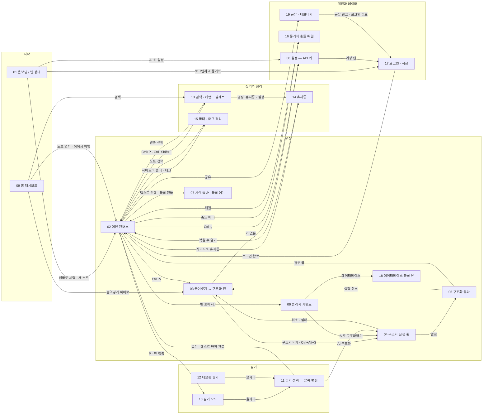

### 3.3 앱 시작 시 첫 화면 규칙

| 조건 | 첫 화면 |
|---|---|
| 첫 실행 (노트 0개, 온보딩 미완료) | 01 온보딩. iPad Safari 탭이면 설치 안내가 먼저 (4.1) |
| 온보딩을 마친 뒤 재실행 | 마지막으로 연 노트(`lastNoteId`)의 02. 설정 › 일반에서 "시작 화면: 홈"을 고르면 09 |
| 마지막 노트가 휴지통에 있거나 없어짐 | 사이드바 첫 노트의 02. 노트가 하나도 없으면 01의 빈 상태 |
| 공유 링크(`/share/:token`)로 진입 | 읽기 전용 공유 페이지 — 앱 셸 없음 (FR-134) |

---

## 4. 핵심 사용자 흐름

각 흐름은 mermaid 순서도와 단계표로 적는다. 노드 이름 앞의 두 자리 숫자는 화면 번호다.

### 4.1 첫 실행 · 온보딩 (iPad PWA 설치 안내 포함)

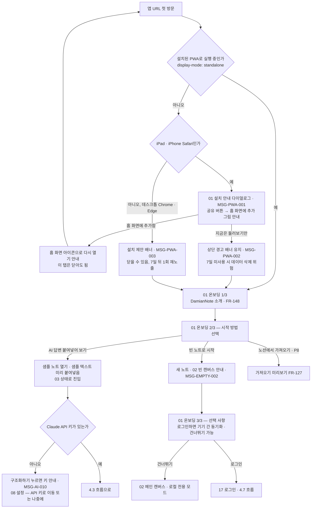

| 단계 | 화면 | 동작 · 규칙 | FR | 메시지 |
|---|---|---|---|---|
| 1 | — | `navigator.standalone` 또는 `matchMedia('(display-mode: standalone)')`로 설치 여부 판단 | D1 | — |
| 2 | 01 | iPad/iPhone Safari 탭이면 설치 안내가 온보딩보다 먼저 나온다. "지금은 둘러보기만"을 고르면 진행은 되지만 배너는 설치할 때까지 남는다(닫기 버튼 없음, 접기만 가능) | D1 · ADR-0005 | MSG-PWA-001 · 002 |
| 3 | 01 | 데스크톱은 설치가 선택 사항이다. `beforeinstallprompt`가 있으면 "앱으로 설치" 버튼 | D1 | MSG-PWA-003 |
| 4 | 01 | 온보딩은 3장 이내. 어느 단계에서든 "건너뛰기"로 02에 간다 | FR-148 | — |
| 5 | 01 → 03 | 첫 실행에는 샘플 노트를 만든다(현재 구현 `buildSampleNote`). 샘플 체험은 미리 붙여넣은 AI 답변으로 03 상태를 보여 준다 | FR-148 "샘플 텍스트로 즉시 체험" | MSG-ONB-001 |
| 6 | 08 | API 키는 온보딩에서 요구하지 않는다. AI를 처음 쓰는 순간 묻는다 | FR-139 · E6 | MSG-AI-010 |
| 7 | 01 → 17 | 로그인은 마지막 장의 선택 사항이다. 건너뛰면 로컬 전용 모드 | FR-094 · E5 | — |
| 8 | 02 | `navigator.storage.persist()` 요청은 설치 후 첫 실행에서 한 번 | DATABASE 11 | — |

### 4.2 노트 만들기 → 블록 → 화살표

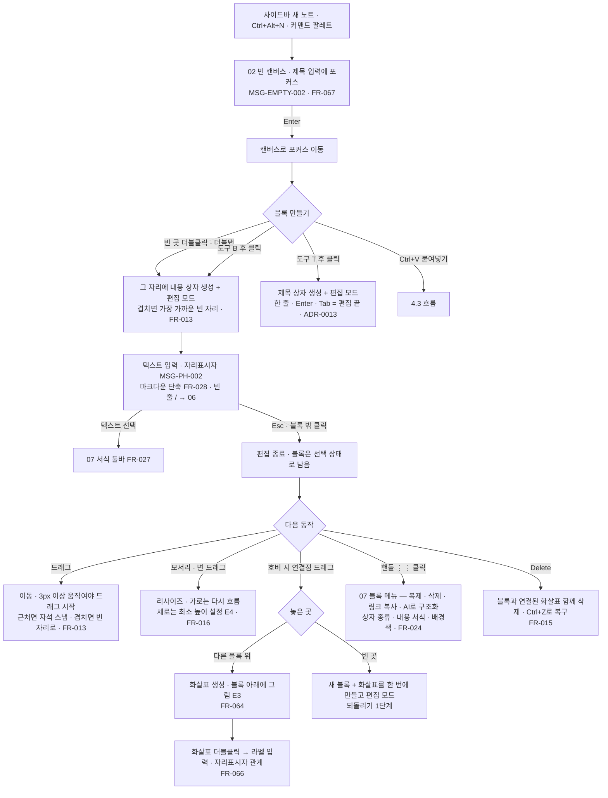

| 단계 | 규칙 | FR |
|---|---|---|
| 새 노트 | 빈 캔버스로 시작하고 제목 입력에 포커스. 제목을 비워 두면 사이드바에는 "제목 없음", 첫 블록 내용으로 자동 제목(FR-069) | FR-067 · 069 |
| 블록 생성 | 더블클릭한 점이 블록 왼쪽 위에서 20px 안쪽에 오도록 만든다(현재 구현). 생성 즉시 편집 모드, 커서는 첫 줄. 그 자리가 다른 블록과 겹치면 가장 가까운 빈 자리(겹친 블록의 아래 · 옆, 간격 16)에 만든다 | FR-013 |
| 상자 종류 | **제목 상자**(T 도구): 크고 굵은 한 줄, 테두리 없음. Enter · Tab = 편집 끝, 여러 줄 붙여넣기는 한 줄로, 마크다운 입력 규칙 없음, 서식 툴바는 글자 서식만. **내용 상자**(B 도구 · 빈 곳 더블클릭): 리치 텍스트 카드. 블록 메뉴 "상자 종류"로 서로 바꾼다(내용 → 제목은 한 줄로 폄, undo 한 번) | ADR-0013 · FR-026 |
| 편집 종료 | Esc 또는 블록 밖 포인터 다운. 블록은 선택된 채로 남아 바로 Delete · 방향키를 쓸 수 있다 | 5.2 |
| 이동 · 도킹 | 화면에서 3px 넘게 움직여야 드래그로 본다(클릭과 구분). 끄는 동안은 다른 블록 위를 지나갈 수 있다. 이웃 블록 가장자리 · 붙는 자리(간격 16)에 화면 10px 안으로 다가가면 자석처럼 붙고 안내선이 보인다(Shift = 스냅 끄기, 이미 막힌 자리로는 붙지 않음). 놓은 자리가 겹치면 가장 가까운 빈 자리로 붙는다. **다른 블록은 앱이 움직이지 않는다**(밀어내기 없음 — 예외: 글이 늘어 아래 상자에 닿으면 그 아래 상자가 이음매 그대로 함께 내려가고, 줄면 내린 만큼 돌아옴. ADR-0014 11/02). 복제(Ctrl+D) · 붙여넣기 · 블록으로 분리 · 연결점에서 새 블록도 같은 규칙 | FR-013 · ADR-0014 |
| 리사이즈 | 단일 선택 시 네 모서리에 핸들, 네 변은 보이지 않는 핸들(4px). 최소 폭 60, 최소 높이 40(현재 구현). Shift+모서리 = 비율 유지 | FR-016 · E4 |
| 화살표 | 블록에 호버하거나 단일 선택하면 네 변 바깥 12px에 연결점. 드래그 중 점선 미리보기와 대상 블록 테두리 강조 | FR-064 |
| 라벨 | 화살표 더블클릭 → 선 중앙에 입력. Enter 저장, Esc 취소, 포커스 이탈 = 저장 | FR-066 |
| 저장 | 모든 변경은 1초 안에 로컬 저장. 상단 바 상태가 "저장 대기 → 저장 중 → 저장됨"으로 바뀐다 | FR-089 · MSG-SAVE-001~003 |

### 4.3 AI 답변 붙여넣기 → 구조화 → 검토 → 되돌리기

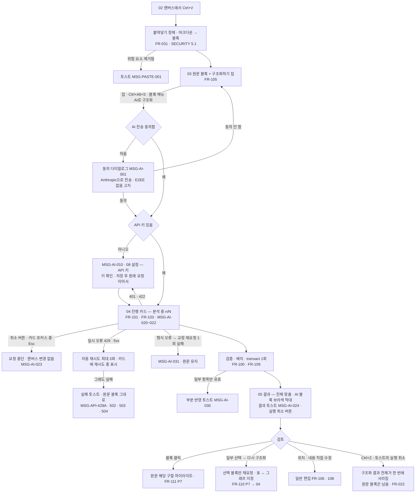

| 단계 | 화면 | 규칙 | FR | 메시지 |
|---|---|---|---|---|
| 붙여넣기 | 02 → 03 | 원문은 항상 블록으로 먼저 캔버스에 놓는다 — 이후 어떤 실패에도 남는다. 위치는 커서가 캔버스 위면 커서 자리, 아니면 화면 중앙 | FR-031 · 105 | MSG-PASTE-001~003 |
| 칩 | 03 | "✦ 구조화하기" · "그대로 두기" 칩은 붙여넣은 블록 옆에 붙고, 블록 선택이 풀려도 다음 편집 전까지 남는다. 공백 제외 20자 미만이면 칩을 띄우지 않고, 단축키 · 블록 메뉴로 요청해도 MSG-AI-032로 막는다 | FR-105 | MSG-AI-032 |
| 키 확인 | 08 | (구현 순서: 동의 다음) 키가 없으면 요청을 보내지 않고 설정 › AI를 이유 문구와 함께 연다. 키는 형식 확인 → Models API로 유효성 확인 → 통과하면 암호화 저장(SECURITY 4절), 실패하면 저장하지 않고 안내. 저장하면 원래 요청을 자동으로 이어간다 | FR-139 · E6 | MSG-AI-010 · 011 · API-422B |
| 동의 | 20(제안) | 기기마다 처음 한 번. 동의 기록은 설정 › AI에서 철회할 수 있고, 철회하면 다음 요청 때 다시 묻는다 | SECURITY 7 · E7 | MSG-AI-001 · 002 |
| 진행 | 04 | 진행 카드는 원문 블록 옆에 붙는다. 같은 원문에 두 번째 요청은 막는다(버튼 비활성). 다른 노트로 이동해도 요청은 계속되고, 완료 시 그 노트에 반영 후 토스트에 "열기" | FR-103 | MSG-AI-020~022 · 025 |
| 취소 | 04 | 이미 받은 청크 결과도 버린다(부분 반영 없음, ARCHITECTURE 7.3) | FR-103 | MSG-AI-023 |
| 실패 | 03 | 인증 오류는 재시도하지 않고 08로. 429 · 5xx는 백오프 3회 후 실패 안내. 504는 입력 줄이기 제안 | FR-102 · API 1.4 | MSG-API-* |
| 반영 | 05 | 한 트랜잭션(origin=ai)으로 원문 블록 오른쪽 빈 자리에 반영하고, 결과를 선택한 채 원문 + 결과가 보이게 화면을 옮긴다(250ms 애니메이션). AI 노드는 본문이 없으면 제목 상자, 있으면 내용 상자. 그래프 · 표는 렌더러(FR-018) 전까지 자리표시자. AI 블록은 왼쪽 3px 보라 막대로 구분 | FR-106~109 · 012 | MSG-AI-024 · 030 · 027 |
| 되돌리기 | 05 → 03 | Ctrl+Z 한 번 = 구조화 결과 전체 제거. 결과 토스트의 "실행 취소"도 같은 동작. 토스트가 사라진 뒤에도 Ctrl+Z로 가능 | FR-022 · 002 | — |

### 4.4 태블릿 필기 → 올가미 → 묶기 또는 OCR

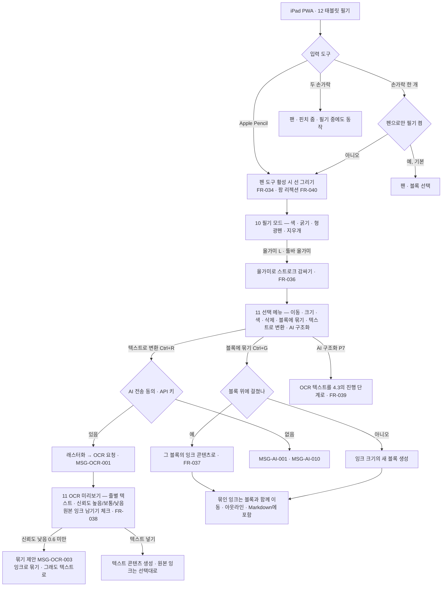

| 규칙 | 내용 | FR |
|---|---|---|
| 펜 감지 | `pointerType: 'pen'` 첫 접촉 시 필기 도구 막대를 자동으로 펼친다(필기 모드 진입). 마우스 · 트랙패드는 P 키나 버튼으로만 진입 | FR-034 · 040 |
| 팜 리젝션 | 펜이 화면에 닿아 있거나 펜 접촉 후 500ms 안의 넓은 터치는 무시 | FR-040 |
| 손가락 | "펜으로만 필기"가 켜져 있으면(iPad 기본값 켬) 손가락 한 개 = 팬/선택. 끄면 손가락도 그린다 | FR-040 |
| 올가미 포함 규칙 | 스트로크 점의 50% 이상이 올가미 안이면 포함(엔진 구현 시 확정) | FR-036 |
| 펜 버튼 · 더블탭 | Apple Pencil 더블탭(지우개 전환)은 PWA에서 불가 — 네이티브 셸 전까지 제공하지 않음. 대신 툴바의 지우개 · 올가미가 엄지 닿는 왼쪽 아래에 있다 | FR-154 · D1 |
| OCR 신뢰도 | 0.8 이상 높음, 0.6 이상 보통, 그 미만 낮음(API 3.3). 숫자는 보여 주지 않는다 | FR-038 |
| 원본 보존 | OCR은 기본값으로 원본 잉크를 남긴다. 묶기 · OCR 모두 Ctrl+Z 한 번으로 되돌린다 | FR-037 · 038 |

### 4.5 정리 — 폴더 · 태그 · 휴지통과 복원

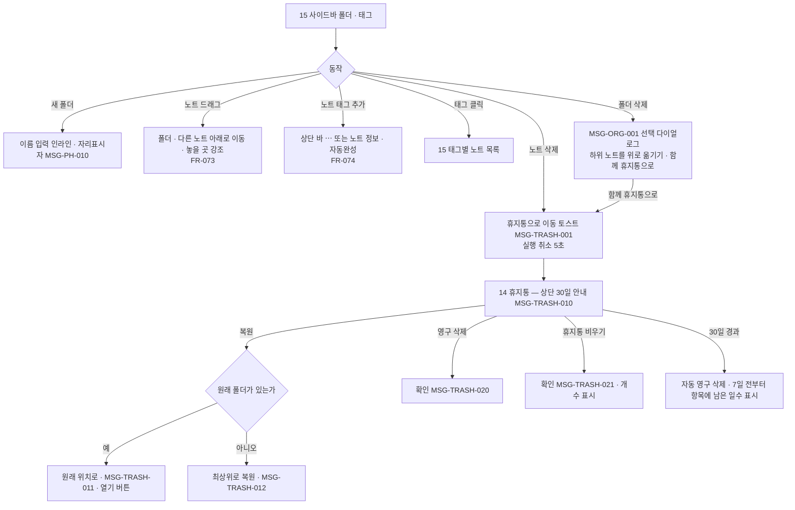

| 규칙 | 내용 | FR |
|---|---|---|
| 노트 삭제 | 확인 없이 휴지통으로 보내고 토스트에서 되돌린다(확인 다이얼로그보다 빠르고 안전). 열려 있던 노트면 사이드바 다음 노트를 연다 | FR-067 · 076 |
| 폴더 삭제 | 비어 있으면 확인 없이 삭제 + 실행 취소 토스트. 노트가 있으면 반드시 선택 다이얼로그 | FR-073 |
| 휴지통 목록 | 삭제 시각 최신순, 원래 위치(폴더 경로) 표시, 검색 · 빠른 전환 · Q&A에서 제외 | FR-076 · 118 · 121 |
| 휴지통의 노트 열기 | 읽기 전용으로 미리보기만. 편집하려면 복원 | FR-076 |
| 보존 기간 | 30일 후 자동 영구 삭제(DATABASE 10). 로그인 상태면 다른 기기에서도 사라진다 | FR-076 |
| 태그 이름 변경 | 모든 노트에 반영. 같은 이름 태그가 있으면 병합할지 묻는다 | FR-074 |

**구현 현황 (2026-10-02)** — 폴더 · 태그는 아직 없다(P3). 휴지통(화면 14)은 구현됐다: 사이드바 노트의 × → 휴지통 + "실행 취소" 토스트(MSG-TRASH-001), 휴지통 화면에 30일 안내 · 검색 · 원래 위치 · 삭제일 · 남은 기간(7일 이하 강조), 항목별 ↺ 복원 · 영구 삭제, 체크박스 다중 선택 바(복원 · 영구 삭제 · 해제), "휴지통 비우기". 영구 삭제 · 비우기는 확인 다이얼로그(초기 포커스 = 취소). 앱 시작 때 30일 지난 노트를 영구 삭제하고 토스트로 알린다. 휴지통의 노트를 링크로 열면 미리보기 대신 "먼저 복원" 안내 토스트를 띄운다. 노트 목록은 최근 수정순 · 이름순 · 생성순 정렬, 더블클릭으로 이름 바꾸기, 제목이 비면 첫 블록의 첫 줄을 대신 보여 준다(FR-069).

### 4.6 검색 · 커맨드 팔레트

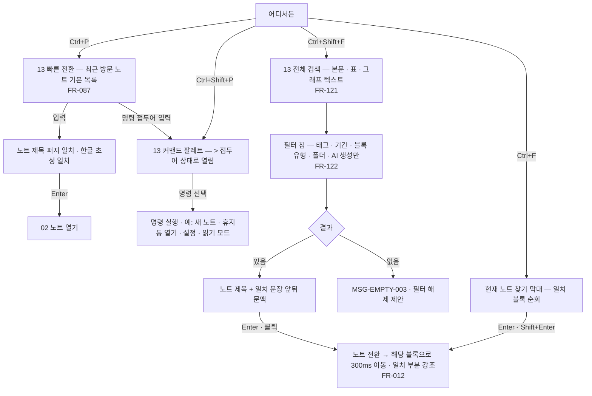

| 규칙 | 내용 | FR |
|---|---|---|
| 하나의 오버레이 | 빠른 전환 · 커맨드 · 전체 검색은 같은 오버레이(13)의 세 모드다. 입력 앞 `>` = 명령, `#` = 태그 필터(제안) | FR-087 · 121 |
| 키보드 | ↑↓ 이동, Enter 열기, Ctrl+Enter 오른쪽 분할로 열기(FR-153, 태블릿 · 넓은 화면), Esc 닫기 후 이전 포커스로 복귀 | FR-087 · 150 |
| 색인 중 | 검색 워커가 색인 중이면 결과 위에 "색인 중 n%" 줄. 결과는 그동안에도 보여 준다 | FR-120 · ARCHITECTURE 5.3 |
| 제외 대상 | 휴지통 · 잠긴 노트는 결과에 없다. 잠긴 노트는 제목만 "잠긴 노트"로 표시할지 P8에서 확정 | FR-121 · 144 |

### 4.7 로그인 · 로컬 노트 업로드 · 두 번째 기기

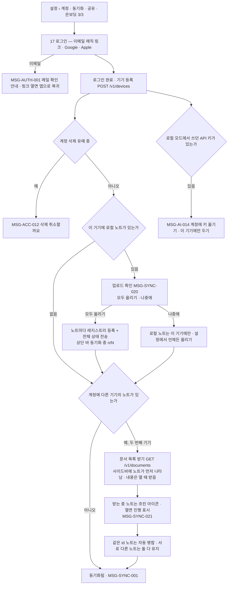

| 규칙 | 내용 | FR |
|---|---|---|
| 로그인은 선택 | 로그인 화면 어디에도 "로그인 없이 계속" 경로가 있다. 로그인하지 않아도 잃는 편집 기능은 없다 | FR-094 · E5 |
| 업로드 확인 | 로그인 직후 한 번만 묻는다. "나중에"를 고른 노트는 동기화 상태 "꺼짐"으로 표시되고 노트 ⋯ 메뉴에서 개별로 올릴 수 있다 | FR-094 · ARCHITECTURE 7.4 |
| 두 번째 기기 | 목록이 먼저, 내용은 지연(노트를 열 때 WS로 받음). 오프라인이면 받지 못한 노트는 "오프라인 — 연결되면 받아요"로 연다 | FR-095 · API 6.1 |
| 키 이동 | 로컬 모드의 키(기기 IDB 암호문)를 계정 Vault로 옮길지 묻는다. 옮기면 기기 사본은 지운다 | FR-139 · SECURITY 4 |
| 로그아웃 | "이 기기의 노트를 남겨 둘까요?" — 기본 남김(로컬 전용 모드로 전환). 지우기는 별도 확인 | SECURITY 3 · MSG-ACC-001~002 |
| 계정 삭제 | 7일 유예 · 그동안 내보내기 zip 제공 · 유예 중 로그인하면 취소 여부 질문 | API 6.5 · MSG-ACC-010~012 |
| 기기 해지 | 다른 기기에서 원격 로그아웃되면(403 device-revoked) 동기화를 멈추고 로컬 데이터는 유지 | API 1.4 · MSG-API-403B |

### 4.8 동기화 충돌 해결

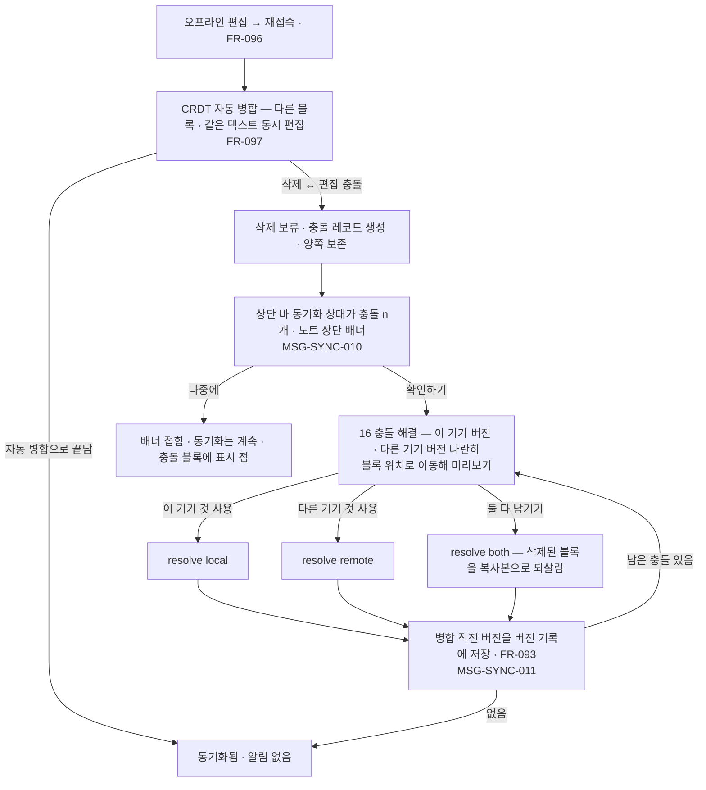

| 규칙 | 내용 | FR |
|---|---|---|
| 알릴 때만 알린다 | 자동 병합은 조용히 처리한다. 사용자가 고를 수 있는 것은 삭제 ↔ 편집 충돌뿐 | FR-097 |
| 해결 전 보존 | 해결 전에는 어느 쪽도 지우지 않는다. 충돌 블록은 점선 테두리 + 경고 점 | FR-097 |
| 일괄 해결 | 충돌이 여러 개면 16에서 "모두 이 기기 것" · "모두 둘 다 남기기"를 제공 | FR-097 |
| 기록 | 해결 직전 상태는 버전 기록에 남아 25(버전 기록)에서 되돌릴 수 있다 | FR-093 |

### 4.9 내보내기 · 공유

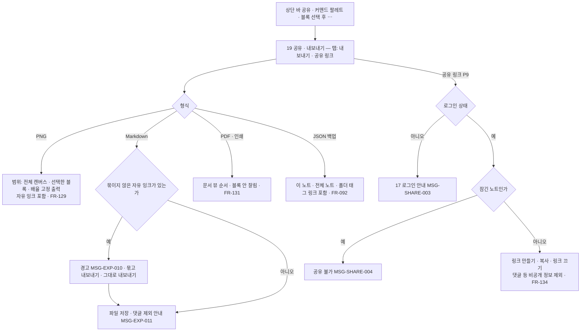

| 규칙 | 내용 | FR |
|---|---|---|
| 파일 저장 | 브라우저 다운로드 또는 File System Access API(지원 시 "저장 위치 고르기"). iPad는 공유 시트 | FR-129~131 |
| 진행 | 1초 넘게 걸리면 모달 안 진행 막대, 취소 가능. 끝나면 토스트 MSG-EXP-001 | — |
| Markdown | 블록 순서는 문서 뷰 규칙(FR-088), 화살표는 들여쓰기 목록, 그래프 · 이미지는 캡션 | FR-130 |
| 공유 링크 | 읽기 전용, 언제든 끌 수 있음. 끄면 즉시 접근 불가 | FR-134 |

### 4.10 오류 복구 — 저장 실패 · 저장 공간 가득 · 새 버전 노트

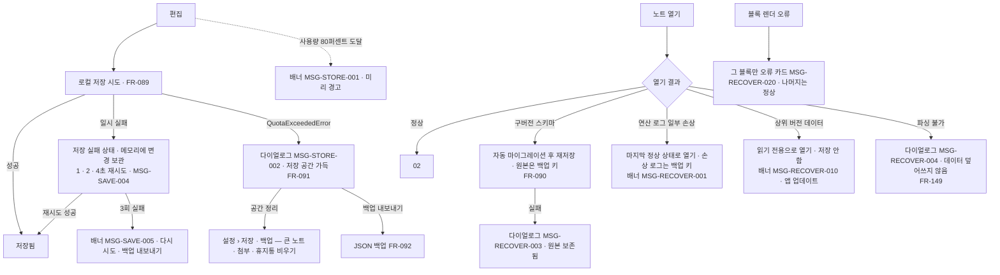

| 상황 | 표시 등급 | 데이터 처리 | FR |
|---|---|---|---|
| 저장 일시 실패 | 상단 바 상태 → 3회 실패 시 배너 | 변경을 메모리에 유지, 탭을 닫으려 하면 `beforeunload` 경고 | FR-089 · 149 |
| 사용량 80% | 배너(닫을 수 있음, 90%에서 다시) | — | FR-091 |
| 저장 공간 가득 | 차단 다이얼로그 | 마지막 저장 시점까지는 안전. 새 변경은 메모리에만 | FR-091 |
| 로그 일부 손상 | 배너 | 마지막 정상 상태로 열고 손상 로그를 백업 키(`corrupt-log`)에 보존 | FR-149 · ENGINE 12 |
| 상위 버전 노트 | 배너 + 상단 바 "읽기 전용" | 편집 · 저장 차단, 데이터 그대로 | FR-090 |
| 마이그레이션 실패 | 차단 다이얼로그 | 원본을 백업 키(`migration`)에 보존 | FR-090 |
| 블록 렌더 오류 | 블록 자리 인라인 | 블록 데이터 보존, 나머지 블록 정상 | FR-149 |

오류 표시 등급은 ARCHITECTURE 10절을 따른다 — **토스트**(재시도 가능, 자동 사라짐) · **배너**(기능이 제한됨, 원인이 풀릴 때까지 유지) · **차단 다이얼로그**(데이터 위험, 사용자가 읽고 닫아야 함). 데이터 위험 오류는 백업 키를 먼저 남긴 뒤 표시한다.

---

## 5. 상호작용 규칙

### 5.1 선택

| 입력 | 결과 | 비고 |
|---|---|---|
| 블록 클릭 | 그 블록만 선택 (이미 선택 그룹 안이면 그룹 유지 — 그룹 드래그 위해) | FR-014 |
| Shift+클릭 | 블록 · 화살표 선택에 추가/제거 | FR-014 |
| 빈 곳 드래그 (마우스 · 펜 선택 도구) | 사각형 범위 선택 — 걸치기만 해도 포함. Shift를 누르면 기존 선택에 더함 | FR-014 |
| 빈 곳 드래그 (손가락) | 팬. 범위 선택은 빈 곳 길게 누른 뒤(500ms) 드래그 | FR-152 · 현재 구현은 팬만 |
| 빈 곳 클릭 · Esc | 선택 해제 | FR-014 |
| 화살표 클릭 | 화살표 선택, 블록 선택 해제. 허용 오차 8px. 블록 아래 숨은 구간은 클릭되지 않음 | FR-065 · E3 |
| Ctrl+A | 텍스트 편집 중이면 블록 안 전체, 아니면 노트의 모든 블록 | FR-014 |
| 선택 표시 | 블록: 2px 파란 테두리 · 단일 선택일 때만 모서리 핸들. 화살표: 파란색 + 양 끝 점 | FR-014 |
| 다중 선택 메뉴 | 블록 핸들 메뉴의 동작이 선택 전체에 적용 | FR-024 |

### 5.2 편집 모드 진입 · 종료

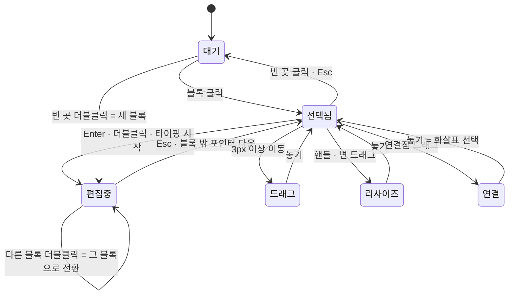

| 규칙 | 내용 |
|---|---|
| 진입 | 선택된 블록에서 Enter = 끝에 커서, 더블클릭 = 클릭한 위치에 커서. 새 블록은 바로 편집 |
| 타이핑으로 진입 (제안) | 블록이 하나 선택된 상태에서 글자 키를 누르면 편집에 들어가 그 글자를 끝에 입력. 단일 문자 도구 키(V · B · A · P …)와 충돌하므로 P4 이후 결정 — 7.3 |
| 종료 | Esc = 편집 종료 + 블록 선택 유지 + 캔버스에 포커스. 블록 밖 포인터 다운 = 종료 후 그 지점 동작 수행 |
| 포커스 유지 예외 | 링크 입력 · 서식 툴바 · 슬래시 메뉴처럼 에디터가 띄운 UI로 포커스가 가도 편집은 끝나지 않는다(`editor.busy`) |
| undo 경계 | 편집 진입 · 종료 때 연속 입력 묶음을 끊는다 — 편집 한 번이 undo 한 단계를 넘지 않도록 |
| IME | 조합 중(`isComposing`)인 키는 전역 단축키로 처리하지 않는다. 조합 중 Esc는 조합 취소만 |
| 읽기 모드 · 편집 잠금 · 읽기 전용 | 진입 동작이 모두 무시되고, 편집 시도 시 상단 바 상태 칩이 한 번 흔들린다(소리 · 토스트 없음) |

### 5.3 키보드 포커스

| 영역 | 포커스 순서 · 규칙 |
|---|---|
| 전역 순서 | 사이드바 → 상단 바 → 캔버스 → 도구 막대 → 줌 컨트롤 → 오른쪽 패널. F6 / Shift+F6로 영역 사이 이동(제안, FR-150) |
| 캔버스 루트 | `tabIndex=0`. 노트를 열면 캔버스 루트에 포커스(현재 구현). 제목에서 Enter → 캔버스 |
| 캔버스 안 | Tab / Shift+Tab = 읽기 순서(아웃라인과 같은 계산)로 다음 · 이전 블록 선택. 방향키 = 선택 블록 이동(1px, Shift 10px) |
| 오버레이 · 팝업 | 열릴 때 첫 입력에 포커스, 닫히면 연 요소로 복귀. 슬래시 · 블록 메뉴는 ↑↓ · Enter · Esc |
| 모달 | 포커스 가둠. 파괴적 버튼에는 초기 포커스를 두지 않는다(취소에 둔다) |
| 입력 필드 | 검색 · 이름 편집 · 키 입력에 포커스가 있으면 전역 단축키를 처리하지 않는다(Esc는 필드가 먼저) |

### 5.4 입력 장치별 차이

| 동작 | 마우스 | 트랙패드 | 터치(손가락) | 펜 |
|---|---|---|---|---|
| 팬 | 휠 · Space+드래그 · 가운데 버튼 드래그 · 손 도구 | 두 손가락 스크롤 | 빈 곳 한 손가락 드래그 · 두 손가락 | 손 도구 또는 두 손가락(손) |
| 줌 | Ctrl/⌘+휠 · Ctrl+= / − | 핀치 | 핀치 | — |
| 블록 생성 | 빈 곳 더블클릭 | 더블 탭 | 빈 곳 더블 탭 | 선택 도구에서 더블 탭 |
| 블록 메뉴 | 호버 → 핸들 ⋮⋮ 클릭 · 우클릭 | 같음 | 블록 선택 후 핸들 탭 · 길게 누르기 | 길게 누르기 |
| 호버 UI | 연결점 · 핸들이 호버로 나타남 | 같음 | 호버 없음 → 선택했을 때만 표시 | 펜 호버 지원 기기는 호버 |
| 범위 선택 | 빈 곳 드래그 | 같음 | 길게 누른 뒤 드래그 | 선택 도구에서 드래그 |
| 필기 | 필기 모드에서 드래그 | 같음 | "펜으로만 필기" 끄면 가능 | 기본 |
| 핸들 크기 | 6px (판정 8px) | 같음 | 44px 판정 영역(FR-152) | 24px 판정 |
| 휠 설정(E2) | 설정 › 편집에서 휠 = 줌으로 바꾸면 휠 줌, 팬은 Space+드래그 · 가운데 버튼 | 핀치 = 줌은 설정과 무관 | 영향 없음 | 영향 없음 |

### 5.5 빈 상태

| 위치 | 조건 | 표시 | 메시지 |
|---|---|---|---|
| 노트 없음 | 노트 0개(휴지통 제외) | 01 빈 상태 — 새 노트 · 붙여넣기 체험 · 가져오기 | MSG-EMPTY-001 |
| 빈 캔버스 | 블록 0개 | 캔버스 중앙 안내 — 더블클릭 · 붙여넣기 · `/`. 키 없으면 키 설정 링크 한 줄 추가. 첫 블록을 만들면 사라짐 | MSG-EMPTY-002 · 004 |
| 검색 결과 없음 | 일치 0건 | 검색어 · 필터 표시, 필터 해제 · 철자 확인 제안 | MSG-EMPTY-003 |
| 휴지통 비어 있음 | 항목 0개 | 14 중앙 안내 | MSG-EMPTY-005 |
| 폴더 비어 있음 | 노트 0개 | 사이드바 폴더 아래 흐린 줄 "비어 있음" | MSG-EMPTY-006 |
| 태그 노트 없음 | 태그에 노트 0개 | 태그 삭제 제안 | MSG-EMPTY-007 |
| 백링크 없음 | 참조 0개 | 패널 안내 + `[[` 사용법 | MSG-EMPTY-008 |
| Q&A 근거 없음 | `grounded:false` | 답변 자리에 "노트에 없음" | MSG-EMPTY-009 |
| 충돌 없음 | 16을 직접 열었을 때 | 안내 한 줄 | MSG-EMPTY-010 |
| 오늘 할 일 없음 | 0건 | 09 위젯 · 오늘 할 일 화면 | MSG-EMPTY-011 |

### 5.6 로딩 상태

| 상황 | 목표 시간 | 표시 규칙 |
|---|---|---|
| 앱 시작 | 1초 | 사이드바 목록은 메타 저장소에서 먼저 그린다. 캔버스는 300ms 넘을 때만 블록 자리 스켈레톤 |
| 노트 열기 | 200ms (ENGINE 목표) | 300ms 안에 끝나면 아무것도 표시하지 않는다(깜빡임 방지). 넘으면 상단 바 얇은 진행 막대 |
| 자동 저장 | 1초 | 상단 바 텍스트만 바뀐다(저장 대기 → 저장 중… → 저장됨). 스피너 없음 |
| AI 구조화 | 수 초~수십 초 | 04 진행 카드: 단계 이름 + n/N + 취소. 10초 넘으면 "긴 글은 조금 더 걸려요" 보조 문구 |
| OCR | 수 초 | 11 선택 영역 위 작은 진행 표시 + 취소 |
| 동기화 첫 다운로드 | 노트 수에 비례 | 상단 바 "받는 중 n/N", 노트는 받는 대로 열 수 있다 |
| 검색 색인 | 백그라운드 | 결과 상단 "색인 중 n%". 검색은 막지 않는다 |
| 내보내기 · 가져오기 | 1초 넘으면 | 모달 진행 막대 + 취소 |
| 버튼 동작 (키 테스트 등) | 1초 넘으면 | 버튼 안 스피너, 같은 버튼 다시 누르기 막음 |

---

## 6. 반응형 레이아웃

### 6.1 브레이크포인트

기준 기기는 개발 PC(1920×1080 Chrome)와 iPad 10세대(820×1180 CSS px, 가로 1180×820)다(D2).

| 이름 | 너비 (CSS px) | 대표 환경 | 사이드바 | 오른쪽 패널 | 도구 막대 |
|---|---|---|---|---|---|
| 데스크톱 L | ≥ 1440 | 데스크톱 브라우저 · PWA 창 | 고정 240px, 접기 가능(Ctrl+\) | 고정 320px (본문을 밀어냄) | 캔버스 하단 중앙 |
| 데스크톱 · 태블릿 가로 | 1024 ~ 1439 | 노트북 · iPad 가로(1180) | 고정 240px, 처음 실행 시 펼침 | 겹쳐 띄움(오버레이 320px) | 하단 중앙 |
| 태블릿 세로 | 768 ~ 1023 | iPad 세로(820) · 스플릿 뷰 절반 | 서랍(오버레이 280px), 기본 접힘 · 왼쪽 가장자리 스와이프로 열기 | 바텀 시트(높이 60%) | 하단 중앙, 필기 도구 막대는 상단 |
| 폰 | < 768 | 폰 · iPad 슬라이드 오버 | 전체 화면 서랍 | 전체 화면 시트 | 하단 고정 바, 아이콘만 |

현재 구현(`styles.css`)에는 768px 미디어 쿼리 하나만 있다. 위 표가 목표다.

### 6.2 접히는 것 · 바뀌는 것

| 요소 | ≥ 1024 | 768 ~ 1023 | < 768 |
|---|---|---|---|
| 상단 바 | 위치 표시 · 제목 · 뷰 전환 · 상태 · 공유 · 패널 | 위치 표시 숨김 · 뷰 전환은 ⋯ 메뉴로 | 제목 + 상태 점 + ⋯ 만 (52px → 48px) |
| 저장 · 동기화 상태 | 텍스트 | 텍스트 | 색 점 + 길게 누르면 텍스트 |
| 줌 컨트롤 | 우하단 4버튼 | 배율 표시 + 맞춤 2버튼 | 숨김 (핀치 · 맞춤은 ⋯ 메뉴) |
| 서식 툴바(07) | 선택 위 떠 있는 툴바 | 같음 (버튼 44px) | 화면 키보드 위 고정 띠 |
| 슬래시 메뉴(06) | 커서 아래 팝업 | 같음 | 하단 시트 |
| 블록 핸들 ⋮⋮ | 호버 시 | 선택 시 | 선택 시 |
| 자유 배치 블록(FR-019) | 자유 배치 | 자유 배치 | 흐름으로 대체 렌더링(FR-152) |
| 스플릿 뷰(FR-153) | 가능 | 가로 1024 이상에서만 | 불가 |
| 홈 대시보드(09) | 벤토 그리드 3열 | 2열 | 1열 |
| 설정 모달 | 왼쪽 탭 + 내용 | 같음 | 탭 목록 → 내용 전체 화면 이동 |
| 터치 대상 | 32px 이상 | 44px 이상 | 44px 이상 (FR-152) |

### 6.3 회전 · 창 크기 변경 (FR-155)

- 회전 · 창 크기 변경 시 화면 중심의 월드 좌표를 유지한다(줌 배율은 그대로).
- 편집 중인 텍스트 · 그리는 중인 스트로크는 끊지 않는다 — 레이아웃 변경은 입력이 끝난 다음 프레임에 적용.
- 브레이크포인트를 넘으면 사이드바 · 패널 상태(펼침/접힘)는 각 브레이크포인트별로 따로 기억한다.
- iPad PWA는 `viewport-fit=cover`와 `env(safe-area-inset-*)`로 홈 인디케이터 · 노치 영역을 피한다. 하단 도구 막대는 safe area 위에 둔다.

---

## 7. 단축키 통합표

### 7.1 표기 · 원칙

- `Ctrl`은 macOS에서 `⌘`, `Alt`는 `⌥`로 자동 치환한다(FR-023). 표는 Windows 기준이다.
- 원본은 FR.md 부록 A다. 아래 표는 부록 A + 현재 구현(`canvas-view.ts` · `text-pm/editor.ts` · `App.tsx`)을 합친 것이고, 둘이 다른 곳은 "비고"에 적었다. 확정은 9절에서 결정한다.
- 맥락: **전역** = 입력 필드 밖 어디서나 · **캔버스** = 캔버스에 포커스, 편집 중 아님 · **편집** = 블록 텍스트 편집 중 · **선택** = 블록이 선택됨 · **필기** = 필기 모드.
- 입력 필드에 포커스가 있거나 IME 조합 중이면 전역 · 캔버스 단축키를 처리하지 않는다. 읽기 모드 · 편집 잠금 · 읽기 전용에서는 편집용 단축키를 끈다.

### 7.2 표

| 분류 | 동작 | 키 | 맥락 | FR | 현재 구현 | 비고 |
|---|---|---|---|---|---|---|
| 전역 | 노트 빠른 전환 | Ctrl+P | 전역 | FR-087 | — | 브라우저 인쇄를 가로챔 |
| 전역 | 커맨드 팔레트 | Ctrl+Shift+P | 전역 | FR-087 | — | Firefox 사생활 창과 겹침(주 대상 아님) |
| 전역 | 현재 노트에서 찾기 | Ctrl+F | 전역 | FR-121 | — | |
| 전역 | 전체 노트 검색 | Ctrl+Shift+F | 전역 | FR-121 | — | |
| 전역 | 찾아 바꾸기 | Ctrl+H | 전역 | FR-123 | — | P9 |
| 전역 | 새 노트 | Ctrl+Alt+N | 전역 | FR-067 | — | Ctrl+N은 브라우저 예약 |
| 전역 | 사이드바 접기 · 펼치기 | Ctrl+\ | 전역 | — | — | |
| 전역 | 읽기 모드 전환 | Ctrl+Shift+R | 전역 | FR-085 | — | 강력 새로고침과 겹침 — 9절 K4 |
| 전역 | 설정 | Ctrl+, | 전역 | PRD-26 | — | |
| 전역 | 단축키 도움말 | Ctrl+/ | 전역 | FR-023 | — | |
| 전역 | 저장 안내만 | Ctrl+S | 전역 | FR-089 | — | 가로채고 MSG-SAVE-010 토스트 |
| 전역 | 닫기 · 해제 단계 | Esc | 전역 | — | 일부 | 7.3 순서 규칙 |
| 전역 | 영역 이동 | F6 / Shift+F6 | 전역 | FR-150 | — | 제안 |
| 캔버스 | 줌 인 · 아웃 | Ctrl+= / Ctrl+- | 캔버스 | FR-011 | 있음 | |
| 캔버스 | 줌 100% | Ctrl+0 | 캔버스 | FR-011 | Shift+0 | 둘 다 지원 제안 |
| 캔버스 | 전체 맞춤 | Shift+1 | 캔버스 | FR-012 | 있음 | |
| 캔버스 | 팬 | Space+드래그 · 가운데 버튼 드래그 · 휠 | 캔버스 | FR-011 | 있음 | 휠 = 팬(E2) |
| 캔버스 | 줌 (휠) | Ctrl+휠 · 핀치 | 캔버스 | FR-011 | 있음 | 설정으로 휠 = 줌 전환 |
| 캔버스 | 가로 팬 | Shift+휠 | 캔버스 | — | 있음 | |
| 캔버스 | 선택 도구 | V | 캔버스 | — | 있음 | 부록 A에 없음 |
| 캔버스 | 내용 상자 도구 | B | 캔버스 | — | 있음 | 부록 A 캔버스 항목에 반영 |
| 캔버스 | 제목 상자 도구 | T | 캔버스 | — | 있음 | 부록 A 캔버스 항목에 반영 (ADR-0013) |
| 캔버스 | 화살표 도구 | A | 캔버스 | — | 있음 | 부록 A에 없음 |
| 캔버스 | 손(이동) 도구 | H | 캔버스 | — | 있음 | 부록 A의 H = 형광펜과 충돌 — 9절 K1 |
| 캔버스 | 내용 상자 만들기 | 더블클릭 | 캔버스 | FR-013 | 있음 | 겹치면 빈 자리로 (ADR-0014) |
| 캔버스 | 스냅 끄고 자유 배치 | 드래그 중 Shift | 캔버스 | FR-013 | 있음 | ADR-0014 |
| 캔버스 | 다음 · 이전 블록 | Tab / Shift+Tab | 캔버스 | FR-150 | — | 제안, 읽기 순서 |
| 선택 | 선택 추가 · 해제 | Shift+클릭 | 캔버스 | FR-014 | 있음 | |
| 선택 | 전체 선택 | Ctrl+A | 캔버스 · 편집 | FR-014 | 있음 | 편집 중이면 블록 안 전체 |
| 선택 | 삭제 | Delete / Backspace | 선택 | FR-015 | 있음 | 연결 화살표 함께 |
| 선택 | 복제 | Ctrl+D | 선택 | FR-015 | 있음 | 브라우저 북마크를 가로챔 |
| 선택 | 복제하며 이동 | Alt+드래그 | 선택 | FR-015 | — | |
| 선택 | 이동 1px · 10px | 방향키 · Shift+방향키 | 선택 | — | 있음 | 연속 이동은 undo 1단계 |
| 선택 | 편집 시작 | Enter | 선택 | — | 있음 | 부록 A에 없음 |
| 선택 | 맨 앞으로 | ] | 선택 | — | 있음 | 필기 모드의 ] = 굵기와 맥락 분리 |
| 선택 | 블록 링크 복사 | Ctrl+L | 선택 | FR-025 | 메뉴만 | 블록 메뉴 "블록 링크 복사"(`#n=<노트>&b=<블록>`)는 있음, 키는 없음. 주소창 단축키를 가로챔 |
| 선택 | 댓글 | Ctrl+Shift+M | 선택 · 편집 | FR-132 | — | Chrome 프로필 전환과 겹칠 수 있음 — K4 |
| 선택 | 리마인더 | Ctrl+Shift+E | 선택 · 편집 | FR-136 | — | |
| 선택 | 노트 잠금 · 해제 | Ctrl+Alt+L | 전역 | FR-144 | — | |
| 선택 | 배치 모드 흐름 ↔ 자유 | Ctrl+Shift+L | 선택 | FR-019 | — | |
| 공통 | 실행 취소 | Ctrl+Z | 전역 | FR-022 | 있음 | 편집 중에도 엔진 undo |
| 공통 | 다시 실행 | Ctrl+Shift+Z · Ctrl+Y | 전역 | FR-022 | 있음 | Ctrl+Y는 부록 A에 없음 |
| 공통 | 복사 · 잘라내기 · 붙여넣기 | Ctrl+C · X · V | 선택 · 편집 | FR-031 | 브라우저 기본 | |
| 공통 | 서식 없이 붙여넣기 | Ctrl+Shift+V | 편집 · 캔버스 | FR-031 | 있음 | 캔버스에서는 새 내용 상자 |
| 서식 | 굵게 · 기울임 · 밑줄 | Ctrl+B · I · U | 편집 | FR-027 | 있음 | |
| 서식 | 취소선 | Ctrl+Shift+S | 편집 | FR-027 | Ctrl+Shift+X | 둘 다 지원 제안 — K2 |
| 서식 | 인라인 코드 | Ctrl+E | 편집 | FR-027 | 있음 | |
| 서식 | 형광펜 | Ctrl+Shift+H | 편집 | FR-027 | 있음 | |
| 서식 | 링크 | Ctrl+K | 편집 | FR-030 | — | |
| 서식 | 서식 모두 지우기 | Ctrl+Space | 편집 | FR-027 | — | macOS ⌘+Space = Spotlight — K3 |
| 블록 타입 | 슬래시 메뉴 | / (빈 줄) | 편집 | FR-029 | — | |
| 블록 타입 | 본문 | Ctrl+Shift+0 | 편집 | FR-026 | Ctrl+Alt+0 | K2 |
| 블록 타입 | 제목 1 · 2 · 3 | Ctrl+Shift+1 · 2 · 3 | 편집 | FR-026 | Ctrl+Alt+1 · 2 · 3 | K2 |
| 블록 타입 | 불릿 · 번호 · 체크박스 | Ctrl+Shift+4 · 5 · 6 | 편집 | FR-026 | — | |
| 블록 타입 | 인용 · 코드 · 콜아웃 | Ctrl+Shift+7 · 8 · 9 | 편집 | FR-026 · 048 | — | |
| 목록 | 들여쓰기 · 내어쓰기 | Tab / Shift+Tab | 편집 | FR-032 | 있음 | |
| 목록 | 줄 위아래 이동 | Alt+↑ / Alt+↓ | 편집 | FR-032 | 있음 | 목록 항목은 하위 항목과 함께 |
| 목록 | 체크박스 완료 | Ctrl+Enter | 편집 | FR-033 | — | |
| 목록 | 토글 접기 · 펼치기 | Ctrl+Shift+T | 편집 | FR-047 | — | Chrome 예약(닫은 탭 다시 열기) — K4 |
| 목록 | 새 줄 · 목록 빠져나오기 | Enter · 빈 항목에서 Enter | 편집 | FR-026 | 있음 | |
| 목록 | 줄 안 줄바꿈 | Shift+Enter | 편집 | — | 있음 | 부록 A에 없음 |
| 편집 | 편집 종료 | Esc | 편집 | — | 있음 | 블록 선택 유지 |
| 편집 | 제목 상자 편집 끝 | Enter · Tab | 편집(제목 상자) | — | 있음 | 한 줄 제목 (ADR-0013) |
| 필기 | 펜 · 형광펜 · 지우개 | P · H · E | 필기 | FR-034 | — | H 충돌 — K1 |
| 필기 | 올가미 | L | 필기 | FR-036 | — | |
| 필기 | 잉크 묶기 · 풀기 | Ctrl+G / Ctrl+Shift+G | 필기 선택 | FR-037 | — | |
| 필기 | 텍스트로 인식 | Ctrl+R | 필기 선택 | FR-038 | — | 새로고침을 가로챔 — 실수 시 위험, K4 |
| 필기 | 펜 색 · 굵기 | 1~5 · [ / ] | 필기 | FR-034 | — | |
| 필기 | 잉크 레이어 표시 | Ctrl+Shift+I | 전역 | FR-035 | — | 개발자 도구와 겹침 — K4 |
| 필기 | 펜 더블탭 · 펜 버튼 | 지우개 · 올가미 | 필기 | FR-154 | — | PWA에서 불가(D1) |
| 음성 · 가져오기 | 녹음 시작 · 정지 | Ctrl+Alt+R | 전역 | FR-043 | — | |
| 음성 · 가져오기 | 가져오기 | Ctrl+Alt+I | 전역 | PRD-22 | — | |
| AI | 선택 블록 구조화 | Ctrl+Alt+S | 선택 · 편집 | FR-105 | 있음 | 부록 A와 같음. 블록 메뉴 "✦ AI로 구조화"도 있음 (Ctrl+Shift+A는 Chrome 탭 검색과 겹쳐 쓰지 않음) |
| AI | 내 노트에 질문 | Ctrl+Shift+J | 전역 | FR-116 | — | 개발자 도구(콘솔)와 겹침 — K4 |
| AI | 작성 도우미 | Ctrl+J | 편집 | FR-112 | — | 다운로드 창을 가로챔 |
| AI | AI 요청 취소 | Esc | 진행 카드 포커스 | FR-103 | — | 7.3 |
| 마크다운 | 제목 1 · 2 · 3 | `# ` · `## ` · `### ` | 편집 | FR-028 | 있음 | |
| 마크다운 | 불릿 · 번호 · 체크박스 | `- ` `* ` · `1. ` · `[] ` `[x] ` | 편집 | FR-028 | 있음 | |
| 마크다운 | 인용 · 코드 · 구분선 | `> ` · ```` ``` ```` · `---` | 편집 | FR-028 | 있음 | |
| 마크다운 | 굵게 · 기울임 · 취소선 · 코드 · 형광펜 | `**` · `*` · `~~` · `` ` `` · `==` | 편집 | FR-028 | 있음 | `==형광펜==`은 부록 A에 없음 |
| 마크다운 | 변환 되돌리기 | 변환 직후 Backspace | 편집 | FR-028 | 있음 | e2e 확인 |

### 7.3 Esc 우선순위

Esc는 한 번에 한 단계만 처리한다(부록 A). 위에서 처음 해당하는 것 하나만 실행한다.

1. IME 조합 중 → 조합 취소 (앱은 처리하지 않음)
2. 열린 팝업 · 메뉴 · 오버레이(슬래시 · 블록 메뉴 · 팔레트 · 라벨 입력) → 닫기
3. 모달 → 닫기 (파괴적 확인은 "취소"와 같음)
4. 텍스트 편집 중 → 편집 종료(블록 선택 유지)
5. 진행 중 제스처(드래그 · 연결 · 올가미) → 취소하고 원위치
6. AI 진행 카드에 포커스가 있을 때만 → 요청 취소. 카드에 포커스가 없으면 Esc로 AI를 취소하지 않는다 — 다른 Esc 단계와 섞여 실수로 취소되는 것을 막기 위해
7. 선택 있음 → 선택 해제, 도구를 선택 도구로
8. 읽기 모드 → 해제

---

## 8. 접근성 (FR-150)

FR-150은 P9지만, 구조를 나중에 바꾸기 어려운 것은 P1부터 지킨다(★).

| # | 항목 | 규칙 | 시점 |
|---|---|---|---|
| A1 | 캔버스 역할 | 캔버스 루트 `role="application"` + `aria-roledescription="캔버스"` + `aria-label="{노트 제목} 캔버스"`. 블록은 `role="group"`, 이름은 첫 줄 텍스트 | ★ P1 |
| A2 | 블록 읽기 순서 | Tab 순서와 스크린리더 순서 = 아웃라인과 같은 읽기 순서 계산(ARCHITECTURE 10). DOM 순서가 z 순서라 다르므로 `aria-flowto` 대신 포커스 관리로 보장 | P6 |
| A3 | 화살표 | 화살표는 캔버스 그림이라 DOM이 없다. 각 블록에 숨은 설명 "나가는 연결: B(원인) · 들어오는 연결: C"를 `aria-describedby`로 연결 | P2 |
| A4 | 선택 · 상태 알림 | `aria-live="polite"` 영역 하나로 "블록 3개 선택됨", 저장 실패, AI 진행(10% 단위 아닌 단계 변화만), 토스트를 읽는다. 데이터 위험 다이얼로그는 `role="alertdialog"` | ★ P1 |
| A5 | 키보드만으로 | 블록 생성(Ctrl+Alt+N 후 Enter 또는 커맨드 "블록 추가"), 이동(방향키), 크기(제안: Alt+Shift+방향키), 연결(커맨드 "선택 블록 연결" → 대상 고르기 목록) — 드래그 없이 모든 조작 가능해야 한다 | P9 |
| A6 | 포커스 표시 | 키보드 포커스는 2px 링 + 2px 간격, 마우스 선택 테두리와 모양을 다르게(점선 아님, 바깥 링) | ★ P1 |
| A7 | 색 대비 | 본문 텍스트 4.5:1, 큰 글자 · UI 경계 3:1(WCAG AA). 현재 토큰 점검 결과 — `--faint #9b9a97`은 흰 배경에서 약 2.8:1로 미달(저장 상태 · 힌트 · 사이드바 섹션 제목에 쓰임) → 텍스트에는 `--muted #6b6b68`(약 5.3:1) 사용. `--accent #4c6ef5`는 약 4.3:1로 작은 글자에는 미달, 큰 글자 · 테두리에는 통과 | ★ P1 |
| A8 | 색 외 단서 | AI 생성 블록은 보라 막대 + 숨은 라벨 "AI 생성". 저장 · 동기화 상태는 색 점만 쓰지 않고 텍스트(폰에서는 `aria-label`) | P2 |
| A9 | 움직임 줄이기 | `prefers-reduced-motion`이면 전체 맞춤 · 블록 이동 애니메이션(300ms)을 즉시 이동으로 | P1 |
| A10 | 터치 대상 | 44px(FR-152). 리사이즈 핸들은 그림 6px, 판정 영역 44px | P4 |
| A11 | 확대 | 브라우저 확대(Ctrl++)는 캔버스 줌이 가로채므로, 앱 UI 글꼴 크기는 설정 › 편집 › 글꼴 크기로 별도 제공(FR-143) | P9 |
| A12 | 필기 · 그래프 대체 텍스트 | 묶인 잉크는 OCR 결과가 있으면 그것을, 없으면 "손글씨 그림"을 이름으로. 그래프 블록은 데이터 표를 숨은 표로 제공 | P4 · P2 |
| A13 | 언어 | `lang="ko"`. 노트 안 영어 문단 자동 표시는 범위 밖 | P1 |

---

## 9. 확인이 필요한 항목

이 문서를 쓰며 PRD · FR · 현재 구현 사이에서 발견한 차이다. 이 문서는 고치지 않았다(PRD · FR은 트래커가 원본).

| # | 항목 | 내용 | 제안 |
|---|---|---|---|
| K1 | H 키 충돌 | 구현: H = 손 도구. 부록 A: H = 형광펜. P · E · L도 필기 맥락 전용 | 필기 모드가 켜져 있으면 필기 키, 아니면 캔버스 도구 키로 맥락 분리. 손 도구는 Space 홀드가 주 경로이므로 H를 형광펜에 양보하는 쪽 추천 |
| K2 | 서식 · 블록 타입 키 | 취소선 Ctrl+Shift+S(부록) vs Ctrl+Shift+X(구현). 제목 Ctrl+Shift+1~3(부록) vs Ctrl+Alt+1~3(구현, 노션 관습) | 부록 A 원칙("기존 관습")을 따르면 Ctrl+Alt+0~9가 노션과 같다. 취소선은 둘 다 지원 |
| K3 | Ctrl+Space | macOS에서 ⌘+Space = Spotlight, Windows 한국어 환경에서도 입력기 전환에 쓰이는 경우가 있다 | 서식 지우기는 툴바 버튼 + 다른 키(예: Ctrl+Shift+\)로 |
| K4 | 브라우저 · OS 예약 키 | Ctrl+Shift+T(닫은 탭 다시 열기, Chrome이 가로채기를 허용하지 않음), Ctrl+Shift+I · J(개발자 도구), Ctrl+Shift+M(Chrome 프로필), Ctrl+Shift+R(강력 새로고침), Ctrl+R(새로고침 — 가로채기 실패 시 편집 중 새로고침) | 설치형 PWA 창 · 브라우저 탭에서 실제 동작을 P3에 확인하고 재배정. 토글은 Ctrl+Enter(노션 관습)로 체크박스와 공유 제안 |
| K5 | Ctrl+0 vs Shift+0 | 구현 툴팁 "100%로 (Shift+0)", 부록 A Ctrl+0 | 둘 다 |
| K6 | 타이핑으로 편집 진입 | 정의 없음 | 단일 문자 도구 키와 충돌 — 결정 필요 |
| K7 | 휠 동작 | FR-011 본문 · 수락 기준은 "휠 = 줌". 확정 결정(D7)과 구현은 "휠 = 팬, Ctrl/⌘+휠 = 줌"이고 설정 전환은 어느 FR에도 없음 | FR-011 · FR-143 갱신 |
| K8 | 줌 범위 | FR-011 25%~400%, 구현 `MIN_ZOOM` 10% | **확정 (2026-10-08)**: 25%~400% — `MIN_ZOOM` 0.25 · 줌 단계에서 10% 뺌. 끝없는 캔버스도 보드 18000 × 18000(`BOARD`) 안, 화면의 새 노트는 A4로 시작 |
| K9 | 리사이즈 | FR-016 "4방향 핸들"에 세로 = 최소 높이(D6) 규칙이 없음. 구현은 모서리 4개 + 보이지 않는 변 | FR-016 수락 기준 보강 |
| K10 | Figma 미작성 화면 | 3.1의 제안 20~25 (AI 동의 · 오른쪽 패널 · 복구 다이얼로그 · 단축키 도움말 · 가져오기 미리보기 · 버전 기록) | 다음 Figma 작업 범위 |

---

## 10. 변경 이력

| 버전 | 날짜 | 내용 |
|---|---|---|
| v0.2 | 2026-10-02 | 4.2에 제목 상자(T) · 내용 상자(B · 더블클릭) · 상자 종류 · 도킹 규칙(ADR-0013 · 0014), 블록 메뉴 항목, 4.3 순서를 구현대로(동의 → 키) · Ctrl+Alt+S · 칩 기준 20자 · 결과 배치, 4.5 휴지통 · 노트 목록 구현 현황, 3.1 설정 화면(08) 탭 구성, 7.2 단축키 구현 여부 갱신 |
| v0.1 | 2026-10-01 | 초안 — IA, 화면 01~19 내비게이션 맵, 핵심 흐름 10개, 상호작용 규칙, 반응형, 단축키 통합표, 접근성 |
